# Brand Guideline Philia Space

Pedoman identitas visual untuk philiaspace.my.id. Draft v2.1, November 2026, diekspor dari brand kit FigCraft. Versi ini menggantikan draft v0.2.

Konsepnya *culture first, language second*. Orang datang ke Philia Space karena suka sesuatu dari Jepang, entah satu seri anime, satu band, atau satu game, lalu bahasanya menyusul dari situ. Tampilannya mengikuti majalah budaya Jepang: foto besar, judul serif, garis tipis, dan nomor bagian.

## Ringkasan

**Logo.** Tidak berubah: kanji 愛間 dalam BIZ UDPMincho Medium, avatar gradien bergelombang, dan wordmark Plus Jakarta Sans ExtraBold dengan tracking -3%. Deskriptornya sekarang `COMMUNITY · CULTURE · LANGUAGE`. Yang berubah cara memakainya: logo tampil lebih kecil, boleh berdiri tanpa kotak, dan kanji boleh tampil sendiri sebagai signature di pojok poster, foto, atau footer.

**Warna.** Hex lama tetap dipakai, porsinya yang berubah. Putih dan Paper mengisi 70 sampai 80 persen area, navy membawa teks dan blok editorial, dan cyan tampil sedikit sebagai aksen.

| Nama | Hex | Dipakai untuk |
|---|---|---|
| Putih | `#FFFFFF` | kanvas utama, sekitar 50% |
| Paper | `#F5F5F5` | bagian yang diselang-seling, sekitar 25% |
| Navy | `#111827` | teks dan blok editorial, sekitar 18% |
| Cyan | `#00BBFF` | aksen: garis bawah, marker, status terpilih, tombol utama. Di v0.2 disebut Langit |
| Laut | `#00669E` | teks tautan di latar terang |
| Abu | `#4B5563` | teks sekunder |
| Garis | `#E5E7EB` | garis pembatas, bukan untuk teks |

Mode gelap memakai abu-abu sangat gelap, bukan hitam murni, mengikuti panduan dark theme Material Design: Malam `#121212` sebagai kanvas, Arang `#1E1E1E` untuk permukaan yang terangkat (kode, kartu, blok navy), `#E4E4E7` untuk teks utama (sekitar 87% putih, supaya tidak menyilaukan), dan `#38BDF8` untuk tautan. Permukaan yang lebih tinggi dibuat sedikit lebih terang, karena bayangan sulit terlihat di atas gelap.

**Kontras.** Teks di atas cyan selalu navy (8,1:1). Putih di atas cyan cuma 2,2:1, jadi tidak pernah dipakai untuk teks, termasuk untuk kanji logo. Cyan di atas putih hanya untuk garis dan bidang.

**Tipografi.** Noto Serif JP untuk judul dan semua teks Jepang, Plus Jakarta Sans untuk isi dan UI, Space Grotesk untuk label dan angka. BIZ UDPMincho Medium hanya untuk kanji logo.

**Foto.** Foto adalah visual utama. Pakai foto sendiri, kiriman anggota, atau foto berlisensi bebas. Screenshot anime, film, atau game hanya untuk ulasan, ukurannya kecil, dan disertai sumber.

## Halaman guideline

| | |
|---|---|
| 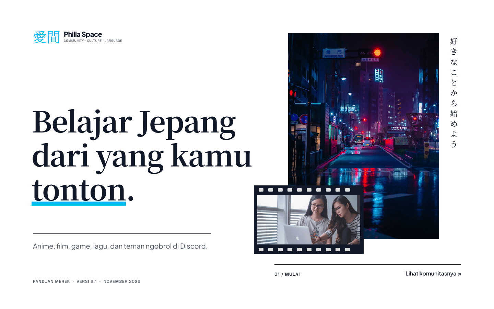 | 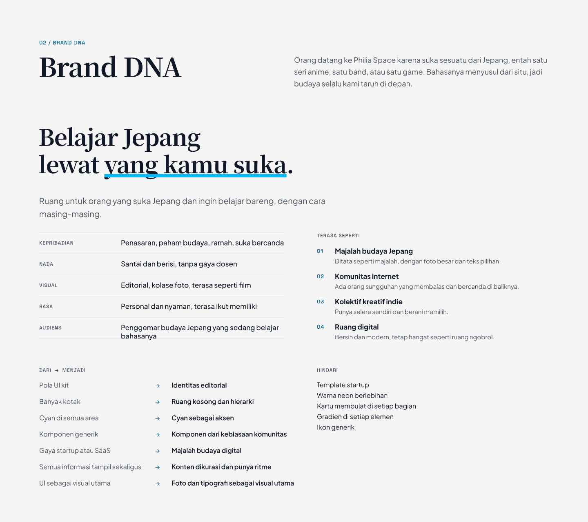 |
| 01 Sampul | 02 Brand DNA |
| 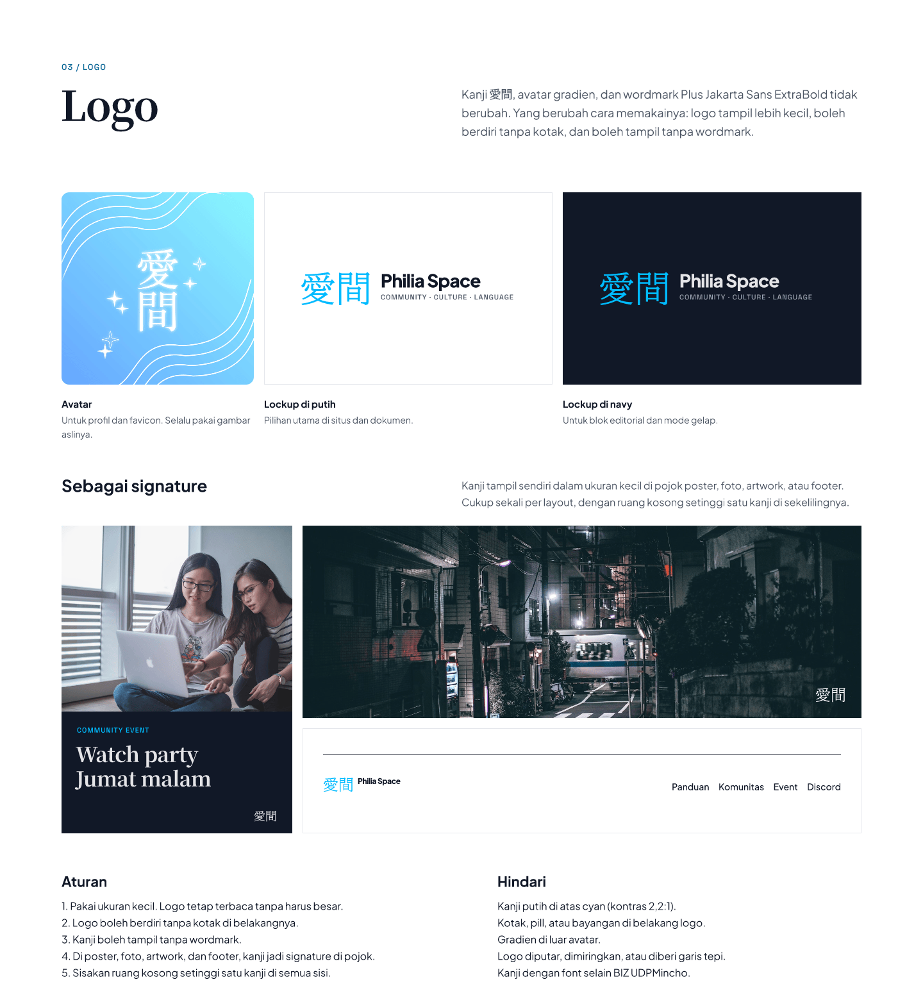 | 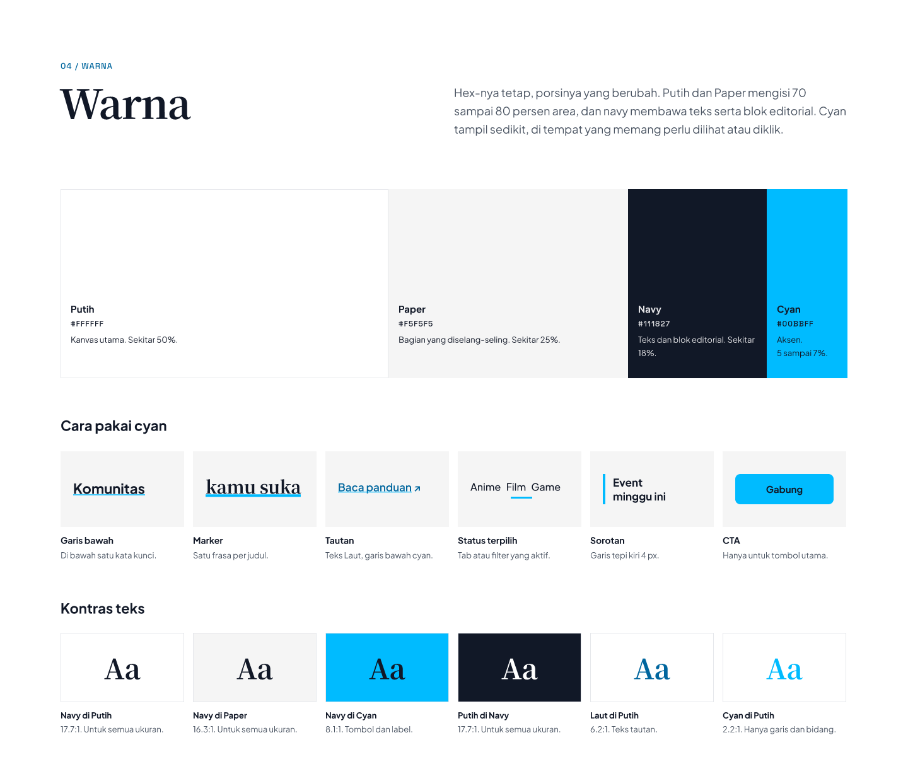 |
| 03 Logo | 04 Warna |
| 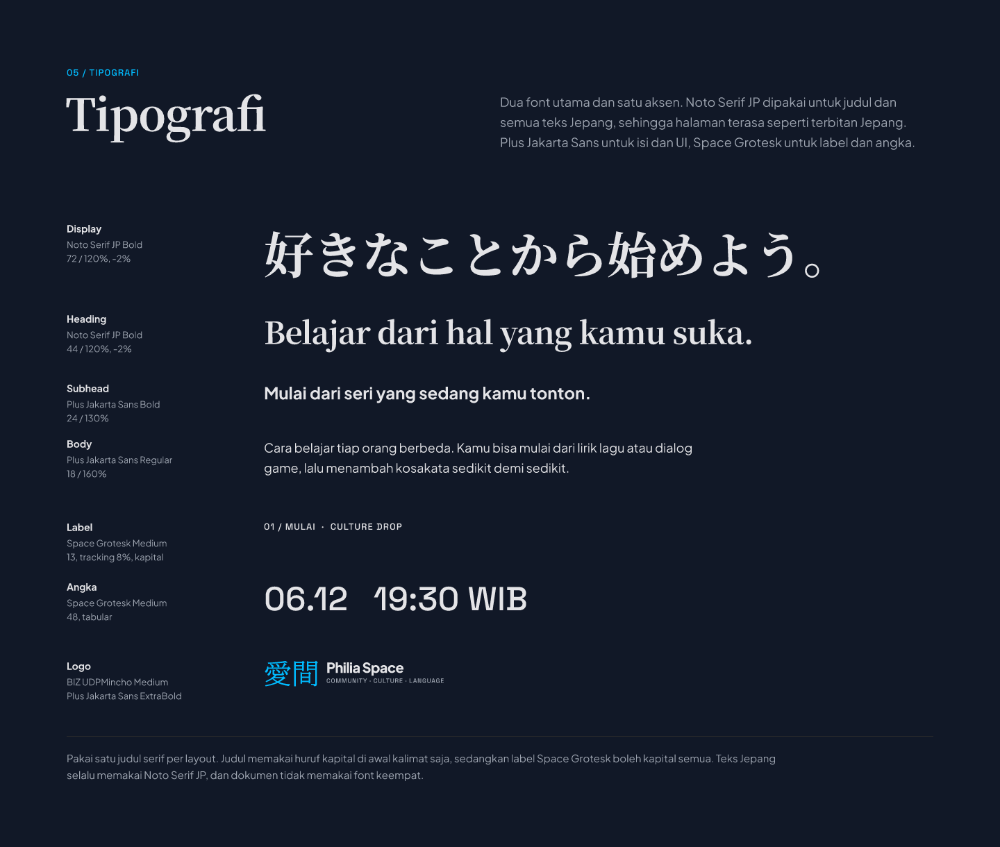 | 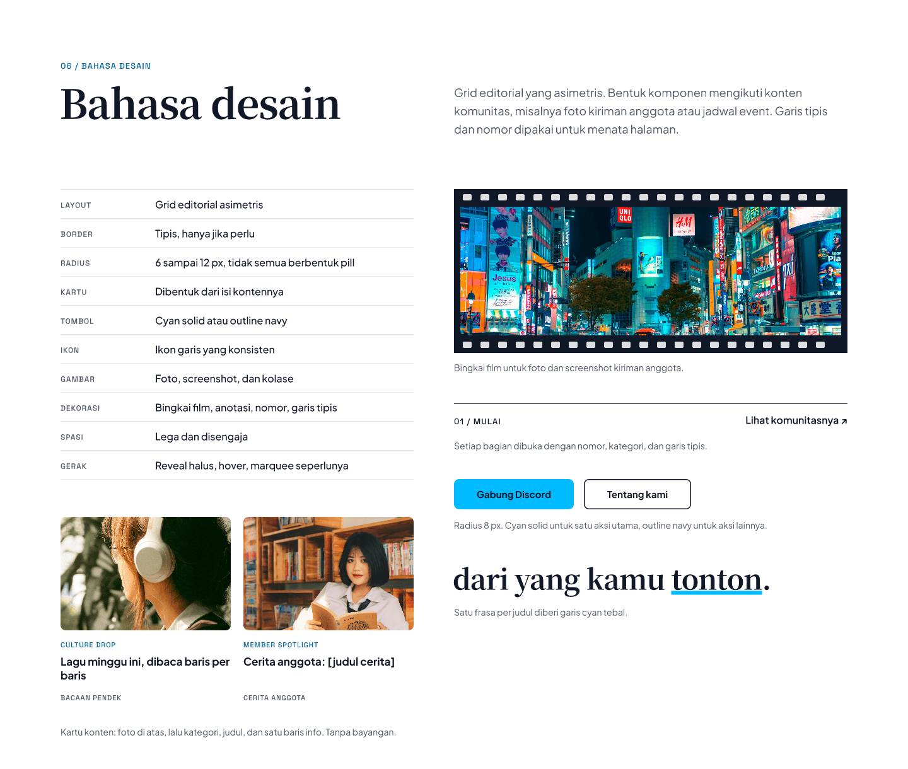 |
| 05 Tipografi | 06 Bahasa desain |
| 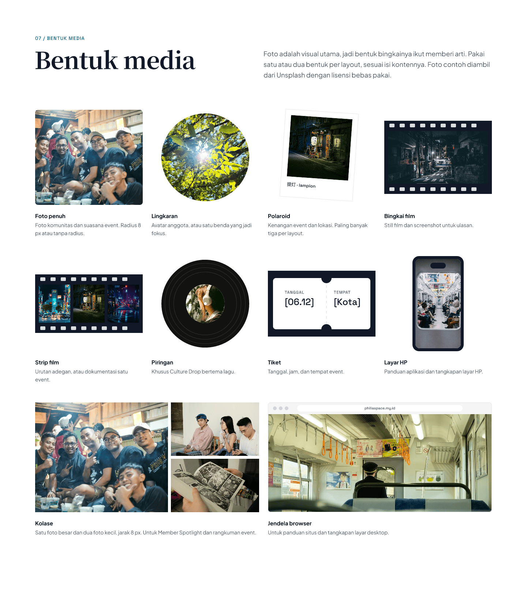 | 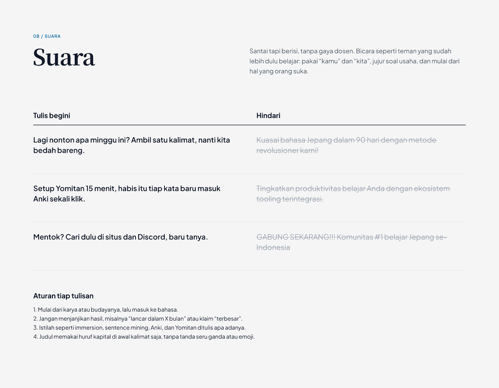 |
| 07 Bentuk media | 08 Suara |
| 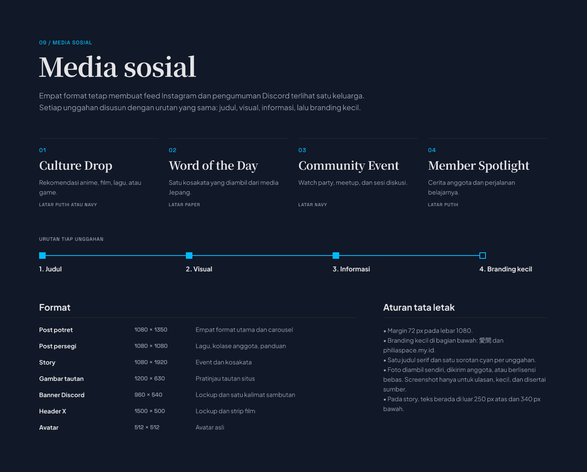 | 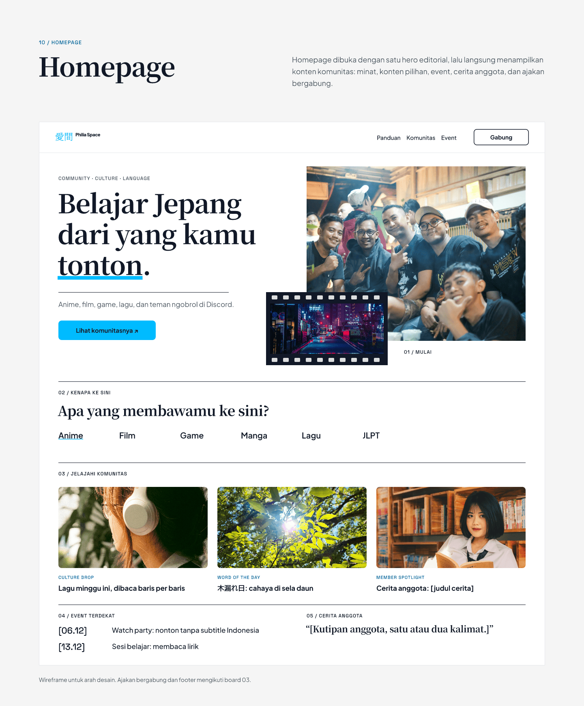 |
| 09 Media sosial | 10 Homepage (wireframe) |
| 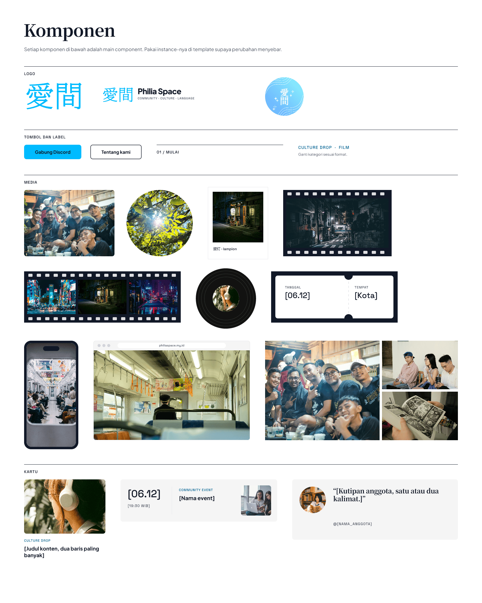 | |
| 11 Katalog komponen | |

## Template media sosial

Empat format tetap: Culture Drop, Word of the Day, Community Event, dan Member Spotlight. Setiap unggahan disusun dengan urutan yang sama: judul, visual, informasi, lalu branding kecil di bawah. Teks dalam kurung siku, misalnya `[06.12]` atau `@[nama_anggota]`, adalah tempat isi yang harus diganti sebelum diunggah.

| File | Ukuran | Isi |
|---|---|---|
| [template-01-culture-drop.png](template/template-01-culture-drop.png) | 1080 × 1350 | rekomendasi film dalam bingkai film |
| [template-02-word-of-the-day.png](template/template-02-word-of-the-day.png) | 1080 × 1350 | satu kosakata, foto lingkaran |
| [template-03-community-event.png](template/template-03-community-event.png) | 1080 × 1350 | watch party |
| [template-04-member-spotlight.png](template/template-04-member-spotlight.png) | 1080 × 1350 | kutipan anggota |
| [template-05-carousel-kota-1-sampul.png](template/template-05-carousel-kota-1-sampul.png) | 1080 × 1350 | carousel, slide 1 |
| [template-05-carousel-kota-2-isi.png](template/template-05-carousel-kota-2-isi.png) | 1080 × 1350 | carousel, slide 2 dengan polaroid |
| [template-05-carousel-kota-3-akhir.png](template/template-05-carousel-kota-3-akhir.png) | 1080 × 1350 | carousel, slide 3 dengan strip film |
| [template-06-story-meetup.png](template/template-06-story-meetup.png) | 1080 × 1920 | story meetup dengan tiket |
| [template-07-persegi-lagu.png](template/template-07-persegi-lagu.png) | 1080 × 1080 | Culture Drop lagu dengan piringan |
| [template-08-persegi-kolase-anggota.png](template/template-08-persegi-kolase-anggota.png) | 1080 × 1080 | kolase anggota |
| [template-09-story-word-of-the-day.png](template/template-09-story-word-of-the-day.png) | 1080 × 1920 | story kosakata |
| [template-10-persegi-panduan.png](template/template-10-persegi-panduan.png) | 1080 × 1080 | tips belajar dengan layar HP |

## Aset media sosial

| File | Ukuran | Dipakai untuk |
|---|---|---|
| [social-avatar-512.png](social/social-avatar-512.png) | 512 × 512 | avatar akun |
| [social-discord-banner-960x540.png](social/social-discord-banner-960x540.png) | 960 × 540 | banner server Discord |
| [social-og-1200x630.png](social/social-og-1200x630.png) | 1200 × 630 | gambar pratinjau tautan (Open Graph) |
| [social-x-header-1500x500.png](social/social-x-header-1500x500.png) | 1500 × 500 | header akun X |

## Foto

Semua foto contoh diambil dari Unsplash dengan [Lisensi Unsplash](https://unsplash.com/license): boleh dipakai gratis, termasuk untuk keperluan komersial, tanpa wajib atribusi. Foto yang menampilkan orang dipilih yang memperlihatkan orang Jepang atau Indonesia. Mereka bukan anggota Philia Space, jadi untuk Member Spotlight sungguhan, ganti dengan foto anggota yang sudah memberi izin.

| Nama di kit | Sumber |
|---|---|
| gang-malam | [unsplash.com/photos/qi2hmCwlhcE](https://unsplash.com/photos/narrow-japanese-street-at-night-qi2hmCwlhcE) |
| jalan-basah | [unsplash.com/photos/yVUQlyRlJSw](https://unsplash.com/photos/wet-street-at-night-in-tokyo-yVUQlyRlJSw) |
| shibuya | [unsplash.com/photos/alY6_OpdwRQ](https://unsplash.com/photos/cars-in-neon-shibuya-intersection-alY6_OpdwRQ) |
| lampion | [unsplash.com/photos/6nuz52vsbWc](https://unsplash.com/photos/japanese-storefront-with-paper-lantern-6nuz52vsbWc) |
| nonton-bareng | [unsplash.com/photos/GXEcTqlZHno](https://unsplash.com/photos/two-women-discussing-each-other-while-looking-on-laptop-GXEcTqlZHno) |
| teman-kopi | [unsplash.com/photos/7vkmrCwFB8E](https://unsplash.com/photos/a-group-of-young-men-sitting-next-to-each-other-7vkmrCwFB8E) |
| kumpul-meja | [unsplash.com/photos/wmhNDKE9Dz0](https://unsplash.com/photos/a-group-of-people-sitting-on-a-bench-next-to-each-other-wmhNDKE9Dz0) |
| membaca | [unsplash.com/photos/KE6CydhUy0g](https://unsplash.com/photos/a-woman-sitting-on-a-bed-reading-a-book-KE6CydhUy0g) |
| buku-tangan | [unsplash.com/photos/nUL9aPgGvgM](https://unsplash.com/photos/person-holding-opened-book-nUL9aPgGvgM) |
| komorebi | [unsplash.com/photos/FsjdtF_6I5k](https://unsplash.com/photos/the-sun-shining-through-the-leaves-of-a-tree-FsjdtF_6I5k) |
| headphone | [unsplash.com/photos/es0h8aBUNQ8](https://unsplash.com/photos/a-woman-wearing-headphones-sitting-in-front-of-a-plant-es0h8aBUNQ8) |
| kereta | [unsplash.com/photos/-qwEUsg7UbI](https://unsplash.com/photos/people-at-the-train-looking-at-their-phones--qwEUsg7UbI) |
| kereta-dalam | [unsplash.com/photos/Xmxl7sk1efg](https://unsplash.com/photos/inside-a-japanese-train-conductor-in-sight-Xmxl7sk1efg) |

## Sumber

File sumber `philia-brand-kit.figcraft` (tiga halaman: Brand guidelines, Template sosial, Komponen) tidak disimpan di repo ini. Kalau desain berubah, ekspor ulang dari FigCraft lalu timpa isi folder `brand/`, `template/`, dan `social/` di sini. PNG di repo sudah dikompres ke 256 warna supaya repo tetap ringan, jadi untuk cetak atau unggahan resolusi penuh, ekspor ulang dari file sumbernya.

Nama file hasil ekspor mengikuti konvensi penamaan lintas platform di [README utama](../README.md): huruf kecil, angka, dan tanda hubung saja.
