# Setup Fushi (Windows)
---

 Diunggah: 4 November 2026 – 'Yaaacha'

---

!!! warning "Draft"
    Halaman ini masih draft. Isinya diuji dengan Fushi 3.0.0 di Windows 11, dan bagian yang belum diuji ditandai dengan kotak "Catatan draft".

??? info "Info: tentang Fushi <small>(klik di sini)</small>"

    Fushi adalah aplikasi satu pintu untuk membaca novel (EPUB), manga, menonton video, dan main galgame sambil mencari kata dengan kamus popup, lalu mengirim katanya jadi kartu Anki. Fushi dulunya bernama Hibiki.

    Panduan ini untuk **Windows**. Fushi juga tersedia untuk Android, macOS, dan iOS di halaman rilis yang sama, tapi langkahnya belum dibahas di sini.

    Sebagian teks di aplikasi masih berbahasa Inggris walaupun bahasa antarmukanya sudah Indonesia, dan installernya tampil dalam bahasa Mandarin. Di halaman ini nama tombol ditulis persis seperti yang muncul di layar.

## **Persiapan**

1. Unduh `fushi-3.0.0-windows-setup.exe` dari [rilis terbaru Fushi di GitHub](https://github.com/hajisensai/fushi/releases/latest). Buka bagian `Assets` kalau daftar filenya belum terlihat.

    | Perangkat | Pilih |
    |---|---|
    | Windows | `fushi-…-windows-setup.exe` |
    | Android | `fushi-…-arm64-v8a.apk` (hampir semua HP sekarang) |
    | macOS (Apple Silicon) | `fushi-…-macos-arm64.dmg` |

2. Siapkan Anki dan add-on AnkiConnect kalau mau menyimpan kata ke Anki. Ikuti [Setup Anki PC](setup-anki-pc-lazy-guide.md) sampai Anki dan AnkiConnect terpasang. Kalau belum mau pakai Anki, lewati langkah ini dan pakai review bawaan Fushi (lihat [Kartu Flashcard](#kartu-flashcard)).
3. Unduh kamus. Fushi bisa memakai kamus format Yomitan (`.zip`), jadi kamus yang sama dengan panduan lain bisa langsung dipakai. Detailnya ada di bagian [Kamus](#kamus)
    - Kamus JP-ID
        - [JIDict](https://github.com/philiaspaceai/JIDict-yomitan#pemasangan)
        - [RH Dict](https://discord.com/channels/1370274344571240552/1544821080148025484/1544821080148025484) (di Discord Philia Space)
    - Kamus JP-EN: JMdict, JMnedict, dan Jitendex bisa diunduh langsung dari dalam Fushi, jadi tidak perlu diunduh dulu

## **Instal**

Installer Fushi tampil dalam bahasa Mandarin. Tidak perlu bisa membacanya, cukup tekan tombol ungu di kanan bawah pada setiap layar.

1. Jalankan `fushi-3.0.0-windows-setup.exe`
2. **Lokasi instal** (`安装 Fushi`). Biarkan lokasinya seperti bawaan (`%LOCALAPPDATA%\Fushi`), lalu tekan `下一步` (Berikutnya). Ruang kosong yang dibutuhkan sekitar 730 MB. Layar ini biasanya dilewati kalau kamu memperbarui Fushi yang sudah terpasang

    ??? info "Muncul kotak 文件夹已存在? <small>(klik di sini)</small>"
        Kotak ini artinya folder instalnya sudah ada, biasanya sisa dari Fushi yang pernah di-uninstall. Tekan `是(Y)` (Ya) untuk lanjut instal ke folder itu.

3. **Pilihan shortcut dan file** (`按你的习惯设置`). Ada tiga centang. Biarkan semuanya tercentang, lalu tekan `下一步` (Berikutnya)
    - 创建桌面快捷方式: buat shortcut di desktop
    - Centang kedua: tambahkan Fushi ke menu "Buka dengan" untuk file video (mkv, mp4, dan lain-lain)
    - Centang ketiga: tambahkan Fushi ke menu "Buka dengan" untuk buku dan manga (epub, pdf, txt, cbz, dan lain-lain)

    Pilihan ini tidak mengganti pemutar video bawaanmu.

    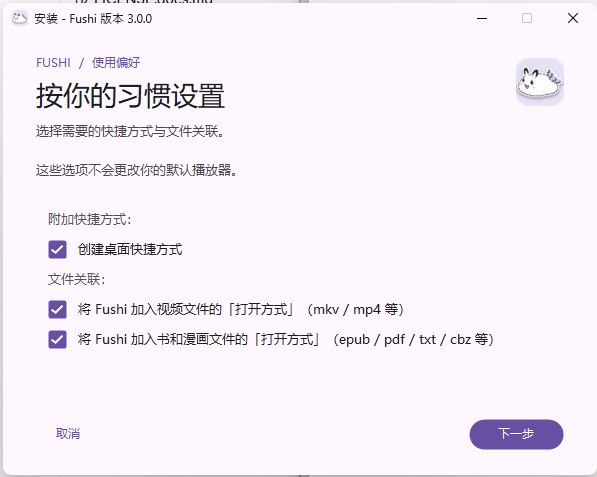{height=300 width=400}

4. **Konfirmasi** (`准备好开始了`). Layar ini merangkum lokasi instal dan centang yang kamu pilih. Tekan `开始安装` (Mulai instal), atau `上一步` (Kembali) kalau mau mengubah sesuatu. Proses instalnya sekitar setengah menit
5. Di layar terakhir, biarkan `启动 Fushi` (Jalankan Fushi) tercentang, lalu tekan `完成` (Selesai)

    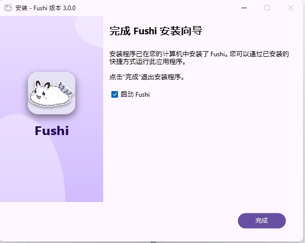{height=300 width=400}

Fushi terpasang di folder pengguna, jadi tidak perlu izin admin.

Uninstall Fushi tidak menghapus data (kamus, pengaturan, dan koneksi Anki). Kalau Fushi dipasang lagi, kamu langsung masuk ke `Beranda` dengan pengaturan lama, tanpa panduan awal. Datanya tersimpan di `%APPDATA%\Fushi\Fushi`.

!!! warning "Pernah pasang Fushi atau Hibiki versi lama?"
    Kalau setelah instal muncul layar **Old data needs an upgrade first**, lihat [Masalah 1](#masalah-1-muncul-old-data-needs-an-upgrade-first) dulu.

## **Setup Awal**

Saat pertama dibuka, Fushi menjalankan panduan awal sebanyak 10 langkah. Tombol `Lewati untuk sekarang` di kiri bawah bisa dipakai kapan saja, dan semua pengaturannya bisa diubah lagi nanti di `Pengaturan`.

1. **Bahasa dan tema.** Pastikan `Pengaturan bahasa` sudah `Bahasa Indonesia`, pilih mode terang/gelap, lalu tekan `Berikutnya`

    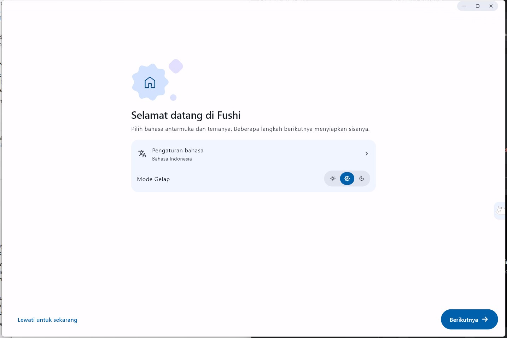{height=300 width=450}

2. **Apa yang akan Anda gunakan?** Fitur yang tidak dicentang akan disembunyikan dari menu samping. Kalau ragu, biarkan semuanya tercentang. Di bagian bawah, `Disiapkan berikutnya` menentukan langkah mana saja yang muncul di panduan ini

    === "Bagian atas"
        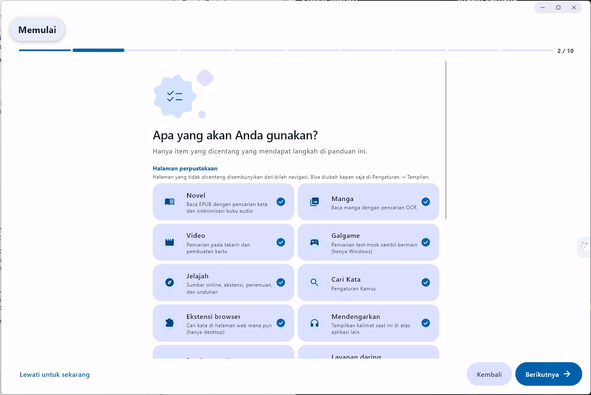{height=300 width=450}
    === "Bagian bawah"
        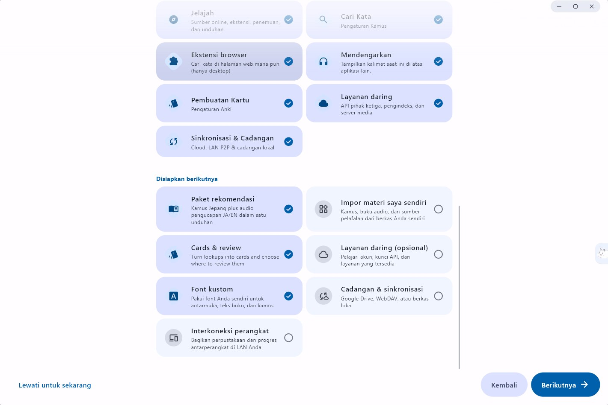{height=300 width=450}

    !!! warning "Paket rekomendasi besarnya sekitar 9,5 GB"
        `Paket rekomendasi` mengunduh kamus plus audio pengucapan dalam satu paket besar. Kalau kuota atau ruang penyimpananmu terbatas, hilangkan centangnya, lalu unduh kamus satu per satu (lihat [Kamus](#kamus)).

3. **How you review.** Buka `Use Anki instead...`, lalu pilih `Anki`. Kalau tidak memakai Anki, pilih `Fushi review`

    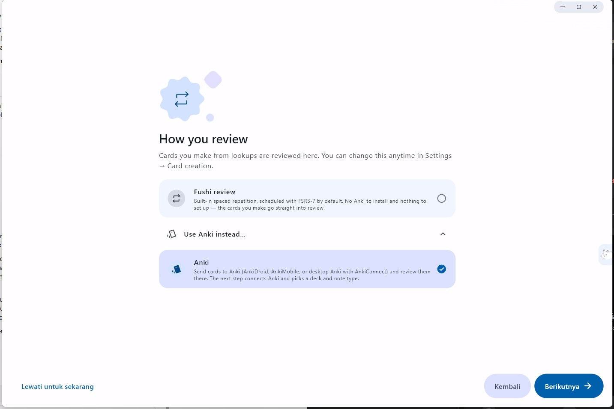{height=300 width=450}

4. **Siapkan Anki.** Buka Anki dulu dan biarkan tetap terbuka. Kalau Fushi sudah tersambung, akan muncul tulisan `Terhubung: ditemukan … dek`
    - Tekan `Buat dek Lapis`. Fushi akan menambahkan tipe catatan Lapis dan dek Lapis ke Anki, lalu memilih keduanya
    - Kalau mau memakai dek lain, ganti lewat `Dek`. Pastikan `Tipe Catatan` tetap `Lapis`
    - `Posisikan ulang otomatis setelah mining` menyala dari awal. Sekitar 30 detik setelah kamu membuat kartu, kartu baru di dek itu diurutkan ulang supaya kata yang paling umum muncul duluan. Kartu yang sudah pernah di-review tidak diubah. Matikan kalau kamu mau mengatur urutan kartu baru sendiri

    === "Koneksi Anki"
        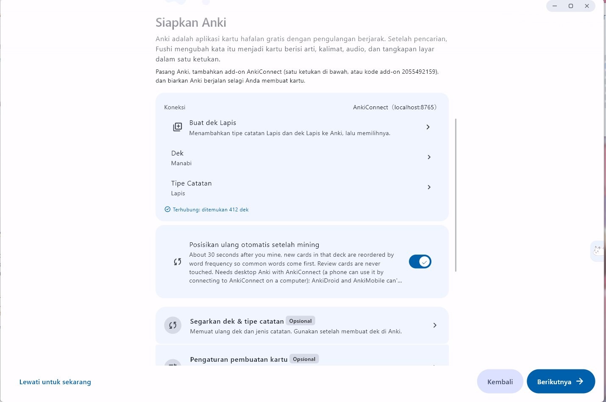{height=300 width=450}
    === "FSRS"
        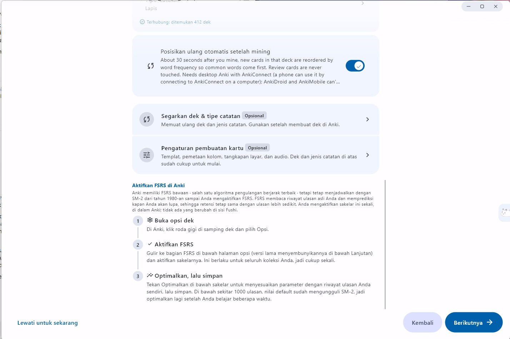{height=300 width=450}

    Di bagian bawah ada petunjuk mengaktifkan FSRS di Anki. Kalau kamu sudah mengikuti [Setup Anki PC](setup-anki-pc-lazy-guide.md), FSRS sudah aktif dan bagian ini bisa dilewati.

5. **Ekstensi browser.** Langkah ini bisa dilewati dulu dan diselesaikan nanti di bagian [Ekstensi browser](#ekstensi-browser)

    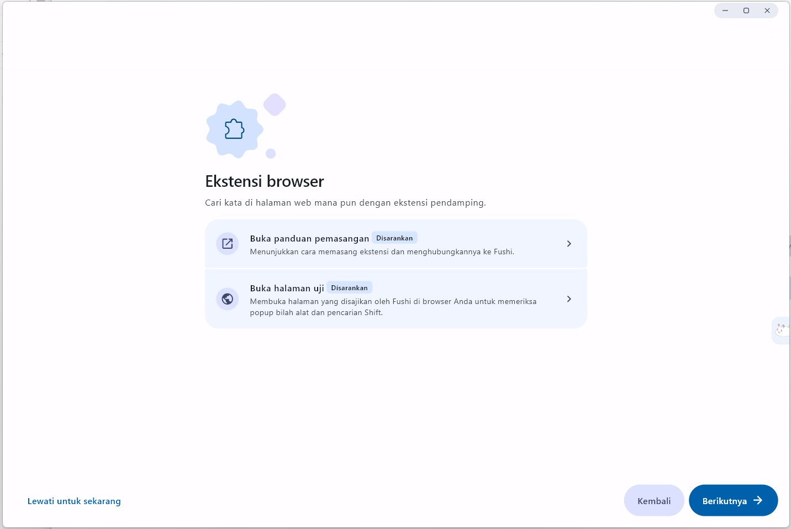{height=300 width=450}

6. **Font.** Opsional. Lewati saja kalau tulisan Jepang di Fushi sudah tampil dengan baik

    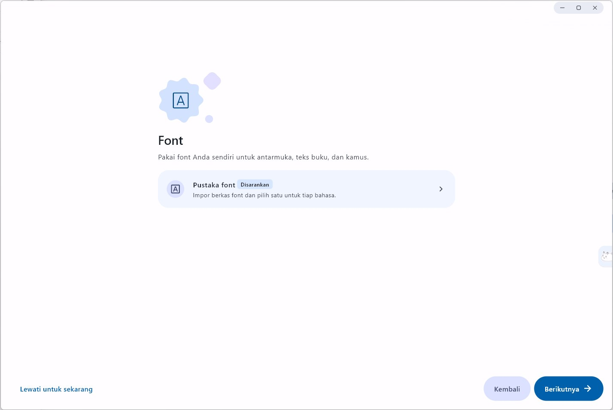{height=300 width=450}

7. **Ketuk untuk mencari.** Langkah latihan mencari kata. Kalau hasil pencariannya kosong, berarti kamus belum terpasang. Lanjut dulu, lalu pasang kamus di bagian [Kamus](#kamus)

    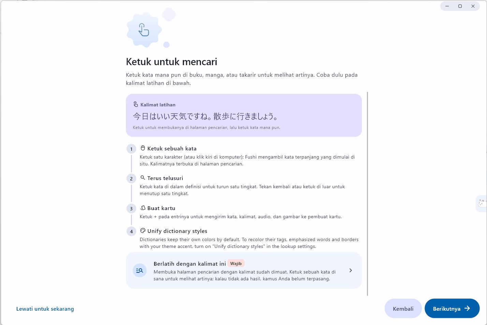{height=300 width=450}

8. **Mencari di luar Fushi.** Sorot teks di aplikasi mana pun, lalu tekan `Ctrl` + `Alt` + `D` untuk mencarinya tanpa pindah jendela. Kombinasi tombolnya bisa diganti di `Pengaturan` > `Pintasan`

    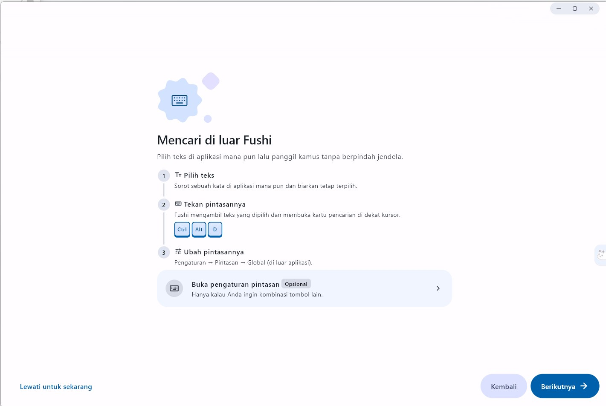{height=300 width=450}

Setelah panduan awal selesai, kamu akan masuk ke `Beranda`. Menu utama ada di samping kiri.

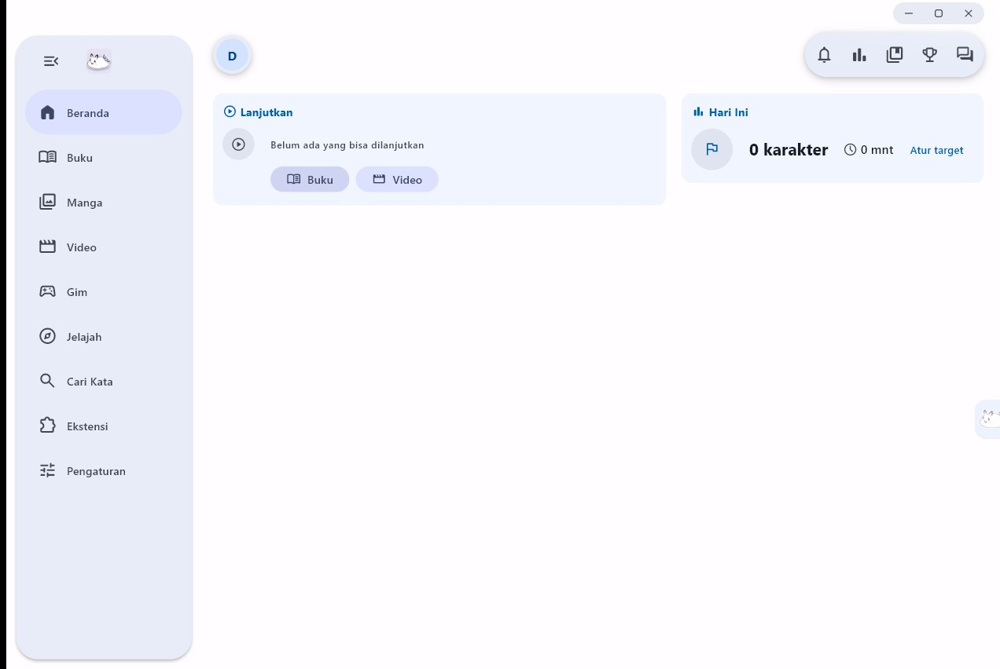{height=300 width=450}

---

## **Kamus**

Kamus dikelola di `Pengaturan` > `Pencarian` > `Kamus`. File kamus berformat `.zip` dan **tidak perlu diekstrak**.

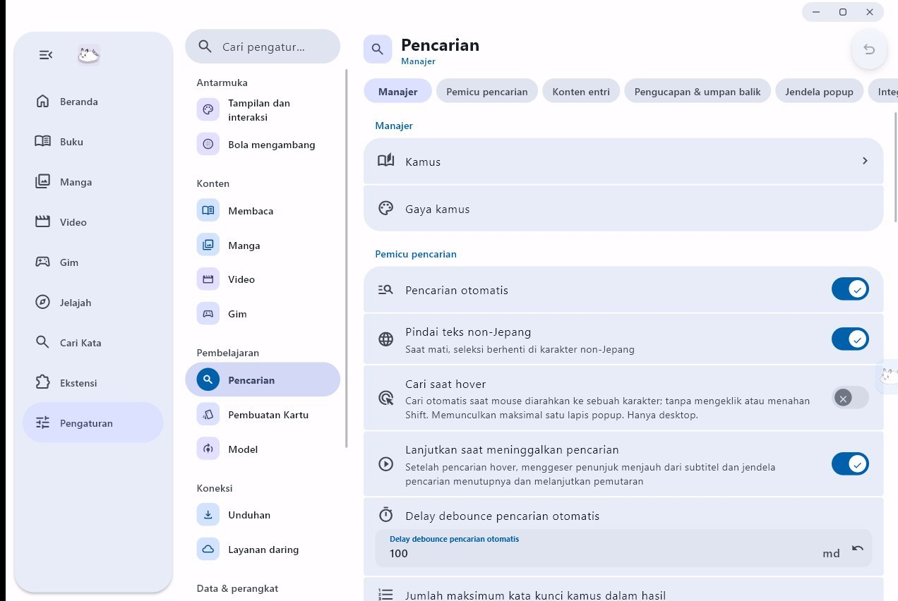{height=300 width=450}

**Cara impor kamus**

1. Buka `Pengaturan` > `Pencarian`, lalu tekan `Kamus`
2. Untuk kamus yang sudah kamu unduh (misalnya JIDict), tekan `Impor Kamus` lalu pilih file `.zip`-nya
3. Untuk JMdict, JMnedict, Jitendex, dan kamus frekuensi JPDB, tekan `Unduh Kamus` lalu pilih dari daftar. Fushi akan mengunduh dan memasangnya sendiri
4. Pastikan tombol di samping kamus dalam keadaan **nyala**
5. Atur urutannya dengan menyeret kamus, atau tekan `Alt` + `↑`/`↓`. Kamus paling atas tampil paling dulu. Kalau ingin arti bahasa Indonesia muncul duluan, taruh JIDict di urutan pertama

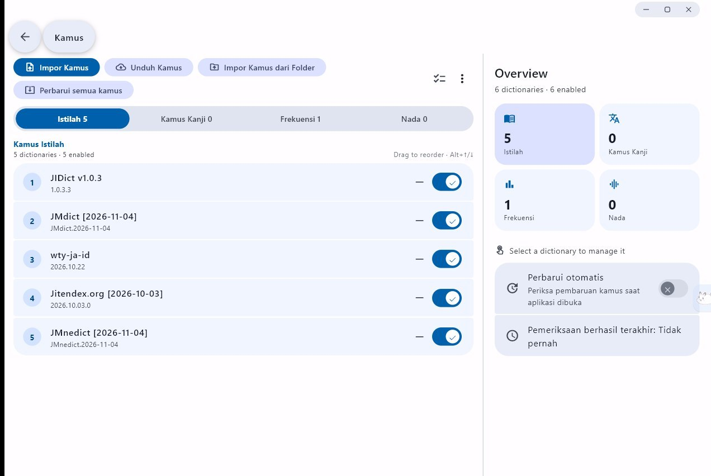{height=300 width=450}

Kamus frekuensi (JPDB) masuk ke tab `Frekuensi`, terpisah dari kamus istilah. Penjelasan arti angka frekuensi ada di [Setup Manatan](Setup-Manatan.md#rekomendasi-kamus-frekuensi).

**Cek kamus sudah jalan**

Buka `Cari Kata` di menu samping, ketik atau tempel kalimat Jepang, lalu klik salah satu kata. Kalau arti dari setiap kamus muncul berjajar seperti di bawah, kamus sudah siap.

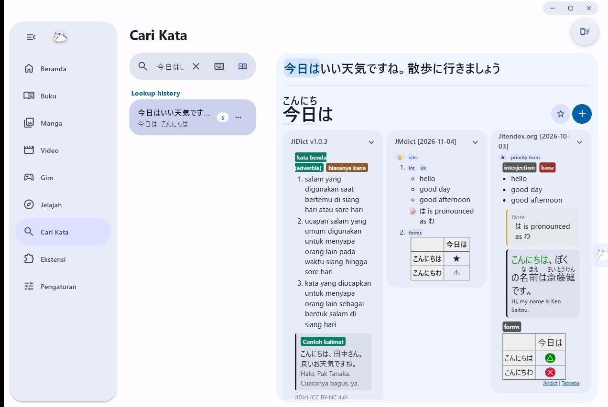{height=300 width=450}

### **Audio pengucapan**

Tanpa sumber audio, tombol speaker tidak muncul di hasil pencarian dan kartu Anki tidak punya audio. Pilih salah satu:

- **Local Audio Server di Anki** (disarankan kalau kamu sudah mengikuti [Yomitan Local Audio](setup-yomitan-pc-lazy-guide.md#info-1-yomitan-local-audio)): buka `Pengaturan` > `Pencarian` > tab `Pengucapan & umpan balik` > `Kelola sumber audio`, lalu nyalakan sumber bernama `Anki`. Sumber ini memakai add-on Local Audio Server di Anki, jadi Anki harus terbuka
- **Paket rekomendasi**: audio sudah termasuk di dalamnya, tapi ukurannya sekitar 9,5 GB

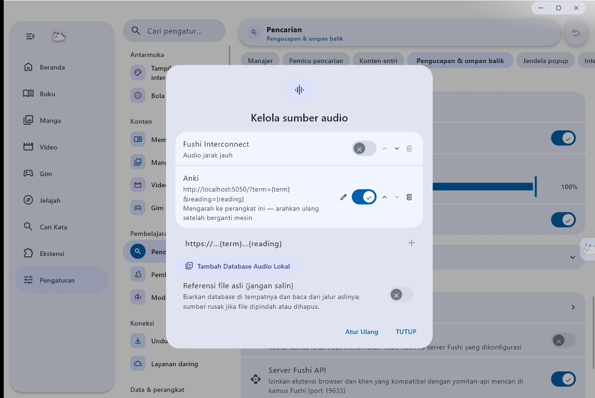{height=300 width=450}

Kalau berhasil, tombol speaker muncul di samping kata yang dicari.

---

## **Kartu Flashcard**

Pengaturan kartu ada di `Pengaturan` > `Pembuatan Kartu`.

=== "Anki (AnkiConnect)"

    Untuk kamu yang sudah review di **Anki desktop**. Fushi dan Anki harus berada di komputer yang sama, dan Anki harus terbuka selama kamu membuat kartu.

    1. Pasang add-on AnkiConnect di Anki: `Tools` > `Add-ons` > `Get Add-ons`, masukkan kode `2055492159`, lalu tutup dan buka lagi Anki
    2. Di Fushi, buka `Pengaturan` > `Pembuatan Kartu` > tab `Anki`
    3. Pastikan `Send to Anki` terpilih
    4. Tekan `Buat dek Lapis` kalau belum melakukannya di panduan awal, atau pilih dek sendiri di `Dek` dan `Lapis` di `Tipe Catatan`
    5. Kalau baru membuat atau mengganti nama dek di Anki, tekan `Segarkan dek & tipe catatan`
    6. Pasang sumber audio pengucapan dulu supaya kartunya punya audio (lihat [Audio pengucapan](#audio-pengucapan))
    7. Cari sebuah kata, lalu tekan tombol **+** biru di samping kata itu. Cek kartunya di Anki dulu sebelum membuat banyak kartu

    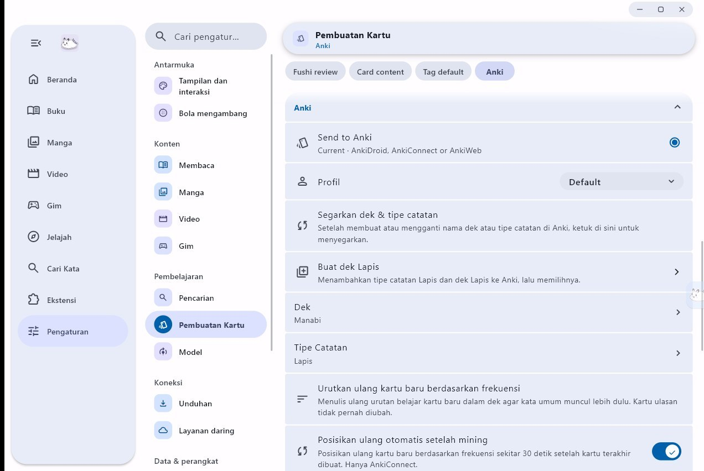{height=300 width=450}

    Setelah kartu dibuat, tombol **+** berubah jadi **✓↩**. Tombol ini menimpa kartu terakhir yang kamu buat, jadi kalau ada yang kurang (misalnya audio belum terpasang), perbaiki dulu lalu tekan tombol ini. Kartu lama ditimpa, bukan diduplikasi.

    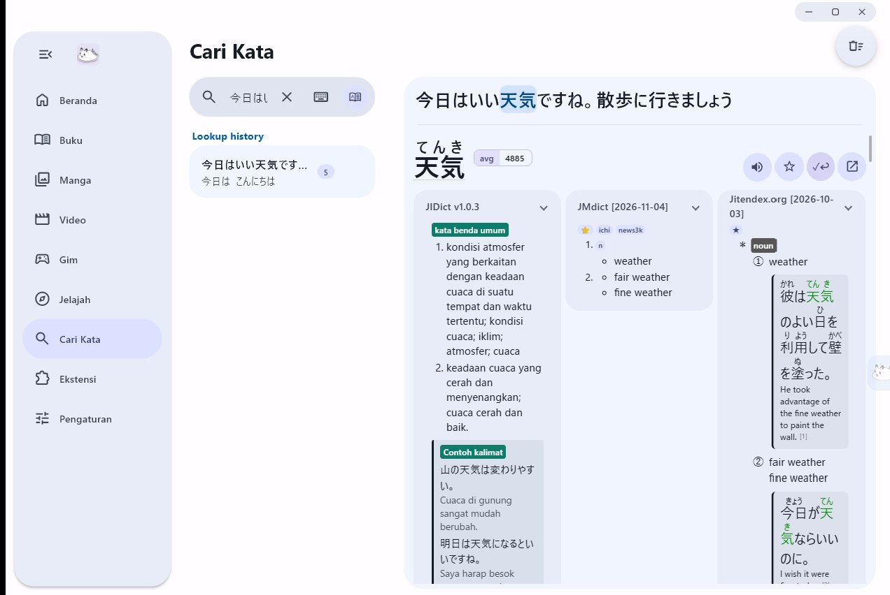{height=300 width=450}

    ??? info "Isi kartu Lapis dari Fushi <small>(klik di sini)</small>"

        Field Lapis langsung terisi tanpa perlu dicocokkan sendiri. Contoh hasil dari halaman `Cari Kata`:

        | Field Anki | Isi |
        |---|---|
        | Expression | Kata yang dicari |
        | ExpressionFurigana | Kata dengan furigana, misalnya `天気[てんき]` |
        | ExpressionReading | Cara baca |
        | ExpressionAudio | Audio pengucapan (kosong kalau sumber audio belum dipasang) |
        | MainDefinition | Arti dari kamus paling atas di daftar kamus |
        | Sentence | Kalimat dengan kata yang dicari dicetak tebal |
        | SentenceFurigana | Kalimat dengan furigana (tidak selalu terisi) |
        | Glossary | Arti dari semua kamus |
        | Frequency, FreqSort | Peringkat frekuensi dari JPDB |
        | IsWordAndSentenceCard | Diisi `x` |

        Karena `IsWordAndSentenceCard` diisi, bagian depan kartu menampilkan kata beserta kalimatnya. Ini bawaan Fushi dan dipakai apa adanya di panduan ini. Kalau kamu sudah terbiasa dengan kartu kalimat dari [panduan Yomitan](setup-yomitan-pc-lazy-guide.md) (`IsSentenceCard` diisi `1`), bentuk kartunya akan sedikit berbeda.

        `PitchPosition` dan `PitchCategories` kosong kalau belum ada kamus aksen nada. `Picture`, `SentenceAudio`, dan `MiscInfo` baru terisi kalau kartu dibuat dari video, buku, atau manga. Kartu juga otomatis diberi tag `fushi`.

    !!! note "Catatan draft"
        Yang sudah diuji baru kartu dari halaman `Cari Kata`. Kartu dari buku, manga, dan video belum dicek.

=== "Fushi review"

    Review bawaan Fushi dengan jadwal FSRS. Tidak perlu Anki atau add-on apa pun, cocok kalau kamu baru mulai.

    1. Buka `Pengaturan` > `Pembuatan Kartu` > tab `Fushi review`
    2. Tekan `Turn on Fushi review`
    3. Cari sebuah kata, lalu tekan tombol **+** biru. Kartu langsung masuk ke antrean review di Fushi

    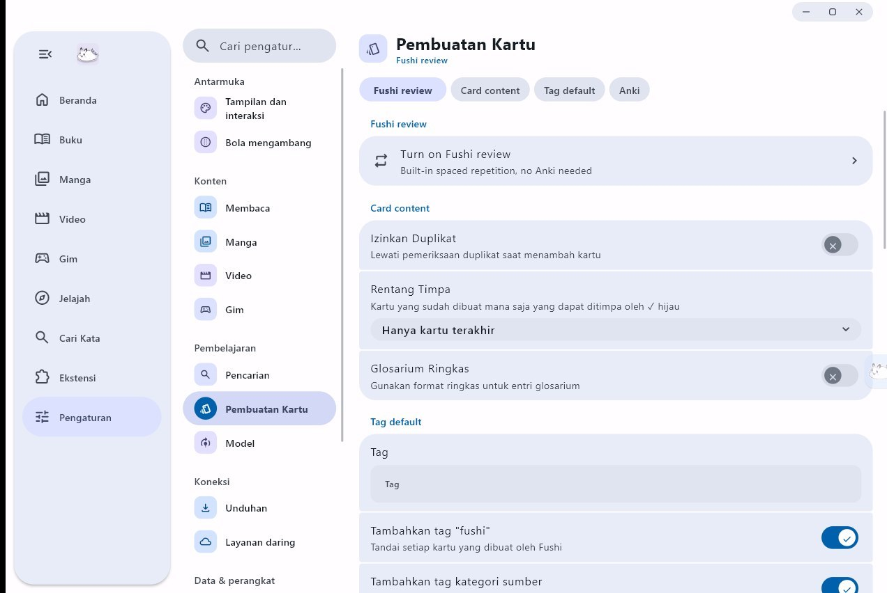{height=300 width=450}

---

## **Sumber Online (Manga, Anime & Novel)**

Fushi bisa membaca manga, menonton anime, dan membaca web novel dari situs online lewat ekstensi sumber. Ekstensinya sama dengan yang dipakai Mihon (manga), Aniyomi (anime), dan LNReader (novel). Fushi tidak menyertakan satu sumber pun, jadi kamu perlu menambahkan **toko ekstensi** (repositori) dulu, lalu memasang ekstensi dari toko itu.

Ekstensi sumber ini berbeda dengan menu `Ekstensi` di samping kiri. Menu itu untuk [ekstensi browser](#ekstensi-browser).

### **Tambah toko ekstensi**

Salin tautan toko sesuai jenisnya:

| Jenis | Tab di Fushi | Tautan toko ekstensi |
|---|---|---|
| Manga | `Manga` | `https://github.com/keiyoushi/extensions/raw/repo/index.pb` |
| Anime | `Video` | `https://raw.githubusercontent.com/yuzono/anime-repo/repo/index.min.json` |
| Novel | `Novel` | `https://raw.githubusercontent.com/LNReader/lnreader-plugins/plugins/v3.0.0/.dist/plugins.min.json` |

Sumber novel berbahasa Jepang di toko LNReader saat ini hanya dua, Syosetsu dan Kakuyomu. Keduanya situs web novel, jadi isinya bukan light novel terbitan resmi.

1. Buka `Jelajah` di menu samping, lalu pilih tab `Sumber` di atas
2. Pilih jenisnya: `Manga` untuk manga, `Video` untuk anime, `Novel` untuk novel
3. Di kanan atas, pilih `Ekstensi`
4. Tekan `Tambah toko ekstensi`

    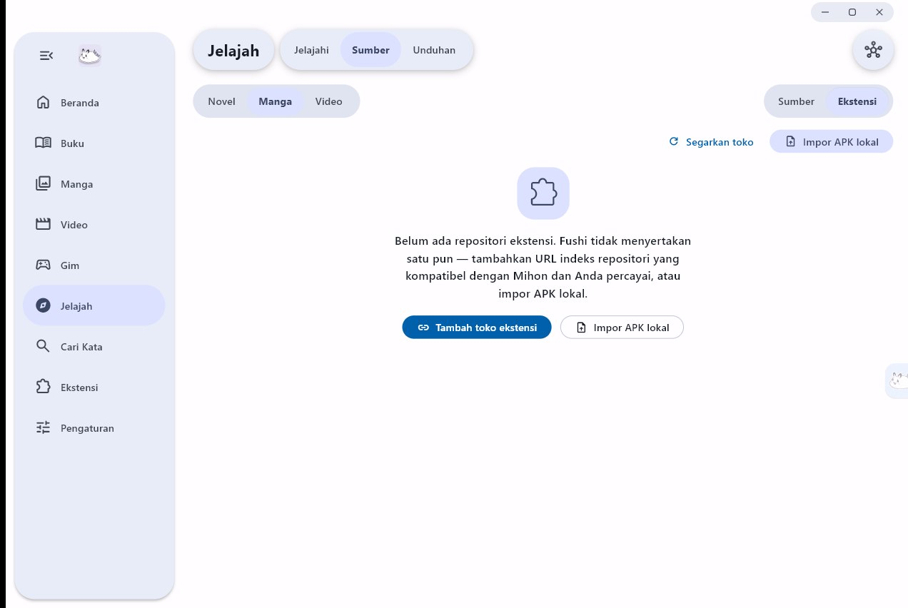{height=300 width=450}

5. Tempel tautan toko di kolom `URL toko ekstensi`, lalu tekan `Tambah toko ekstensi`

    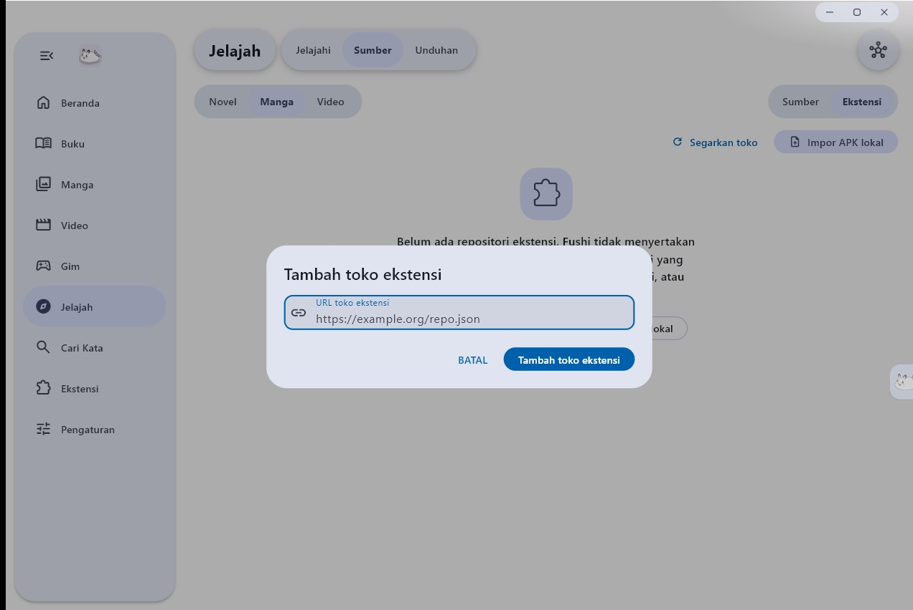{height=300 width=450}

6. Toko yang berhasil ditambahkan muncul di daftar beserta jumlah ekstensinya. Ulangi langkah 2–5 untuk jenis yang lain

    === "Manga (Keiyoushi)"
        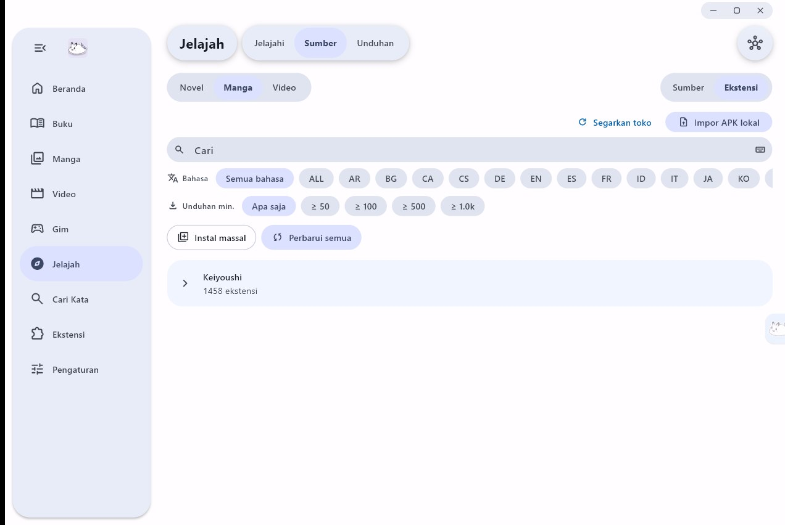{height=300 width=450}
    === "Anime (Yūzōnō)"
        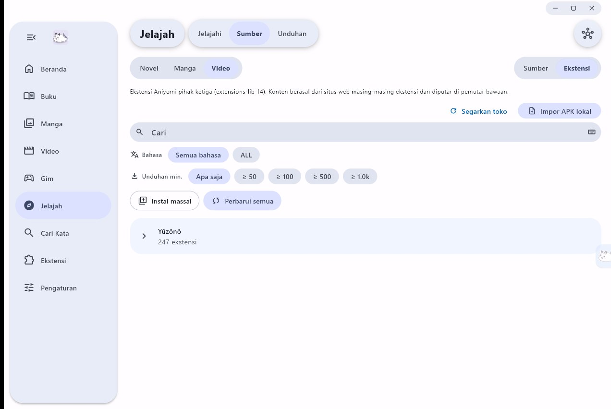{height=300 width=450}

Tautan toko anime di atas otomatis diganti Fushi ke versi `index.pb` setelah ditambahkan. Itu normal.

### **Pasang ekstensi sumber**

1. Masih di `Jelajah` > `Sumber` > `Ekstensi`, pilih `JA` di baris `Bahasa` supaya hanya sumber berbahasa Jepang yang tampil
2. Buka toko ekstensinya (tekan panah di samping nama toko)
3. Tekan `Instal` di sumber yang kamu mau. Tombol `Pratinjau` bisa dipakai untuk melihat isinya dulu

    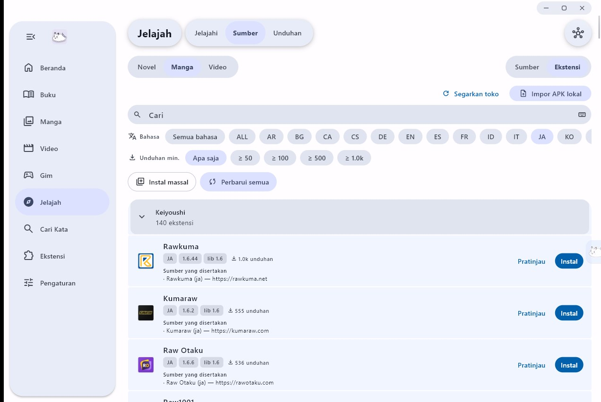{height=300 width=450}

4. Saat pertama memasang ekstensi dari sebuah toko, muncul kotak `Percayai penanda tangan ekstensi?`. Tekan `Instal` kalau kamu percaya dengan toko tersebut. Ekstensi lain dari toko yang sama biasanya punya penanda tangan yang sama, jadi kotak ini tidak muncul lagi

    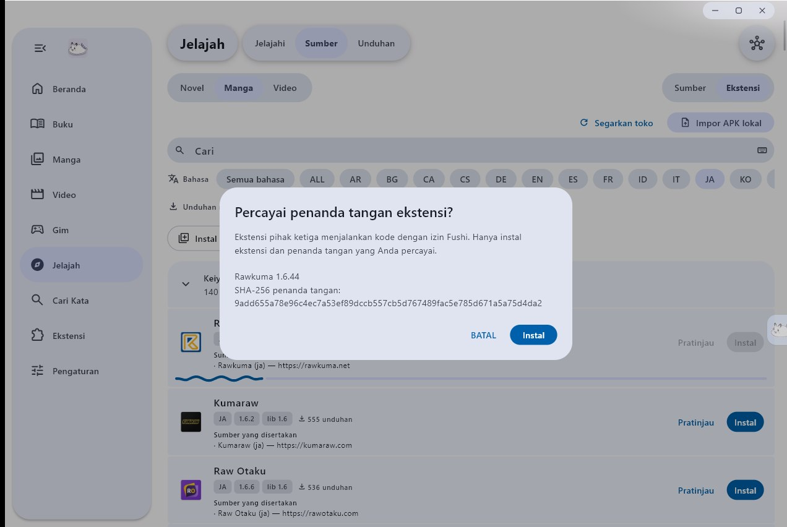{height=300 width=450}

!!! warning "Pasang ekstensi dari toko yang kamu percaya saja"
    Ekstensi menjalankan kode dari pihak ketiga dengan izin Fushi. Isi dari setiap sumber berasal dari situs masing-masing, bukan dari Fushi.

### **Cari judul**

1. Buka `Jelajah`, pilih tab `Jelajahi`, lalu pilih jenisnya (`Manga`, `Video`, atau `Novel`)
2. Ketik judul di kolom `Cari setiap sumber yang aktif`, lalu tekan `Enter`. Fushi mencari di semua sumber yang sudah terpasang sekaligus. Kalau mau mencari di satu sumber saja, pilih sumbernya di menu `Semua sumber` di sebelah kiri kolom pencarian
3. Kalau belum tahu mau baca apa, gulir ke bawah. Ada daftar judul populer dari setiap sumber, dan bagian `Jelajahi sumber` untuk menjelajahi satu sumber tertentu

    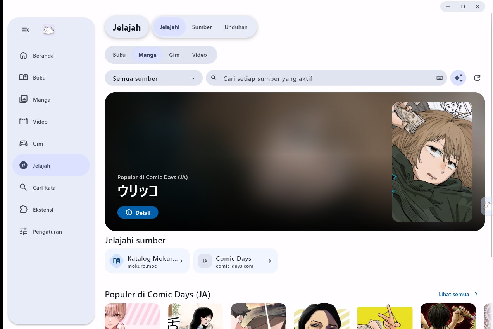{height=300 width=450}

4. Pilih judulnya untuk membuka halaman detail. Dari sini kamu bisa langsung membaca (`Lanjutkan membaca`), memilih chapter atau episode di sebelah kanan, atau menyimpannya lewat `Tambah ke rak manga`

    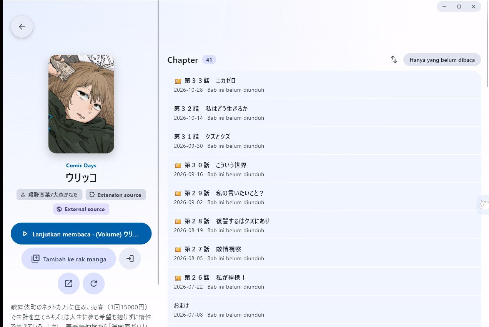{height=300 width=450}

!!! note "Catatan draft"
    Yang sudah diuji: kedua toko berhasil ditambahkan, satu ekstensi manga (Comic Days) terpasang, pencarian kata kunci memberi hasil, dan halaman detail judul bisa dibuka. Memasukkan tautan dan mengetik di kolom pencarian dilakukan lewat alat baris perintah Fushi, bukan diketik di aplikasi, jadi langkah tempel tautan (langkah 5) dan tekan `Enter` (Cari judul langkah 2) perlu dicoba sekali lagi langsung di aplikasi. Membaca chapter, menonton episode anime, dan mencari kata di dalamnya belum dicoba.

---

## **Gim**

Fushi bisa membaca teks dialog dari game di Windows (text hook), terutama visual novel. Kata di dialog itu bisa dicari dan dijadikan kartu, lengkap dengan cuplikan layar game. Game dikelola di menu `Gim`.

!!! danger "Hati-hati dengan game online"
    Fushi membaca teks dengan cara masuk ke proses game. Game online yang punya anti-cheat bisa menganggap ini kecurangan, dan akunmu bisa kena tindakan. Pakai fitur ini untuk visual novel atau game offline. Untuk game online, risikonya kamu tanggung sendiri.

### **Tambah game**

1. Buka `Gim` di menu samping, lalu pilih tab `Impor`
2. Tekan `Tambah game`, lalu pilih file `.exe` game-nya. Bisa juga dengan menyeret file `.exe` ke jendela Fushi

    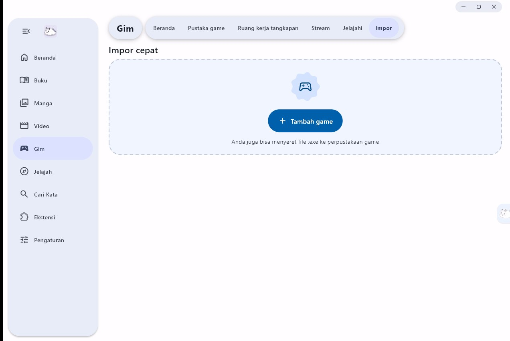{height=300 width=450}

3. Game yang ditambahkan muncul di tab `Pustaka game`

    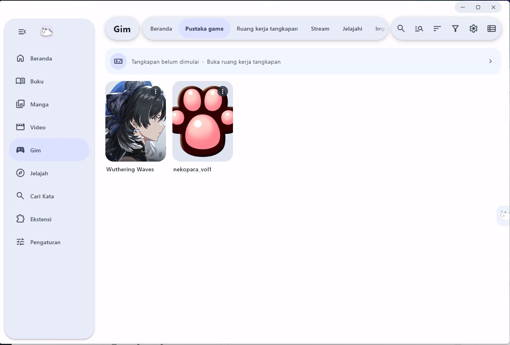{height=300 width=450}

### **Main dan ambil teks dialog**

1. Jalankan game **lewat Fushi**, jangan dari shortcut game-nya sendiri. Pilih game-nya di `Gim`, lalu tekan `Luncurkan`. Fushi akan membuka game sekaligus memasang text hook

    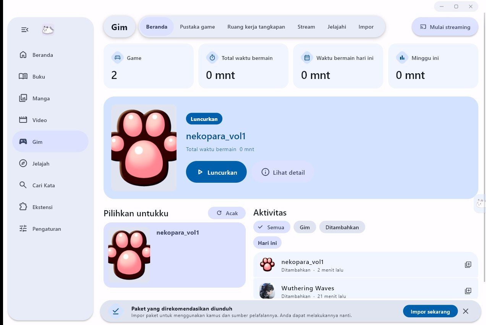{height=300 width=450}

2. Mainkan sampai dialog pertama muncul, lalu kembali ke Fushi dan buka tab `Ruang kerja tangkapan`. Kalau hook berhasil, statusnya `Mendengarkan`

    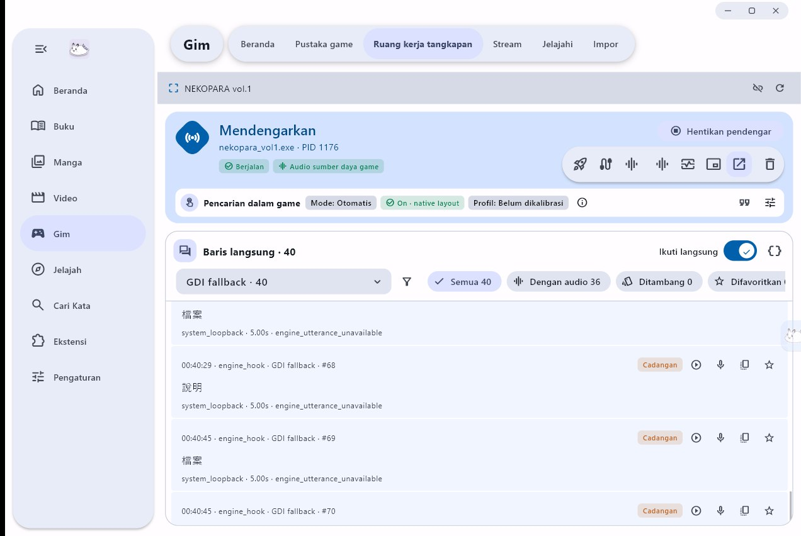{height=300 width=450}

3. **Pilih thread teks yang benar.** Fushi biasanya menemukan beberapa sumber teks (thread). Buka menu di bawah `Baris langsung`, lalu pilih thread yang isinya dialog Jepang dan punya keterangan `… dengan audio`. Thread seperti ini yang paling bisa diandalkan, karena audio suara karakter ikut masuk ke kartu. Di NEKOPARA, thread itu bernama `EmbedKrkrZ`
    - Hindari `GDI fallback` (biasanya berisi teks menu game) dan thread yang hurufnya berulang (`危危なな…`)
    - Thread yang teksnya bersih tapi tanpa audio (di NEKOPARA misalnya `TextRender`) tetap bisa dipakai, tapi kartunya tidak punya audio kalimat
    - Kalau game menampilkan beberapa bahasa sekaligus (misalnya Jepang dan Inggris), baris bahasa lain ikut masuk ke thread. Ubah pengaturan bahasa teks di game jadi Jepang saja
    - Kalau thread yang cocok belum muncul, majukan dialog beberapa baris lalu cek lagi. Kalau setelah game dibuka ulang teks dialog tidak masuk, buka menu ini lagi dan pilih ulang thread-nya

    === "Daftar thread"
        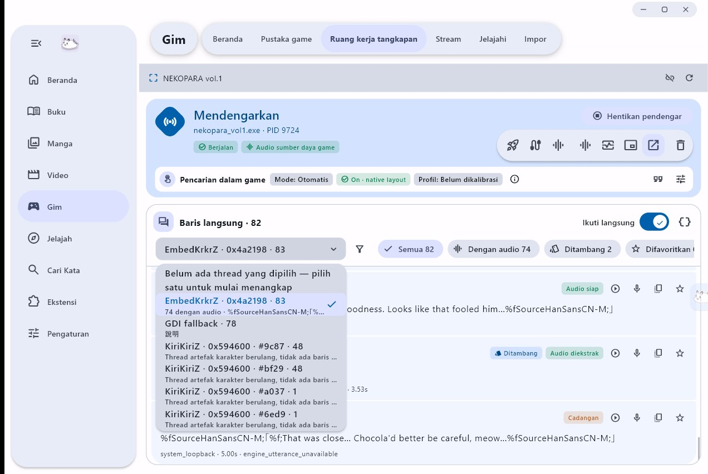{height=300 width=450}
    === "Thread sudah dipilih"
        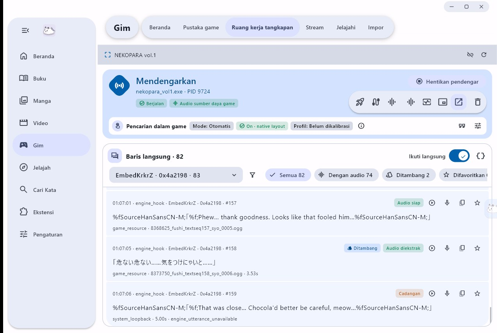{height=300 width=450}

    Baris yang suaranya berhasil diambil diberi label `Audio siap` atau `Audio diekstrak`.

4. Kembali ke game. Fushi menampilkan baris dialog sebagai **subtitle mengambang** di bawah jendela game. Klik kata di subtitle itu untuk memunculkan popup kamus, lalu tekan **+** untuk membuat kartu

    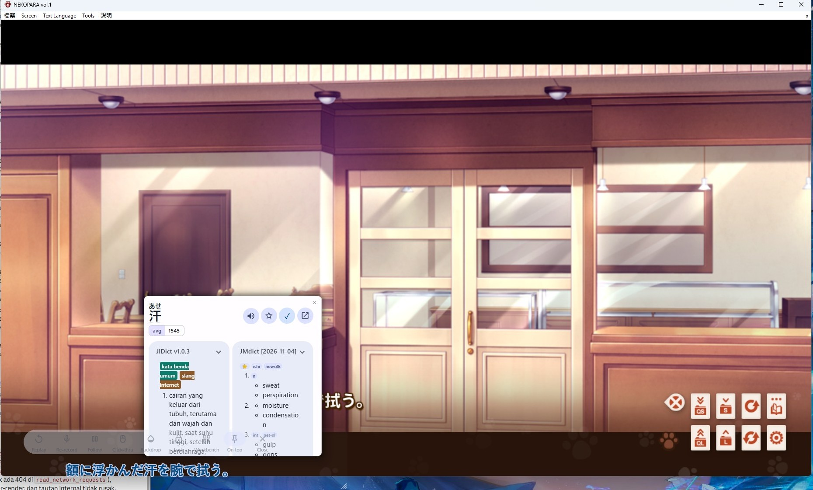{height=300 width=450}

5. Kalau kata itu sudah pernah dijadikan kartu, muncul kotak `Kartu sudah ada di Anki`. Pilih `Timpa kartu ini` untuk memperbarui kartu lama, atau `Tambah sebagai kartu baru`

    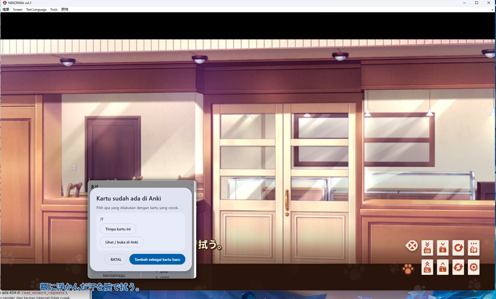{height=300 width=450}

Kartu dari game berisi kata, arti, audio kata, kalimat dialog, gambar layar game di field `Picture`, dan judul game di `MiscInfo`. Kartunya juga diberi tag `Game` dan judul game. Audio kalimat masuk ke `SentenceAudio` kalau baris itu bersuara (bukan narasi).

!!! warning "Ganti gambar kartu jadi gambar animasi (AVIF)"
    Bawaan Fushi menyimpan gambar kartu sebagai **klip video** (WebM). Klip ini bisa gagal diputar di Anki. Pada uji coba, klip dari NEKOPARA tertulis 20 detik padahal isinya cuma sekitar 4 detik, dan pemutarnya macet di 0:00.

    Format yang umum dipakai komunitas: gambar diam atau **gambar animasi AVIF** di `Picture`, dengan audio kalimat terpisah di `SentenceAudio`. Cara mengaturnya di Fushi:

    1. Buka `Pengaturan` > `Pembuatan Kartu` > tab `Anki`, lalu cari bagian `Media kartu`
    2. Di `Gambar kartu galgame`, pilih mode animasi (`gif`) untuk gambar bergerak, atau `currentFrame` untuk satu gambar diam
    3. Pastikan `Format animasi kartu game` diisi `avif`
    4. Lakukan hal yang sama untuk kartu dari anime/video: `Gambar kartu video` dan `Format animasi kartu video`

    Pilihan `gif` di sini adalah nama mode gambar bergerak. Format filenya tetap mengikuti `Format animasi`, jadi kalau diisi `avif`, hasilnya file AVIF.

??? info "Perlu izin administrator? <small>(klik di sini)</small>"
    Untuk kebanyakan visual novel, Fushi tidak perlu dibuka sebagai administrator. Kalau game-nya sendiri berjalan sebagai administrator (misalnya game yang launcher-nya meminta izin admin), buka Fushi sebagai administrator juga: tutup Fushi, lalu klik kanan shortcut Fushi > `Run as administrator`. Setelah selesai main, tutup Fushi lalu buka lagi seperti biasa.

!!! note "Catatan draft"
    Diuji dengan NEKOPARA Vol. 1 tanpa izin administrator: hook berhasil, thread teks bisa dipilih, popup kamus muncul dari subtitle mengambang, dan kartu masuk ke Anki. Mencari kata langsung di teks dalam jendela game (bukan di subtitle mengambang) belum dicoba.

    Setelah `Gambar kartu galgame` diganti ke mode animasi, kartu berisi file AVIF animasi yang valid (480×270, sekitar 1 detik) dalam tag gambar biasa. Yang belum dicek: tampilan gambarnya di Anki desktop dan AnkiDroid, screenshot bagian `Media kartu`, dan nama opsi persis di aplikasi. Nama pengaturan di atas diambil dari daftar pengaturan Fushi.

    Audio kalimat sudah diuji: kartu dari baris bersuara Chocola (「危ない危ない……気をつけにゃいと……」, thread `EmbedKrkrZ`) berisi audio kalimat AAC sekitar 3,5 detik di `SentenceAudio` dan gambar AVIF di `Picture`. Baris narasi dan dialog Kashou (tokoh utama) memang tidak bersuara.

    Cara mengubah bahasa teks di NEKOPARA jadi Jepang saja belum dicoba.

---

## **Ekstensi browser**

Dengan ekstensi Fushi, kamu bisa mencari kata di halaman web mana pun dan memakai subtitle Fushi di situs video. Ekstensi ini belum ada di Chrome Web Store, jadi dipasang manual. Langkah di bawah untuk browser berbasis Chromium (Chrome, Edge, Brave, Vivaldi, Opera).

1. Di Fushi, buka `Ekstensi` di menu samping. Panduan pemasangannya ada di sana, dan nama browser bawaanmu sudah dikenali otomatis
2. Buka halaman ekstensi browser (misalnya `chrome://extensions` atau `brave://extensions`). Tombol `Try to open` bisa membukanya langsung
3. Nyalakan `Mode pengembang` (tombol di pojok kanan atas)
4. Klik `Muat yang belum dikemas` (`Load unpacked`)
5. Pilih folder ekstensinya. Jalurnya sudah otomatis disalin, jadi cukup tempel (`Ctrl` + `V`) di kolom alamat jendela pilih folder. Foldernya ada di `%APPDATA%\Fushi\Fushi\fushi-browser-extension`
6. Kembali ke Fushi dan tekan `Periksa koneksi`. Kalau berhasil, tulisannya berubah jadi `Ekstensi terhubung`

=== "Panduan pemasangan"
    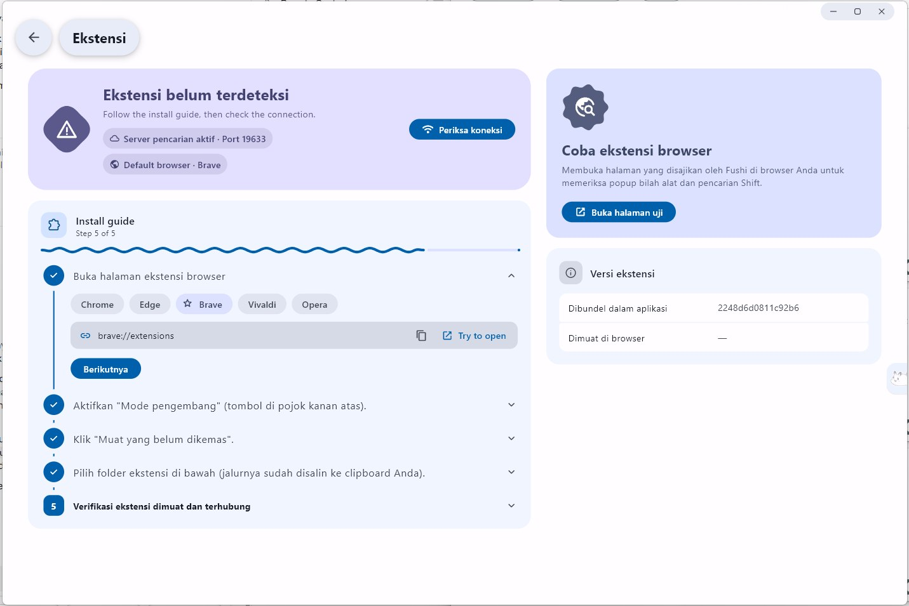{height=300 width=450}
=== "Langkah terakhir"
    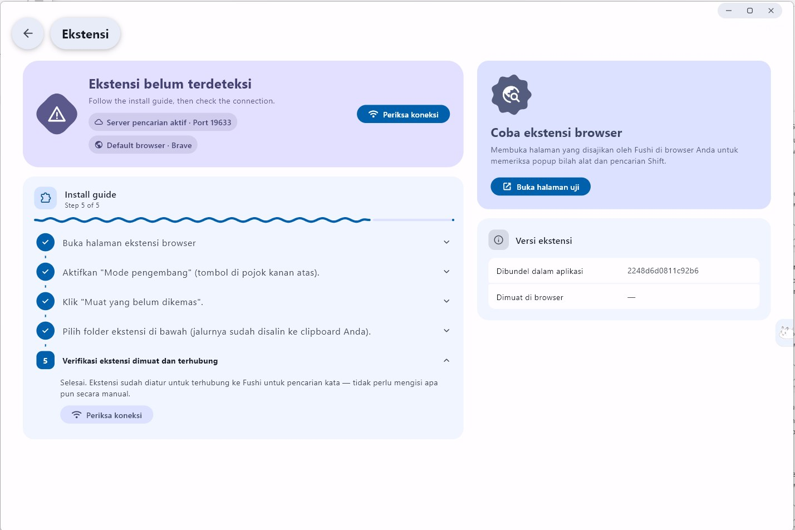{height=300 width=450}
=== "Terhubung"
    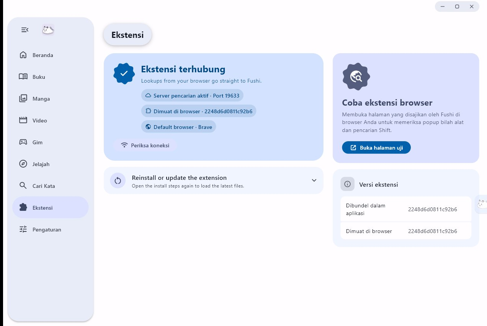{height=300 width=450}

Setelah terpasang, tahan `Shift` sambil mengarahkan kursor ke teks Jepang di browser untuk mencarinya. Pengaturan ekstensi (cara mencari, subtitle, tampilan) ada di halaman pengaturan ekstensi di browser.

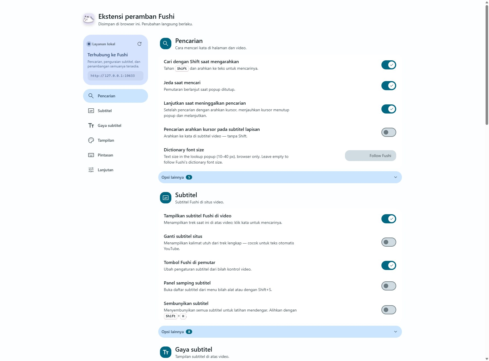{height=300 width=450}

!!! warning "Jangan hapus atau pindahkan folder data Fushi"
    Ekstensi dimuat dari dalam folder data Fushi. Kalau folder itu dihapus atau dipindah, ekstensinya ikut berhenti bekerja dan harus dipasang ulang lewat `Reinstall or update the extension` di halaman `Ekstensi`.

---

## **FAQs**

#### Pertanyaan 1: Apa bedanya Fushi dengan Manatan?

??? question "Apa bedanya Fushi dengan Manatan? <small>(klik di sini)</small>"

    - Keduanya menggabungkan pembaca buku, manga, dan pemutar video dengan kamus popup dalam satu aplikasi
    - Fushi juga punya pencarian di luar aplikasi (`Ctrl` + `Alt` + `D`), ekstensi browser, dan dukungan galgame (khusus Windows)
    - Fushi bisa membuat dek dan tipe catatan Lapis di Anki langsung dari aplikasinya

#### Pertanyaan 2: Apakah Paket rekomendasi wajib diunduh?

??? question "Apakah Paket rekomendasi wajib diunduh? <small>(klik di sini)</small>"

    - Tidak. Paket ini besarnya sekitar 9,5 GB karena berisi audio pengucapan
    - Untuk mulai, cukup pasang JIDict, JMdict, JMnedict, dan JPDB Frequency (lihat [Kamus](#kamus))
    - Kalau paketnya sudah terunduh, Fushi akan menawarkan `Impor sekarang` di bagian bawah `Beranda`. Aplikasi akan memulai ulang setelah impor selesai

#### Pertanyaan 3: Apakah Fushi butuh browser?

??? question "Apakah Fushi butuh browser? <small>(klik di sini)</small>"

    - Tidak. Browser hanya diperlukan kalau kamu mau memakai ekstensi untuk mencari kata di halaman web atau menonton di situs video

## **Masalah Umum**

#### Masalah 1: Muncul "Old data needs an upgrade first"

??? warning "Muncul layar Old data needs an upgrade first <small>(klik di sini)</small>"

    Layar ini muncul kalau di komputermu masih ada data dari Hibiki atau Fushi versi awal yang terlalu lama untuk dibaca Fushi 3.0.0. Datanya belum diubah sama sekali.

    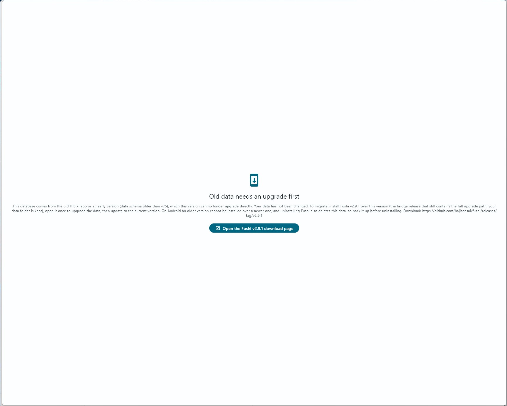{height=300 width=450}

    Pilih salah satu:

    - **Mulai dari nol**: tutup Fushi, buka folder `%APPDATA%\Fushi`, ganti nama folder `Fushi` di dalamnya (misalnya jadi `Fushi.lama`), lalu buka Fushi lagi. Kamus harus diimpor ulang
    - **Pertahankan data lama**: tutup Fushi, pasang [Fushi 2.9.1](https://github.com/hajisensai/fushi/releases/tag/v2.9.1) di atas versi sekarang, buka sekali sampai datanya selesai diperbarui, tutup, lalu pasang lagi versi terbaru

#### Masalah 2: Hasil pencarian kosong

??? warning "Hasil pencarian kosong <small>(klik di sini)</small>"

    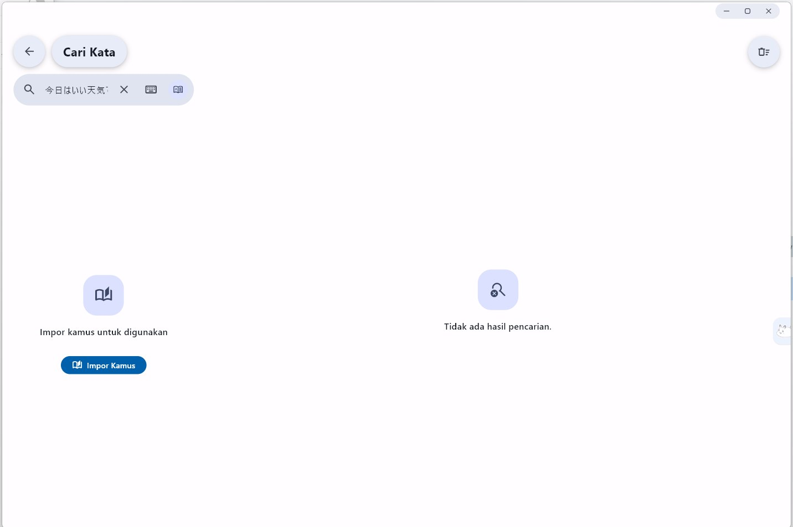{height=300 width=450}

    - Kamus belum terpasang. Ikuti bagian [Kamus](#kamus)
    - Kalau kamus sudah terpasang, cek di `Pengaturan` > `Pencarian` > `Kamus` bahwa tombolnya menyala

#### Masalah 3: Ekstensi belum terdeteksi

??? warning "Ekstensi belum terdeteksi <small>(klik di sini)</small>"

    - Pastikan Fushi sedang terbuka. Ekstensi butuh Fushi berjalan supaya bisa mencari kata
    - Tekan `Periksa koneksi` di halaman `Ekstensi`. Status di Fushi kadang baru berubah setelah tombol ini ditekan
    - Cek di halaman ekstensi browser bahwa ekstensi Fushi menyala dan tidak ada pesan error
    - Kalau masih gagal, buka `Reinstall or update the extension` di halaman `Ekstensi` dan ulangi langkah pemasangan

#### Masalah 4: Kartu tidak masuk ke Anki

??? warning "Kartu tidak masuk ke Anki <small>(klik di sini)</small>"

    - Pastikan Anki desktop sedang terbuka dan add-on AnkiConnect sudah terpasang
    - Buka `Pengaturan` > `Pembuatan Kartu` > tab `Anki`, lalu tekan `Segarkan dek & tipe catatan`
    - Pastikan `Dek` dan `Tipe Catatan` sudah terpilih
    - Kartu yang gagal dikirim saat Anki tertutup akan disimpan di antrean dan bisa dikirim ulang setelah Anki dibuka
    - Kartu masuk tapi audionya kosong: pasang sumber audio dulu (lihat [Audio pengucapan](#audio-pengucapan)), lalu tekan tombol **✓↩** untuk menimpa kartu tadi

#### Masalah 5: Masih bingung?

??? warning "Masih bingung? <small>(klik di sini)</small>"

    Tanyakan di [Discord Philia Space](https://discord.gg/hp55WMbbG6). Sertakan versi Fushi dan screenshot layar yang bermasalah.
