# Setup Hoshi Reader (iOS)
---

 Diunggah: 6 November 2026 – `Yaaacha`

---

??? info "Info: tentang Hoshi Reader <small>(klik di sini)</small>"

    Hoshi Reader adalah aplikasi untuk membaca light novel dan buku EPUB sambil mencari kata dengan kamus popup, lalu mengirim katanya jadi kartu Anki.

    Di Philia Space, Hoshi Reader dipakai untuk **light novel dan buku** di iPhone dan iPad. Untuk anime dan manga di iPhone, pakai [Manatan](Setup-Manatan.md). Pengguna Android bisa ke [Setup Hoshi Reader (Android)](Setup-Hoshi-Reader.md).

    Aplikasinya berbahasa Inggris, jadi nama tombol ditulis persis seperti yang muncul di layar.

---

## **Persiapan**

1. iPhone atau iPad dengan **iOS 18** ke atas
2. Tentukan cara membuat kartu Anki. Pilih salah satu:

    | Cara | Butuh | Catatan |
    |---|---|---|
    | AnkiMobile | Aplikasi [AnkiMobile](https://apps.apple.com/app/ankimobile-flashcards/id373493387) (berbayar) | Bisa mining di mana saja |
    | AnkiConnect | Anki dan add-on AnkiConnect di PC | Gratis, tapi PC harus menyala dan tersambung ke Wi-Fi yang sama dengan iPhone |

    Untuk keduanya, siapkan dulu dek dan note type Lapis lewat [Setup Anki PC](setup-anki-pc-lazy-guide.md). Kalau memakai AnkiMobile, sinkronkan lewat AnkiWeb supaya `Mining Deck` dan `Lapis` ikut masuk ke iPhone.

3. Unduh kamus format Yomitan (`.zip`) ke iPhone, misalnya ke aplikasi `Files`
    - Kamus JP-ID
        - [JIDict](https://github.com/philiaspaceai/JIDict-yomitan#pemasangan)
        - [RH Dict](https://discord.com/channels/1370274344571240552/1544821080148025484/1544821080148025484) (di Discord Philia Space)
    - Kamus JP-EN bisa diunduh langsung dari dalam Hoshi Reader (lihat [Kamus](#kamus))
4. Siapkan file EPUB light novel di iPhone

---

## **Pasang**

1. Pasang [Hoshi Reader dari App Store](https://apps.apple.com/app/hoshi-reader/id6758244332)
2. Buka Hoshi Reader

---

## **Impor Buku**

1. Di tab `Books`, tekan ikon `+` di kanan atas

    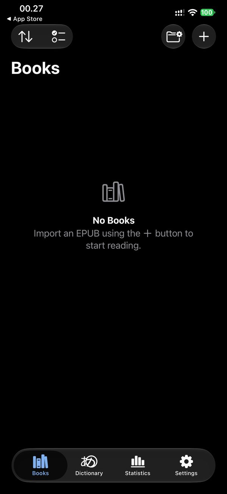{width=250}

2. Pilih file EPUB di jendela `Files`, lalu tekan `Buka`. Beberapa buku bisa dipilih sekaligus

    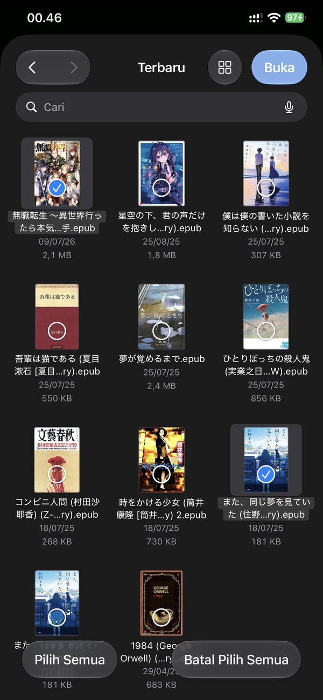{width=250}

3. Buku yang diimpor muncul di `Books`

    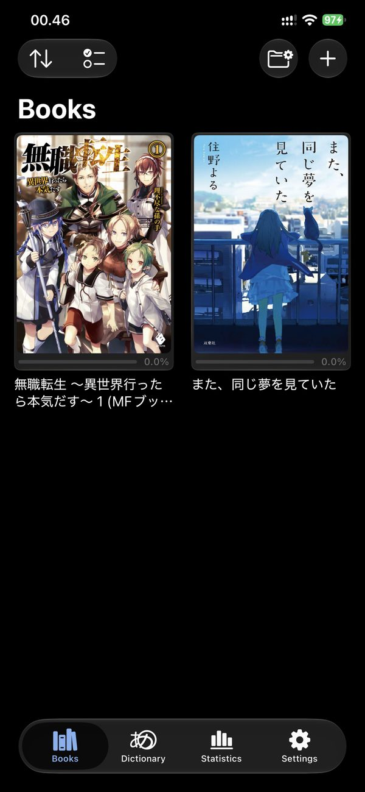{width=250}

Buku juga bisa langsung dikirim ke Hoshi Reader dari aplikasi lain. Misalnya saat mengunduh EPUB dari Discord, tekan `Open in Hoshi`, atau tekan tombol bagikan lalu pilih Hoshi Reader dari daftar aplikasi.

---

## **Kamus**

Hoshi Reader belum punya kamus saat pertama dipasang.

1. Buka tab `Settings`, lalu tekan `Dictionaries`

    === "Settings"
        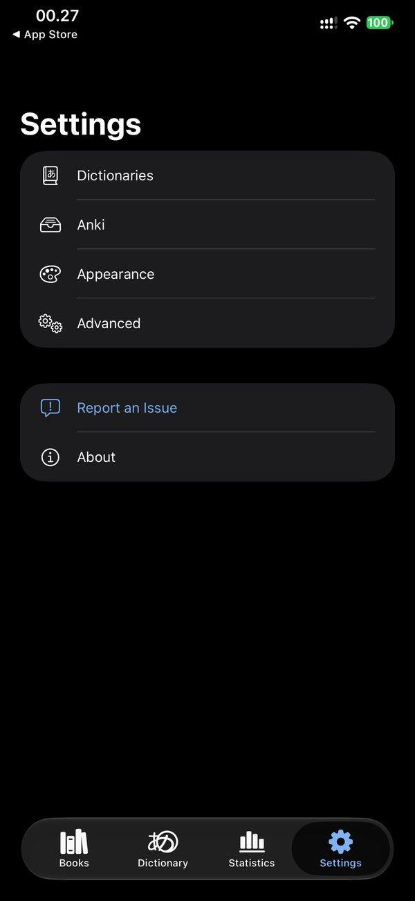{width=250}
    === "Dictionaries"
        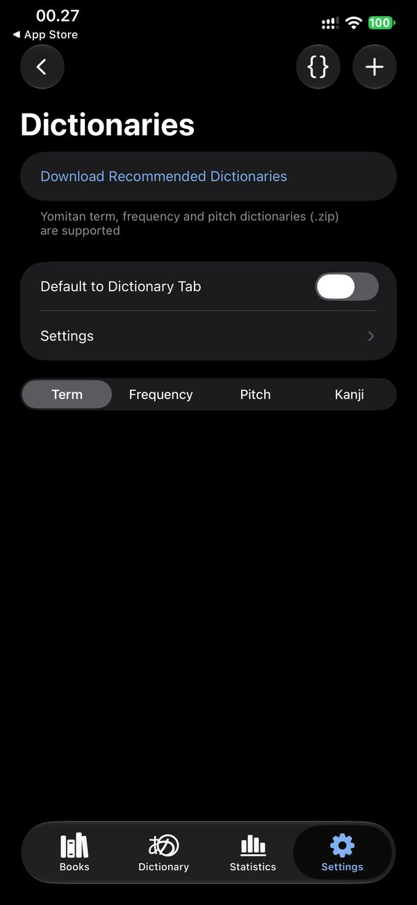{width=250}

2. Tekan ikon `+` di kanan atas, pilih file `.zip` kamus (misalnya JIDict), lalu tekan `Buka`. File `.zip` **tidak perlu diekstrak**, dan beberapa kamus bisa dipilih sekaligus

    === "Satu kamus"
        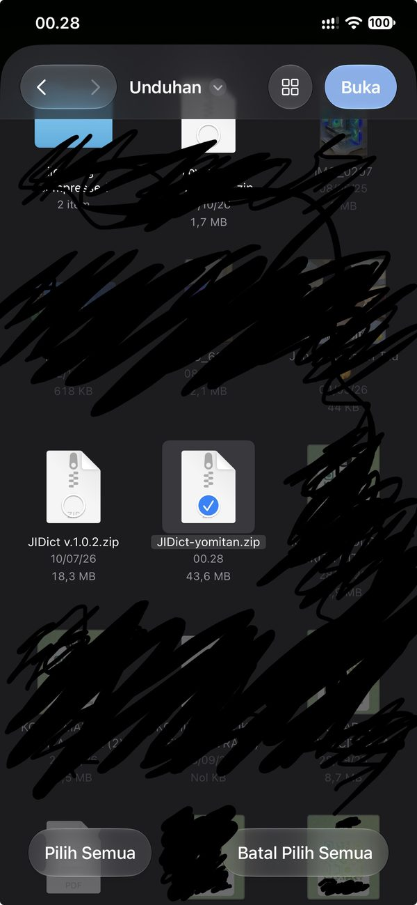{width=250}
    === "Banyak kamus (1)"
        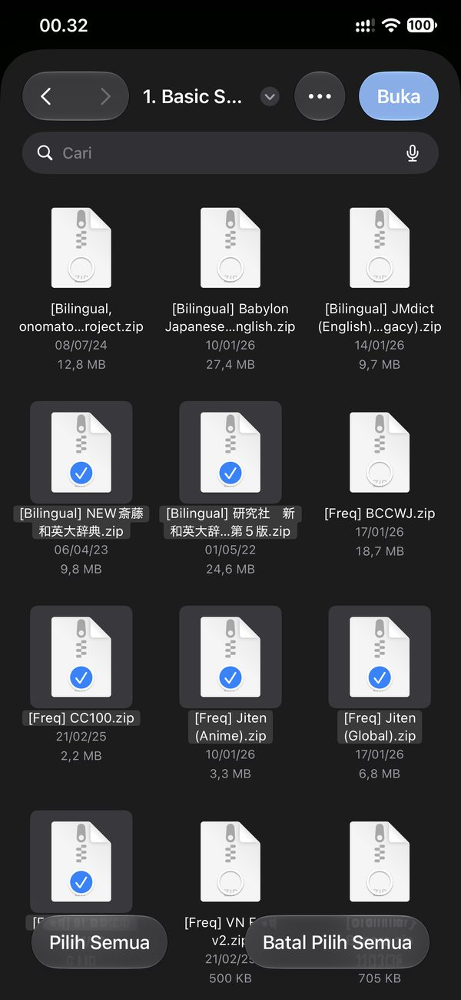{width=250}
    === "Banyak kamus (2)"
        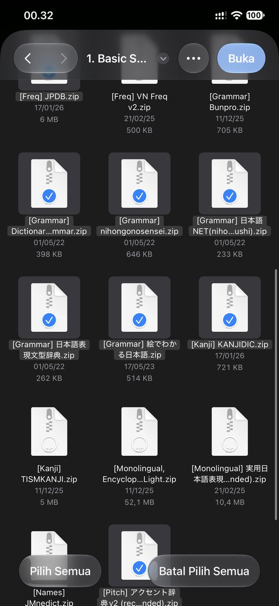{width=250}

3. Kamus yang berhasil diimpor muncul di bagian bawah, dikelompokkan per jenis: `Term`, `Frequency`, `Pitch`, dan `Kanji`. Pastikan tombol di sampingnya menyala

    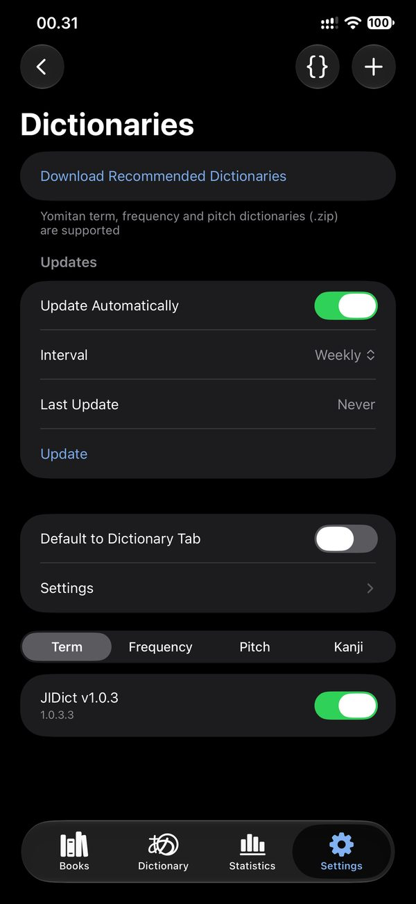{width=250}

4. Untuk kamus JP-EN, tekan `Download Recommended Dictionaries`, lalu `Download`. Hoshi Reader akan mengunduh JMdict, JMnedict, dan kamus frekuensi Jiten (sekitar 33 MB)

    === "Konfirmasi"
        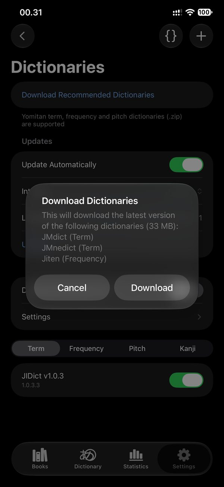{width=250}
    === "Mengunduh"
        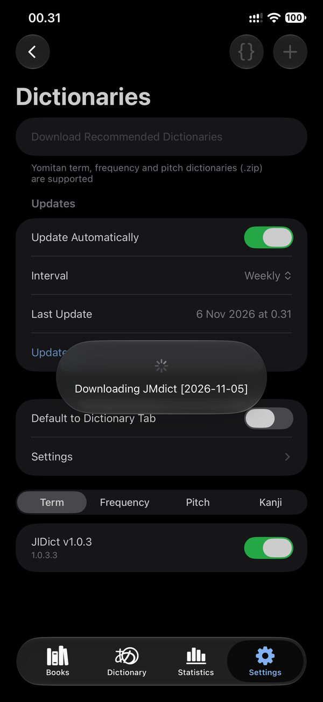{width=250}

5. Atur urutan kamus dengan menyeretnya. Kamus paling atas tampil paling dulu. Kalau ingin arti bahasa Indonesia muncul duluan, taruh JIDict di urutan pertama

Untuk menghapus kamus, geser kamusnya ke kiri. `Update Automatically` di bagian `Updates` memperbarui kamus seperti JMdict seminggu sekali.

??? info "Opsional: font urutan goresan kanji <small>(klik di sini)</small>"
    Setelah ada kamus kanji, muncul tombol `Download Stroke Order Font`. Font ini (17 MB) menampilkan urutan goresan saat kamu mencari kanji. Tekan tombolnya, lalu `Download`.

    === "Tombol"
        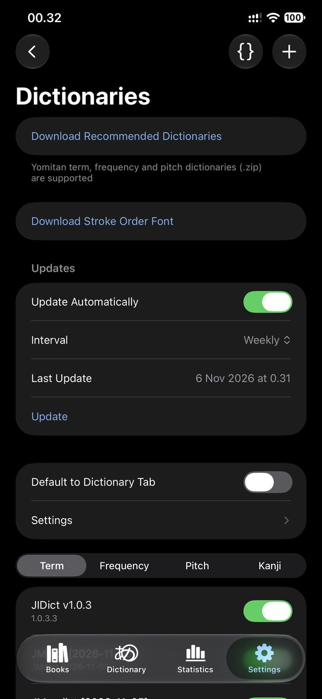{width=250}
    === "Konfirmasi"
        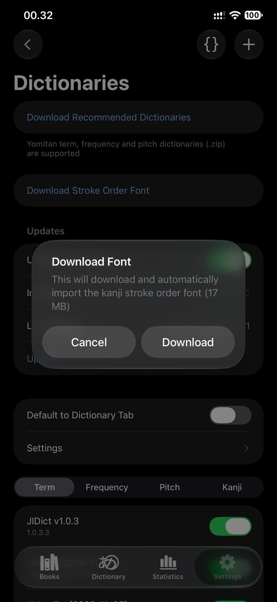{width=250}
    === "Mengunduh"
        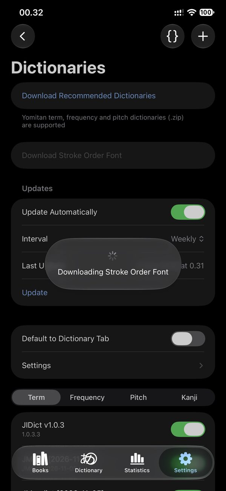{width=250}

**Cek kamus sudah jalan:** buka buku, lalu tekan salah satu kata. Kalau popup berisi artinya muncul, kamus sudah siap.

---

## **Membaca**

1. Tekan sampul buku di `Books` untuk mulai membaca
2. Tekan layar sekali untuk memunculkan tombol. Tombol kiri bawah untuk kembali ke `Books`, tombol kanan bawah untuk membuka menu
3. Dari menu kanan bawah, `Appearance` mengatur tampilan teks dan popup kamus, `Contents` membuka daftar isi, dan `Statistics` menampilkan statistik baca

=== "Pembaca"
    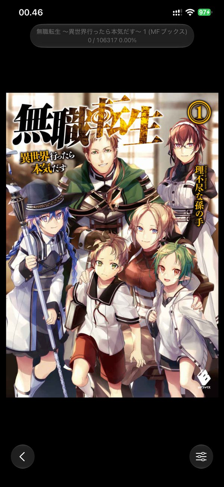{width=250}
=== "Menu"
    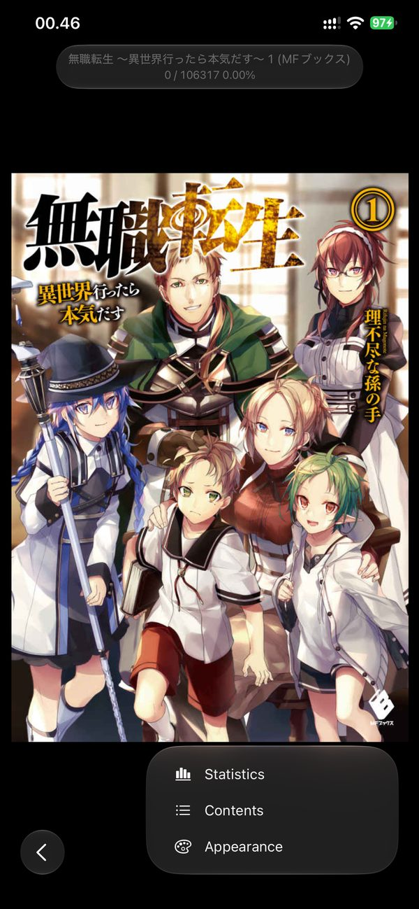{width=250}

---

## **Kartu Anki**

### **1. Sambungkan ke Anki**

Pilih sesuai cara yang kamu tentukan di [Persiapan](#persiapan).

=== "AnkiMobile"

    Tidak ada yang perlu diatur di sini. Hoshi Reader tersambung ke AnkiMobile saat kamu menekan `Fetch decks and models from Anki` di [langkah 2](#2-ambil-dek-dan-note-type).

    **Supaya kata yang sama tidak masuk dua kali**

    AnkiMobile tidak bisa dicek langsung untuk kata yang sudah ada. Sebagai gantinya, kirim backup dek ke Hoshi Reader:

    1. Di AnkiMobile, ekspor salah satu:
        - Seluruh koleksi: tekan `Add/Export` di kiri bawah > `Export Collection`
        - Satu dek saja: geser dek ke kanan, lalu tekan `Export`
    2. Hilangkan centang `Include media`, lalu tekan `Export to Share Sheet`
    3. Pilih Hoshi Reader dari daftar aplikasi

    Hoshi Reader akan memakai backup itu untuk mengecek kata yang sudah ada, dan menambahkan kata yang baru kamu mining ke daftarnya. Kalau kamu juga mining di HP atau PC lain, ulangi ekspor ini sesekali supaya datanya tetap sama.

=== "AnkiConnect (PC)"

    !!! warning "Pakai hanya di Wi-Fi rumah"
        Langkah ini membuat AnkiConnect bisa diakses semua perangkat di jaringan yang sama. Jangan lakukan di Wi-Fi umum seperti kafe atau kampus.

    **Di PC**

    1. Pastikan add-on AnkiConnect sudah terpasang (lihat [Setup Anki PC](setup-anki-pc-lazy-guide.md))
    2. Di Anki, buka `Tools` > `Add-ons`, pilih `AnkiConnect`, lalu klik `Config` di kanan bawah
    3. Ganti nilai `webBindAddress` dari `127.0.0.1` menjadi `0.0.0.0`, klik `OK`, lalu tutup dan buka lagi Anki

        === "Sebelum"
            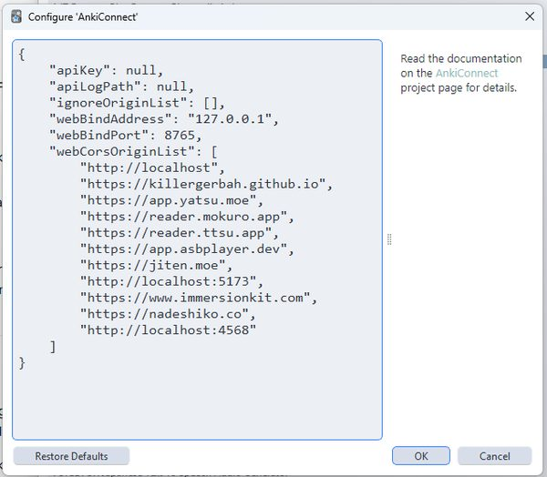{width=400}
        === "Sesudah"
            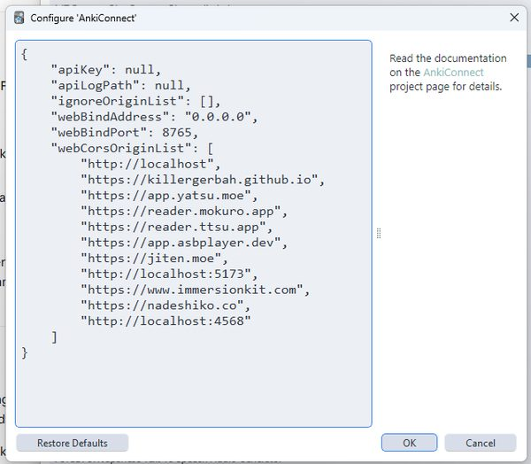{width=400}

    4. Cari alamat IPv4 PC-mu (bukan alamat router/gateway):

        === "Windows"
            `Settings` > `Network & internet` > `Wi-Fi` atau `Ethernet`, lalu gulir ke `IPv4 address`
        === "MacOS"
            `System Settings` > `Wi-Fi` > `Details` pada jaringan yang tersambung, lalu cari `IP address`

    **Di iPhone**

    1. Buka `Settings` > `Advanced` > `AnkiConnect`, lalu nyalakan `Use AnkiConnect`
    2. Di `Address`, isi `http://IP-PC-KAMU:8765`, misalnya `http://192.168.1.5:8765`. `API Key (optional)` biarkan kosong
    3. Tekan `Connect`. Saat iPhone bertanya apakah Hoshi boleh menemukan perangkat di jaringan lokal, tekan `Izinkan`, lalu tekan `Connect` lagi
    4. Kalau di PC muncul jendela Windows Defender Firewall, klik `Allow access`. Tekan `Connect` sekali lagi kalau belum tersambung
    5. Kalau berhasil, tulisan di bawahnya berubah jadi `Status: Connected`

    === "AnkiConnect"
        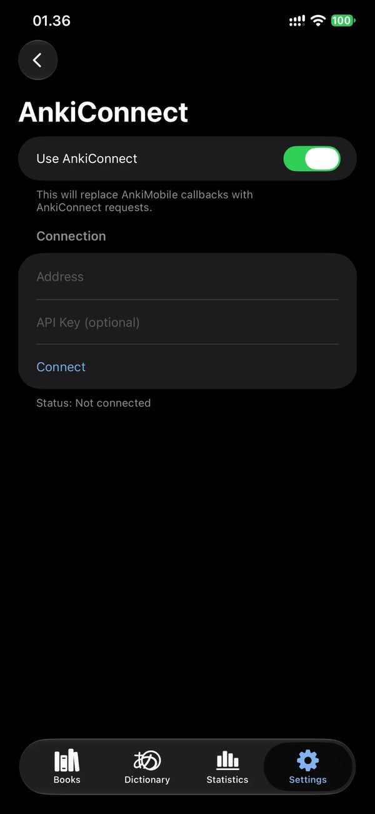{width=250}
    === "Izin jaringan"
        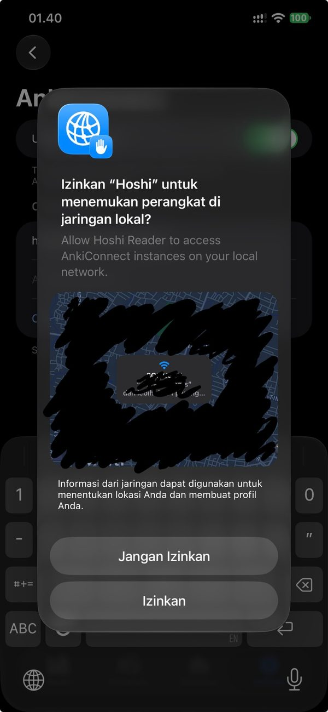{width=250}
    === "Tersambung"
        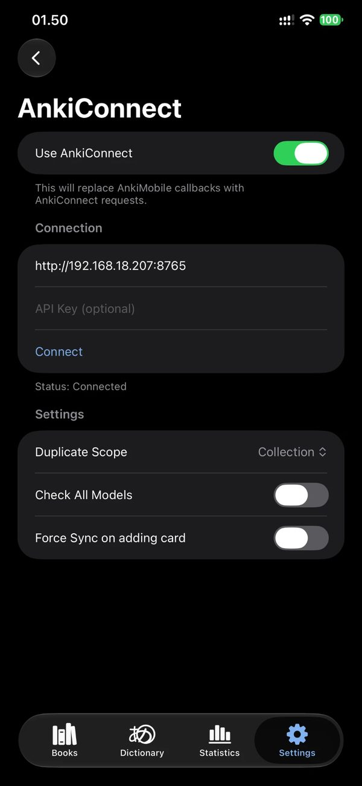{width=250}

    Setelah tersambung, muncul pengaturan tambahan:

    - `Duplicate Scope`: `Collection` mengecek kata yang sama di semua dek, `Deck` hanya di dek mining
    - `Check All Models`: nyalakan supaya kata yang sudah ada di note type lain juga dianggap dobel
    - `Force Sync on adding card`: nyalakan kalau mau Anki di PC langsung sinkron ke AnkiWeb setiap kali kartu masuk

    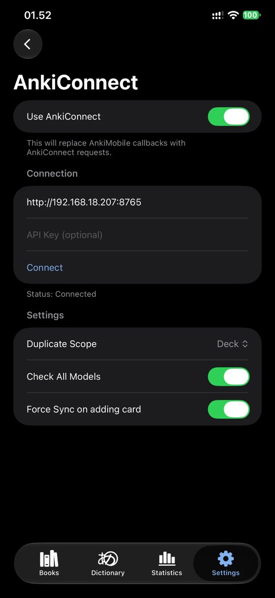{width=250}

    Dengan AnkiConnect, pengecekan kata yang sudah ada langsung jalan tanpa backup. PC harus tetap menyala dan Anki terbuka selama kamu mining.

### **2. Ambil dek dan note type**

1. Buka `Settings` > `Anki`
2. Tekan `Fetch decks and models from Anki`. Saat muncul `Fetch from Anki?`, tekan `OK`
    - **AnkiMobile:** kamu akan dibawa ke AnkiMobile. Saat ditanya apakah Hoshi Reader boleh membaca dek dan note type, tekan `OK`, lalu kamu kembali ke Hoshi Reader
    - **AnkiConnect:** di bawah tombol muncul `AnkiConnect Status: Connected`

=== "Anki"
    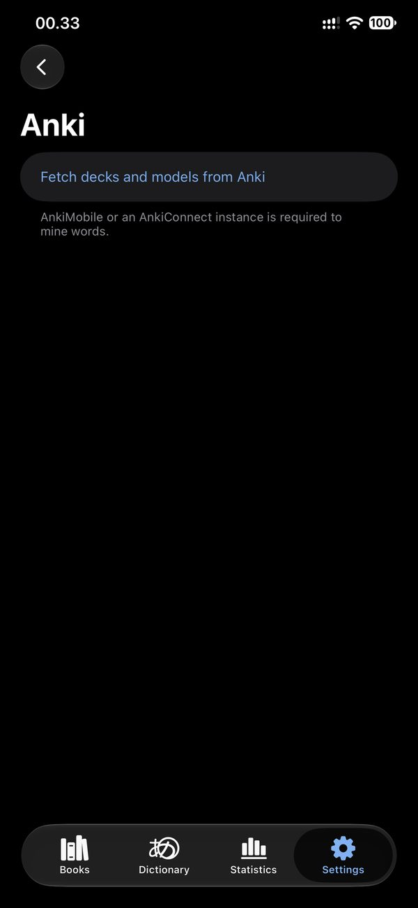{width=250}
=== "Konfirmasi"
    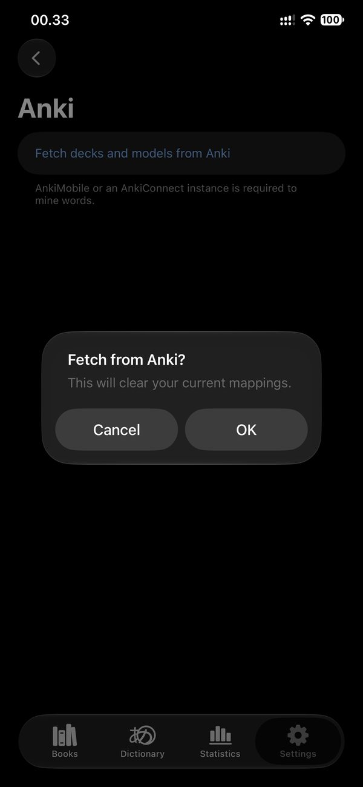{width=250}
=== "Sesudah fetch"
    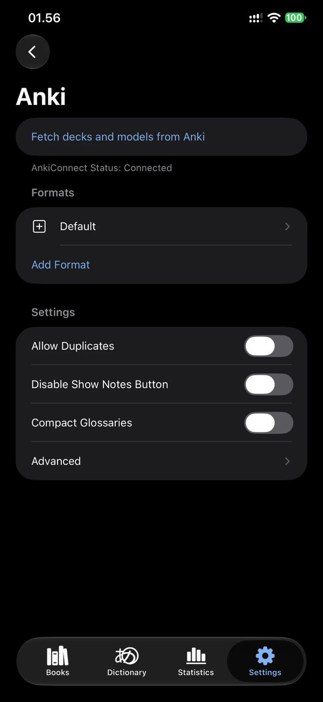{width=250}

Isian field yang sudah kamu atur akan dikosongkan setiap kali kamu menekan tombol ini.

### **3. Atur format kartu**

1. Di bagian `Formats`, tekan `Default`
2. (Opsional) Ganti namanya, misalnya `Mining`
3. Di `Deck`, pilih `Mining Deck` (atau dek lain yang kamu pakai untuk mining)
4. Di `Model`, pilih `Lapis`. Field di bawahnya langsung terisi otomatis
5. Cek dua field ini dan sesuaikan dengan kebutuhanmu:
    - `Picture` terisi `{book-cover}`, jadi sampul buku ikut masuk ke kartu. Kosongkan kalau tidak mau ada gambar
    - `SentenceAudio` masih kosong. Isi dengan `{sasayaki-audio}` kalau kamu membaca sambil memutar [audiobook](#audiobook-sasayaki), supaya potongan audio kalimatnya ikut masuk ke kartu

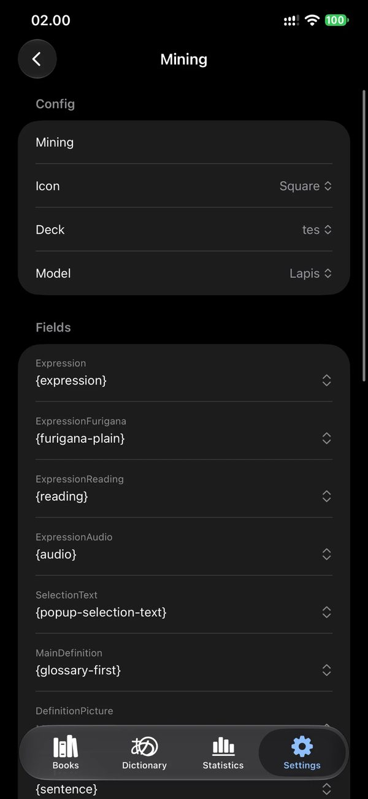{width=250}

??? info "Daftar isian field Lapis <small>(klik di sini)</small>"
    Isian otomatis untuk note type `Lapis`. Penjelasan tiap field ada di [dokumentasi Lapis](https://github.com/donkuri/lapis#how-to-use-lapis).

    | Field Lapis | Isi |
    |---|---|
    | `Expression` | `{expression}` |
    | `ExpressionFurigana` | `{furigana-plain}` |
    | `ExpressionReading` | `{reading}` |
    | `ExpressionAudio` | `{audio}` |
    | `SelectionText` | `{popup-selection-text}` |
    | `MainDefinition` | `{glossary-first}` |
    | `Sentence` | `{sentence}` |
    | `SentenceAudio` | kosong (isi `{sasayaki-audio}` kalau memakai audiobook) |
    | `Picture` | `{book-cover}` |
    | `Glossary` | `{glossary}` |
    | `PitchPosition` | `{pitch-accent-positions}` |
    | `PitchCategories` | `{pitch-accent-categories}` |
    | `Frequency` | `{frequencies}` |
    | `FreqSort` | `{frequency-harmonic-rank}` |
    | `MiscInfo` | `{document-title}` |

??? info "Opsional: kategori kamus <small>(klik di sini)</small>"
    Di `Settings` > `Anki` > `Advanced`, kamu bisa memberi kategori pada setiap kamus. Kategori ini dipakai oleh isian seperti `{bilingual-definition}` dan `{monolingual-definition}`.

    - Kamus JP-ID dan JP-EN (JIDict, JMdict, JMnedict, 新和英) pilih `Bilingual`
    - Kamus JP-JP, termasuk kamus tata bahasa berbahasa Jepang seperti 絵でわかる日本語, pilih `Monolingual`
    - Kamus yang tidak mau dimasukkan ke kartu pilih `Exclude`, misalnya kamus tata bahasa yang penjelasannya panjang seperti 日本語文法辞典 dan JLPT文法解説まとめ

    `{selected-glossary} Fallback` menentukan isian pengganti untuk `{selected-glossary}`, misalnya `{bilingual-definition}`. Nyalakan `Show All Handlebars` kalau ingin melihat semua isian yang tersedia saat mengatur field.

    === "Pilihan fallback"
        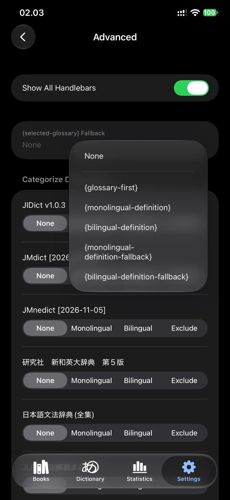{width=250}
    === "Kategori kamus"
        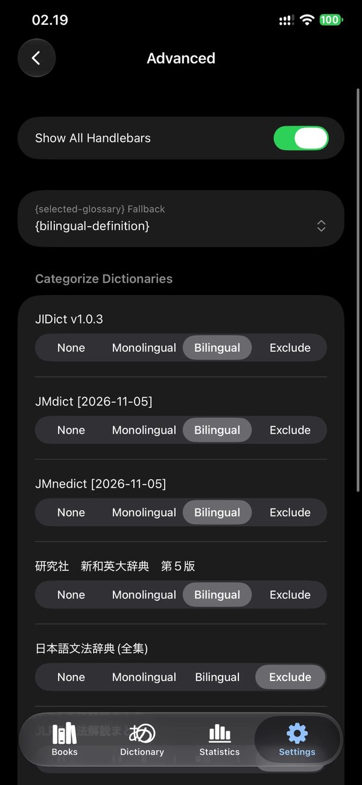{width=250}
    === "Kategori kamus (lanjutan)"
        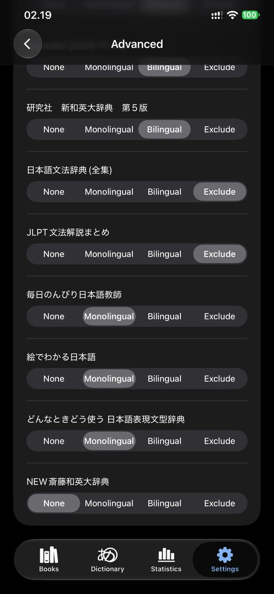{width=250}

### **Mining**

Buka buku, tekan kata yang tidak kamu tahu, lalu tekan ikon `+` di kanan atas popup kamus. Kalau memakai AnkiMobile, layar akan pindah sebentar ke AnkiMobile lalu kembali ke Hoshi Reader.

Setelah kartu masuk, ikon di popup berubah dan muncul ikon kaca pembesar untuk membuka kartu itu di Anki.

=== "Sebelum"
    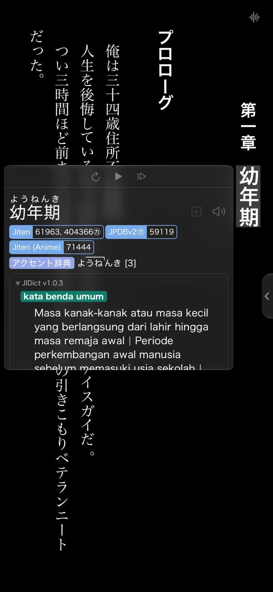{width=250}
=== "Sesudah"
    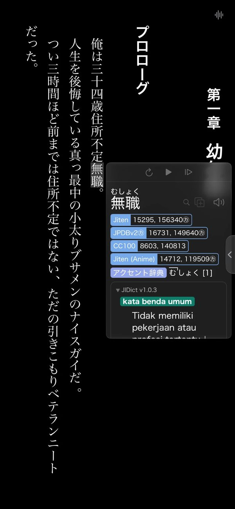{width=250}

Hasilnya di Anki:

=== "Dengan sampul buku"
    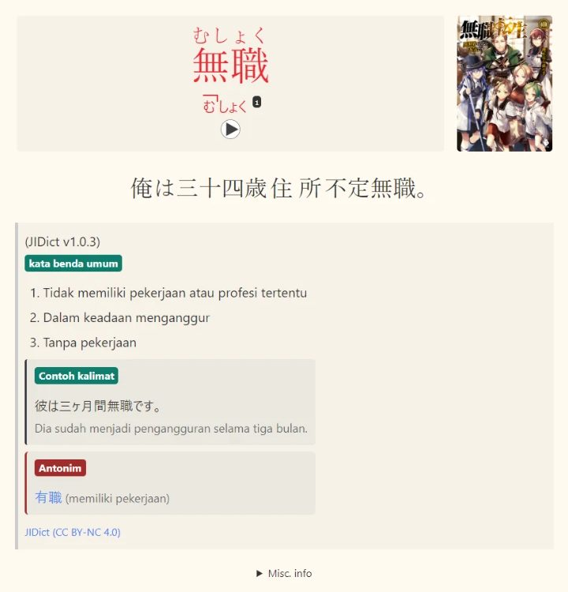{width=400}
=== "Dengan audio kalimat"
    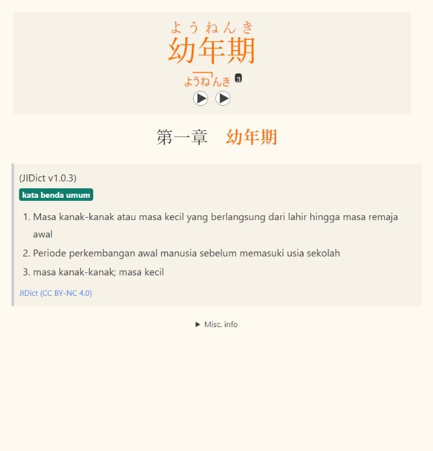{width=400}

Kartu pertama memakai `Picture` = `{book-cover}`. Kartu kedua mengosongkan `Picture` dan mengisi `SentenceAudio` = `{sasayaki-audio}`, jadi ada dua tombol putar: audio kata dan audio kalimat.

Popup kamus juga menampilkan frekuensi kata dan tombol audio pengucapan. Kalau [audio lokal](#audio-lokal) sudah terpasang, kamu bisa memilih rekaman dari beberapa sumber.

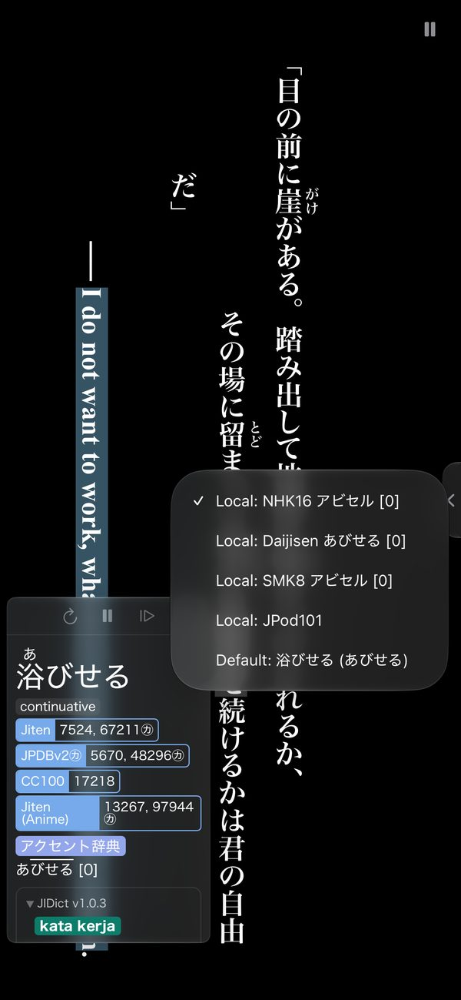{width=250}

---

## **Audio Lokal**

Tanpa audio lokal, audio pengucapan diambil dari internet. Dengan audio lokal, audio tetap ada walaupun sedang offline.

!!! warning "Butuh ruang kosong sekitar 13 GB saat impor"
    File `android.db` sendiri sekitar 6,2 GB, tapi selama proses impor dibutuhkan ruang kosong sekitar 13 GB.

1. Unduh [android.db](https://drive.google.com/file/d/1Fn11_nN04zM89yKFYBWVTi0Xpaf6I3qe/view) ke iPhone. Nama filenya memang "android", tapi file yang sama dipakai untuk iPhone
2. Buka `Settings` > `Advanced` > `Audio`

    === "Advanced"
        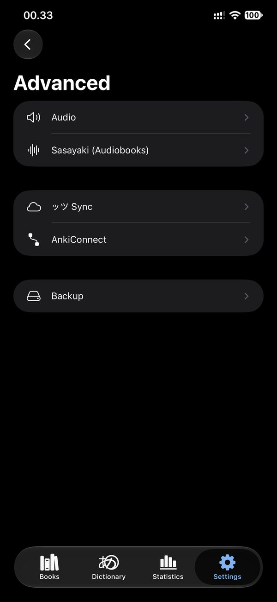{width=250}
    === "Audio"
        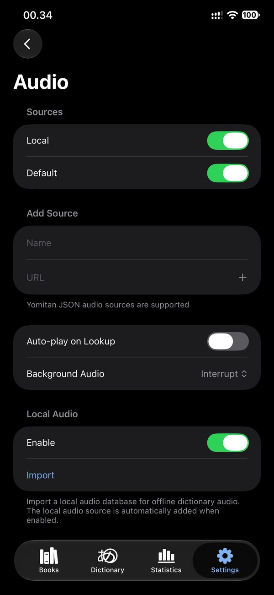{width=250}

3. Gulir ke bagian `Local Audio`, lalu nyalakan `Enable`
4. Tekan `Import`, lalu pilih file `android.db`

    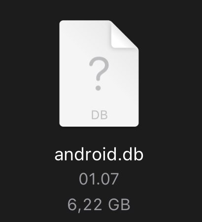{width=200}

5. Kalau impor berhasil, muncul tombol merah `Delete android.db (6,22 GB)`. **Jangan** tekan tombol ini, karena tombol ini menghapus audio yang sudah diimpor

    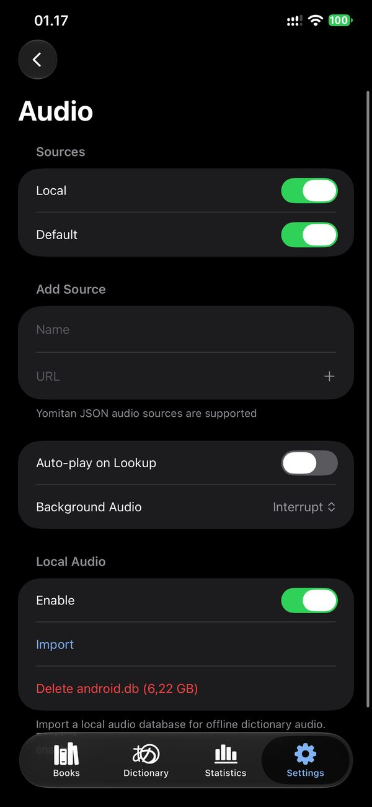{width=250}

6. Hapus `android.db` dari folder unduhan lewat aplikasi `Files` untuk mengosongkan ruang. Hoshi Reader sudah menyimpan salinannya sendiri

Hoshi Reader akan menambahkan sumber audio `Local` dan memakainya lebih dulu dibanding sumber lain.

---

## **Audiobook (Sasayaki)**

Sasayaki memutar audiobook sambil menandai kalimat yang sedang dibacakan. Bagian ini opsional.

**Yang dibutuhkan:** file audiobook (`.mp3` atau `.m4b`) dan subtitle `.srt` untuk buku yang sama. Subtitle-nya dibuat dengan [SubPlz](https://github.com/kanjieater/SubPlz).

**Nyalakan Sasayaki**

1. Buka `Settings` > `Advanced` > `Sasayaki (Audiobooks)`, lalu nyalakan `Enable`
2. (Opsional) Nyalakan `Show Sasayaki Toggle` untuk menampilkan tombol Sasayaki di dalam pembaca

=== "Mati"
    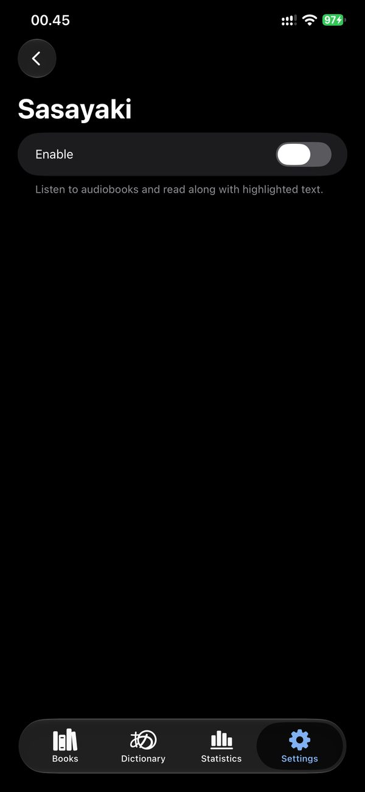{width=250}
=== "Nyala"
    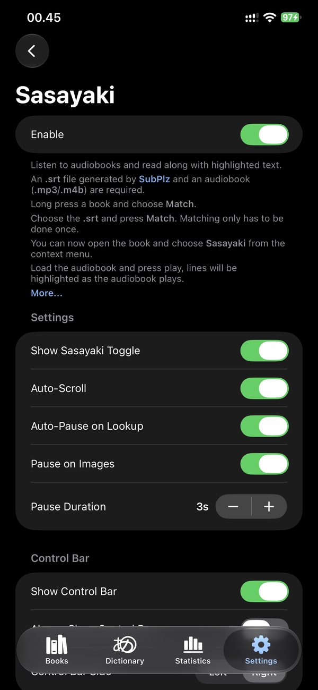{width=250}
=== "Pengaturan lain"
    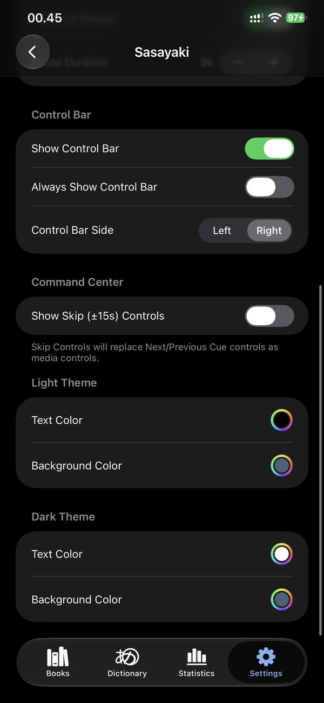{width=250}

**Cocokkan subtitle dengan buku** (cukup sekali per buku)

1. Di `Books`, tekan lama sampul buku, lalu pilih `Match`
2. Tekan `Open`, lalu pilih file `.srt`-nya
3. Tekan `Match`. Kalau `Match Rate` sudah mendekati 100%, tekan `Done`

=== "Tekan lama"
    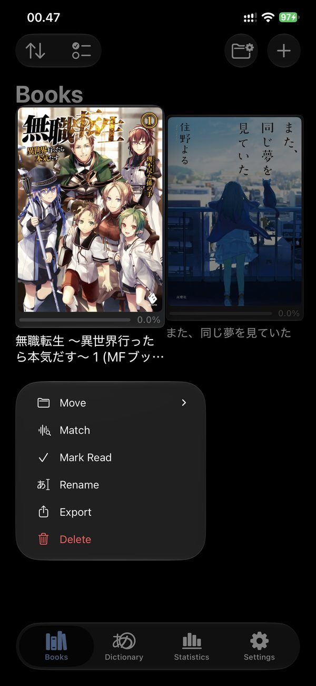{width=250}
=== "Match"
    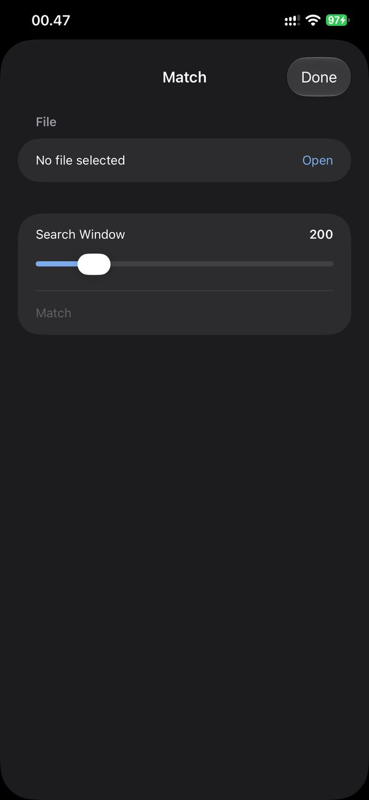{width=250}
=== "Hasil"
    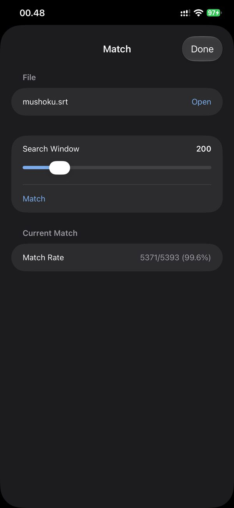{width=250}

**Putar audiobook**

1. Buka bukunya, tekan menu kanan bawah, lalu pilih `Sasayaki`
2. Tekan `Load Audio`, lalu pilih file audiobook-nya
3. Tekan tombol putar. Kalimat yang sedang dibacakan akan ditandai, dan halaman bergeser sendiri

=== "Menu"
    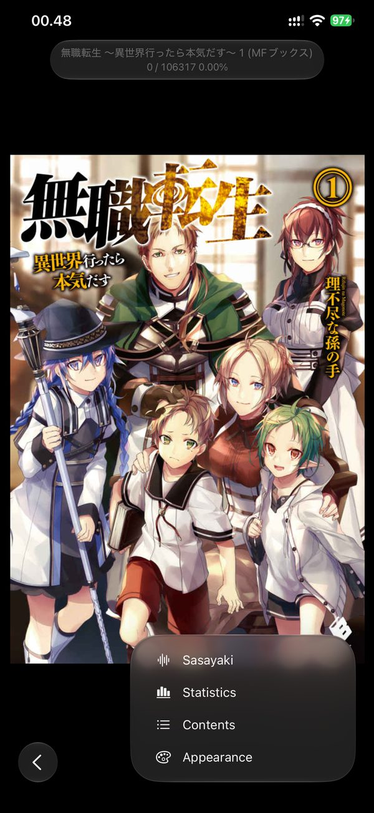{width=250}
=== "Load Audio"
    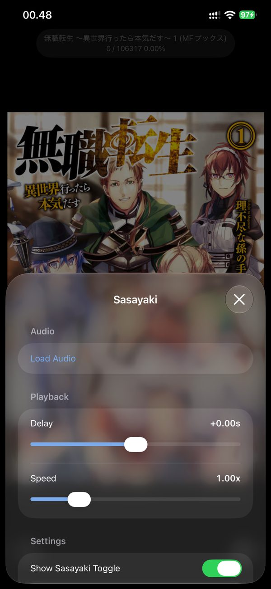{width=250}
=== "Pilih file"
    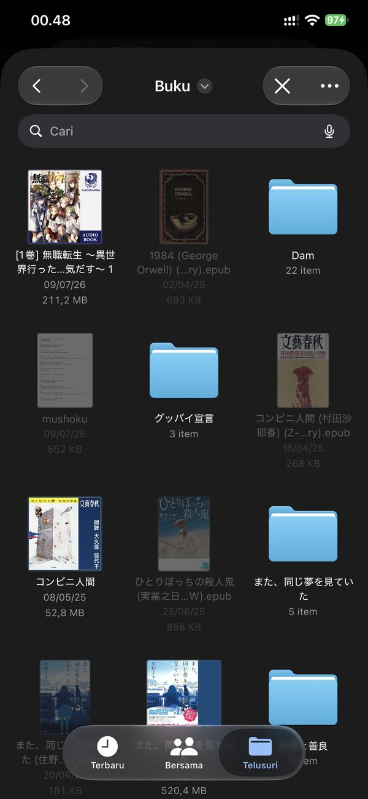{width=250}
=== "Putar"
    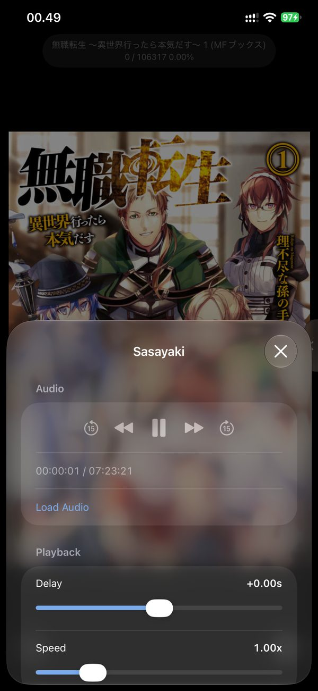{width=250}
=== "Kalimat ditandai"
    {width=250}

Kalau audio dan tulisan tidak pas, geser `Delay` di panel Sasayaki.

**Audio kalimat di kartu Anki:** isi field `SentenceAudio` dengan `{sasayaki-audio}` (lihat [Atur format kartu](#3-atur-format-kartu)). Saat kamu mining dari buku yang audiobook-nya sedang dimuat, potongan audio kalimat itu ikut masuk ke kartu.

---

## **Tips**

- **Buka langsung ke kamus.** Nyalakan `Default to Dictionary Tab` di `Settings` > `Dictionaries` kalau kamu lebih sering memakai Hoshi Reader sebagai kamus daripada untuk membaca
- **Rapikan rak buku.** Ikon folder di kanan atas `Books` dipakai untuk membuat rak, misalnya "Sedang dibaca", "Selesai", atau "Nanti"
- **Pantau kebiasaan membaca.** Menu `Statistics` di dalam pembaca dan tab `Statistics` di bawah menampilkan jumlah karakter dan waktu baca
- **Cadangkan data.** `Settings` > `Advanced` > `Backup` menyimpan buku dan kamus, berguna sebelum ganti HP

---

## **Pertanyaan Umum**

#### Pertanyaan 1: Kamus apa saja yang sebaiknya dipasang?

??? question "Kamus apa saja yang sebaiknya dipasang? <small>(klik di sini)</small>"

    - Untuk mulai, cukup JIDict ditambah kamus dari `Download Recommended Dictionaries` (JMdict, JMnedict, dan Jiten)
    - Kalau sudah lebih lancar membaca bahasa Jepang, tambahkan kamus monolingual (JP-JP) sedikit demi sedikit
    - Daftar kamus lain ada di [Setup Yomitan dan Anki PC](setup-yomitan-pc.md#kamus). Semua kamus format Yomitan (`.zip`) bisa dipakai di Hoshi Reader
    - Jangan pasang terlalu banyak kamus sekaligus. Popup jadi panjang dan arti yang kamu cari tertimbun di bawah

#### Pertanyaan 2: Angka di popup kamus itu apa?

??? question "Angka di popup kamus itu apa? <small>(klik di sini)</small>"

    Angka itu dari kamus frekuensi (misalnya Jiten, JPDB, dan CC100). Makin kecil angkanya, makin sering kata itu dipakai, jadi makin penting untuk dipelajari duluan. Penjelasan lengkapnya ada di [Rekomendasi Kamus Frekuensi](Setup-Manatan.md#rekomendasi-kamus-frekuensi).

#### Pertanyaan 3: Lebih baik pakai AnkiMobile atau AnkiConnect?

??? question "Lebih baik pakai AnkiMobile atau AnkiConnect? <small>(klik di sini)</small>"

    - **AnkiMobile** cocok kalau kamu sering membaca di luar rumah. Kekurangannya, aplikasinya berbayar dan pengecekan kata dobel butuh backup dek yang diperbarui sesekali
    - **AnkiConnect** gratis dan pengecekan kata dobelnya langsung jalan, tapi PC harus menyala dengan Anki terbuka, dan iPhone harus tersambung ke Wi-Fi yang sama

#### Pertanyaan 4: Apakah kartu dari iPhone bisa diulas di PC atau Android?

??? question "Apakah kartu dari iPhone bisa diulas di PC atau Android? <small>(klik di sini)</small>"

    Bisa. Kartu masuk ke koleksi Anki biasa, jadi ikut tersinkron lewat AnkiWeb ke semua perangkat yang memakai akun yang sama. Kalau memakai AnkiConnect, nyalakan `Force Sync on adding card` supaya Anki di PC langsung sinkron setiap kali ada kartu baru.

#### Pertanyaan 5: Apakah audio lokal wajib?

??? question "Apakah audio lokal wajib? <small>(klik di sini)</small>"

    Tidak wajib, tapi **sangat disarankan**. Pengembang Hoshi Reader sendiri tidak menyarankan memakai sumber audio bawaan (`Default`). Sebagian kata tidak punya audio di sumber itu, misalnya ばらばら, jadi kartu Anki-nya juga masuk tanpa audio. Pasang [audio lokal](#audio-lokal) supaya audio pengucapannya lebih lengkap, dan bisa dipakai walaupun sedang offline.

#### Pertanyaan 6: Bisa lanjut baca di PC?

??? question "Bisa lanjut baca di PC? <small>(klik di sini)</small>"

    Hoshi Reader punya `ッツ Sync` di `Settings` > `Advanced` untuk menyinkronkan posisi baca dengan ッツ Reader lewat Google Drive. Pengaturannya butuh membuat kunci akses Google Cloud sendiri, jadi langkahnya belum dibahas di sini.

---

## **Masalah Umum**

#### Masalah 1: Popup kamus kosong

??? warning "Popup kamus kosong <small>(klik di sini)</small>"
    - Buka `Settings` > `Dictionaries`, lalu cek tab `Term`. Pastikan ada kamus di sana dan tombolnya menyala
    - Kamus frekuensi dan pitch saja tidak cukup. Harus ada minimal satu kamus `Term` seperti JIDict atau JMdict

#### Masalah 2: AnkiConnect tidak tersambung

??? warning "Status AnkiConnect tetap Not connected <small>(klik di sini)</small>"
    - Pastikan Anki di PC sedang terbuka, dan iPhone serta PC tersambung ke Wi-Fi yang sama
    - Cek lagi alamat IPv4 PC. Alamat ini bisa berubah setelah router atau PC dinyalakan ulang
    - Pastikan `webBindAddress` sudah `0.0.0.0` dan Anki sudah ditutup lalu dibuka lagi
    - Kalau tadi menekan `Jangan Izinkan`, buka Pengaturan iPhone > `Privasi & Keamanan` > `Jaringan Lokal`, lalu nyalakan Hoshi
    - Di Windows, cek apakah Anki diblokir Windows Defender Firewall

#### Masalah 3: Kartu masuk tanpa gambar atau audio kalimat

??? warning "Kartu masuk tanpa gambar atau audio kalimat <small>(klik di sini)</small>"
    - Cek field `Picture` dan `SentenceAudio` di format kartu (lihat [Atur format kartu](#3-atur-format-kartu))
    - Menekan `Fetch decks and models from Anki` mengosongkan isian field. Kalau baru saja menekannya, atur ulang formatnya
    - `{sasayaki-audio}` hanya terisi kalau audiobook untuk buku itu sedang dimuat di Sasayaki

#### Masalah 4: Kata tidak bisa ditambahkan karena dianggap dobel

??? warning "Kata tidak bisa ditambahkan karena dianggap dobel <small>(klik di sini)</small>"
    - Artinya kata itu sudah ada di Anki. Ini disengaja supaya tidak ada kartu ganda
    - Kalau tetap mau menambahkan, nyalakan `Allow Duplicates` di `Settings` > `Anki`
    - Dengan AnkiConnect, `Duplicate Scope` menentukan tempat pengecekan: `Collection` untuk semua dek, `Deck` hanya untuk dek mining

#### Masalah 5: Impor audio lokal gagal

??? warning "Impor audio lokal gagal <small>(klik di sini)</small>"
    - Pastikan ruang kosong di iPhone sekitar 13 GB sebelum impor
    - Pastikan file `android.db` sudah selesai diunduh. Ukurannya sekitar 6,2 GB

#### Masalah 6: Match Rate Sasayaki rendah

??? warning "Match Rate Sasayaki rendah <small>(klik di sini)</small>"
    - Pastikan file `.srt` dibuat untuk buku dan edisi yang sama dengan EPUB-nya
    - Audiobook versi ringkas atau yang babnya berbeda akan menurunkan Match Rate
    - Coba geser `Search Window` di layar `Match`, lalu tekan `Match` lagi

#### Masalah 7: Furigana tetap tersorot setelah memilih kata

??? warning "Furigana tetap tersorot setelah memilih kata <small>(klik di sini)</small>"
    Kadang saat kamu memilih kata yang punya furigana, furigananya tetap tersorot walaupun kata itu sudah tidak dipilih. Ini masalah dari mesin tampilan iOS (WebKit), dan menurut pengembangnya belum bisa diperbaiki. Sorotan itu hilang sendiri setelah kamu membalik halaman, dan tidak memengaruhi kamus atau kartu Anki.
