# Setup Hoshi Reader (Android)
---

 Diunggah: 6 November 2026 · Diperbarui: 10 November 2026 – `Yaaacha`

---

!!! warning "Draft"
    Halaman ini masih draft dan belum masuk menu. Screenshot diambil dari Hoshi Reader Android v1.5.0. Popup kamus dan pembuatan kartu belum ada screenshot-nya, jadi letak tombolnya bisa sedikit berbeda.

??? info "Info: tentang Hoshi Reader <small>(klik di sini)</small>"

    Hoshi Reader adalah aplikasi untuk membaca light novel dan buku EPUB sambil mencari kata dengan kamus popup, lalu mengirim katanya jadi kartu di AnkiDroid. Semuanya dalam satu aplikasi, tanpa perlu browser, Yomitan, atau AnkiConnect Android.

    Di Philia Space, Hoshi Reader dipakai untuk **light novel dan buku** di HP. Untuk anime dan manga, pakai [Chimahon](Setup-Chimahon.md).

    Hoshi Reader aslinya aplikasi iPhone. Versi Android ini dibuat ulang oleh komunitas dan isinya sudah setara dengan versi iPhone. Aplikasinya masih berbahasa Inggris, jadi nama tombol ditulis persis seperti yang muncul di layar.

??? info "Pakai iPhone atau iPad? <small>(klik di sini)</small>"

    Ikuti [Setup Hoshi Reader (iOS)](Setup-Hoshi-Reader-iOS.md). Cara membuat kartu Anki di iPhone berbeda dengan Android.

---

## **Persiapan**

1. Unduh APK Hoshi Reader dari [rilis terbaru di GitHub](https://github.com/HuangAntimony/Hoshi-Reader-Android/releases/latest). Buka bagian `Assets` kalau daftar filenya belum terlihat

    | File | Untuk |
    |---|---|
    | `Hoshi-Reader-v…-arm64-v8a.apk` | Hampir semua HP sekarang. Pilih ini kalau ragu |
    | `Hoshi-Reader-v…-armeabi-v7a.apk` | HP lama (32-bit) |

    Hoshi Reader butuh Android 8.0 ke atas.

2. Pasang [AnkiDroid](https://play.google.com/store/apps/details?id=com.ichi2.anki) dari Play Store
3. Siapkan dek dan note type Lapis di AnkiDroid. Ikuti [Setup Anki PC](setup-anki-pc-lazy-guide.md) di komputer, lalu masuk ke akun AnkiWeb yang sama di AnkiDroid dan tekan sinkron. `Mining Deck` dan note type `Lapis` akan ikut masuk ke HP
    - Kalau tidak punya PC, unduh [`Lapis.apkg`](https://github.com/donkuri/lapis/releases/latest) di HP, lalu buka filenya dengan AnkiDroid untuk mengimpornya
4. Unduh kamus format Yomitan (`.zip`) ke HP. Kamus yang sama dengan panduan lain bisa langsung dipakai
    - Kamus JP-ID
        - [JIDict](https://github.com/philiaspaceai/JIDict-yomitan#pemasangan)
        - [RH Dict](https://discord.com/channels/1370274344571240552/1544821080148025484/1544821080148025484) (di Discord Philia Space)
    - Kamus JP-EN bisa diunduh langsung dari dalam Hoshi Reader (lihat [Kamus](#kamus))
5. Siapkan file EPUB light novel di HP

---

## **Pasang**

1. Buka file APK yang tadi diunduh
2. Kalau muncul peringatan aplikasi dari sumber tidak dikenal, tekan `Settings`, nyalakan izin untuk browser atau file manager yang kamu pakai, lalu kembali dan tekan `Install`
3. Buka Hoshi Reader. Menu utamanya ada di bawah: `Books`, `Dictionary`, `Statistics`, dan `Settings`

=== "Books"
    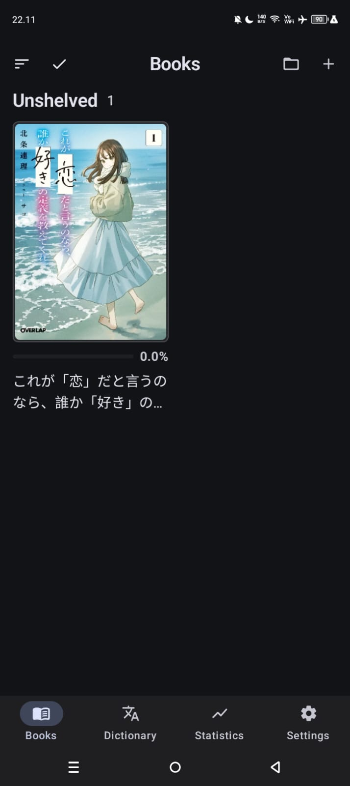{width=250}
=== "Settings"
    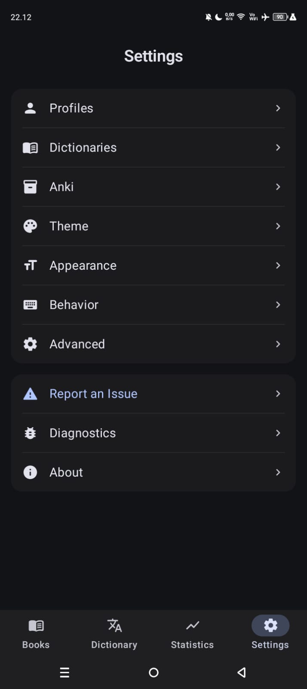{width=250}

---

## **Kamus**

1. Buka `Settings` > `Dictionaries`
2. Tekan ikon `+` di kanan atas, lalu pilih file `.zip` kamus. File `.zip` **tidak perlu diekstrak**
3. Untuk kamus JP-EN, tekan `Download Recommended Dictionaries`, lalu pilih kamus dari daftar. Hoshi Reader akan mengunduh dan memasangnya sendiri
4. Atur urutan kamus. Kamus paling atas tampil paling dulu. Kalau ingin arti bahasa Indonesia muncul duluan, taruh JIDict di urutan pertama

    Kamus dikelompokkan per jenis lewat tab `Term`, `Frequency`, `Pitch`, dan `Kanji`.

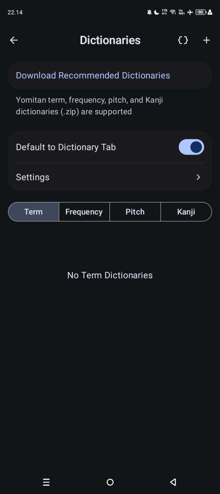{width=250}

!!! tip "HP dengan RAM kecil"
    Kalau RAM HP-mu di bawah 3 GB dan impor kamus gagal atau aplikasinya tertutup sendiri, buka `Settings` di halaman `Dictionaries`, nyalakan `Low Memory Usage Mode`, lalu impor ulang.

    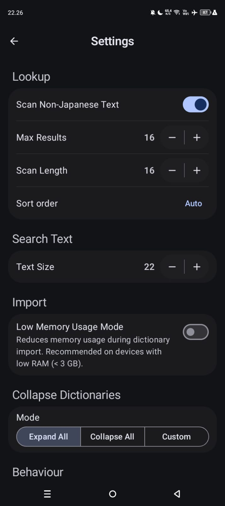{width=250}

**Cek kamus sudah jalan:** buka tab `Dictionary`, ketik kata Jepang di kolom `Search`, lalu lihat apakah artinya muncul.

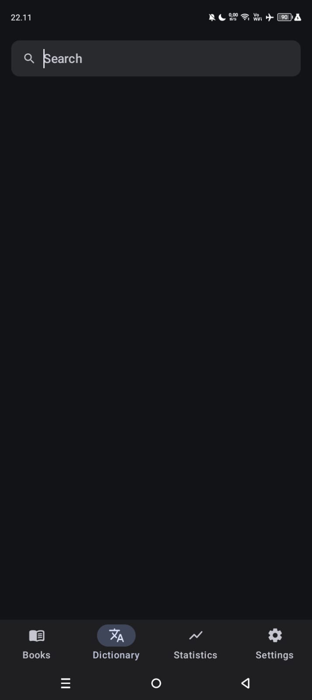{width=250}

---

## **Kartu Anki**

Pastikan AnkiDroid sudah terpasang dan pernah dibuka sekali.

1. Buka `Settings` > `Anki`
2. Pastikan pilihan di kiri atas adalah `AnkiDroid`, lalu tekan `Fetch` untuk mengambil daftar dek dan note type. Saat AnkiDroid meminta izin, tekan izinkan
3. Tekan format kartu `Default`, lalu pilih `Mining Deck` (atau dek lain yang kamu pakai untuk mining) sebagai dek dan `Lapis` sebagai note type
4. Pastikan field Lapis sudah terisi. Untuk note type bernama `Lapis`, Hoshi Reader mengisinya otomatis
5. (Opsional) Nyalakan `Sync AnkiDroid after adding card` kalau mau kartu baru langsung tersinkron ke AnkiWeb

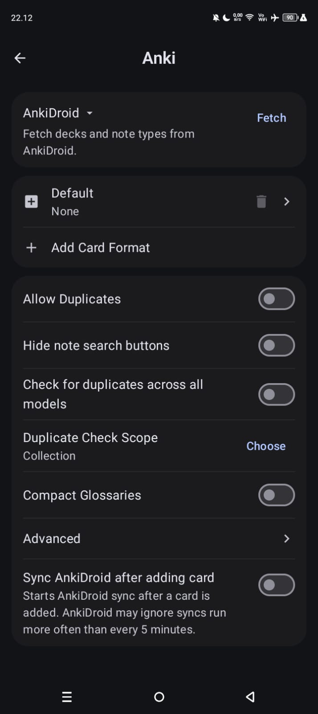{width=250}

!!! warning "Biarkan `Use AnkiConnect` mati"
    Hoshi Reader membuat kartu langsung lewat AnkiDroid, jadi AnkiConnect Android tidak dibutuhkan. Kalau `Use AnkiConnect` (di `Settings` > `Advanced`) dinyalakan tanpa diatur dengan benar, dek dan note type tidak bisa dimuat.

---

## **Membaca dan Mining**

1. Buka tab `Books`, tekan `+` di kanan atas, lalu pilih `Import files` dan pilih file EPUB-nya. Untuk banyak buku sekaligus, pakai `Import folder`
2. Tekan sampul buku untuk mulai membaca
3. Tekan kata yang tidak kamu tahu untuk membuka popup kamus. Kata di dalam arti kamus juga bisa ditekan untuk dicari lagi
4. Tekan tombol tambah kartu di popup untuk mengirim kata ke Anki. Kalimat tempat kata itu muncul ikut masuk ke kartu

=== "Impor"
    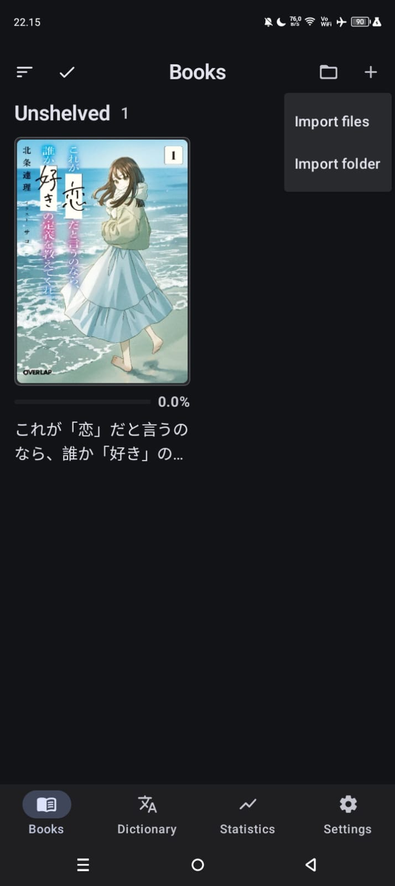{width=250}
=== "Menu Pembaca"
    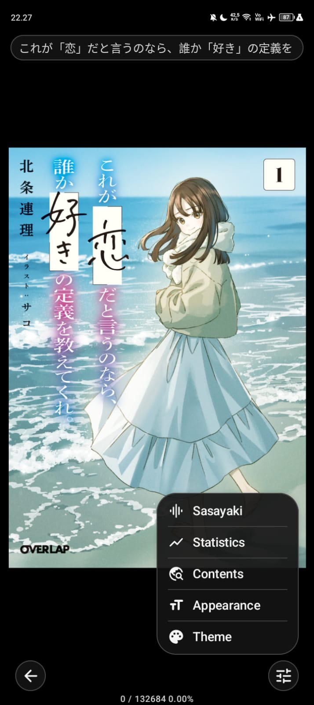{width=250}

Saat membaca, tombol di kanan bawah membuka menu `Sasayaki` (audiobook), `Statistics`, `Contents` (daftar isi, highlight, galeri gambar, dan pencarian), `Appearance`, dan `Theme`. Tombol di kiri bawah untuk kembali ke daftar buku.

Tampilan teks (vertikal atau horizontal, ukuran, font) dan ukuran popup kamus diatur di `Appearance`, tema warna di `Theme`. Keduanya juga ada di tab `Settings`. Kalau mau membalik halaman dengan tombol volume, nyalakan `Volume Keys Turn Pages` di `Settings` > `Behavior`.

??? info "Isi menu Contents <small>(klik di sini)</small>"

    `Contents` berisi daftar bab (`Chapters`), kata atau kalimat yang kamu tandai (`Highlights`), semua gambar di buku (`Gallery`), dan pencarian teks (`Search`). Tekan bab untuk melompat ke sana, atau `Jump` untuk melompat ke posisi tertentu.

    === "Chapters"
        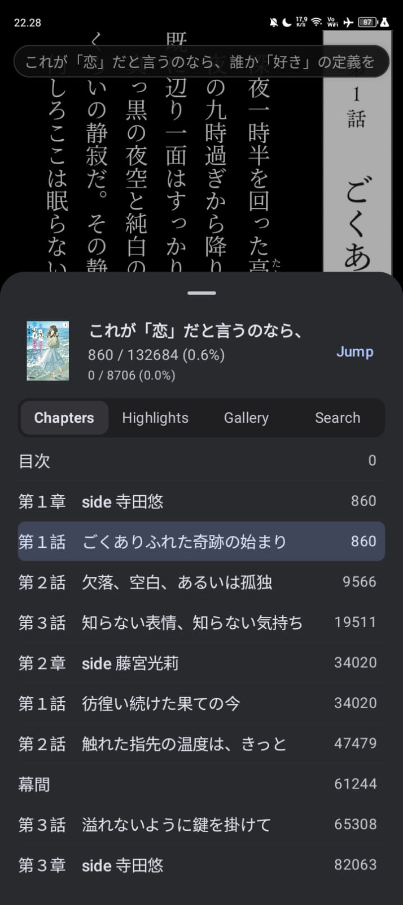{width=250}
    === "Highlights"
        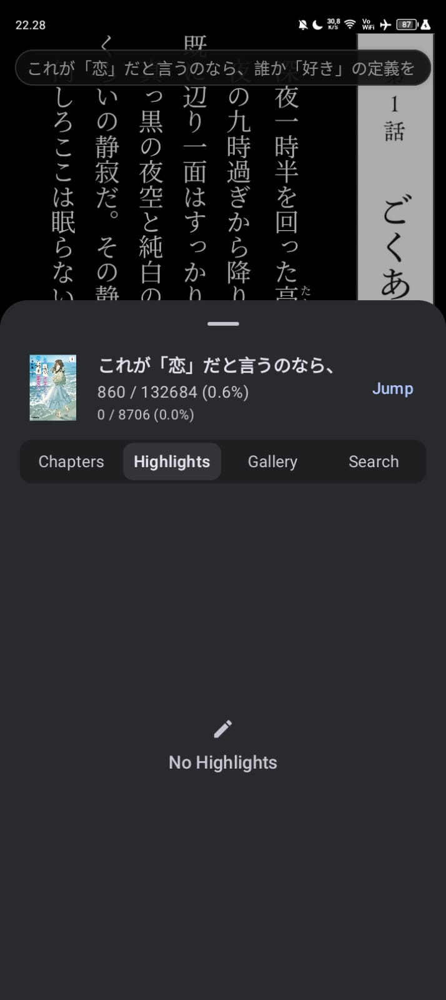{width=250}
    === "Gallery"
        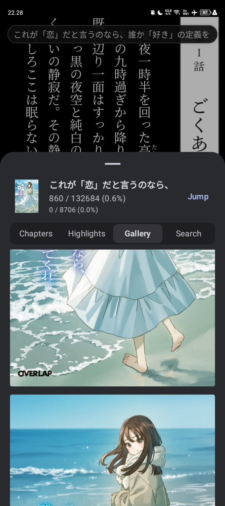{width=250}

??? info "Mengelola buku: rak, urutan, ganti nama, hapus <small>(klik di sini)</small>"

    Tekan lama sampul buku untuk membuka menunya: `Move` (pindah ke rak), `Profile`, `Rename`, `Mark` (tandai sudah atau belum dibaca), `Export EPUB`, dan `Delete`. Ikon folder di kanan atas tab `Books` untuk membuat dan mengatur rak, ikon garis di kiri atas untuk mengurutkan buku.

    === "Menu Buku"
        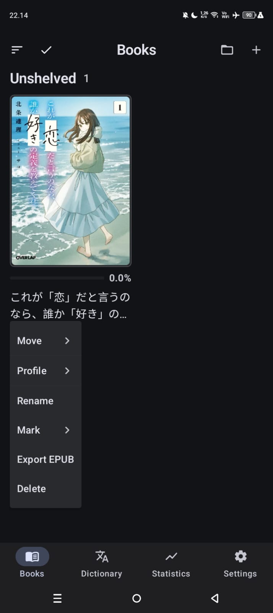{width=250}
    === "Move"
        {width=250}
    === "Profile"
        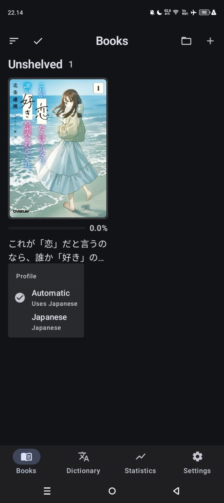{width=250}
    === "Rename"
        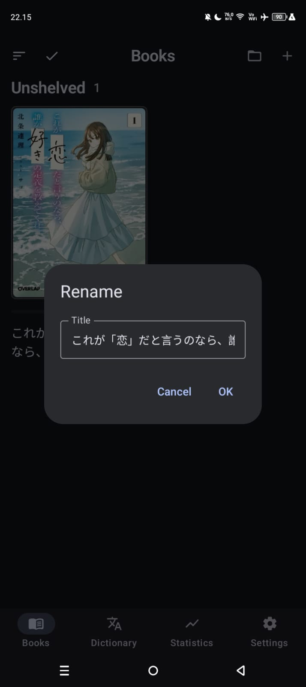{width=250}
    === "Mark"
        {width=250}
    === "Delete"
        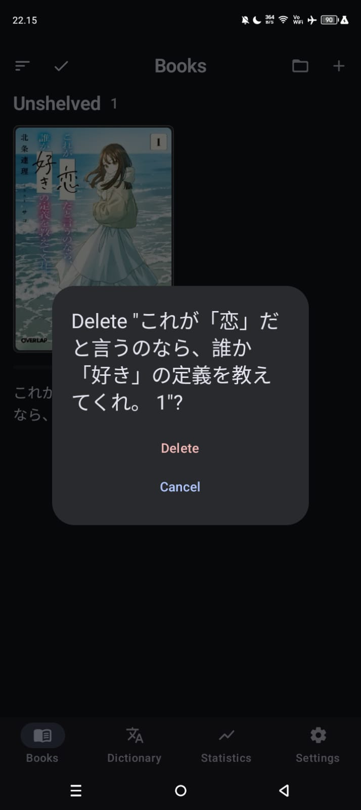{width=250}
    === "Rak"
        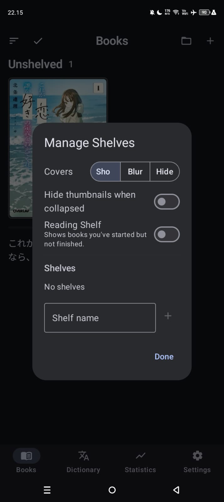{width=250}
    === "Urutkan"
        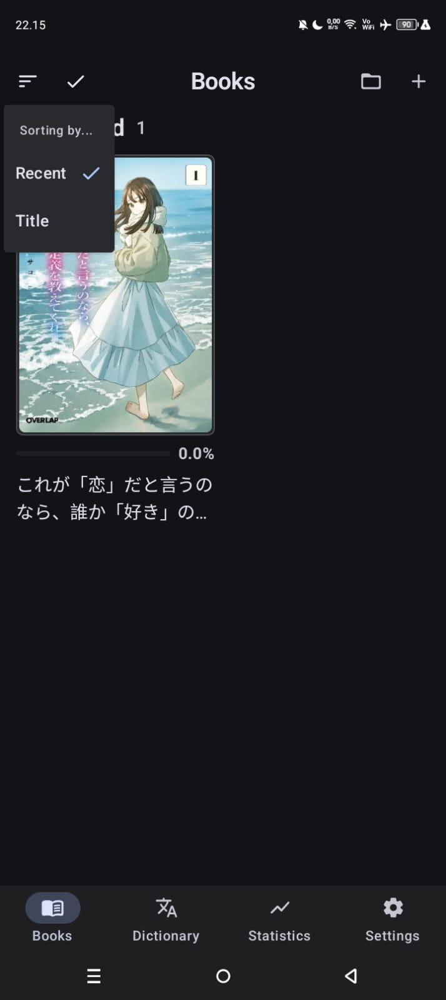{width=250}

??? info "Pengaturan tampilan dan perilaku <small>(klik di sini)</small>"

    - `Appearance`: arah teks (`Vertical` atau `Horizontal`), font, ukuran huruf, furigana, mode halaman (`Paginated` atau `Continuous`), progres yang ditampilkan, dan ukuran popup kamus
    - `Theme`: tema terang atau gelap, ikut sistem, dan warna aksen
    - `Behavior`: tombol volume untuk membalik halaman atau mengatur audiobook, layar tetap menyala, dan buka buku terakhir saat aplikasi dibuka

    === "Appearance 1"
        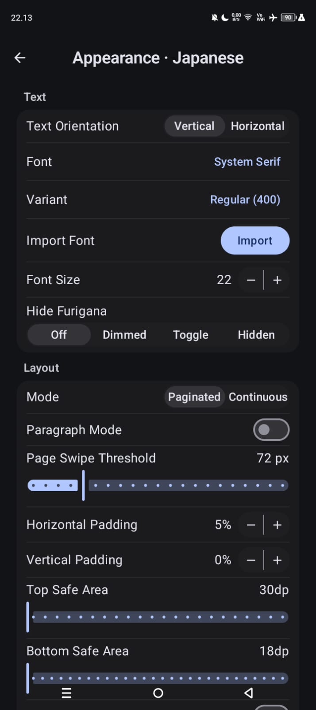{width=250}
    === "Appearance 2"
        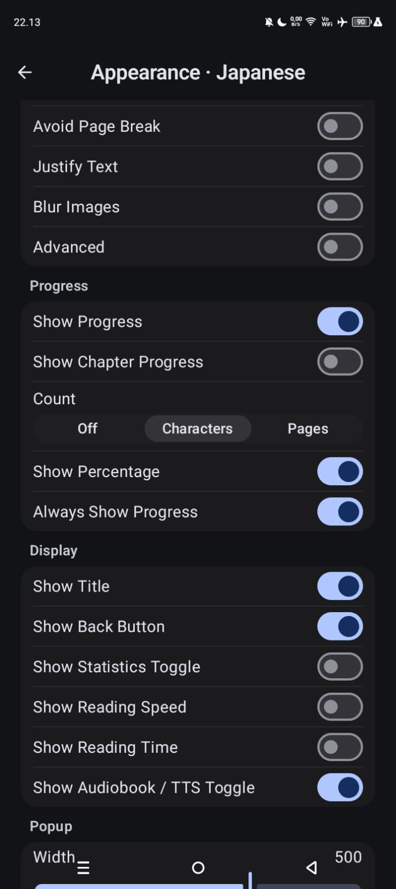{width=250}
    === "Appearance 3"
        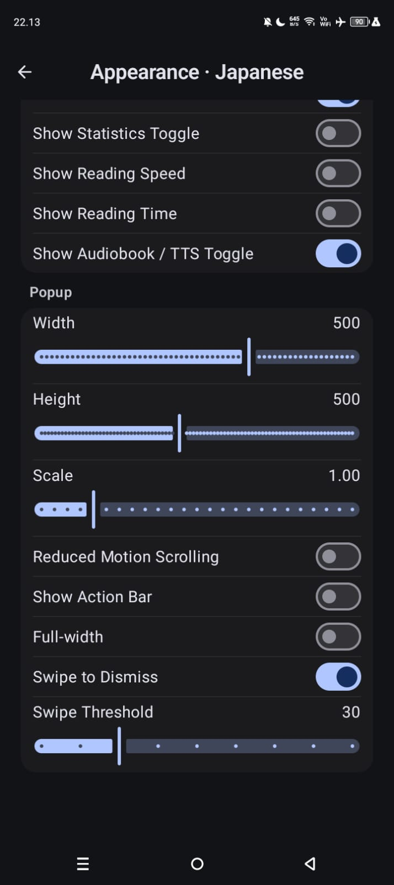{width=250}
    === "Theme 1"
        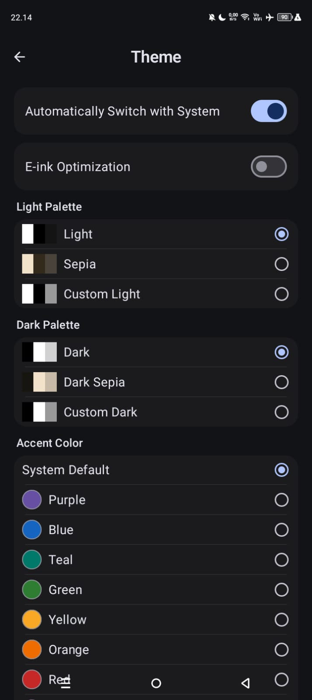{width=250}
    === "Theme 2"
        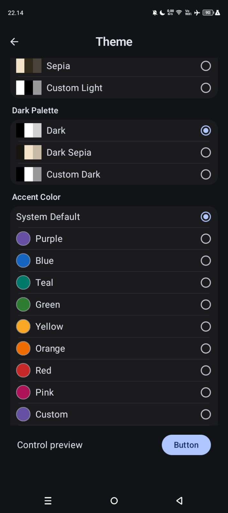{width=250}
    === "Behavior"
        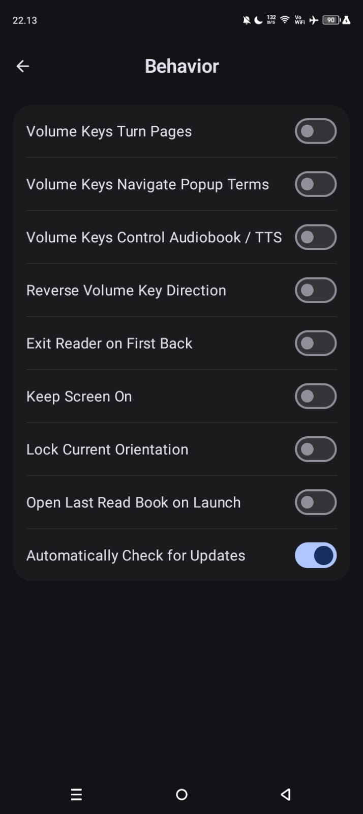{width=250}

---

## **Audio Lokal**

Tanpa audio lokal, audio pengucapan diambil dari internet. Dengan audio lokal, audio tetap ada walaupun sedang offline, dan tidak perlu AnkiConnect Android.

!!! warning "Butuh ruang kosong sekitar 6 GB"
    File audionya sekitar 5,8 GB. Pastikan memori HP masih cukup sebelum impor. Kalau memori HP-mu terbatas, ada versi ringan sekitar 2 GB dan versi online, lihat [Info 4](#info-4-pilihan-sumber-audio).

1. Unduh [android.db](https://drive.google.com/file/d/1Fn11_nN04zM89yKFYBWVTi0Xpaf6I3qe/view)
2. Buka `Settings` > `Advanced` > `Word audio`
3. Nyalakan `Local Audio`, tekan `Import`, lalu pilih file `android.db`

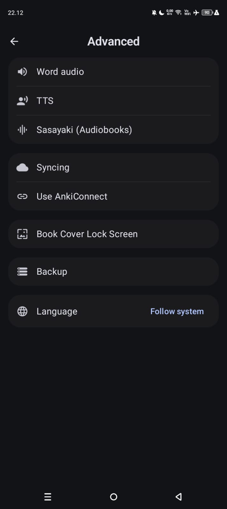{width=250}

Hoshi Reader akan menambahkan sumber audio `Local` dan memakainya lebih dulu dibanding sumber lain.

---

## **Info Tambahan**

#### Info 1: Lanjut baca di PC

Hoshi Reader bisa menyinkronkan buku dan posisi baca lewat Google Drive, dengan format yang sama seperti ッツ Reader. Pengaturannya ada di `Settings` > `Advanced` > `Syncing` dan butuh membuat kunci akses Google Cloud sendiri, jadi lewati saja kalau hanya membaca di HP.

#### Info 2: Audiobook

Hoshi Reader bisa memutar audiobook sambil menandai kalimat yang sedang dibacakan dan membalik halaman sendiri. Untuk fitur yang sama di PC, lihat [Yatsu Whispersync](setup-LN-pc-lazy-guide.md#info-3-audiobook-dengan-yatsu-whispersync).

??? info "Cara memutar audiobook (Sasayaki) <small>(klik di sini)</small>"

    1. Buka bukunya, tekan tombol di kanan bawah, lalu pilih `Sasayaki`
    2. Di tab `Resources`, bagian `Audiobook`, tekan `Open` dan pilih file audiobook (`.mp3`, `.m4b`, `.m4a`, atau `.opus`). `Copy Audiobook to App Storage` menyalin file audiobook ke penyimpanan aplikasi
    3. Cocokkan audio dengan teks buku:
        - Punya subtitle `.srt` untuk audiobook itu: pilih `Subtitles`, lalu muat file subtitle-nya. Subtitle bisa dibuat dengan [SubPlz](https://github.com/kanjieater/SubPlz)
        - Tidak punya: pilih `Transcription`, atur `Transcription performance` (`Low`, `Balanced`, atau `High`), lalu tekan `Transcribe`. Hoshi Reader akan membuat teks dari audionya langsung di HP, jadi butuh waktu
    4. Tab `Settings` di Sasayaki untuk mengatur jeda (`Delay`), kecepatan, gulir otomatis, dan jeda otomatis saat mencari kata (`Auto-Pause on Lookup`)

    Pengaturan umum Sasayaki ada di `Settings` > `Advanced` > `Sasayaki (Audiobooks)`. Alurnya mirip dengan [versi iOS](Setup-Hoshi-Reader-iOS.md#audiobook-sasayaki).

    === "Resources"
        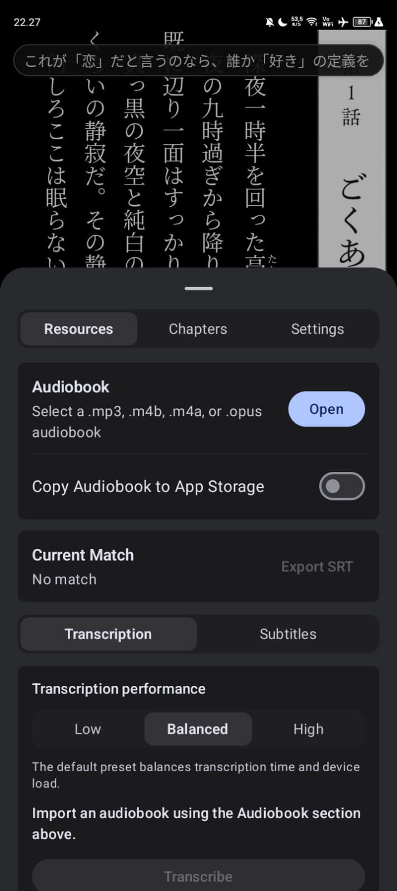{width=250}
    === "Chapters"
        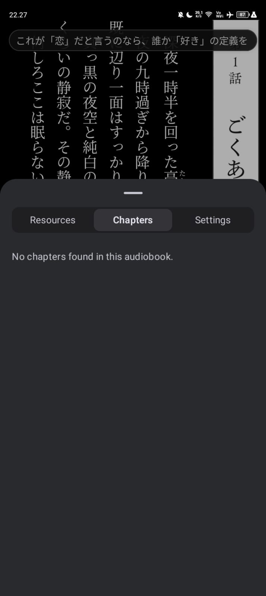{width=250}
    === "Settings 1"
        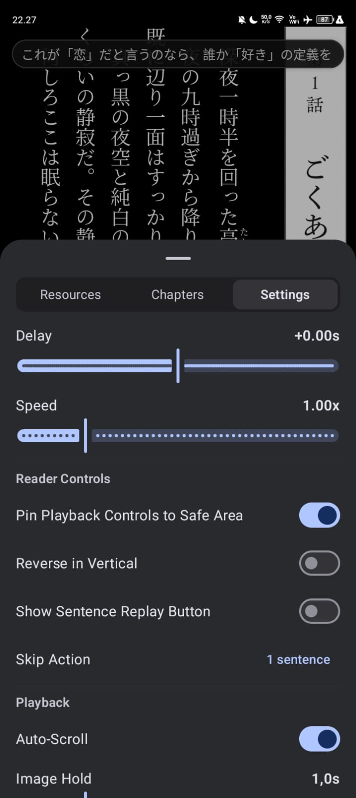{width=250}
    === "Settings 2"
        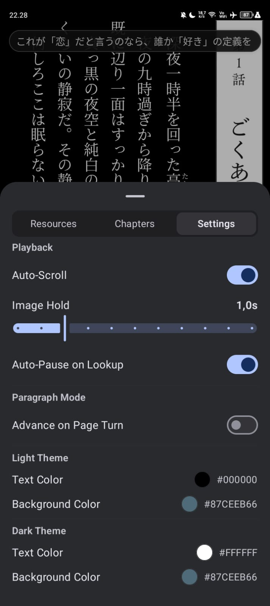{width=250}

#### Info 3: Statistik membaca

??? info "Statistik membaca <small>(klik di sini)</small>"

    Tab `Statistics` mencatat jumlah karakter yang dibaca per hari, target harian (bawaannya 5.000 karakter), streak, waktu membaca, dan kecepatan membaca. Target harian bisa diubah dengan menekan angkanya.

    === "Target Harian"
        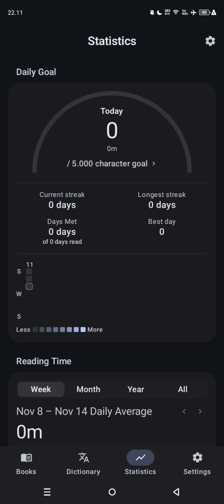{width=250}
    === "Waktu Membaca"
        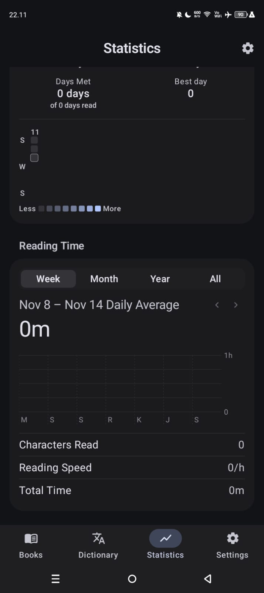{width=250}

#### Info 4: Pilihan sumber audio

??? tip "Pilihan sumber audio untuk HP dengan memori terbatas <small>(klik di sini)</small>"

    Sumber audio di bawah bisa dipakai di Hoshi Reader, Manatan, Chimahon, dan Hibiki.

    | Pilihan | Ukuran | Cocok untuk |
    |---|---|---|
    | [Versi besar](https://drive.google.com/file/d/1Fn11_nN04zM89yKFYBWVTi0Xpaf6I3qe/view) | Sekitar 5,8 GB | Memori masih lega. Ini file yang sama dengan langkah [Audio Lokal](#audio-lokal) |
    | [Versi ringan](https://drive.google.com/drive/folders/1bDu2rAOmnGQEbtjG4VBj5LJoKjkxGPEX?usp=drive_link) | Sekitar 2 GB | Memori terbatas tapi tetap ingin audio offline. Impor dengan cara yang sama seperti versi besar |
    | Online | Tidak perlu diunduh | Memori hampir penuh. Butuh internet setiap kali audio diputar |

    URL untuk sumber audio online:

    ```
    https://audio.juranumunit.workers.dev/?term={term}&reading={reading}&sources=nhk16,shinmeikai8,jpod,tts1,tts2
    ```

    Salin URL itu dan tambahkan sebagai sumber audio custom di pengaturan audio aplikasimu. Biarkan `{term}` dan `{reading}` apa adanya, karena aplikasi akan menggantinya dengan kata yang sedang dicari.

---

## **Pertanyaan Umum**

#### Pertanyaan 1: Apakah masih perlu Yomitan dan AnkiConnect Android?

Tidak. Kamus dan pembuatan kartu sudah ada di dalam Hoshi Reader. Panduan [LN & Buku Android](setup-LN-android-lazy-guide.md) yang memakai browser tetap bisa dipakai sebagai alternatif.

#### Pertanyaan 2: Bagaimana cara memperbarui Hoshi Reader?

??? question "Cara memperbarui Hoshi Reader <small>(klik di sini)</small>"

    Buka `Settings` > `About`, lalu tekan `Check for stable updates`. Versi yang terpasang terlihat di baris `Version`. `Get latest preview` untuk versi uji coba yang belum stabil.

    === "About"
        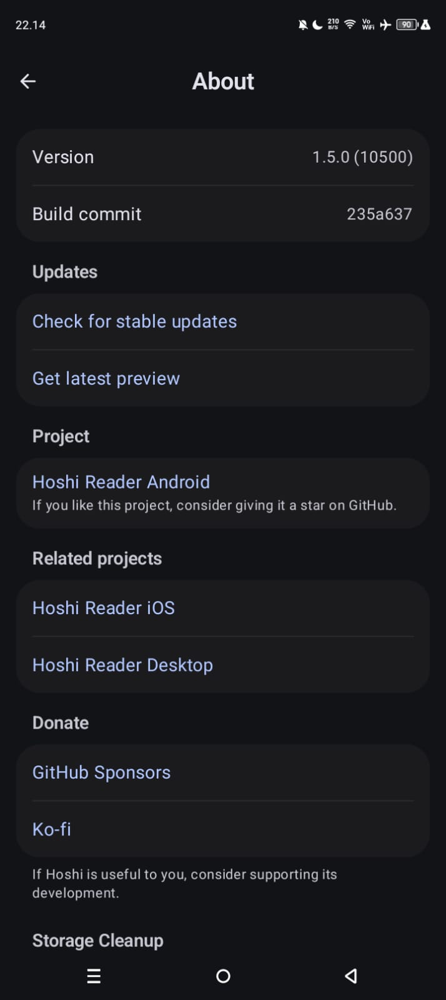{width=250}
    === "About (bawah)"
        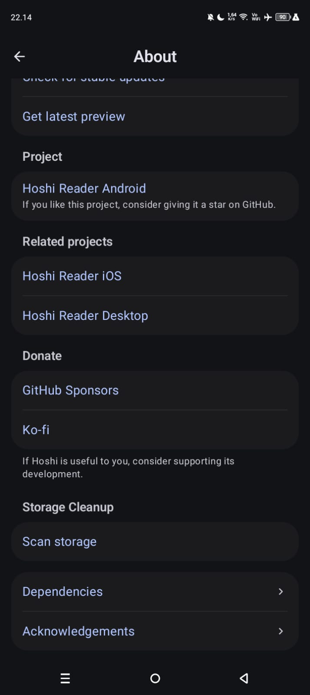{width=250}
