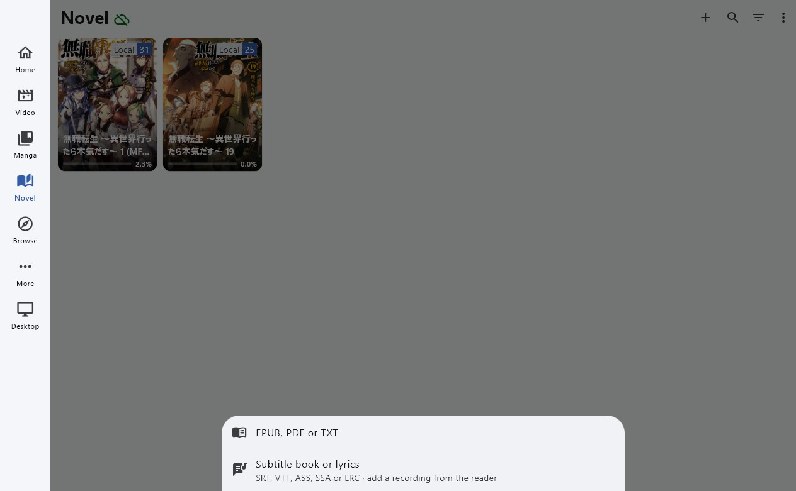
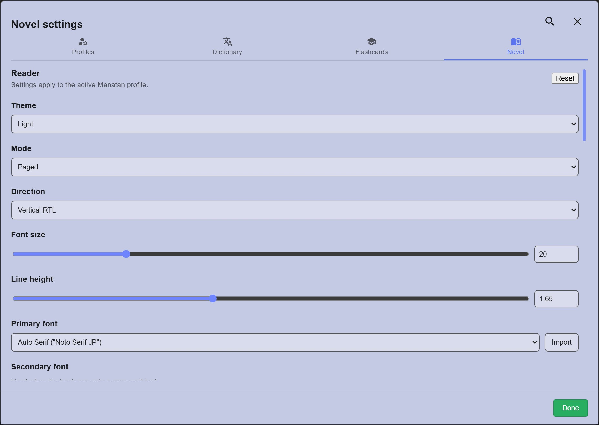

# Novel (EPUB)

Impor file EPUB, PDF, atau TXT, lalu baca dengan kamus popup.

---

## Impor buku

1. Buka menu `Novels`.
2. Tekan ikon tiga titik di kanan atas, lalu pilih `Import EPUB, PDF or TXT`.
3. Pilih file bukunya. Setelah muncul di daftar, tekan sampulnya untuk mulai membaca.
   > **NB:** Manatan hanya menerima EPUB, PDF, dan TXT. File lain seperti `.azw3` atau `.mobi` perlu dikonversi dulu ke EPUB dengan aplikasi lain, misalnya [Calibre](https://calibre-ebook.com/). Pakai file yang tidak terenkripsi (tanpa DRM).

{height=500 width=500}

??? warning "Audiobook belum didukung <small>(klik di sini)</small>"

    Per November 2026, Manatan belum bisa memutar audiobook bersamaan dengan bukunya. Yang tersedia hanya text-to-speech (suara buatan) lewat ikon speaker di bilah atas pembaca.

    Kalau ingin membaca sambil mendengarkan audiobook, pakai [Yatsu Reader dengan Yatsu Whispersync](setup-LN-pc-lazy-guide.md#info-3-audiobook-dengan-yatsu-whispersync) di PC, atau [Hoshi Reader](Setup-Hoshi-Reader-iOS.md#audiobook-sasayaki) di iPhone atau iPad.

---

## Membaca

=== "Halaman Buku"
	{height=500 width=500}
=== "Pengaturan"
	{height=500 width=500}

- Klik atau ketuk bagian atas layar untuk memunculkan bilah menu. Pengaturan ada di ikon roda gigi `Novel settings` > tab `Novel`.
- Untuk mencari arti kata, arahkan kursor atau ketuk kata tersebut sampai popup kamus muncul.
- Kalau arti kata tidak muncul, pastikan kamus sudah diimpor dan popup untuk `Novel` sudah dinyalakan. Lihat [cara impor kamus](Setup-Manatan.md#kamus).
- Pastikan teksnya bisa dipilih. Kata di halaman yang isinya hanya gambar tidak bisa dicari langsung di kamus.

??? info "Isi bilah menu dan pengaturan pembaca <small>(klik di sini)</small>"

    Ikon di bilah atas, dari kiri ke kanan:

    | Ikon | Fungsi |
    |---|---|
    | Speaker | Text-to-speech (dibacakan suara buatan) |
    | Kaca pembesar | Cari kata di dalam buku |
    | Grafik | Statistik membaca |
    | Gambar | Galeri gambar di dalam buku |
    | Tanda kutip | Daftar highlight |
    | Daftar | Daftar isi |
    | Kotak | Layar penuh |
    | Roda gigi | Pengaturan |

    Pengaturan yang paling sering diubah di tab `Novel`:

    | Pengaturan | Isi |
    |---|---|
    | Theme | Warna latar: putih, terang, sepia, gelap, hitam |
    | Mode | `Paged` (per halaman) atau `Continuous` (digulir) |
    | Direction | `Vertical RTL` untuk teks tegak seperti buku Jepang, `Horizontal` untuk teks mendatar |
    | Font size, Line height | Ukuran huruf dan jarak baris |
    | Primary font | Jenis huruf. Beberapa perlu diunduh dulu |
    | Show furigana | Tampilkan atau sembunyikan furigana |
    | Reader status display | Tampilkan judul, jumlah huruf, dan persentase bacaan |

---

## Sinkronisasi antar perangkat (opsional)

Sinkronisasi tidak wajib. Kalau diaktifkan, progres membaca tetap sama di semua perangkatmu.

Manatan mengutamakan penyimpanan lokal (*local-first*), jadi tetap bisa dipakai secara luring kalau sinkronisasi dimatikan.

Sumber: [Novels (EPUB)](https://manatan.com/docs/guides/novels)
