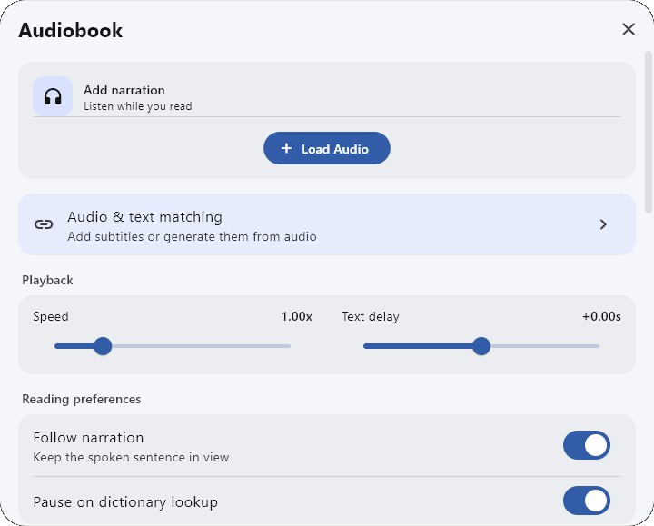
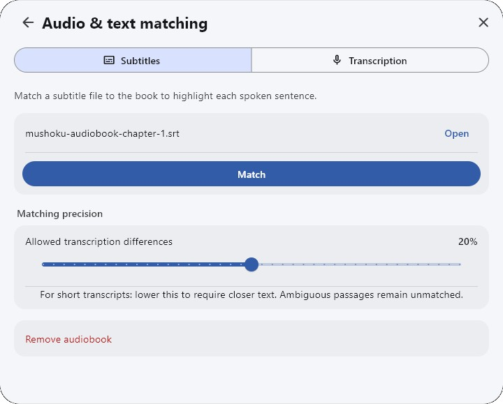
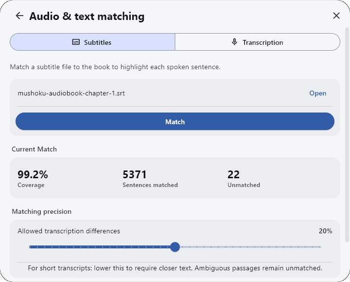

# Novel (EPUB)

Impor file EPUB, PDF, atau TXT, lalu baca dengan kamus popup.

---

## Impor buku

1. Buka menu `Novel`.
2. Tekan ikon `+` di kanan atas, lalu pilih `EPUB, PDF or TXT`.
3. Pilih file bukunya. Setelah muncul di daftar, tekan sampulnya untuk mulai membaca.
   > **NB:** Manatan hanya menerima EPUB, PDF, dan TXT. File lain seperti `.azw3` atau `.mobi` perlu dikonversi dulu ke EPUB dengan aplikasi lain, misalnya [Calibre](https://calibre-ebook.com/). Pakai file yang tidak terenkripsi (tanpa DRM).

{height=500 width=500}

---

## Audiobook

Manatan bisa memutar audiobook bersamaan dengan bukunya. Kalimat yang sedang dibacakan disorot, dan halaman ikut berpindah mengikuti suara.

Fitur ini hanya ada di aplikasi Manatan versi sekarang (dicoba di versi 6.3.14 untuk Windows). Versi lama yang dibuka lewat browser (Web UI) tidak punya fitur ini.

Yang perlu disiapkan: file audiobook (MP3, M4B, M4A, Ogg, Opus, FLAC, atau WAV) dan, kalau ada, file subtitle audiobook itu (misalnya SRT atau VTT). Audiobook, subtitle, dan bukunya harus dari edisi yang sama.

1. Buka bukunya, klik bagian atas layar untuk memunculkan bilah menu, lalu tekan ikon headphone.

    {height=500 width=500}

2. Di panel `Audiobook`, tekan `Load Audio`, lalu pilih file audiobook-nya.

    {height=500 width=500}

3. Setelah nama file audio muncul di panel, tekan `Audio & text matching`.
4. Di tab `Subtitles`, tekan `Open`, pilih file subtitle-nya, lalu tekan `Match`.
   > **NB:** Kalau tidak punya file subtitle, buka tab `Transcription` dan tekan `Generate subtitles`. Manatan akan membuat subtitle dari audionya lalu mencocokkannya dengan buku.

    {height=500 width=500}

5. Tunggu sampai bagian `Current Match` muncul. `Coverage` menunjukkan berapa persen kalimat buku yang berhasil dicocokkan dengan suara.

    {height=500 width=500}

6. Tutup panel dengan tombol `X`, lalu tekan tombol putar di bilah bawah. Kalimat yang sedang dibacakan disorot biru.

    {height=500 width=500}

Tombol di bilah bawah, dari kiri ke kanan:

| Tombol | Fungsi |
|---|---|
| Mundur | Kalimat sebelumnya |
| Putar/jeda | Memutar atau menjeda audiobook |
| Ulang | Mengulang kalimat yang sedang dibacakan |
| Maju | Kalimat berikutnya |
| Garis waktu | Pindah ke bagian lain audiobook |
| Headphone | Membuka panel `Audiobook` |

??? info "Pengaturan di panel Audiobook <small>(klik di sini)</small>"

    | Pengaturan | Isi |
    |---|---|
    | Speed | Kecepatan putar |
    | Text delay | Menggeser sorotan lebih cepat atau lebih lambat kalau tidak pas dengan suara |
    | Follow narration | Halaman ikut berpindah mengikuti kalimat yang dibacakan |
    | Pause on dictionary lookup | Audio berhenti sebentar saat popup kamus dibuka |
    | Pause to show illustrations | Berhenti sebentar di halaman bergambar, lamanya diatur di `Pause duration` |
    | Narration highlight | Warna dan ketebalan sorotan kalimat |
    | Show control bar | Tampilkan atau sembunyikan bilah putar di bawah |
    | Volume | Besar suara audiobook |

    Untuk melepas audiobook dari buku, buka `Audio & text matching`, lalu tekan `Remove audiobook`.

Selain audiobook, ikon speaker di bilah atas pembaca tetap bisa dipakai untuk text-to-speech (dibacakan suara buatan).

Pilihan lain untuk membaca sambil mendengarkan audiobook: [Yatsu Reader dengan Yatsu Whispersync](setup-LN-pc-lazy-guide.md#info-3-audiobook-dengan-yatsu-whispersync) di PC, [Hoshi Reader](Setup-Hoshi-Reader.md#info-2-audiobook) di Android, atau [Hoshi Reader](Setup-Hoshi-Reader-iOS.md#audiobook-sasayaki) di iPhone dan iPad.

---

## Membaca

=== "Halaman Buku"
	{height=500 width=500}
=== "Pengaturan"
	{height=500 width=500}

- Klik atau ketuk bagian atas layar untuk memunculkan bilah menu. Pengaturan ada di ikon roda gigi `Novel settings` > tab `Novel`.
- Untuk mencari arti kata, arahkan kursor atau ketuk kata tersebut sampai popup kamus muncul.
- Kalau arti kata tidak muncul, pastikan kamus sudah diimpor dan popup untuk `Novel` sudah dinyalakan. Lihat [cara impor kamus](Setup-Manatan.md#kamus).
- Pastikan teksnya bisa dipilih. Kata di halaman yang isinya hanya gambar tidak bisa dicari langsung di kamus.

??? info "Isi bilah menu dan pengaturan pembaca <small>(klik di sini)</small>"

    Ikon di bilah atas, dari kiri ke kanan:

    | Ikon | Fungsi |
    |---|---|
    | Headphone | [Audiobook](#audiobook) |
    | Speaker | Text-to-speech (dibacakan suara buatan) |
    | Kaca pembesar | Cari kata di dalam buku |
    | Grafik | Statistik membaca |
    | Gambar | Galeri gambar di dalam buku |
    | Tanda kutip | Daftar highlight |
    | Daftar | Daftar isi |
    | Kotak | Layar penuh |
    | Roda gigi | Pengaturan |

    Pengaturan yang paling sering diubah di tab `Novel`:

    | Pengaturan | Isi |
    |---|---|
    | Theme | Warna latar: putih, terang, sepia, gelap, hitam |
    | Mode | `Paged` (per halaman) atau `Continuous` (digulir) |
    | Direction | `Vertical RTL` untuk teks tegak seperti buku Jepang, `Horizontal` untuk teks mendatar |
    | Font size, Line height | Ukuran huruf dan jarak baris |
    | Primary font | Jenis huruf. Beberapa perlu diunduh dulu |
    | Show furigana | Tampilkan atau sembunyikan furigana |
    | Reader status display | Tampilkan judul, jumlah huruf, dan persentase bacaan |

---

## Sinkronisasi antar perangkat (opsional)

Sinkronisasi tidak wajib. Kalau diaktifkan, progres membaca tetap sama di semua perangkatmu.

Manatan mengutamakan penyimpanan lokal (*local-first*), jadi tetap bisa dipakai secara luring kalau sinkronisasi dimatikan.

Sumber: [Novels (EPUB)](https://manatan.com/docs/guides/novels)
