# Setup Manatan
---

 Diunggah: 12 April 2026 · Diperbarui: 10 November 2026 – `Yaaacha`

---

??? info "Info: panduan ini mengikuti Manatan versi baru <small>(klik di sini)</small>"

    Manatan versi sekarang memakai tampilan aplikasi baru di desktop dan HP. Versi lama memakai Web UI di browser (panel menu di kiri), jadi kalau tampilan aplikasimu masih seperti itu, perbarui dulu ke versi terbaru.

    Langkah di halaman ini diterjemahkan dan diringkas dari [dokumentasi resmi Manatan](https://manatan.com/docs/guides/getting-started). Sebagian screenshot di bawah masih dari versi lama, jadi letak menunya bisa sedikit berbeda.

---

## **Persiapan**
Langkah-langkah persiapan sebelum menjalankan Manatan:

1. Unduh Manatan dari [halaman unduhan resmi](https://manatan.com/download)

    | Perangkat | Pilih |
    |---|---|
    | Windows | Windows x64 (Windows 10 atau 11, 64-bit) |
    | macOS | Apple Silicon untuk Mac M-series, Intel untuk Mac lama. Cek di menu Apple > `About This Mac` |
    | Linux | Installer Linux atau [Flatpak resmi](https://kolbyml.github.io/Manatan/io.github.kolbyml.Manatan.flatpakref) |
    | Android | APK ARM64 (hampir semua HP sekarang). Butuh Android 8.0 ke atas. Izinkan pemasangan aplikasi saat diminta |
    | iPhone & iPad | [App Store](https://apps.apple.com/ca/app/manatan/id6756917436). Versi beta (TestFlight) opsional, tautannya ada di [Discord Manatan](https://discord.gg/tDAtpPN8KK) |

    Kalau halaman unduhan tidak bisa dibuka, ambil installer desktop dan Android dari [rilis resmi di GitHub](https://github.com/KolbyML/Manatan/releases/latest).

2. Buat API Key Jimaku (opsional, untuk mencari subtitle anime):
	- Buat akun di [Jimaku](https://jimaku.cc/account)
	- Buat API Key dengan menekan tombol `Generate` di bagian bawah pada menu `Account Setting`
	- Salin dan simpan API Key untuk nanti dimasukkan ke kolom `Jimaku API Key` di aplikasi Manatan
3. Unduh kamus. Panduan memilih kamus ada di bagian [Kamus](#kamus)
	- Kamus JP-ID
		- [JIDict](https://github.com/philiaspaceai/JIDict-yomitan#pemasangan)
		- [RH Dict](https://discord.com/channels/1370274344571240552/1544821080148025484/1544821080148025484) (di Discord Philia Space)
	- Kamus JP-EN dan monolingual JP
		- [JMdict dan JMnedict](https://github.com/yomidevs/jmdict-yomitan?tab=readme-ov-file#jmdict-for-yomitan). Pilih `JMdict_english.zip` dan `JMnedict.zip`.
		- [Koleksi Marv](https://drive.google.com/drive/u/0/folders/1LXMIOoaWASIntlx1w08njNU005lS5lez)
		- [Koleksi Shoui](https://drive.google.com/drive/u/0/folders/16nPmTCQtpi43wkYdvTh7Qfngr21FE36W)
4. Tentukan mau menyimpan kata ke mana. Detailnya ada di bagian [Kartu Flashcard](#kartu-flashcard)
	- **Manatan SRS**: flashcard bawaan Manatan. Tidak perlu Anki, bisa langsung dipakai di HP
	- **Anki lewat AnkiConnect**: kalau kamu sudah mengerjakan ulasan di Anki desktop. Note type bawaannya sekarang **Manatan-NoteType** dan dipasang otomatis saat kartu pertama dibuat

### **Setup Awal**

1. Jalankan aplikasi Manatan yang sesuai dengan perangkat, lalu tunggu sampai setup awalnya selesai. Peluncuran pertama bisa memakan waktu sekitar 30 detik.

	??? info "Peringatan Saat Pertama Dibuka"
        === "MacOS"
		    Saat pertama kali menjalankan Manatan, akan muncul peringatan ini. Klik `Done` > buka `System Settings` > `Privacy & Security` > (gulir ke bawah) `Open Anyway` > `Open Anyway` > selesai. Buka kembali Manatan seperti biasa
		   
	        {height=300 width=300}
 

2. Ikuti langkah awal di aplikasi. Kalau ditanya bahasa yang dipelajari, pilih `Japanese`
3. Kalau diminta Jimaku API Key, masukkan API Key dari langkah persiapan. Bisa juga dilewati dan diisi nanti
4. Pastikan kamu bisa membuka `Library` dan `Settings`. Kalau aplikasinya tidak mau terbuka, lihat [Manatan tidak terbuka](#masalah-1-manatan-tidak-terbuka) sebelum menghapus data apa pun

> Pengaturan Manatan ada di `More` > ikon roda gigi di kanan atas. Di halaman ini disebut `Settings`.

### **Pasang ekstensi**

Ekstensi hanya perlu kalau kamu mau membaca atau menonton dari sumber daring. Untuk EPUB atau file lokal milikmu sendiri, langkah ini bisa dilewati.

1. Buka `Settings` > `Browse`
2. Salin URL repositori di bawah, lalu masukkan satu per satu sesuai kategorinya di pengaturan Manatan
        <table>
      <thead>
        <tr>
          <th style="text-align:left">Kategori</th>
          <th style="text-align:left; border-left: 1px solid var(--md-typeset-table-color)">Repositori Ekstensi (Pilih salah satu)</th>
        </tr>
      </thead>
      <tbody>
        <tr>
          <th colspan="2" style="text-align:center; border-top: 1px solid var(--md-typeset-table-color)">Manga</th>
        </tr>
        <tr>
          <td><b>Keiyoushi</b></td>
          <td style="border-left: 1px solid var(--md-typeset-table-color)"><a href="https://github.com/keiyoushi/extensions/raw/repo/index.pb">URL</a> **Recommended**</td>
        </tr>
        <tr>
          <td><b>Kareadita</b></td>
          <td style="border-left: 1px solid var(--md-typeset-table-color)"><a href="https://raw.githubusercontent.com/Kareadita/tach-extension/repo/index.min.json">URL</a></td>
        </tr>
        <tr>
          <td><b>Aidoku Community</b></td>
          <td style="border-left: 1px solid var(--md-typeset-table-color)"><a href="https://aidoku-community.github.io/sources/index.min.json">URL</a></td>
        </tr>
        <tr>
          <td><b>Amqx (Aidoku)</b></td>
          <td style="border-left: 1px solid var(--md-typeset-table-color)"><a href="https://amqx.github.io/sources/index.min.json">URL</a></td>
        </tr>
        <tr>
          <th colspan="2" style="text-align:center; border-top: 1px solid var(--md-typeset-table-color)">Anime</th>
        </tr>
        <tr>
          <td><b>Yuzono</b></td>
          <td style="border-left: 1px solid var(--md-typeset-table-color)"><a href="https://raw.githubusercontent.com/yuzono/anime-repo/repo/index.min.json">URL</a> **Recommended**</td>
        </tr>
      </tbody>
    </table>

3. Matikan `Show NSFW` jika kamu tidak ingin media NSFW muncul di hasil pencarian
4. Kembali ke halaman utama

### **Tambah sumber**

1. Buka `Browse`.
2. Buka `Video Extensions` (anime) atau `Manga Extensions`, lalu pasang ekstensi yang kamu butuhkan. Daftar ekstensi anime yang sudah dicoba ada di bagian [Anime](#anime).
3. Ekstensi yang sudah terpasang muncul di `Video Sources` dan `Manga Sources`. Cara mencari judul dan menyimpannya ke Library ada di [Penggunaan Media](#penggunaan-media).

??? warning "Catatan keamanan" 
    Repositori ekstensi sering kali disediakan oleh pihak ketiga. Pasang hanya dari penyedia yang kamu percayai.

---
## **Penggunaan Media**

### **Manga**

1. Membaca dari sumber daring (ekstensi)
	- Buka `Browse` > `Manga Sources`, lalu tekan ikon kaca pembesar di kanan atas untuk membuka pencarian global
	- Pastikan opsi `All` yang aktif, bukan `Pinned`, supaya Manatan mencari di semua sumber manga yang sudah dipasang
	- Ketik judul manga. Hasil dari tiap sumber akan muncul berurutan
	- Buka judul yang cocok, lalu tekan `Add to Library`
	- Pilih chapter untuk mulai membaca. Selanjutnya judul ini bisa dibuka langsung dari menu `Manga`
2. Membaca dari berkas lokal.
	- [Manga Lokal](Setup-Manatan-manga-lokal.md)
3. Pengaturan pembaca
	- Klik bagian tengah halaman manga untuk membuka menu di kiri, lalu tekan `Settings`
	- Untuk manga Jepang, pilih `Reading mode` > `Single page (right to left)` atau `Double page (right to left)` supaya halaman dibalik dari kanan ke kiri
=== "Menu Pembaca"
	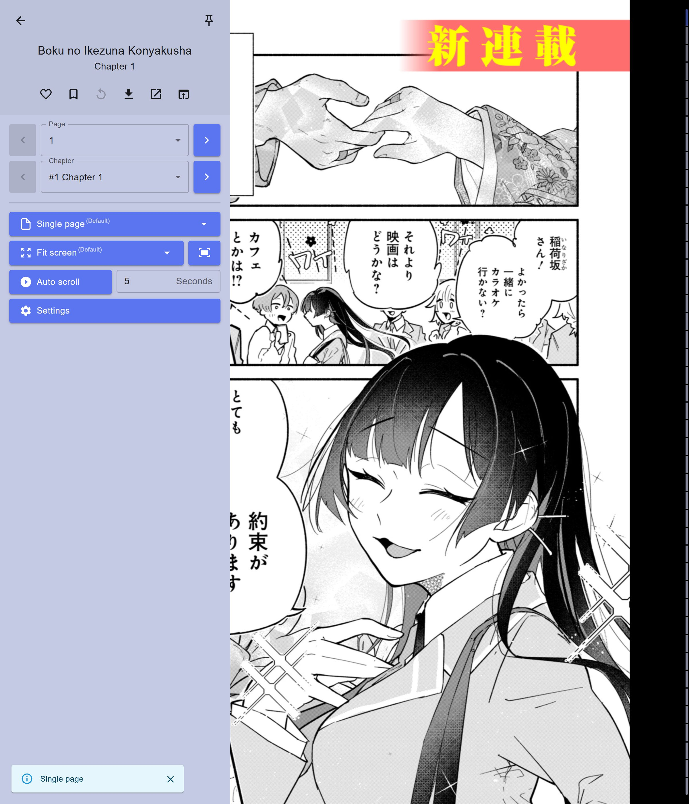{height=500 width=500}
=== "Layout"
	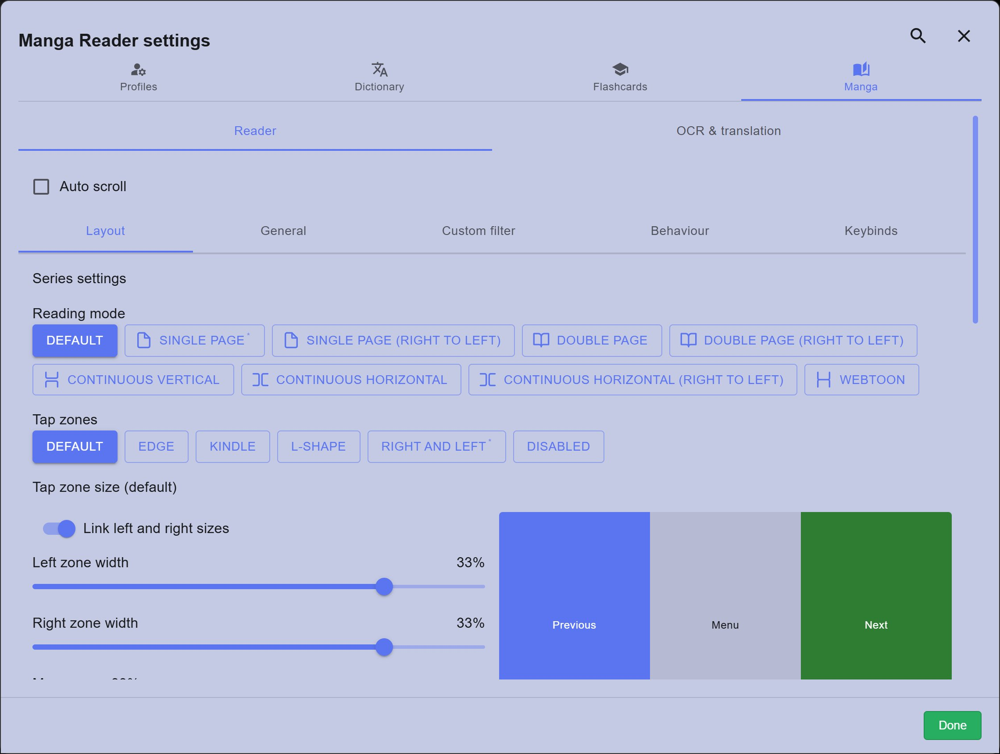{height=500 width=500}
=== "General"
	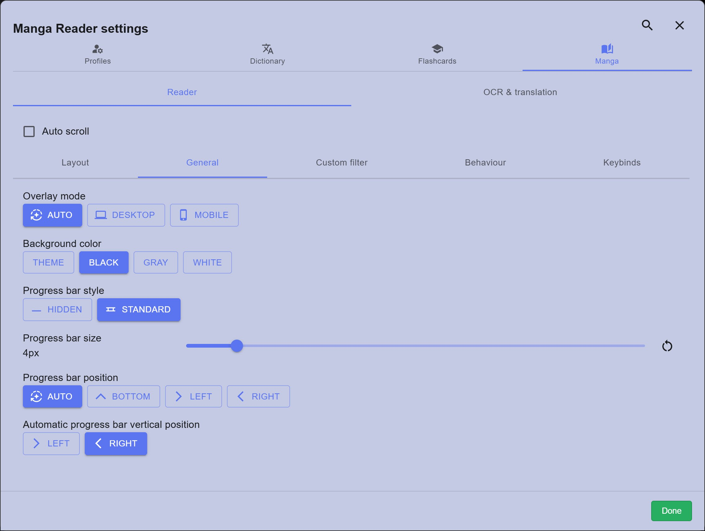{height=500 width=500}
=== "Custom Filter"
	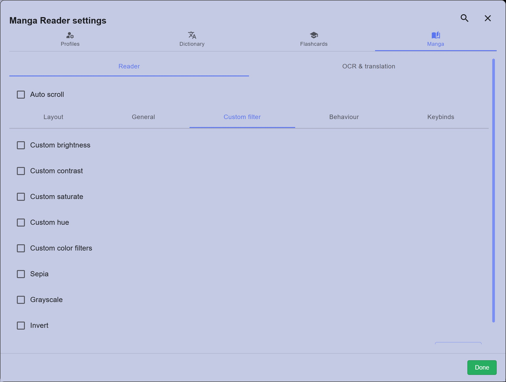{height=500 width=500}
=== "Behaviour"
	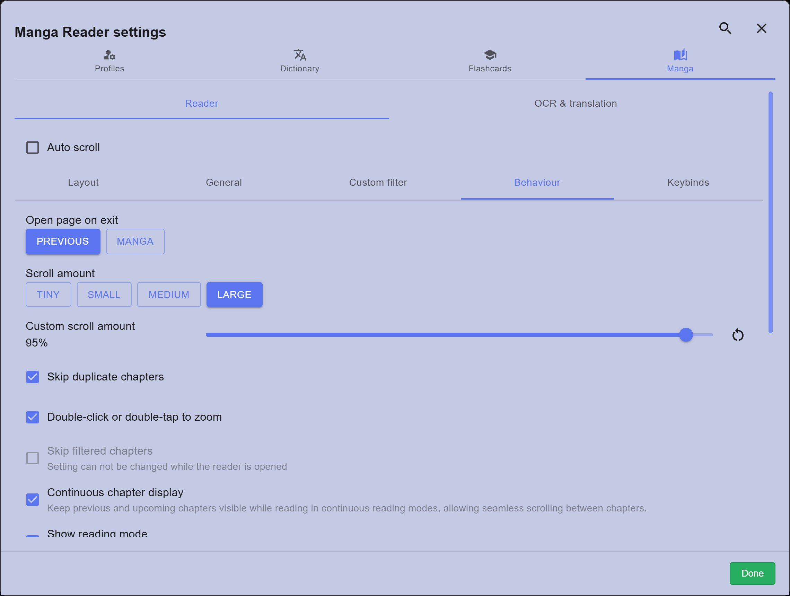{height=500 width=500}
=== "Keybinds"
	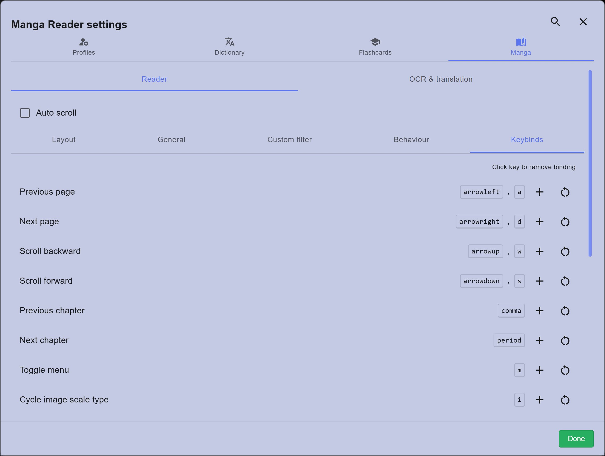{height=500 width=500}

??? info "Isi tiap tab pengaturan pembaca manga <small>(klik di sini)</small>"

    | Tab | Isi |
    |---|---|
    | Layout | Mode baca (satu halaman, dua halaman, gulir, webtoon) dan arahnya, zona ketuk untuk pindah halaman beserta ukurannya, dan ukuran gambar (pas lebar, pas tinggi, pas layar) |
    | General | Tampilan menu, warna latar, dan bilah progres |
    | Custom Filter | Kecerahan, kontras, dan filter warna halaman |
    | Behaviour | Halaman yang dibuka saat keluar, jarak gulir, dobel klik untuk zoom, kecepatan gulir otomatis, dan pemberitahuan saat pindah chapter |
    | Keybinds | Shortcut keyboard. Bawaannya: `←` `→` pindah halaman, `,` `.` pindah chapter, `M` buka menu, `R` ganti mode baca, `Space` gulir otomatis, `C` keluar |

    Di tab Layout, bagian `Series settings` hanya berlaku untuk judul yang sedang dibuka. Kalau pilihannya `Default`, Manatan memakai pengaturan bawaan mode baca yang ada di bawahnya (misalnya bagian `Single page`).
	
### **Anime**

1. Menonton dari sumber daring (ekstensi)
	- Buka `Browse` > `Video Sources`, lalu pilih salah satu sumber. Sumber dikelompokkan per bahasa, jadi sumber `English` ada di bawah kelompok `All`. Pencarian global belum bisa dipakai untuk anime, jadi judul harus dicari di tiap sumber satu per satu
	- Tekan ikon kaca pembesar di kanan atas, ketik judul anime, lalu tekan Enter. Kamu juga bisa melihat-lihat daftar `Popular` dan `Latest`
	- Buka judul yang cocok, lalu tekan `Add to Library`
	- Pilih episode, atau tekan `Start` untuk mulai dari episode pertama. Selanjutnya judul ini bisa dibuka langsung dari menu `Video`
	- Kalau judulnya tidak ketemu, coba ketik judul versi lain (romaji atau Inggris). Kalau masih tidak ketemu atau videonya tidak mau diputar, coba sumber lain dari [daftar ekstensi anime](#ekstensi-anime-yang-sudah-dicoba) di akhir bagian ini
2. Menonton dari sumber berkas lokal
	- [Anime lokal](Setup-Manatan-anime-lokal.md)
3. Pemutar video
	- Untuk memasang subtitle Jepang, tekan ikon subtitle (nomor 4 di gambar) > `Find online subtitles` > `Jimaku`. Cari judul animenya dalam romaji (misalnya `Jigokuraku`), pilih judul yang cocok, lalu pilih salah satu file `Jimaku - ...` di daftar subtitle
	- Kalau subtitle tidak pas dengan suara, geser 100 ms per klik dengan tombol `‹` dan `›` di kanan bawah
	- Ikon grafik (nomor 7) membuka `Vocabulary stats`: perkiraan berapa banyak kata di episode ini yang sudah kamu kenal, dihitung dari subtitle utama. Supaya angkanya berguna, pakai subtitle Jepang sebagai subtitle utama (`P`)
	- Mode putar dan shortcut keyboard ada di [Tips 2](#tips-2-mode-putar-dan-shortcut-pemutar-video)
=== "Tata Letak"
	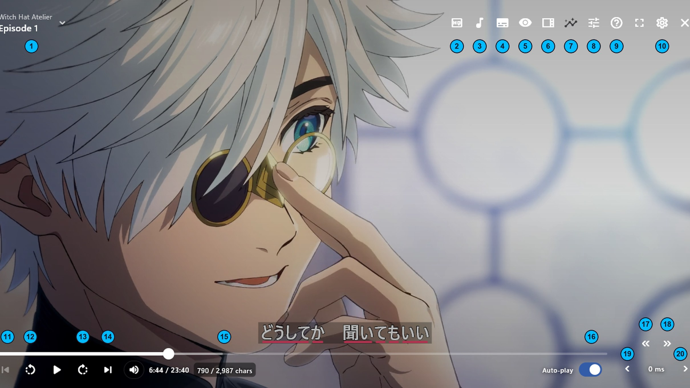{height=1000 width=600}
=== "Pilih Episode"
	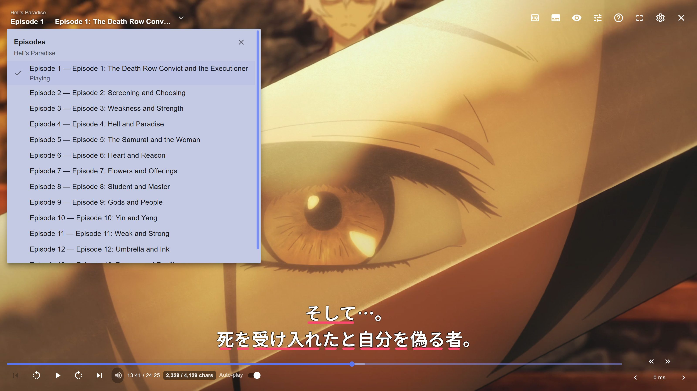{height=1000 width=600}
=== "Kualitas Video"
	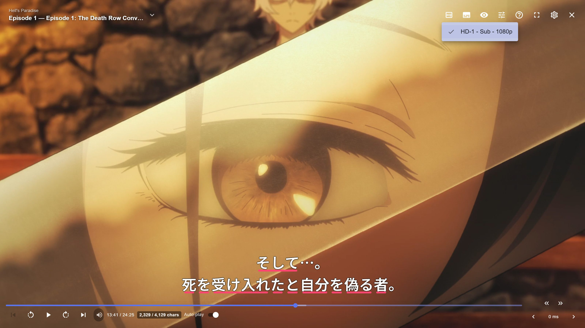{height=1000 width=600}
=== "Subtitle"
	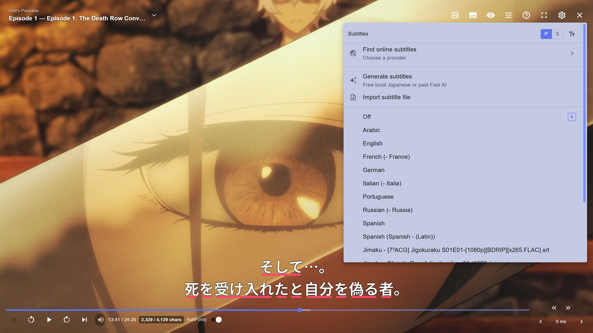{height=1000 width=600}
=== "Daftar Subtitle"
	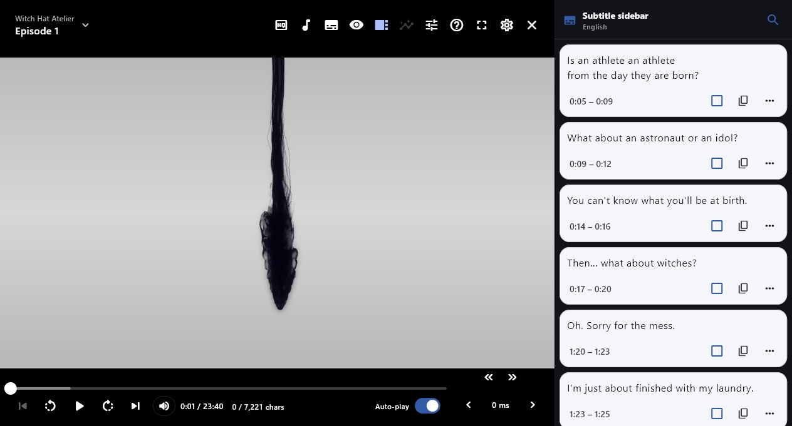{height=1000 width=600}
=== "Statistik Kosakata"
	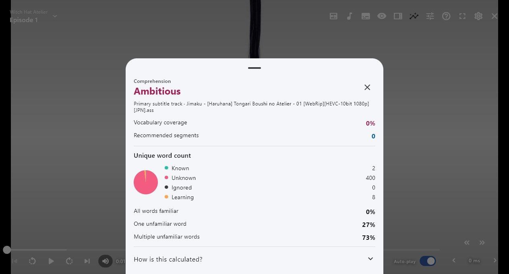{height=1000 width=600}

??? info "Fungsi tiap tombol di pemutar video <small>(klik di sini)</small>"

    Nomor mengikuti gambar **Tata Letak**.

    | No | Fungsi |
    |---|---|
    | 1 | Judul dan episode yang sedang diputar. Tekan untuk membuka daftar episode |
    | 2 | Pilih server dan kualitas video |
    | 3 | Pilih trek audio, kalau videonya punya lebih dari satu |
    | 4 | Menu subtitle: cari subtitle di Jimaku, buat subtitle otomatis, impor file subtitle, dan pilih subtitle utama (`P`) atau kedua (`S`) |
    | 5 | Sembunyikan atau tampilkan subtitle |
    | 6 | Daftar kalimat subtitle di samping video. Tekan salah satu kalimat untuk melompat ke sana |
    | 7 | Statistik kosakata (`Vocabulary stats`): berapa kata di episode ini yang sudah dikenal, belum dikenal, dan sedang dipelajari |
    | 8 | Mode putar dan kecepatan video |
    | 9 | Daftar shortcut keyboard |
    | 10 | Pengaturan: profil, kamus, flashcard, dan tampilan subtitle |
    | 11 | Episode sebelumnya |
    | 12 | Mundur ke kalimat subtitle sebelumnya |
    | 13 | Maju ke kalimat subtitle berikutnya |
    | 14 | Episode berikutnya |
    | 15 | Jumlah huruf subtitle yang sudah lewat dari total satu episode |
    | 16 | Putar episode berikutnya secara otomatis |
    | 17 | Jadikan detik ini awal kalimat subtitle sebelumnya |
    | 18 | Jadikan detik ini awal kalimat subtitle berikutnya |
    | 19 | Subtitle 100 ms lebih cepat |
    | 20 | Subtitle 100 ms lebih lambat |

#### Ekstensi anime yang sudah dicoba

Dicoba pada 6 November 2026 dengan Manatan Windows v6.3.8, repositori [Yuzono](#pasang-ekstensi), dan DNS Cloudflare menyala di perangkat. Sumber daring bisa berubah atau mati sewaktu-waktu, jadi kalau satu sumber bermasalah, coba yang lain.

- **Softsub**: subtitle terpisah dari video, bisa dimatikan dan diganti subtitle Jepang dari Jimaku. Paling cocok untuk immersion
- **Hardsub**: subtitle menempel di video dan tidak bisa dimatikan

| Kategori | Ekstensi | Catatan |
|---|---|---|
| ALL / Multi | AnimeOnsen | Tidak bisa dibuka saat DNS Cloudflare menyala, bisa tanpa DNS |
| ALL / Multi | AnimeXin | Donghua (animasi Tiongkok) |
| ALL / Multi | LMAnime | Donghua (animasi Tiongkok) |
| Bahasa Indonesia | Oploverz | Hardsub Indonesia. Dicoba tanpa DNS |
| English | Animekai (Unoriginal) | Softsub |
| English | Anichi | Softsub |
| English | Anikoto | Softsub |
| English | AllAnime | Hardsub Inggris |
| English | AnimePahe | Hardsub Inggris |
| English | AnimeGG | Campuran hardsub Inggris, dub, dan raw. Setidaknya salah satunya tersedia |
| English | AniWave (Unoriginal) | Softsub, kadang ada subtitle Indonesia |
| English | Aniwaves.ru | Hardsub Inggris |
	
### **Novel (EPUB)**

Impor berkas EPUB, PDF, atau TXT dan baca. Bisa juga sambil mendengarkan audiobook-nya.

- Selanjutnya: [Novel (EPUB)](Setup-Manatan-novels.md)

---
## **Popup Dictionary**

### **Kamus**

Saat pertama kali memasang Manatan, kamu perlu memuat kamus untuk memakai fitur popup dictionary.
File kamus berformat `.zip` dan **tidak perlu diekstrak**.

**Cara impor kamus**

1. Buka `Settings` > `Language learning` > `Dictionary`
2. Gulir ke `Installed Dictionaries`, lalu tekan `Import New`
3. Pilih file `.zip` kamus, lalu tunggu sampai muncul tanda berhasil dan tekan `Done`
    - Pilih file `.zip` kamusnya, bukan folder hasil ekstrak, file subtitle, atau tombol `Download ZIP` repo GitHub
4. Pastikan tombol kamus yang baru diimpor dalam keadaan **nyala**
5. Kembali ke atas halaman `Dictionary`. Di bagian `Popup dictionary`, nyalakan tempat kamu mau memakai popup: `Video`, `Manga`, dan `Novel`
6. Coba cari satu kata di EPUB atau subtitle. Kalau arti katanya muncul, kamus sudah siap

Tombol kamus dan tombol `Video`/`Manga`/`Novel` punya fungsi berbeda, jadi cek keduanya kalau popup tidak muncul. Mulai dari satu kamus definisi dulu, lalu tambahkan kamus frekuensi, pitch, atau lainnya belakangan.

Kalau tidak ingin memasang terlalu banyak kamus, kamu bisa memakai daftar ringkas ini.

??? info "Daftar Ringkas oleh [Donkuri](https://donkuri.github.io/learn-japanese/setup/#what-if-i-dont-want-to-use-all-these-dictionaries): <small>(klik di sini)</small>"

	<ul>
	  <li>JMdict (atau Jitendex)</li>
	  <li>JMnedict</li>
	  <li>三省堂 8th Ed (atau 明鏡 2nd Ed)</li>
	  <li>Kanji Jitenon</li>
	  <li>NHK2016</li>
	  <li>JPDB Frequency v2.2</li>
	</ul>

Di bawah ini ada beberapa daftar rekomendasi. Kamu bisa mencampurnya atau mengikuti semuanya, sesuai keinginanmu.

<b>Daftar Rekomendasi <i>shoui</i> dari TheMoeWay:</b> <i>(klik di sini)</i>

  Daftar lebih lengkap dan penjelasan lebih lanjut dari Shoui ada di situs <a href="https://learnjapanese.moe/monolingual/#getting-and-using-monolingual-dictionaries">TheMoeWay</a>

<b>Bilingual</b>

<ul>
  <li>[Bilingual] JMdict Extra (Recommended).zip</li>
  <li>[Bilingual] 新和英.zip</li>
</ul>

<b>Frekuensi</b>

<ul>
  <li>[Freq] CC100.zip</li>
  <li>[Freq] JPDB (Recommended).zip</li>
</ul>

<b>Kanji</b>

<ul>
  <li>[Kanji] KANJIDIC (English) (Recommended).zip</li>
</ul>

<b>Monolingual</b>

<ul>
  <li>[Monolingual] 実用日本語表現辞典 (Recommended).zip</li>
  <li>[Monolingual, Encyclopedia] PixivLight.zip</li>
</ul>

<b>Tata Bahasa</b>

<ul>
  <li>[Grammar] Dictionary of Japanese Grammar 日本語文法辞典 (Recommended).zip</li>
  <li>[Grammar] どんなとき使う日本語表現文型辞典.zip</li>
  <li>[Grammar] 毎日のんびり日本語教師 (nihongosensei).zip</li>
  <li>[Grammar] JLPT文法解説まとめ(nihongo_kyoushi).zip</li>
  <li>[Grammar] 絵でわかる日本語.zip</li>
</ul>

<b>Nama</b>

<ul>
  <li>[Names] JMnedict.zip</li>
</ul>

<b>Pitch</b>

<ul>
  <li>[Pitch] アクセント辞典v2 (Recommended).zip</li>
</ul>

<b>Daftar Rekomendasi <i>marv</i> dari Yomitan:</b> <i>(klik di sini)</i>

<b>Bilingual</b>

<ul>
  <li>[JA-EN] jitendex-yomichan</li>
  <li>[JA-EN] NEW 斎藤和英大辞典</li>
  <li>[JA-EN] 新和英</li>
</ul>

<b>Tata Bahasa</b>

<ul>
  <li>[JA Grammar] dojg-consolidated-v1_01</li>
</ul>

<b>Frekuensi</b>

<ul>
  <li>[JA Freq] JPDB_2022-05-10T03_27_02.930Z</li>
  <li>[JA Freq] Freq_CC100</li>
  <li>[JA Freq] BCCWJ-LUW</li>
</ul>

<b>Monolingual</b>

<ul>
  <li>[JA-JA] 実用日本語表現辞典</li>
  <li>[JA-JA] デジタル大辞泉</li>
  <li>[JA-JA Encyclopedia] Pixiv</li>
</ul>

<b>Kanji</b>

<ul>
  <li>[Kanji] KANJIDIC_english</li>
  <li>[Kanji] JPDB Kanji</li>
</ul>

<b>Pitch Accent</b>

<ul>
  <li>[Pitch] 大辞泉</li>
</ul>

<b>Daftar Kamus Lengkap:</b> <i>(klik di sini)</i>

<b>Kamus Bilingual</b>

<ul>
  <li>1. JIDict    Kamus Jepang-Indonesia berbasis JMdict dan Sanseido, dikembangkan oleh tim Philia Space, fokus pada hasil yang mudah dipahami oleh pelajar bahasa Jepang di Indonesia.</li>
  <li>2. JMdict    Kamus Jepang-Inggris utama dengan lebih dari 180.000 entri. Banyak dipakai sebagai sumber utama untuk kamus turunan lain. </li>
  <li>3. Jitendex.org    Versi gabungan dari kamus bilingual JMdict, dengan tambahan fitur-fitur khusus dari situs Jitendex.org.</li>
  <li>4. 新和英    Kamus Jepang-Inggris resmi dari Kenkyusha, menawarkan definisi yang lebih formal dan kontekstual dibanding JMdict.</li>
</ul>

<b>Proper Noun & Kanji Dictionary</b>

<ul>
  <li>5. JMnedict    Kamus nama-nama orang, tempat, dan organisasi dalam bahasa Jepang. Berguna saat menemui nama khusus.</li>
  <li>6. KANJIDIC (English)    Informasi karakter kanji dalam bahasa Inggris, termasuk makna, bacaan, stroke, dan level JLPT.</li>
  <li>7. 漢字源    Kamus kanji berbahasa Jepang dengan penjelasan etimologi dan penggunaan historis. Lebih cocok untuk pembelajar lanjutan.</li>
  <li>8. weblio 古語辞典    Kamus kosakata klasik Jepang. Membantu memahami bahasa kuno yang sering muncul dalam sastra dan sejarah.</li>
</ul>

<b>Monolingual – Kamus Besar & Onomatope</b>

<ul>
  <li>9. 旺文社国語辞典 第十一版  Kamus modern dengan definisi mudah dipahami, cocok untuk pelajar Jepang level menengah.</li>
  <li>10. 明鏡国語辞典 第三版  Menyediakan definisi dengan gaya penjelasan yang jernih dan mudah dibaca.</li>
  <li>11. デジタル大辞泉  Kamus komprehensif modern yang sering digunakan oleh penutur asli.</li>
  <li>12. 岩波国語辞典 第八版  Kamus yang terkenal dengan keakuratan dan gaya konservatifnya.</li>
  <li>13. 広辞苑 第七版  Salah satu kamus Jepang terbesar dan paling prestisius.</li>
  <li>14. 精選版 日本国語大辞典  Versi ringkas dari 日本国語大辞典, tetap komprehensif namun lebih praktis.</li>
  <li>15. ハイブリッド新辞林  Gabungan dari berbagai sumber, cepat dan ringan untuk pencarian harian.</li>
  <li>16. 新明解国語辞典 第八版  Dikenal karena penjelasan yang berani dan interpretatif.</li>
  <li>17. 三省堂国語辞典 第八版  Kamus ringkas namun mendalam, sangat cocok untuk pengguna tingkat menengah.</li>
  <li>18. 例解学習国語辞典 第十一版  Kamus anak-anak yang sangat ramah pelajar asing.</li>
  <li>19. 新選国語辞典 第十版  Kamus ringkas untuk referensi cepat.</li>
  <li>20. 国語辞典オンライン  Versi daring ringan yang berisi banyak entri praktis.</li>
  <li>21. 実用日本語表現辞典  Fokus pada ekspresi praktis dan idiom.</li>
  <li>22. surasura 擬声語  Khusus kosakata onomatope, lengkap dengan contoh penggunaan dan makna.</li>
</ul>

<b>Kamus untuk Bunpou & Pelajaran:</b>

<ul>
  <li>23. 日本語文法辞典（全集）  Seri lengkap kamus tata bahasa DoJG (Beginner–Advanced) dalam format searchable.</li>
  <li>24. JLPT文法解説まとめ  Ringkasan tata bahasa JLPT dari berbagai sumber, mudah dinavigasi.</li>
  <li>25. 毎日のんびり日本語教師  Penjelasan tata bahasa yang ringan dan jelas, dengan label level JLPT.</li>
  <li>26. 絵でわかる日本語  Kamus tata bahasa berbasis ilustrasi, cocok untuk pemula dan pelajar visual.</li>
</ul>

<b>Kamus Pendukung (3 kanji atau lebih):</b>

<ul>
  <li>27. 学研 四字熟語辞典  Fokus pada idiom empat kanji, termasuk makna dan contoh penggunaan.</li>
  <li>28. 新明解四字熟語辞典  Alternatif dengan definisi yang unik dan gaya khas 新明解.</li>
</ul>

<b>Kamus Khusus (dialek–peribahasa–dan sejenisnya):</b>

<ul>
  <li>29. 故事ことわざの辞典 Berisi peribahasa dan ungkapan klasik Jepang.</li>
  <li>30. 故事・ことわざ・慣用句オンライン Versi daring dari berbagai sumber idiomatik.</li>
  <li>31. ことわざ・慣用句の百科事典 Ensiklopedia idiom dan ungkapan tetap (set phrases).</li>
  <li>32. 全国方言辞典 Kamus dialek dari berbagai daerah Jepang.</li>
</ul>

<b>Kamus JLPT, Frekuensi & Korpus:</b>

<ul>
  <li>33. JLPT Kumpulan kosakata JLPT level N1–N5.</li>
  <li>34. CC100 Korpus bahasa Jepang yang digunakan untuk analisis frekuensi kata.</li>
  <li>35. JPDB Frekuensi kosakata dari database JPDB.</li>
  <li>36. YouTube Frekuensi kata berdasarkan subtitle video YouTube Jepang.</li>
  <li>37. BCCWJ Balanced corpus of contemporary written Japanese (BCCWJ).</li>
  <li>38. PixivLight Frekuensi kosakata dari karya buatan pengguna di Pixiv.</li>
</ul>

<b>Kamus Pitch Accent:</b>

<ul>
  <li>39. 大辞林第四版 Selain kamus besar, versi ini menyertakan informasi pitch accent.</li>
  <li>40. 三省堂国語辞典第八版 (pitch) Tambahan aksen dari 三省堂 untuk entri tertentu.</li>
  <li>41. 新明解第八版 (pitch) Informasi pitch berdasarkan edisi 新明解 ke-8.</li>
  <li>42. 大辞泉 (pitch) Pitch accent versi tambahan untuk entri 大辞泉.</li>
  <li>43. アクセント辞典 Kamus aksen khusus untuk penutur asli dan pembelajar tingkat lanjut.</li>
  <li>44. NHK 日本語発音アクセント新辞典 Standar referensi aksen NHK untuk kata-kata Jepang modern.</li>
  <li>45. NHK (pitch) Tambahan pitch untuk entri berdasarkan standar NHK.</li>
</ul>

### **Rekomendasi Kamus Frekuensi**

Manatan mendukung penggunaan **kamus frekuensi** yang menunjukkan seberapa umum sebuah kata digunakan.

<b>JPDB</b>
Merupakan daftar frekuensi yang diambil dari [jpdb.io](https://jpdb.io), sebuah situs yang menganalisis banyak *light novel*, *visual novel*, anime, dan *J-drama*. Jadi, daftar ini mencerminkan seberapa sering kata muncul dalam media fiksi berbahasa Jepang.

<b>CC100</b>
Merupakan daftar frekuensi dari data korpus internet Jepang. Kata-kata formal akan tampak lebih umum dalam daftar ini.  
Contoh: 審議会 (*council*) memiliki peringkat ke-9733 di CC100, tetapi ke-58730 di JPDB.

<b>Apa yang dimaksud dengan "kata umum"?</b>

- **Sangat umum:** 1–10.000
- **Umum:** 10.001–20.000
- **Cukup umum:** 20.001–30.000
- **Agak jarang:** 30.001–40.000
- **Jarang:** 40.001–50.000
- **Sangat jarang:** 50.001–80.000
- **Tingkat yang mungkin tidak dikenal penutur asli:** 80.000+

### **Pengaturan Popup Dictionary**

Pengaturan Popup Dictionary ada di `More` > ikon roda gigi di kanan atas > `Settings` > `Language learning` > `Dictionary`. Isi yang sama juga bisa dibuka dari ikon roda gigi di pemutar video, pembaca manga, dan pembaca novel, lewat tab `Dictionary`.

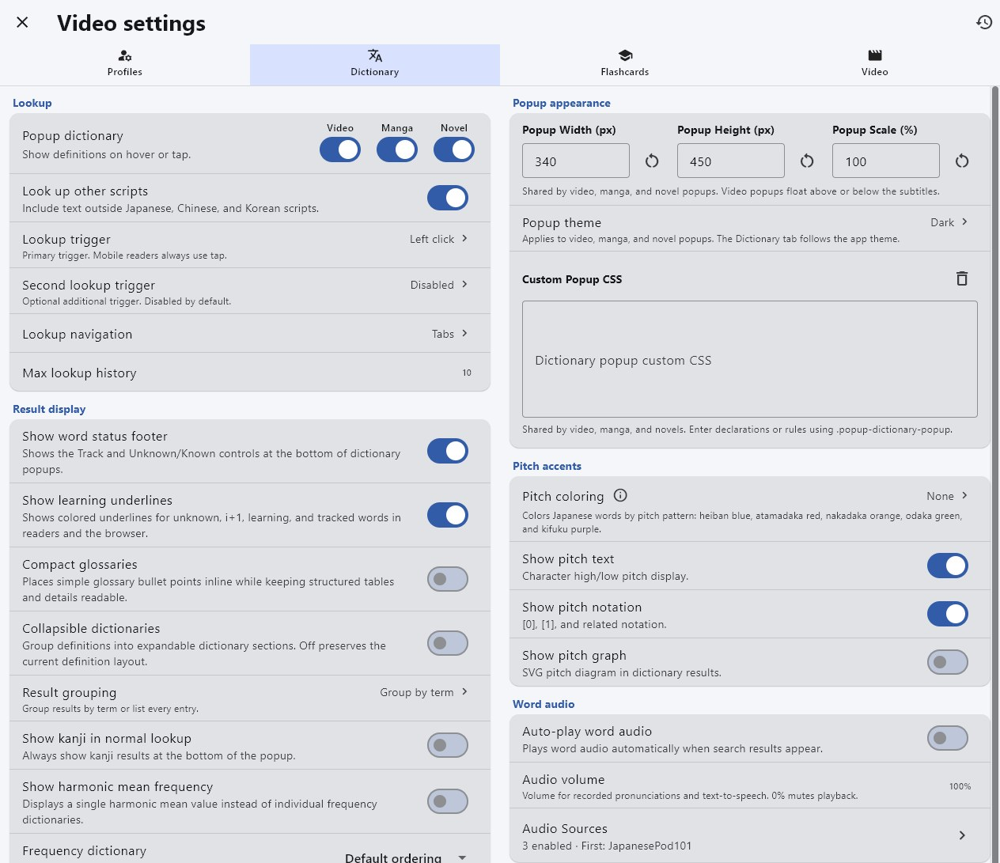{height=500 width=800}

Kolom kiri mengatur cara mencari kata dan isi hasilnya, kolom kanan mengatur tampilan popup, pitch accent, audio, dan daftar kamus. Pengaturan bawaannya sudah bisa langsung dipakai. Yang paling sering diubah:

| Pengaturan | Isi |
|---|---|
| Popup dictionary | Nyalakan popup untuk `Video`, `Manga`, dan `Novel` |
| Lookup trigger | Cara memunculkan popup. Bawaannya `Left click`, dan bisa ditambah cara kedua di `Second lookup trigger` |
| Show word status footer | Tombol `Track` dan `Unknown/Known` di bawah popup |
| Show learning underlines | Garis warna di bawah kata yang belum dikenal, sedang dipelajari, atau sedang dilacak |
| Collapsible dictionaries | Hasil tiap kamus bisa dilipat supaya popup tidak terlalu panjang |
| Popup Width, Height, Scale | Ukuran popup. Berlaku untuk video, manga, dan novel sekaligus |
| Popup theme | Warna popup (terang atau gelap) |
| Custom Popup CSS | Tampilan popup sesuai seleramu, lihat [Info 2](#info-2-custom-popup-css) |
| Pitch coloring | Warna kata sesuai pola pitch accent |
| Auto-play word audio | Audio kata langsung diputar saat popup muncul |
| Installed Dictionaries | Daftar kamus yang dipasang. Urutan di sini menentukan urutan hasil di popup |

---

---

## **Kartu Flashcard**

Simpan kata yang kamu cari supaya bisa kamu ulas nanti. Pengaturannya ada di `Settings` > `Language learning` > `Flashcards`.

=== "Manatan SRS"

    Flashcard bawaan Manatan. Tidak perlu Anki atau add-on apa pun.

    1. Buka `Settings` > `Language learning` > `Flashcards`
    2. Nyalakan `Enable flashcards`, pilih `Manatan SRS`, lalu pilih dek tujuan. `Default` juga boleh untuk awal
    3. Biarkan `Card Type` di `Manatan-NoteType`
    4. Cari kata, lalu tekan tombol **plus hijau** di samping arti kata. Tombol berubah jadi ikon buku emas kalau kartu sudah tersimpan. Tombol `Track` itu fungsi lain, bukan untuk menyimpan kartu
    5. Untuk mengerjakan ulasan: `More` > `Manatan SRS` > `Decks` > pilih dek > `Study Now`

    Manatan SRS juga bisa dipakai di [browser](https://manatan.com/srs/) dengan akun Manatan, dan ada [dek buatan komunitas](https://manatan.com/srs/shared-decks) yang bisa diunduh.

    Sumber: [Manatan SRS](https://manatan.com/docs/guides/manatan-srs)

=== "Anki (AnkiConnect)"

    Untuk kamu yang sudah mengerjakan ulasan di **Anki desktop**. Manatan dan Anki harus di komputer yang sama.

    1. Di Anki, buka `Tools` > `Add-ons` > `Get Add-ons`, masukkan kode `2055492159` ([AnkiConnect](https://ankiweb.net/shared/info/2055492159)), lalu klik `OK`
    2. Tutup lalu buka lagi Anki. Biarkan Anki tetap terbuka selama mengirim kartu
    3. Di Manatan, buka `Settings` > `Language learning` > `Flashcards`
    4. Nyalakan `Enable flashcards` dan pilih `AnkiConnect`
    5. Pakai alamat `http://127.0.0.1:8765`, lalu klik `Retry Connection` kalau perlu sampai muncul `Connected`
    6. Pilih dek di `Target Deck`, lalu pilih `Manatan-NoteType (default)` di `Card Type`. Note type ini dipasang otomatis saat kartu pertama dibuat, dan field-nya sudah diatur, jadi tidak perlu dicocokkan satu per satu
    7. Cari kata, klik tombol **plus hijau** (`Add to Anki`) **sekali**, lalu tunggu. Setelah berhasil, tombolnya berubah jadi `Open in Anki`
    8. Cek kartunya di Anki dulu sebelum menambah banyak kartu

    Audio dan gambar tergantung sumbernya, jadi field media yang kosong belum tentu berarti koneksinya gagal.

    !!!warning "Khusus Anki desktop"
        Langkah di atas untuk Anki di PC. AnkiDroid (Android) dan AnkiMobile (iOS) memakai cara lain, jadi jangan ikuti langkah pasang add-on ini di HP. Kalau kamu belajar di HP, pakai Manatan SRS saja.

    ??? info "Mau pakai Lapis, Kiku, Senren, atau Mining-JP? <small>(klik di sini)</small>"

        Untuk setup baru, Manatan menyarankan Manatan-NoteType. Note type lain tetap bisa dipakai, tapi field-nya harus diisi sendiri. Isiannya ada di [Field Note Type di Manatan](manatan-field-note-type.md).

        Kiku butuh Anki 25.09 ke atas dan sangat bergantung pada Anki desktop, jadi kurang cocok kalau kamu sering mengerjakan ulasan di HP. Detailnya di [Memperbarui Note Type](pembaruan-note-type.md).

    Sumber: [Connect Manatan to Anki](https://manatan.com/docs/guides/ankiconnect-guide) dan [Kiku custom note type](https://manatan.com/docs/guides/kiku-guide)

### **Isi field sesuai note type**

Tiap note type punya kebutuhan sendiri. Sebelum memakai note type selain Manatan-NoteType, baca dulu panduan note type tersebut: field apa yang harus diisi, dan apakah field-nya perlu template khusus.

Di Manatan, tiap field di `Field mapping` punya dua pilihan: isi kartunya (`Card content`) dan `Update Mode`. `Update Mode` menentukan apa yang terjadi pada field itu kalau kamu menambang kata yang kartunya sudah ada.

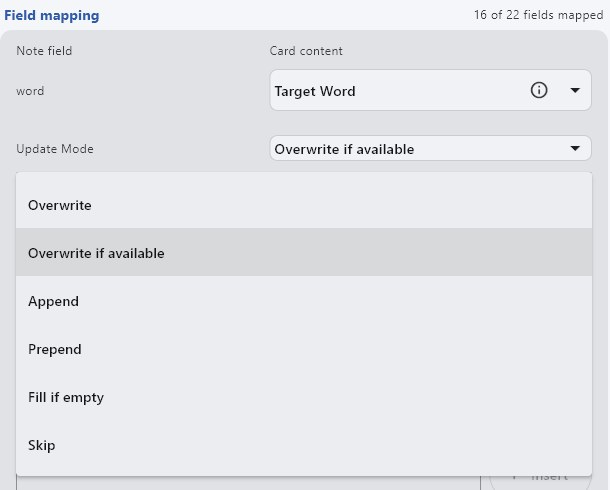{height=400 width=500}

| Update Mode | Yang terjadi pada field |
|---|---|
| Overwrite | Isi lama diganti isi baru |
| Overwrite if available | Isi lama diganti hanya kalau isi baru tidak kosong |
| Append | Isi baru ditambahkan di belakang isi lama |
| Prepend | Isi baru ditambahkan di depan isi lama |
| Fill if empty | Diisi hanya kalau field masih kosong |
| Skip | Field tidak diubah |

Kartu yang sudah ada diatur di bagian `Duplicates` di paling bawah. `Check for Duplicates` memeriksa apakah kata itu sudah punya kartu, lalu `Duplicate Action` menentukan tindakannya: `Prevent` (tidak membuat kartu), `Overwrite` (memperbarui kartu lama sesuai `Update Mode` tiap field), atau `Add anyway` (tetap membuat kartu baru). `Check Scope` menentukan pemeriksaannya di dek mana saja.

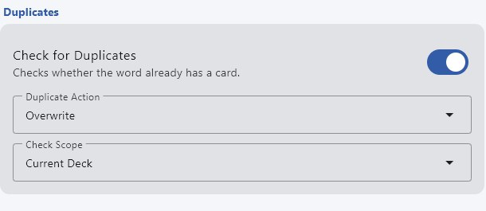{height=250 width=500}

Kebanyakan note type hanya menyimpan satu kalimat per kartu. Untuk note type seperti itu, field kalimat sebaiknya `Overwrite` supaya kalimat tidak menumpuk.

Isian lengkap untuk Lapis, Kiku, Senren, dan Mining-JP ada di [Field Note Type di Manatan](manatan-field-note-type.md).

??? example "Contoh: Senren dengan banyak adegan <small>(klik di sini)</small>"

    [Senren](https://brenoaqua.github.io/Senren/scene_switching) bisa menyimpan beberapa adegan (kalimat, gambar, dan audio) untuk satu kata, lalu kamu bisa berpindah adegan di kartunya. Supaya ini jalan, menambang kata yang sama harus menambah adegan ke kartu lama, bukan membuat kartu baru atau menghapus adegan sebelumnya:

    1. Di `Card Type`, pilih `Senren`.
    2. Di bagian `Duplicates`, nyalakan `Check for Duplicates` dan pilih `Overwrite` di `Duplicate Action`.
    3. Atur `Update Mode` field berikut ke `Append`: `picture`, `sentence`, `sentenceFurigana`, `sentenceAudio`, dan `miscInfo`. Kalau kamu memakai terjemahan kalimat, `sentenceTranslation` juga `Append`.
    4. Field lain yang isinya tetap, seperti kata, bacaan, pitch, dan frekuensi, pakai `Overwrite if available`. Field yang hanya perlu diisi sekali, seperti arti kata dan audio kata, pakai `Fill if empty`. Daftar lengkapnya ada di [tab Senren](manatan-field-note-type.md#isian-per-note-type).
    5. Untuk `sentence` dan `sentenceFurigana`, pilih `Custom Template` dan bungkus isinya dengan `...`. Tanda ini yang memisahkan satu adegan dengan adegan berikutnya.

    Tombol pindah adegan baru muncul kalau kartunya punya minimal dua audio kalimat.

    Sumber: [Senren: scene switching](https://brenoaqua.github.io/Senren/scene_switching)

---

## **Info Tambahan dan Tips**

#### Info 1: Pembuatan Kategori

??? info "Penambahan kategori Anime dan Manga <small>(klik di sini)</small>"

    Kamu bisa membuat kategori dengan cara:

    1. Tekan tombol `More` (titik tiga di bawah).
    2. Tekan `Edit Category Manga/Anime`.

#### Info 2: Custom Popup CSS

??? info "Custom Popup CSS <small>(klik di sini)</small>"

    Sekarang Manatan hanya punya satu kolom `Custom Popup CSS`, dan isinya berlaku untuk popup di video, manga, dan novel sekaligus. Kolom ini ada di [pengaturan Popup Dictionary](#pengaturan-popup-dictionary), di kolom kanan bagian `Popup appearance`.

    Tulis aturannya untuk `.popup-dictionary-popup`, seperti keterangan di bawah kolomnya. Custom CSS buatan pengguna lain bisa kamu dapatkan di server [Discord Manatan](https://discord.gg/h9xJzTqjrZ). CSS lama yang dulu dibuat terpisah untuk anime dan manga mungkin perlu disesuaikan dulu.

#### Tips 1: Media dalam bahasa lain

??? tip "Pencarian media dalam bahasa lain <small>(klik di sini)</small>"

    Manatan juga bisa dipakai untuk membaca dan menonton dalam bahasa lain. Caranya:

    1. Buka menu `Browse`.
    2. Tekan tombol tiga garis di kanan atas.
    3. Pilih bahasa penyedia yang diinginkan.

    Setelah itu, setiap sumber dari bahasa yang sudah diaktifkan juga akan muncul di hasil pencarian. Kamus Yomitan dalam bahasa lain bisa kamu temukan [di sini](https://github.com/MarvNC/yomitan-dictionaries).

    !!! warning "Popup kamus untuk bahasa lain"
        Menonton dan membaca dalam bahasa apa pun bisa dilakukan gratis. Popup kamusnya lain cerita: kamus, flashcard, dan pengaturan disimpan per **profil**, dan tiap profil hanya punya satu bahasa belajar. Versi gratis hanya punya satu profil (`Default`, bahasa Jepang). Profil tambahan untuk bahasa lain butuh membership Manatan.

        Profil gratis memang bisa diganti bahasanya lewat `Settings` > `Profiles` > ikon tiga titik > `Change language`, tapi setelah itu profil tersebut tidak lagi berbahasa Jepang.

        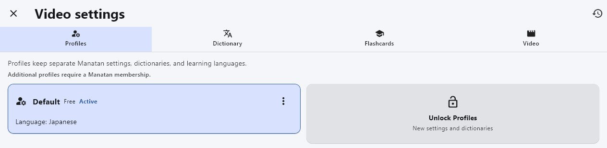{height=300 width=800}

#### Tips 2: Mode putar dan shortcut pemutar video

??? tip "Mode putar dan shortcut pemutar video <small>(klik di sini)</small>"

    Mode putar dibuka dari ikon pengaturan putar (nomor 8 di gambar [Tata Letak](#anime)).

    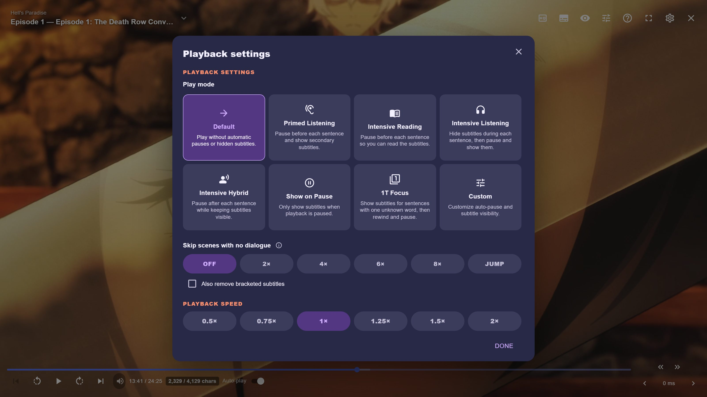{height=1000 width=600}

    | Mode | Cara kerja |
    |---|---|
    | Default | Diputar biasa, tanpa jeda otomatis dan tanpa menyembunyikan subtitle |
    | Primed Listening | Jeda sebelum tiap kalimat dan tampilkan subtitle kedua |
    | Intensive Reading | Jeda sebelum tiap kalimat supaya subtitle sempat dibaca |
    | Intensive Listening | Subtitle disembunyikan selama kalimat diucapkan, lalu video jeda dan subtitle muncul |
    | Intensive Hybrid | Jeda setelah tiap kalimat, subtitle tetap terlihat |
    | Show on Pause | Subtitle hanya muncul saat video dijeda |
    | 1T Focus | Subtitle muncul untuk kalimat yang hanya punya satu kata yang belum kamu kenal, lalu video mundur dan jeda |
    | Custom | Atur sendiri kapan video jeda dan kapan subtitle terlihat |

    Di bawahnya ada `Automatic resume` untuk melanjutkan video otomatis setelah jeda mode belajar, `Skip scenes with no dialogue` untuk mempercepat (2× sampai 8×) atau melompati adegan tanpa dialog, dan `Playback Speed` untuk kecepatan video.

    Shortcut keyboard (bisa juga dilihat dari ikon tanda tanya):

    | Tombol | Fungsi |
    |---|---|
    | `Space` | Putar atau jeda |
    | `←` / `→` | Kalimat subtitle sebelumnya / berikutnya |
    | `↑` | Ulangi kalimat yang sedang tampil |
    | `↓` | Sembunyikan atau tampilkan subtitle |
    | `Shift` + `↓` | Sembunyikan atau tampilkan subtitle kedua |
    | `Shift` + `←` / `→` | Mundur / maju beberapa detik |
    | `Ctrl` + `←` / `→` | Jadikan detik ini awal kalimat subtitle sebelumnya / berikutnya |
    | `Ctrl` + `Shift` + `←` / `→` | Subtitle 100 ms lebih cepat / lebih lambat |

---

## **Pertanyaan Umum**

#### Pertanyaan 1: Rekomendasi sumber anime dan manga?

??? question "Source mana saja yang direkomendasikan untuk sumber Anime dan Manga? <small>(klik di sini)</small>"

    - Untuk anime, lihat [daftar ekstensi anime yang sudah dicoba](#ekstensi-anime-yang-sudah-dicoba). Pilih yang softsub supaya subtitle bawaannya bisa diganti subtitle Jepang
    - Untuk manga, sebaiknya pasang sebanyak mungkin sumber manga, termasuk ekstensi dengan tag `18+`, karena ketersediaan manga di tiap penyedia sangat beragam. Beberapa rekomendasi utama yang sudah diuji:
        - MangaMura (memiliki tag 18+, tapi tidak semua isinya berupa manga 18+)
        - Love4u (memiliki tag 18+, tapi tidak semua isinya berupa manga 18+)
        - Rawkuma (memiliki tag 18+, tapi tidak semua isinya berupa manga 18+)

#### Pertanyaan 2: Manga yang kamu cari tidak ada, bagaimana mencarinya?

??? question "Manga yang kamu cari tidak ada? Kenapa? <small>(klik di sini)</small>"

    Ketersediaan manga sangat bergantung pada penyedia ekstensi. Untuk memudahkan pencarian:

    1. Aktifkan `Show NSFW` di pengaturan.
    2. Tambahkan sumber seperti MangaMura dan Rawkuma, atau lebih baik lagi pasang semua ekstensi di kategori 日本語.
    3. Setelah sumbernya terpasang, `Show NSFW` boleh dibiarkan menyala atau dimatikan lagi.

#### Pertanyaan 3: Kapan kamus diperbarui? Harus memperbarui sendiri?

??? question "Kapan kamusnya diperbarui? Perlu diperbarui sendiri? <small>(klik di sini)</small>"

    - Kamus jarang diperbarui dan isinya jarang berubah, jadi tidak perlu buru-buru pindah ke versi terbaru.  
	- Kalau ingin selalu memakai versi terbaru, kamu bisa memperbaruinya sendiri tiap 4 bulan sekali.

#### Pertanyaan 4: Apakah Manatan butuh browser?

??? question "Apakah Manatan butuh browser? <small>(klik di sini)</small>"

    - Tidak. Versi sekarang memakai tampilan aplikasi sendiri di desktop dan HP. Versi lama memakai Web UI di browser, jadi panduan lama yang menunjukkan panel menu di kiri mungkin tidak cocok lagi
    - Manatan SRS punya versi [browser](https://manatan.com/srs/) terpisah yang bisa dipakai tanpa memasang aplikasi

#### Pertanyaan 5: Apakah OCR jalan offline?

??? question "Apakah OCR jalan offline? <small>(klik di sini)</small>"

    - OCR bisa memakai Google Cloud Vision API. Kalau diaktifkan, bagian gambar yang kamu pilih dikirim lewat internet untuk dibaca teksnya
    - OCR bisa dimatikan kapan saja di pengaturan

#### Pertanyaan 6: Apakah Manatan sudah termasuk sumber anime dan manga?

??? question "Apakah Manatan sudah termasuk sumber anime dan manga? <small>(klik di sini)</small>"

    - Tidak. Manatan hanya pembaca dan pemutar. Sumber daring perlu kamu tambahkan sendiri lewat [ekstensi](#pasang-ekstensi), atau pakai file milikmu sendiri

---

## **Masalah Umum**

#### Masalah 1: Manatan tidak terbuka

??? warning "Manatan tidak terbuka <small>(klik di sini)</small>"
    - Pastikan installer yang kamu pasang sesuai dengan perangkatmu (lihat tabel di [Persiapan](#persiapan))
    - Tutup lalu buka lagi aplikasinya, dan tunggu sampai setup awal selesai
    - Catat versi aplikasi dan pesan error yang muncul sebelum minta bantuan
    - Versi sekarang tidak lagi memakai alamat browser seperti `127.0.0.1:4568`. Alamat itu hanya untuk versi lama (Web UI)

#### Masalah 2: File lokal tidak muncul

??? warning "File lokal tidak muncul <small>(klik di sini)</small>"
    - Pastikan jalur folder lokal sudah benar di pengaturan.
    - Pastikan struktur folder sesuai dengan panduan.
    - Segarkan (refresh) daftar setelah menambahkan file.

    Panduan:

    - [Manga lokal](Setup-Manatan-manga-lokal.md)
    - [Anime lokal](Setup-Manatan-anime-lokal.md)

#### Masalah 3: Popup kamus tidak muncul atau hasilnya salah

??? warning "Popup kamus tidak muncul atau hasilnya salah <small>(klik di sini)</small>"
    - Pastikan impor kamus selesai, tombol kamusnya nyala, dan popup untuk `Video`/`Manga`/`Novel` sudah dinyalakan. Lihat [cara impor kamus](#kamus)
    - Coba dulu satu kata umum di EPUB yang teksnya bisa dipilih
    - Halaman manga berupa gambar, jadi teksnya harus dibaca OCR dulu sebelum bisa dicari di kamus
    - Pastikan yang kamu impor kamus definisi, bukan cuma kamus frekuensi atau pitch

#### Masalah 4: Subtitle hilang atau tidak sinkron

??? warning "Subtitle hilang atau tidak sinkron <small>(klik di sini)</small>"
    - Coba trek subtitle lainnya.
    - Geser waktu subtitle 100 ms per klik dengan tombol `‹` dan `›` di kanan bawah pemutar. Lihat [fungsi tiap tombol](#anime).
    - Untuk file lokal, pastikan subtitle memang ada di dalam file videonya.
    - Menambah kamus tidak akan memunculkan subtitle yang memang tidak ada.

#### Masalah 5: Kartu tidak masuk ke Anki

??? warning "Kartu tidak masuk ke Anki <small>(klik di sini)</small>"
    - Pastikan Anki desktop terbuka dan sudah dibuka ulang setelah memasang AnkiConnect
    - Cek di Anki `Tools` > `Add-ons` bahwa AnkiConnect aktif
    - Pastikan alamat di Manatan sama dengan port AnkiConnect (biasanya `8765`), dan dek tujuannya benar
    - Kalau katanya sudah pernah dijadikan kartu, cek pengaturan duplikat dulu
    - Jangan membuka akses AnkiConnect ke internet atau mematikan pengaman hanya supaya koneksinya jalan

#### Masalah 6: Mau reset data aplikasi

??? warning "Mau reset data aplikasi <small>(klik di sini)</small>"
    - **Jangan** langsung menghapus folder aplikasi sebagai langkah pertama
    - Ekspor atau cadangkan dulu library, koleksi ulasan (SRS), dan pengaturanmu
    - Kalau tidak yakin data mana yang akan terhapus, tanya dulu di Discord

#### Masalah 7: Masih bingung?

??? warning "Masih bingung? <small>(klik di sini)</small>"
    Tanyakan di [Discord Manatan](https://discord.gg/tDAtpPN8KK). Supaya cepat dibantu, sertakan:

    - Perangkat dan sistem operasi
    - Versi Manatan
    - Langkah mana yang bermasalah
    - Reader dan kamus yang dipakai, kalau berkaitan
    - Apa yang kamu harapkan, apa yang terjadi, dan pesan error-nya

    Hapus info akun dan konten pribadi dari screenshot sebelum dibagikan. Jangan pernah membagikan password atau token.
