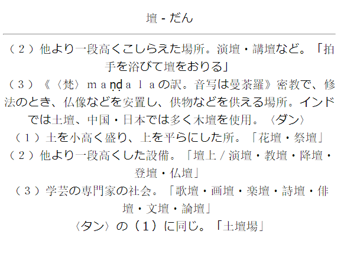
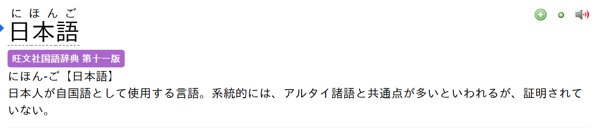

# Apakah kamu sudah pakai font yang benar?

---

!!! info "Terjemahan dari TheMoeWay"
    Halaman ini terjemahan bahasa Indonesia dari [panduan font](https://learnjapanese.moe/font/) di TheMoeWay, ditulis oleh **shoui** dan kontributor TheMoeWay. Sebagian referensi dan sumber belajar diganti ke versi bahasa Indonesia.

    Versi asli dan terjemahan ini sama-sama berlisensi [GPL-3.0](https://www.gnu.org/licenses/gpl-3.0.html). Kalau kamu nyaman baca bahasa Inggris, baca [versi aslinya](https://learnjapanese.moe/font/).


Komputer dan HP biasanya menampilkan kanji dengan font China. Bentuk kanji Jepang sedikit berbeda. Kalau matamu terbiasa dengan bentuk versi China, kamu bisa salah ingat bentuk kanji yang benar, apalagi saat menulis.

---

## Cek Font Kamu

Kanji yang paling kelihatan bedanya adalah [直](https://jisho.org/search/%E7%9B%B4%20%23kanji), yang dipakai di kata [直す](https://jpdb.io/search?q=%E7%9B%B4%E3%81%99) (*naosu*, memperbaiki).

<div style="display: flex; gap: 20px;">
  <figure style="text-align: center;">
    
    <figcaption>Naosu di font China (DengXian)</figcaption>
  </figure>

  <figure style="text-align: center;">
    
    <figcaption>Naosu di font Jepang (IPAex Gothic)</figcaption>
  </figure>
</div>

Lihat 直 di kalimat sebelumnya. Kalau bentuknya seperti gambar kanan, kamu sudah pakai font Jepang dan halaman ini bisa dilewati. Kalau seperti gambar kiri, ikuti langkah sesuai perangkatmu di bawah.

---

## Windows

Pilih salah satu cara.

=== "Cara 1: Pasang font Jepang (disarankan)"

    1. Tekan ++win+i++ untuk membuka `Settings`
    2. Buka `System` > `Optional features`
    3. Klik `View features` (di samping `Add an optional feature`)
    4. Ketik `Japanese` di kolom pencarian
    5. Centang `Japanese supplemental fonts`, lalu klik `Next` > `Install`

    Di Windows 10, jalurnya `System` > `Optional features` > `Add a feature`, lalu cari `Japanese supplemental fonts` dan klik `Install`.

    ??? tip "Cara lanjutan: PowerShell"
        Font Jepang juga bisa dipasang lewat `Windows PowerShell (Administrator)`. Tidak perlu restart.

        ```powershell
        Add-WindowsCapability -Online -Name Language.Fonts.Jpan~~~und-JPAN~0.0.1.0
        ```

    Setelah fontnya terpasang, atur font di browser berbasis Chromium (Chrome, Edge, Brave, dan sejenisnya):

    1. Buka menu :material-dots-vertical: > `Settings` > `Appearance` (di Brave namanya `Content`) > `Customize fonts`
    2. Atur fontnya seperti ini:
        - `Standard font`: `Meiryo UI`
        - `Serif font`: `Yu Mincho`
        - `Sans-serif font`: `Meiryo`
        - `Fixed-width font`: `MS Gothic`

    Di Firefox, pengaturan ini biasanya sudah otomatis.

=== "Cara 2: Jadikan bahasa Jepang bahasa tampilan"

    Cara ini paling pasti membuat kanji tampil versi Jepang, tapi **seluruh tampilan Windows ikut berubah jadi bahasa Jepang**. Pakai hanya kalau kamu memang mau.

    1. Buka `Settings` > `Time & language` > `Language & region`
    2. Klik `Add a language`, cari `Japanese`, pilih, lalu klik `Next`
    3. Centang `Set as my Windows display language`. Pastikan `Language pack` dan `Basic typing` juga tercentang
    4. Klik `Install`
    5. Setelah unduhan selesai, Windows akan meminta kamu `Sign out` untuk menerapkan bahasa barunya

??? question "Sudah pasang font Jepang, tapi kanji masih versi China?"
    Biasanya karena `Chinese supplemental fonts` juga terpasang. Ubah locale sistem ke Jepang:

    1. Tekan ++win+r++ untuk membuka kotak `Run`
    2. Ketik `intl.cpl`, lalu tekan ++enter++
    3. Buka tab `Administrative`, lalu klik `Change system locale...`
    4. Pilih `Japanese (Japan)`, lalu klik `OK`

---

## macOS

Tambahkan bahasa Jepang sebagai bahasa pilihan:

1. Buka menu Apple > `System Settings` > `General` > `Language & Region`
2. Di `Preferred Languages`, klik `+`, lalu pilih `Japanese 日本語`

Bahasa tampilan Mac tidak berubah selama bahasa Jepang tidak kamu taruh di urutan teratas.

---

## Linux

Di Linux, font untuk kanji ditentukan oleh font yang terpasang dan aturan fontconfig. Kalau font Jepang belum ada atau urutannya salah, kanji tampil dengan bentuk China. Bahasa sistem tidak perlu diganti ke Jepang.

Semua perintah di bawah dijalankan di Terminal. Salin satu blok, tempel, tekan ++enter++, lalu lanjut ke langkah berikutnya.

### 1. Pasang font Jepang

=== "Ubuntu, Debian, Linux Mint"

    ```bash
    sudo apt update
    sudo apt install fonts-noto-cjk
    ```

=== "Arch"

    ```bash
    sudo pacman -S noto-fonts-cjk
    ```

Paket ini berisi font Noto CJK yang punya bentuk kanji Jepang, China, dan Korea sekaligus. Langkah berikutnya memastikan bentuk Jepang yang dipakai untuk teks bahasa Jepang.

### 2. Buat aturan fontconfig

Salin seluruh blok ini ke Terminal sekaligus, dari baris `mkdir` sampai baris `EOF`:

```bash
mkdir -p ~/.config/fontconfig/conf.d
cat > ~/.config/fontconfig/conf.d/99-japanese-fonts.conf <<'EOF'
<?xml version="1.0"?>
<!DOCTYPE fontconfig SYSTEM "fonts.dtd">
<fontconfig>
  <match>
    <test name="lang" compare="contains"><string>ja</string></test>
    <test name="family"><string>sans-serif</string></test>
    <edit name="family" mode="prepend"><string>Noto Sans CJK JP</string></edit>
  </match>
  <match>
    <test name="lang" compare="contains"><string>ja</string></test>
    <test name="family"><string>serif</string></test>
    <edit name="family" mode="prepend"><string>Noto Serif CJK JP</string></edit>
  </match>
  <match>
    <test name="lang" compare="contains"><string>ja</string></test>
    <test name="family"><string>monospace</string></test>
    <edit name="family" mode="prepend"><string>Noto Sans Mono CJK JP</string></edit>
  </match>
</fontconfig>
EOF
```

Perintah ini membuat file baru khusus untuk aturan font Jepang. File `fonts.conf` milikmu, kalau ada, tidak disentuh.

??? info "Apa isi aturan ini?"
    Setiap kali aplikasi meminta font sans-serif, serif, atau monospace untuk teks berbahasa Jepang, fontconfig mendahulukan versi JP dari Noto CJK. Font untuk bahasa lain tidak berubah.

### 3. Terapkan aturannya

```bash
fc-cache -f
```

Tutup lalu buka lagi aplikasi yang mau diperbaiki, termasuk browser. Komputer tidak perlu di-restart.

### 4. Periksa hasilnya

Jalankan:

```bash
fc-match 'sans-serif:lang=ja'; fc-match 'serif:lang=ja'; fc-match 'monospace:lang=ja'
```

Ketiga baris hasilnya harus menyebut nama font ini, berurutan:

| Jenis | Hasil yang benar |
|---|---|
| Sans-serif | `Noto Sans CJK JP` |
| Serif | `Noto Serif CJK JP` |
| Monospace | `Noto Sans Mono CJK JP` |

Kalau yang muncul `SC`, `TC`, `KR`, atau font lain, ulangi langkah 2 dan 3.

Setelah itu, buka lagi bagian [Cek Font Kamu](#cek-font-kamu) dan lihat bentuk 直. Kalau masih versi China, lanjut ke [Kalau Font China Masih Muncul di Browser](#kalau-font-china-masih-muncul-di-browser).

??? info "Opsional: tambahkan locale Jepang"
    Tidak wajib untuk memperbaiki font. Locale Jepang hanya membantu aplikasi yang menebak bahasa dari locale sistem.

    === "Ubuntu, Debian, Linux Mint"

        1. Jalankan `sudo dpkg-reconfigure locales`
        2. Cari `ja_JP.UTF-8`, lalu tekan ++space++ untuk mencentangnya
        3. Tekan ++enter++
        4. Saat diminta memilih locale default, **tetap pilih locale yang sekarang kamu pakai** (misalnya `en_US.UTF-8`), bukan Jepang

    === "Arch"

        1. Buka `/etc/locale.gen`, lalu hapus tanda `#` di depan baris `#ja_JP.UTF-8 UTF-8`
        2. Jalankan `sudo locale-gen`

??? question "Mau membatalkan semua perubahan ini?"
    Hapus file aturannya, lalu perbarui cache font:

    ```bash
    rm ~/.config/fontconfig/conf.d/99-japanese-fonts.conf
    fc-cache -f
    ```

    Tutup lalu buka lagi aplikasimu. Font Noto CJK boleh tetap terpasang.

Rujukan: [Arch Wiki: Font configuration](https://wiki.archlinux.org/title/Font_configuration/Examples#Japanese), [contoh file dari tatsumoto-ren](https://github.com/tatsumoto-ren/dotfiles/blob/main/.config/fontconfig/conf.d/99-japanese-fonts.conf).

---

## Kalau Font China Masih Muncul di Browser

### Chromium (Chrome, Edge, Brave)

Kadang font China tetap muncul walaupun pengaturan sistem sudah benar. Paksa fontnya:

1. Buka menu :material-dots-vertical: > `Settings` > `Appearance` > `Customize fonts`
2. Atur fontnya seperti ini:
    - `Standard font`: `Noto Sans CJK JP Regular`
    - `Serif font`: `Noto Serif CJK JP Regular`
    - `Sans-serif font`: `Noto Sans CJK JP Regular`
    - `Fixed-width font`: `Noto Sans Mono CJK JP Regular`

Di Windows yang tidak punya font Noto, pakai pengaturan Meiryo dari [Cara 1](#windows).

### Firefox

Firefox memakai font China sebagai cadangan kalau bahasa Jepang tidak ada di pengaturan bahasanya, atau kalau halaman web tidak menandai teksnya sebagai bahasa Jepang (`lang="ja"`). Untuk mengubahnya:

1. Buka `about:config` di tab baru
2. Lewati halaman peringatan kalau muncul
3. Cari `font.cjk_pref_fallback_order`
4. Pindahkan `ja` ke posisi paling depan

!!! warning "Jangan hapus komanya"
    Koma memisahkan tiap kode bahasa, jadi jangan sampai ikut terhapus.

=== "Sebelum"
    
=== "Sesudah"
    

---

## Android

Tambahkan bahasa Jepang (tertulis 日本語) sebagai bahasa kedua di pengaturan bahasa HP. Bahasa tampilan HP tidak berubah selama bahasa Jepang tidak kamu geser ke urutan teratas.


---

## iOS

Tambahkan keyboard Jepang, kana atau romaji, pilih yang nyaman untukmu. Biasanya ini sudah cukup.

---

## Anki

Font China paling terasa mengganggu di kartu Anki. Kana tampil sans-serif sementara kanjinya serif, ukurannya tidak seimbang, **dan** bentuk kanjinya versi China.

<figure>
  
  <figcaption>Sayangnya, banyak kartu orang yang tampilannya seperti ini.</figcaption>
</figure>

Kalau font Jepang sudah terpasang di sistem, Anki seharusnya otomatis memakainya. Kalau tidak, paksa dengan salah satu cara di bawah. Font yang disarankan adalah IPAex Gothic, font sans-serif Jepang yang rapi. [Unduh di sini](https://moji.or.jp/wp-content/ipafont/IPAexfont/ipaexg00401.zip).

=== "Pasang font di sistem"

    1. Pasang fontnya, lalu restart komputer:
        - Windows: klik dua kali file fontnya, lalu klik `Install`
        - macOS: seret file fontnya ke Font Book
        - Linux: pindahkan file ke `~/.local/share/fonts/`, lalu jalankan `fc-cache -f -v`
    2. Di Anki, buka `Add` > `Cards` > `Styling`
    3. Atur `font-family` di bagian `.card`:

        ```css
        .card {
          font-family: IPAexGothic; /* font yang dipakai kartu */
        }
        ```

=== "Taruh font di collection.media"

    Cara ini juga jalan di AnkiDroid, karena fontnya ikut tersinkron bersama kartu.

    1. Ganti nama file font supaya diawali garis bawah, misalnya `_ipaexg.ttf`. Tanpa garis bawah, `Check Media` di Anki menganggap file ini tidak terpakai dan bisa menghapusnya
    2. Salin file font itu ke folder `collection.media`:
        - Windows: `C:\Users\<user>\AppData\Roaming\Anki2\(profile)\collection.media`
        - macOS: `~/Library/Application Support/Anki2/(profile)/collection.media`
        - Linux: `~/.local/share/Anki2/(profile)/collection.media`
        - Android: `/storage/emulated/0/AnkiDroid/collection.media`
    3. Di Anki, buka `Add` > `Cards` > `Styling`
    4. Tambahkan kode ini

        ```css
        @font-face {
          font-family: CustomFont; /* nama font, bebas */
          src: url('_ipaexg.ttf'); /* nama file font di collection.media */
        }

        .card {
          font-family: CustomFont; /* pakai nama font di atas */
        }
        ```

    !!! warning "Jangan salin mentah-mentah"
        Kalau styling kartumu sudah punya `.card`, cukup tambahkan baris yang belum ada. Jangan timpa seluruh isinya.

Hasilnya:

=== "Definisi bahasa Jepang"
    
=== "Definisi bilingual"
    

Ganti juga font editor Anki supaya kanji tampil benar saat kamu mengedit kartu:

1. Buka `Add` > `Fields`
2. Di setiap field, ganti `Editing font` ke salah satu font Jepang ini:
    - IPAexGothic
    - Meiryo
    - MS Gothic
    - Yu Gothic
    - Hiragino Kaku Gothic Pro
    - Noto Sans CJK JP Regular

---

## Yomitan

Yomitan seharusnya mengikuti font browser. Kalau ternyata tidak, paksa lewat `Popup CSS` di pengaturan Yomitan:

```css
.kanji-link,
.source-text,
.gloss-content,
.tag-label-content {
  font-family: IPAexGothic;
}
```

<figure>
  
  <figcaption>Definisi Jepang-Jepang dengan font IPAex Gothic.</figcaption>
</figure>
