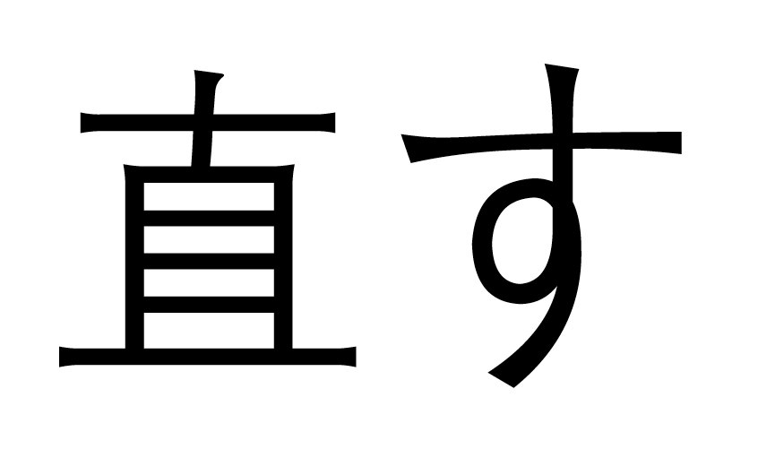
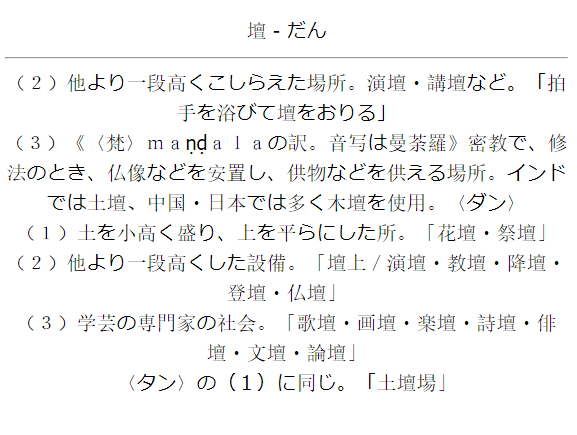
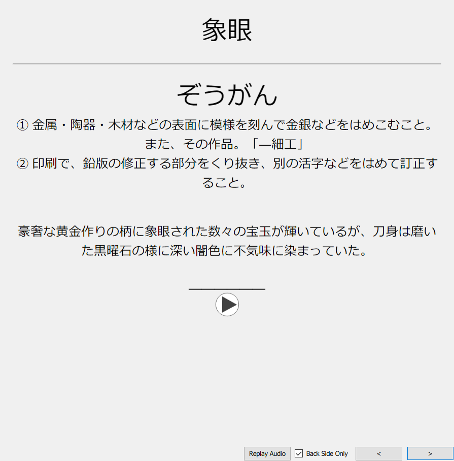
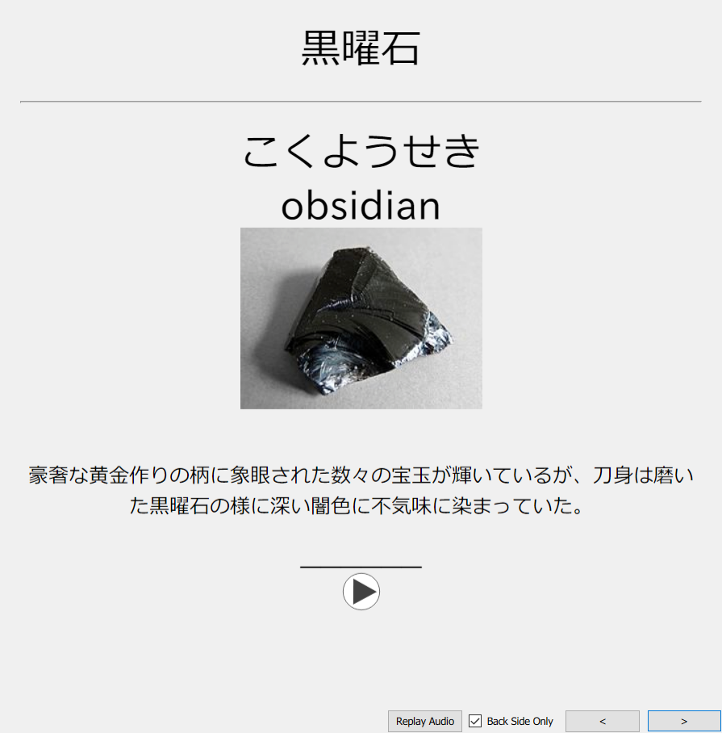
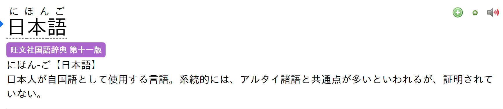

# Apakah kamu sudah pakai font yang benar?

---

Diunggah: 10 Agustus 2025 · Diperbarui: 5 November 2026 – `Yaaacha`

---

??? warning "Perhatian <small>(klik di sini)</small>"
    - Panduan ini adaptasi dan lokalisasi dari [TheMoeWay](https://learnjapanese.moe/font/), dengan referensi dan sumber belajar yang diganti ke versi bahasa Indonesia.
    - Kalau kamu nyaman baca panduan bahasa Inggris, versi aslinya ada di tautan itu.


Secara bawaan, komputer dan HP biasanya menampilkan kanji dengan font China. Bentuk kanji Jepang sedikit berbeda, dan ini bisa jadi masalah kalau matamu terbiasa melihat bentuk kanji versi China, bukan versi Jepangnya.

**Cara cek apakah browser kamu sudah pakai font Jepang**

Salah satu karakter yang paling kelihatan bedanya antara font Jepang dan China adalah [直](https://jisho.org/search/%E7%9B%B4%20%23kanji). Kanji ini dipakai di kata [直す](https://jpdb.io/search?q=%E7%9B%B4%E3%81%99) (*naosu*) yang artinya *menyembuhkan, memperbaiki, membetulkan*.


<div style="display: flex; gap: 20px;">
  <figure style="text-align: center;">
    
    <figcaption>Naosu di font China (DengXian)</figcaption>
  </figure>

  <figure style="text-align: center;">
    
    <figcaption>Naosu di font Jepang (IPAex Gothic)</figcaption>
  </figure>
</div>

Kalau 直 di layarmu bentuknya seperti gambar kedua, selamat, kamu sudah pakai font Jepang. Kalau belum, ganti fontnya dengan langkah di bawah sesuai perangkatmu.

---

## Windows 10

1. Tekan ++win+i++ untuk membuka `Settings`.
2. Buka `System` > `Optional features` > `Add a feature`.
3. Cari `Japanese supplemental fonts`, lalu klik `Install`.

??? tip "Cara lanjutan: PowerShell"
	Font Jepang juga bisa dipasang lewat `Windows PowerShell (Administrator)`:
	```powershell
	Get-WindowsCapability -Online -Name Language.Fonts.Jpan~~~und-JPAN* | Add-WindowsCapability -Online
	```  
	Tidak perlu restart.

??? question "Kamu juga punya Chinese supplemental fonts?"
	Ubah locale sistem ke `Japanese (Japan)`.
	!!! abstract "Cara ganti locale ke Jepang"
		1. Tekan ++windows+r++ untuk membuka kotak dialog Run.
		2. Ketik `intl.cpl`, lalu tekan ++enter++.
		3. Klik tab `Administrative`, lalu klik `Change system locale...`.
		4. Pilih `Japanese (Japan)`, lalu klik `OK`.
		
Kalau kamu pakai browser berbasis Chromium (misalnya Google Chrome, Brave, atau Thorium):

1. Buka menu :material-dots-vertical: > `Settings`.
2. Klik `Appearance` di menu kiri (di Brave namanya `Content`).
3. Klik `Customize fonts`.
4. Atur fontnya seperti ini:
    - `Standard font`: `Meiryo UI`
    - `Serif font`: `Yu Mincho`
    - `Sans-serif font`: `Meiryo`
    - `Monospace`: `MS Gothic`

Di Firefox, pengaturan ini biasanya sudah otomatis.

---

## macOS

Tambahkan bahasa Jepang sebagai bahasa pilihan di System Preferences:

1. Buka menu Apple > `System Preferences` > `Language & Region` > `General`.
2. Klik `Add a language`, lalu pilih `Japanese 日本語`.

---

## Linux

Pastikan `ja_JP.UTF-8` ada di daftar locale sistemmu. Kalau belum ada, hapus tanda komentar (`#`) di baris `#ja_JP.UTF-8 UTF-8` dalam file `/etc/locale.gen`, lalu jalankan:

``` bash
sudo locale-gen
```

Setelah itu, pasang paket [noto-fonts-cjk](https://archlinux.org/packages/extra/any/noto-fonts-cjk/). Paket ini ada di repositori resmi Arch, dan kalau dipasang di Arch, aturan fontconfig yang diperlukan biasanya langsung ikut teratur.

Kalau **ada bagian** dari langkah di atas yang tidak cocok untukmu (misalnya distro, font, atau cara pasangnya berbeda), fontconfig belum tentu sudah diatur dengan benar.

Kalau tidak tahu cara mengeceknya, tambahkan saja file baru berisi aturan fontconfig khusus teks Jepang di folder `~/.config/fontconfig/conf.d` (kalau foldernya belum ada, buat dulu). Sebagai acuan, pakai [bagian ini](https://wiki.archlinux.org/title/Font_configuration/Examples#Japanese) dari Arch Wiki atau [contoh file konfigurasi yang bagus ini](https://github.com/tatsumoto-ren/dotfiles/blob/main/.config/fontconfig/conf.d/99-japanese-fonts.conf) dari tatsumoto-ren.

#### Catatan

#### Browser

##### Chromium-based

Kadang font China masih saja muncul walaupun pengaturannya sudah benar (entah kenapa). Kalau begitu, paksa ganti fontnya:

1. Buka menu :material-dots-vertical: > `Settings`.
2. Klik `Appearance` di menu kiri.
3. Klik `Customize fonts`.
4. Atur fontnya seperti ini:
    - `Standard font`: `Noto Sans CJK JP Regular`
    - `Serif font`: `Noto Serif CJK JP Regular`
    - `Sans-serif font`: `Noto Sans CJK JP Regular`

##### Firefox

Kalau tidak ada bahasa Jepang di pengaturan bahasa Firefox, atau halaman web (atau sebagian halamannya) tidak mencantumkan `lang="ja"`, Firefox biasanya memakai font China sebagai cadangan. Sebabnya, font China umumnya mencakup lebih banyak karakter.

Supaya tidak begitu, ikuti langkah ini:

1. Buka `about:config` di tab baru.
2. Lewati halaman peringatan kalau muncul.
3. Cari `font.cjk_pref_fallback_order`.
4. Pindahkan `ja` ke posisi paling depan di isian (*value*) itu.

!!! warning "Jangan hapus komanya"
	Koma memisahkan tiap kode bahasa di isian itu, jadi jangan sampai ikut terhapus.

Sebelum:


Sesudah:


---

## Android

Tambahkan bahasa Jepang (tertulis 日本語) sebagai bahasa kedua. Bahasa tampilan HP tidak akan berubah selama bahasa Jepang tidak kamu geser ke urutan teratas.


---

## iOS

Cukup tambahkan keyboard Jepang (kana atau romaji, pilih yang nyaman untukmu).

---

## Anki

Menurut TheMoeWay, font China paling mengganggu justru di kartu Anki. Kana bisa tampil dengan font sans-serif sementara kanjinya serif, ukurannya tidak proporsional, **dan** bentuk kanjinya versi China. Hasilnya aneh sekali.

<figure>
  
  <figcaption>Ya ampun. Sungguh, banyak kartu orang yang tampilannya seperti ini.</figcaption>
</figure>

Kalau font Jepang sudah terpasang di sistem, seharusnya Anki otomatis memakainya. Kalau tidak, kamu bisa memaksanya.

### Paksa font Jepang di Anki

IPAex Gothic adalah font sans-serif Jepang yang bagus dan disarankan untuk Anki. Unduh [di sini](https://moji.or.jp/wp-content/ipafont/IPAexfont/ipaexg00401.zip).

Pasang fontnya di sistem, lalu restart:

- Windows: klik dua kali file fontnya, lalu klik `Install`.
- macOS: seret file fontnya ke Font Book.
- Linux: pindahkan file ke `~/.local/share/fonts/`, lalu jalankan `fc-cache -f -v`.

Setelah itu, atur font kartunya di Anki:

1. Klik `Add`.
2. Klik `Cards`.
3. Klik `Styling`.
4. Atur `font-family` sesuai font yang kamu pasang:

```css
.card {
 font-family: IPAexGothic; /* di sini font diset */
}
```

Cara lain: taruh file font di folder `collection.media` milik Anki.

- Windows: `C:\Users\<user>\AppData\Roaming\Anki2\(profile)\collection.media`
- macOS: `~/Library/Application Support/Anki2/(profile)/collection.media`
- Linux: `~/.local/share/Anki2/(profile)/collection.media`
- Android: `/storage/emulated/0/AnkiDroid/collection.media`

Setelah itu, atur font kartunya di Anki:

1. Klik `Add`.
2. Klik `Cards`.
3. Klik `Styling`.
4. Ubah `font-family` ke font yang kamu mau.

!!! warning "Jangan salin mentah-mentah"
    Tambahkan saja bagian yang belum ada di styling kartumu.

```css
@font-face {
  font-family: CustomFont; /* nama font, bebas */
  src: url('ipaexg.ttf');  /* nama file font di collection.media */
}

.card {
  font-family: CustomFont; /* pakai nama font di atas */
}
```

Hasilnya:

<figure>  <figcaption>Dengan definisi bahasa Jepang penuh.</figcaption> </figure> <figure>  <figcaption>Dengan definisi bilingual.</figcaption> </figure>

Ganti juga font editor di Anki:

1. Klik `Add`.
2. Klik `Fields`.
3. Di setiap field, ganti `Editing font` ke salah satu font ini (atau font Jepang lain yang kamu tahu):
    - IPAexGothic
    - Meiryo
    - MS Gothic
    - Yu Gothic
    - Hiragino Kaku Gothic Pro
    - Noto Sans CJK JP Regular

---

## Yomitan

Yomitan seharusnya mengikuti font browser. Kalau ternyata tidak, paksa Yomitan memakai font Jepang lewat `Popup CSS`:

```css
.kanji-link {
   font-family: IPAexGothic;
}

.source-text {
   font-family: IPAexGothic;
}

.gloss-content {
   font-family: IPAexGothic;
}

.tag-label-content {
   font-family: IPAexGothic;
}
```  


<figure>
  
  <figcaption>Definisi Jepang ke Jepang dengan font IPAexゴシック.</figcaption>
</figure>


