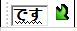

# Mengetik Bahasa Jepang

---

??? warning "Perhatian <small>(klik di sini)</small>"
    - Panduan ini adaptasi dan lokalisasi dari [TheMoeWay](https://learnjapanese.moe/ime/), dengan referensi dan sumber belajar yang diganti ke versi bahasa Indonesia.
    - Kalau kamu nyaman baca panduan bahasa Inggris, versi aslinya ada di tautan itu.
    - Versi aslinya hanya membahas Windows. Bagian macOS dan Linux ditambahkan oleh Philia Space.

Semua komputer dan HP sekarang bisa dipakai mengetik huruf Jepang. Alat untuk mengubah ketikan keyboard menjadi huruf Jepang disebut IME (*Input Method Editor*). Kamu tetap memakai keyboard biasa: ketik `nihongo` dalam huruf Latin, lalu IME mengubahnya menjadi にほんご dan menawarkan kanji 日本語.

Bahasa tampilan komputermu tidak perlu diganti ke bahasa Jepang.

---

## Windows

### Pasang IME

=== "Windows 11"

    1. Buka `Settings` > `Time & language` > `Language & region`
    2. Klik `Add a language`, cari `Japanese`, lalu klik `Next`

=== "Windows 10"

    1. Buka `Settings` > `Time & Language` > `Language` (di menu sebelah kiri)
    2. Di bagian `Preferred languages`, klik `Add a language`, cari `Japanese`, lalu klik `Next`

Secara bawaan Windows ikut memasang fitur tambahan seperti paket bahasa, pengenalan suara, dan tulisan tangan. Yang dibutuhkan untuk mengetik hanya `Basic typing`, jadi centang lainnya boleh dikosongkan.

### Pakai IME

Setelah terpasang, pindah ke keyboard Jepang dengan salah satu cara ini:

- Klik tulisan `ENG` di pojok kanan bawah taskbar, lalu pilih `Japanese (Microsoft IME)`
- Tekan ++win+space++ untuk berganti keyboard

Klik dulu kotak teks, misalnya kotak pencarian Windows, kolom alamat browser, atau Notepad, lalu mulai mengetik.

### Mode input

Keyboard Jepang punya beberapa mode input, tetapi yang akan sering kamu pakai hanya dua. Penandanya ada di taskbar:

- **A** (*Direct Input*): huruf keluar persis seperti di keyboard, sama dengan keyboard bahasa Inggris
- **あ** (*Hiragana*): ketikanmu dibaca sebagai bahasa Jepang dan diubah oleh IME

Untuk berpindah di antara keduanya, klik ikon A atau あ di taskbar, atau tekan ++alt+grave++. Tombol ++grave++ ada di sebelah kiri angka 1.

Mode awalnya A, jadi setiap kali mau mengetik bahasa Jepang kamu biasanya menekan ++alt+grave++ dulu. Windows mengingat mode ini per aplikasi, bukan untuk seluruh sistem.

??? info "Kotak IME muncul di pojok kiri atas layar"
    

    Sebagian besar aplikasi baru mengabaikan IME kalau tidak ada kotak teks yang aktif. Program Windows lama (misalnya Computer Management) dan aplikasi Java (misalnya Minecraft) berbeda: dalam mode あ, IME tetap aktif dan kotaknya muncul di pojok kiri atas layar seperti pada gambar ini.

    Karena itu, sebaiknya kamu tetap di mode A saat tidak sedang mengetik bahasa Jepang, atau pindah ke keyboard bahasa Inggris dengan ++win+space++ kalau IME mengganggu.

---

## macOS

### Pasang IME

1. Buka menu Apple > `System Settings` > `Keyboard`
2. Di bagian `Text Input`, klik `Edit...` di samping `Input Sources`
3. Klik `+` di kiri bawah, pilih `Japanese`, lalu pilih `Romaji`
4. Klik `Add`

Pilih `Romaji` supaya kamu bisa mengetik dengan huruf Latin. Mode `Kana` memakai susunan tombol keyboard Jepang yang perlu dihafal dulu.

### Pakai IME

Pindah ke keyboard Jepang dengan ++ctrl+space++, atau tekan tombol ++fn++ / Globe :globe_with_meridians: di keyboard Mac. Kamu juga bisa mengklik ikon input di menu bar, lalu memilih `Hiragana`.

Dalam mode Jepang, ++ctrl+shift+j++ berpindah ke hiragana dan ++ctrl+shift+semicolon++ kembali ke huruf Latin.

??? info "Kanji muncul sendiri sebelum menekan Space?"
    Itu fitur `Live Conversion`: macOS langsung mengubah ketikanmu menjadi kanji. Kalau lebih suka memilih kanji sendiri dengan ++space++ seperti di Windows, buka lagi `Edit...` di `Input Sources`, pilih `Japanese - Romaji`, lalu matikan `Live Conversion`.

---

## Linux

Panduan ini memakai Ubuntu dengan desktop bawaannya (GNOME) dan IME Mozc. Mozc adalah versi sumber terbuka dari Google Japanese Input, dan cara pakainya mirip Microsoft IME di Windows.

### Pasang IME

1. Buka Terminal, lalu jalankan:

    ```bash
    sudo apt update
    sudo apt install ibus-mozc
    ```

2. Keluar (*log out*) lalu masuk lagi ke akunmu supaya Mozc terbaca
3. Buka `Settings` > `Keyboard`
4. Di bagian `Input Sources`, klik `+ Add Input Source...`
5. Pilih `Japanese`, lalu pilih `Japanese (Mozc)`, dan klik `Add`

Pastikan yang kamu pilih `Japanese (Mozc)`. Pilihan `Japanese` tanpa Mozc hanya mengubah susunan tombol keyboard, sehingga ketikanmu tidak bisa diubah menjadi kanji.

??? info "Distro lain"
    Di distro lain, IME Mozc biasanya tersedia sebagai paket `ibus-mozc` atau `fcitx5-mozc`. Pasang yang sesuai dengan sistem input desktopmu (IBus atau Fcitx5), lalu tambahkan Mozc lewat pengaturan sistem input tersebut.

### Pakai IME

Tekan ++win+space++ (tombol Windows di keyboard disebut `Super` di Linux) untuk berpindah antara keyboard bahasa Inggris dan Mozc.

Kalau Mozc sudah aktif tetapi yang keluar tetap huruf Latin, berarti Mozc sedang di mode *Direct Input*. Klik indikator bahasa di pojok kanan atas layar, lalu pilih `Hiragana`.

---

## Latihan Mengetik

Pindah ke mode あ (hiragana), lalu coba ketik kata-kata berikut di Notepad, TextEdit, atau kolom teks apa saja:

- こんにちは: ketik `konnnitiha`, lalu tekan ++enter++ untuk menyelesaikan
- 案内: ketik `annnai`, tekan ++space++ sampai muncul 案内, lalu ++enter++
- 私は日本語を勉強しています: ketik `watasihanihonngowobennkyousiteimasu`. Tekan ++space++ untuk memilih kanji lain, lalu ++enter++
- コレハカタカナニュウリョクテストデス: ketik `korehakatakananyuuryokutesutodesu`, ubah semuanya ke katakana (lihat [Daftar Tombol](#daftar-tombol)), lalu ++enter++
- ←→: ketik `hidari`, tekan ++space++ sampai muncul ←, lalu ++enter++. Lakukan hal yang sama dengan `migi` untuk →

Kalau mengikuti latihan ini di Windows, coba juga:

- 記号も入力できます: ketik `kigoumonyuuryokudekimasu`, tekan ++tab++ untuk memilih saran yang muncul, lalu ++enter++
- かきくけこabc: ketik `kakikukeko`, lalu ketik `abc` sambil menahan ++shift++, dan tekan ++enter++. Menahan ++shift++ membuat ketikan berikutnya keluar sebagai huruf Latin biasa
- ＡＢＣ: sambil menahan ++shift++, ketik `abc`, lalu tekan ++enter++

??? info "Apa itu \"edit\" dan kenapa harus menekan Enter?"
    Teks yang sedang diolah IME bergaris bawah. Selama garis itu masih ada, IME masih bisa mengubah bentuknya. Teks bergaris bawah yang terlalu panjang lebih sulit diatur, karena itu biasakan menekan ++enter++ setiap kali bentuknya sudah sesuai.

??? info "Kenapa `ti`, bukan `chi`?"
    Latihan di atas memakai romanisasi Kunrei-shiki, misalnya `ti` untuk ち. Cara ini lebih cepat daripada mengetik `chi`. Romanisasi Hepburn (`chi`, `shi`, `tsu`) juga bisa dipakai, kecuali untuk partikel は dan わ yang selalu diketik `ha` dan `wa`. Coba ketik `chikurin`, `an'nai`, dan `on'na`.

??? info "Huruf dan angka yang lebar"
    Huruf seperti ＡＢＣ dan １２３ disebut huruf lebar penuh (*full-width*). Lebarnya disamakan dengan huruf Jepang supaya tulisan campuran terlihat rapi: あいうえおＡＢＣＤＥＦABCDEF. Huruf ini hanya bisa diketik dalam mode あ.

Simbol juga bisa dicari lewat bacaan Jepangnya. Ketik `ramuda` lalu tekan ++space++ untuk λ, `ponndo` untuk £, atau `enn` untuk ¥.

---

## Daftar Tombol

Tombol yang sama di ketiga sistem:

| Fungsi | Tombol |
|---|---|
| Selesaikan dan simpan teks | ++enter++ |
| Batalkan teks yang sedang diolah | ++esc++ |
| Ubah ke kanji, tekan lagi untuk pilihan lain | ++space++ |
| Pilih kandidat | ++up++ ++down++ atau tombol angka |

Tombol yang berbeda:

| Fungsi | Windows | macOS | Linux (Mozc) |
|---|---|---|---|
| Ganti keyboard (Inggris ↔ Jepang) | ++win+space++ | ++ctrl+space++ | ++win+space++ |
| Ganti mode A ↔ あ | ++alt+grave++ | ++ctrl+shift+j++ / ++ctrl+shift+semicolon++ | klik indikator di pojok kanan atas |
| Ubah ke hiragana | ++f6++ | ++ctrl+j++ | ++f6++ |
| Ubah ke katakana | ++f7++ | ++ctrl+k++ | ++f7++ |
| Ubah ke katakana lebar setengah | ++f8++ | ++ctrl+semicolon++ | ++f8++ |
| Ubah ke huruf Latin lebar penuh | ++f9++ | ++ctrl+l++ | ++f9++ |
| Ubah ke huruf Latin biasa | ++f10++ | | ++f10++ |

Di laptop, tombol ++f6++ sampai ++f10++ mungkin perlu ditekan bersama ++fn++.

Khusus Microsoft IME di Windows:

| Fungsi | Tombol |
|---|---|
| Lengkapi otomatis, atau pilih saran berikutnya | ++tab++ |
| Ubah lagi teks yang sudah diselesaikan | ++win+slash++ |
| Batalkan teks terakhir | ++ctrl+z++ |
| Kembalikan ke hiragana (sebelum ++enter++) | ++ctrl+backspace++ |
| Cari kandidat di Bing | ++ctrl+b++ |

??? info "Keyboard JIS"
    Secara bawaan, IME Jepang memakai susunan keyboard US (++shift+2++ menghasilkan `@`). Susunan keyboard JIS (106/109 tombol) hanya perlu dipilih kalau kamu memang memakai keyboard fisik buatan Jepang yang punya tombol seperti 無変換 dan 変換.
