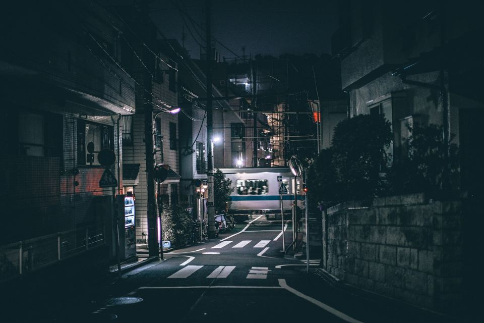
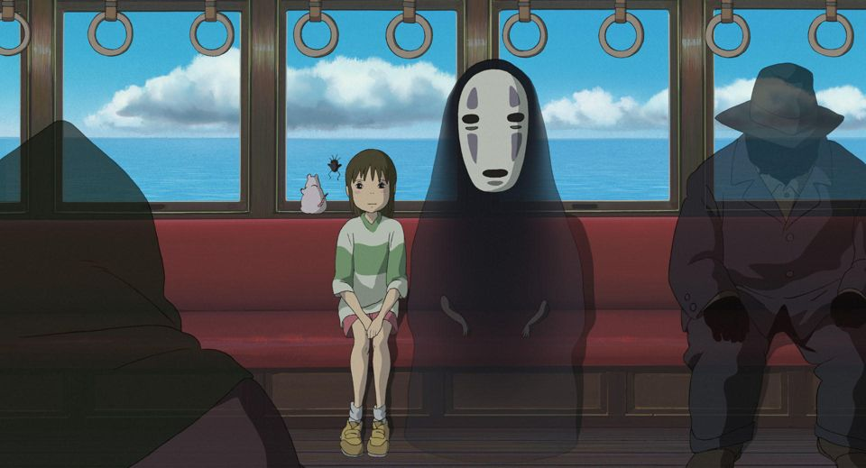
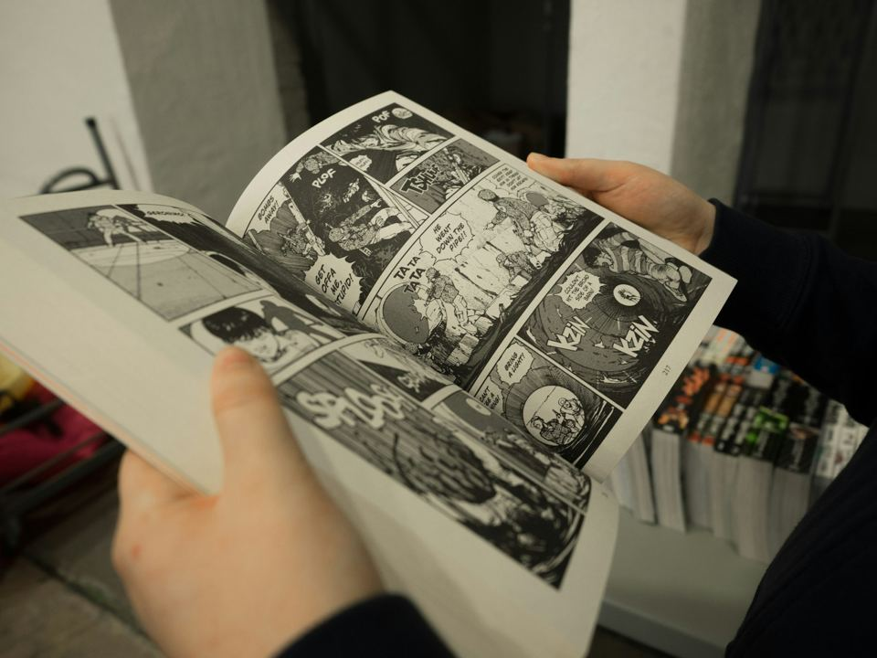
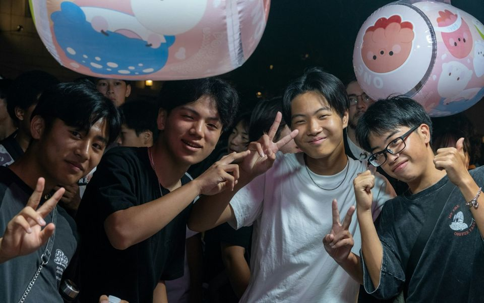

<section class="pl-hero">
  

    
Komunitas immersion bahasa Jepang

    <h1>Belajar bahasa Jepang dari anime, manga, dan novel yang kamu suka.</h1>
    
Panduan berbahasa Indonesia untuk belajar lewat immersion dan sentence mining: tonton dan baca media Jepang asli, simpan kata baru beserta kalimatnya ke Anki, lalu ulang sedikit tiap hari. Ditulis oleh anggota komunitas yang menjalani cara ini sendiri.

    

      <a href="panduan-ringkas-JP/" class="pl-btn pl-btn-primary">Mulai dari Panduan Ringkas</a>
      <a href="setup/" class="pl-btn pl-btn-secondary">Sudah bisa kana? Pasang alat mining</a>
    

    
Gratis · Teks berlisensi GPL-3.0

  

  

    
    <figure class="pl-film" aria-label="Contoh alur sentence mining">
      

        
        
この<mark>言葉</mark>、どこかで聞いたことがある。

      

      <figcaption class="pl-popup">
        Subtitle 00:12:41 · asbplayer → Yomitan → Anki
        言葉ことば コトバ [3]
        kata; bahasa; ucapan
        ✓ Kartu ditambahkan ke deck Mining
      </figcaption>
    </figure>
    
好きなことから始めよう

  

</section>

<section class="pl-section">
  <header class="pl-section-head">
    

      
Mulai dari mana

      <h2>Pilih titik mulai sesuai posisimu sekarang.</h2>
    

    
Urutannya fleksibel. Kamu bisa memasang Anki dan Yomitan sambil masih menghafal kana.

  </header>

  

    <article class="pl-phase">
      01
      <h3>Baru mulai</h3>
      
Belum hafal kana, atau baru dengar soal immersion. Targetnya 30 hari pertama.

      <a href="panduan-ringkas-JP/" class="pl-primary-link">Panduan Ringkas</a>
      <ul class="pl-links">
        <li><a href="rutinitas-awal/">Rencana 30 hari pertama</a></li>
        <li><a href="kanji/">Belajar kanji</a></li>
        <li><a href="font/">Perbaiki font Jepang</a></li>
        <li><a href="ime/">Mengetik bahasa Jepang</a></li>
        <li><a href="panduan/">Kenapa immersion? Panduan lengkap</a></li>
      </ul>
    </article>

    <article class="pl-phase pl-phase-navy">
      02
      <h3>Siap mining</h3>
      
Kalau kamu sudah bisa membaca kana dan ingin mulai menyimpan kata baru ke Anki, ikuti LazyGuide. Dengan panduan itu, semua alat mining terpasang sekaligus tanpa perlu diatur satu per satu.

      <a href="setup/" class="pl-primary-link">Pengantar LazyGuide</a>
      <ul class="pl-links">
        <li><a href="setup-anki-pc-lazy-guide/">Anki di PC</a></li>
        <li><a href="setup-yomitan-pc-lazy-guide/">Yomitan di PC</a></li>
        <li><a href="setup-yomitan-android-lazy-guide/">Yomitan di Android</a></li>
        <li><a href="setup-ShareX-pc/">ShareX untuk OCR (Windows)</a></li>
      </ul>
    </article>

    <article class="pl-phase">
      03
      <h3>Sudah jalan</h3>
      
Sudah mining dan ingin merapikan alat atau isian kartu, atau pindah ke aplikasi lain.

      <a href="Setup-Manatan/" class="pl-primary-link">Manatan, semua perangkat</a>
      <ul class="pl-links">
        <li><a href="pengaturan-note-type/">Isian field note type</a></li>
        <li><a href="setup-yomitan-pc/">Yomitan + Anki manual (PC)</a></li>
        <li><a href="Setup-Fushi/">Fushi (Windows)</a></li>
      </ul>
    </article>
  

</section>

<section class="pl-section">
  <header class="pl-section-head">
    

      
Mau mining dari apa?

      <h2>Mulai dari yang paling sering kamu tonton atau baca.</h2>
    

    
Tiap panduan menjelaskan cara membuka medianya, mencari arti kata, lalu menyimpannya ke Anki. Pilih sesuai perangkatmu.

  </header>

  

    <article class="pl-media-card">
      
      <h3>Anime</h3>
      <ul class="pl-devices">
        <li><a href="setup-anime-pc-lazy-guide/">PCasbplayer di browser</a></li>
        <li><a href="kartu-anime-satu-klik/">PCMPV dengan Yomipv</a></li>
        <li><a href="setup-anime-android-lazy-guide/">AndroidSubtitle Jepang di HP</a></li>
      </ul>
    </article>
    <article class="pl-media-card">
      
      <h3>Manga</h3>
      <ul class="pl-devices">
        <li><a href="setup-manga-pc-lazy-guide/">WindowsOCR atau Mokuro</a></li>
        <li><a href="setup-manga-android-lazy-guide/">AndroidBaca di browser</a></li>
        <li><a href="Setup-Manatan/">SemuaManatan</a></li>
      </ul>
    </article>
    <article class="pl-media-card">
      
      <h3>Light novel &amp; buku</h3>
      <ul class="pl-devices">
        <li><a href="setup-LN-pc-lazy-guide/">PCEPUB di browser</a></li>
        <li><a href="setup-LN-android-lazy-guide/">AndroidBaca di browser</a></li>
        <li><a href="Setup-Hoshi-Reader/">AndroidHoshi Reader</a></li>
        <li><a href="Setup-Hoshi-Reader-iOS/">iPhoneHoshi Reader</a></li>
      </ul>
    </article>
  

</section>

<section class="pl-section">
  <header class="pl-section-head">
    

      
Alat &amp; sumber

      <h2>Semua alatnya gratis.</h2>
    

    
Ini alat yang dipakai di panduan-panduan di atas. Kamus, dek Anki, dan bahan ujian ada di Sumber Belajar.

  </header>
  <ul class="pl-tool-list">
    <li>Anki</li><li>Yomitan</li><li>Lapis</li><li>asbplayer</li><li>Yomipv</li><li>Manatan</li><li>mokuro</li><li>Yatsu Reader</li><li>ShareX</li>
  </ul>
  

    <article class="pl-card">
      
Sumber belajar

      <h3>Kamus, dek, dan bahan ujian</h3>
      
Kamus, dek Anki, aplikasi, situs, bahan immersion, serta bahan ujian JLPT, JFT, SSW, dan tes lainnya.

      <a href="sumber/" class="pl-arrow">Buka Sumber Belajar</a>
    </article>
    <article class="pl-card">
      
Buatan komunitas

      <h3>Proyek komunitas</h3>
      
Kamus JIDict, dek Anki komunitas menurut tujuan belajar, dan alat gratis buatan anggota.

      <a href="proyek/" class="pl-arrow">Lihat proyeknya</a>
    </article>
  

</section>

<section class="pl-community">
  
  

    
Komunitas

    <h2>Mentok? Tanya di Discord. Tapi baca dulu, cari dulu.</h2>
    
Tempat sesama pembelajar saling bantu soal kendala teknis, rekomendasi materi, dan curhat progres. Sebelum bertanya, baca dulu panduan di situs ini dan coba kolom pencariannya.

    <a href="join/" class="pl-btn pl-btn-primary">Gabung ke Discord</a>
    <ul class="pl-links">
      <li><a href="https://www.tiktok.com/@philiaspace.id">TikTok @philiaspace.id</a></li>
      <li><a href="riwayat-perubahan/">Riwayat perubahan situs</a></li>
    </ul>
  

</section>

<aside class="pl-donate">
  
<strong>Situs ini jalan dari donasi.</strong> Domainnya dibayar dari kantong pengelola. Kalau panduannya kepake, traktir kopi lewat Trakteer.

  <a href="donate/" class="pl-arrow">Dukung Philia Space</a>
</aside>

<footer class="pl-footer">
  

    愛間
    Philia SpaceCommunity · Culture · Language
  

  <ul class="pl-footer-links">
    <li><a href="https://github.com/Philia-Space/philiaspace.my.id">GitHub</a></li>
    <li><a href="join/">Discord</a></li>
    <li><a href="https://www.tiktok.com/@philiaspace.id">TikTok</a></li>
    <li><a href="proyek/">Proyek komunitas</a></li>
    <li><a href="riwayat-perubahan/">Riwayat perubahan</a></li>
    <li><a href="donate/">Donasi</a></li>
  </ul>
  
Panduan belajar bahasa Jepang untuk pembelajar di Indonesia. Isi panduan boleh disalin dan diubah dengan menyebut sumber dan memakai lisensi yang sama (<a href="https://github.com/Philia-Space/philiaspace.my.id/blob/main/LICENSE.docs.md">GPL-3.0</a>). Foto dari Unsplash. Adegan <i>Spirited Away</i> © Studio Ghibli, dari <a href="https://www.ghibli.jp/info/013344/">galeri resmi Ghibli</a> yang boleh dipakai bebas.

</footer>

