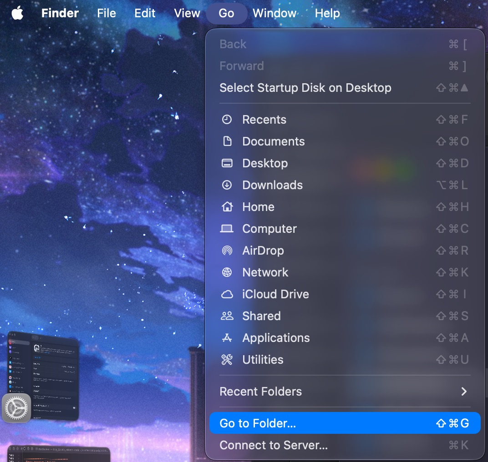

---
hide:
  - footer
---
# Panduan Ringkas Belajar Bahasa Jepang
---

Diunggah: 3 Agustus 2025 · Diperbarui: 5 November 2026 – `Yaaacha`

---

??? warning "Perhatian <small>(klik di sini)</small>"
    - Panduan ini terjemahan dari [LazyGuide](https://lazyguidejp.github.io/jp-lazy-guide/conciseGuideToJumpstartJP/), dengan beberapa referensi dan sumber belajar yang diganti ke versi bahasa Indonesia.

    - Kalau kamu nyaman baca panduan bahasa Inggris, versi aslinya ada di tautan itu.

- Panduan ini sengaja dibuat sangat singkat, sebagai lawan dari panduan lain yang isinya tembok teks dan tautan ke hal-hal berbayar yang sebenarnya tidak perlu. Untuk pemula, panduan seperti itu malah bikin makin bingung.

- Penulis asli LazyGuide sudah lulus JLPT N2 (2022) saat menulis panduan ini, dan pendapatnya masih sama sampai sekarang.

---

## Tips

??? tips "5 Tips untuk Pemula <small>(klik di sini)</small>"
    - **Konsisten dan fokus itu kuncinya.** Tidak ada trik lain yang benar-benar manjur.

    - **Jangan bandingkan dirimu dengan orang lain.** Jangan menyerah, dan jangan percaya pada orang yang bilang kamu bisa jago dalam waktu singkat.

    - **Lakukan saja.** Banyak orang lebih banyak berpikir daripada benar-benar mulai. Kamu tidak akan pernah merasa siap kalau tidak mulai.

    - **Waktu dan jumlah di panduan ini bukan aturan kaku.** Kalau kamu butuh waktu 10 kali lebih lama, atau justru lebih cepat, tidak apa-apa. Angka di sini cuma patokan dasar.

    - **Kamu tidak bodoh, dan tidak terlalu tua.** Kalau kamu bisa belajar bahasa ibumu, kamu juga bisa belajar bahasa lain. Burung beo saja bisa.

---

## Langkah-Langkah

1. Pelajari kana: [Hiragana](https://youtu.be/icK6kVTegDA/) dulu, lalu [Katakana](https://youtu.be/5lC9rhjrHxU?/).
    - Targetkan **15 kana baru per hari**.
    - Lewati saja penjelasan panjangnya dan langsung ke bagian mempelajari hurufnya.
    - Kerjakan [Kana Quiz](https://kana-quiz.tofugu.com/) **setiap kali selesai belajar 5 kana baru**. Beri jeda antarulasan, misalnya 15 menit, 30 menit, 1 jam, lalu 8 jam.
    - Tahap ini biasanya selesai dalam 2 minggu.

2. Unduh [Anki](https://apps.ankiweb.net/) dan [paket add-on Anki dari LazyGuide](https://drive.google.com/drive/folders/1dfmYAp0eg_bhhAkohUISYaS6B6QOBtww?usp=sharing).
    - Ekstrak arsip add-on itu (password: `lazyguide`), lalu tempel isinya ke folder berikut:
    === "Windows"
        Folder di Windows: `C:\Users\NamaUserKamu\AppData\Roaming\Anki2`
        {height=70% width=70%} 
    === "MacOS"
        Folder di MacOS: `~/Library/Application Support/Anki2`

        Folder `Library` tersembunyi secara bawaan. Untuk membukanya, klik `Finder` > `Go` > `Go to Folder...` (++cmd+shift+g++), tempel alamat folder di atas, lalu tekan `Enter`.

        {height=50% width=50%}

        {height=70% width=70%}
    - Mulai ulang Anki.

3. Unduh **satu** dek kosakata sesuai tujuanmu, lalu buka berkasnya.
    - [Kaishi V2](https://discord.com/channels/1370274344571240552/1525753475051556954/1525753475051556954): paling disarankan untuk mulai immersion. Isinya kata-kata yang paling sering dipakai orang Jepang. Kalau baru mulai, kerjakan dek ini dulu.
    - [Kaishi 1.5k versi RenRen](https://discord.com/channels/1370274344571240552/1502926207535284335/1502926207535284335) atau [Kaishi.1.5k.apkg](https://github.com/donkuri/Kaishi/releases/latest) (versi asli berbahasa Inggris).
    - Kalau tujuanmu JLPT, pakai [Multilingual Eggrolls JLPT 10k](https://discord.com/channels/1370274344571240552/1515670605708398713/1515670605708398713), atau [Ankidrone Essential V9](https://discord.com/channels/1370274344571240552/1378654438134386718/1529321716105613432) sebagai alternatif.
    - Mengerjakan dua dek sekaligus juga boleh, misalnya Kaishi dan dek JLPT.
    - Saat mengerjakan dek, cukup pakai dua tombol: `Again` (++1++) kalau kamu tidak tahu jawabannya, dan `Good` (++space++ atau ++3++) kalau tahu. Kamu tidak perlu memikirkan `Hard` (++2++) atau `Easy` (++4++).

4. Buka menu `Deck`, klik ikon gir, lalu salin [pengaturannya](panduan-ringkas-JP.md/#__tabbed_2_1) di bawah.
    - Klik `Tools` > `Preferences` di bilah menu kiri atas, lalu sesuaikan dengan [pengaturan ini](panduan-ringkas-JP.md/#__tabbed_2_4).

    ??? info "Pengaturan Anki <small>(klik di sini)</small>"
    
        === "Pengaturan 1"
            {height=300 width=600}
        === "Pengaturan 2"
            {height=300 width=600}
        === "Pengaturan 3"
            {height=300 width=600}
        === "Pengaturan Preferences Anki"
            {height=300 width=600}

5. Kerjakan dek kosakata Kaishi. Mulai dengan **10 kartu baru per hari** (maksimal 30, jangan berlebihan), bersamaan dengan panduan tata bahasa di langkah 6.
    - Kanji sudah termasuk di dek ini. Cara belajarnya: **pelajari kosakata, bukan kanji secara terpisah**.

6. Pilih salah satu panduan tata bahasa: [panduan teks Tae Kim](https://guidetojapanese.org/learn/grammar/basic), [panduan video Cure Dolly](https://www.youtube.com/playlist?list=PLg9uYxuZf8x_A-vcqqyOFZu06WlhnypWj) (cukup 34 video pertama), atau [NHK World](https://www3.nhk.or.jp/nhkworld/lesson/indonesian/learn/list/).
    - Kuisnya tidak perlu dikerjakan dengan sempurna, **bahkan boleh dilewati**.
    - Yang penting kamu **menangkap isi materinya**, atau minimal tahu garis besarnya, karena **kamu bakal kembali ke materi itu ratusan kali nanti**.
    - Sumber belajar tata bahasa lain dalam bahasa Indonesia ada di [daftar sumber belajar di Discord](https://discord.com/channels/1370274344571240552/1394673355910545471/1394673744546369577).

7. Setelah menyelesaikan dek Kaishi dan panduan tata bahasa (teks atau video), kamu bisa mulai **mining** dan **immersion sungguhan**.
    - Dek Kaishi **biasanya selesai dalam 2–4 bulan**, tergantung usahamu.

8. Saat immersion, cek poin tata bahasa dengan cepat di [DoJG](https://dojglite.github.io/main/) (pemula) dan [Nihongokyoshi](https://nihongokyoshi-net.com/jlpt-grammars/) (menengah ke atas).
    - **Baca atau tonton hal yang kamu suka**, tapi cukup sampai tingkat kesulitan sedang, sekitar 4–5/10 di [jpdb](https://jpdb.io/). Awalnya bakal berat sekali, tapi jalani saja.

9. Buka [Panduan Lazy Mining](setup.md) untuk menyiapkan alat mining terbaru dengan mudah, untuk semua jenis media.
    - Mining adalah proses **membuat kartu dari media** yang kamu pakai untuk immersion. Dengan alat di panduan itu, kartu **bisa dibuat cukup dengan sekali klik**.

---

### Penutup

- Panduan ini **versi yang sangat disederhanakan**, jadi memang tidak lengkap. Jalani saja sambil belajar. Kalau bingung, tanya di server Discord seputar Japanese immersion.

- **Tidak perlu buku teks yang bertele-tele** dan **tidak perlu langganan**. Jangan juga terjebak bertahun-tahun belajar teori sambil merasa belum siap, karena kamu tidak akan pernah siap kalau tidak mulai immersion.

- Versi yang lebih lengkap ada di [Panduan Bahasa Jepang](panduan.md).
