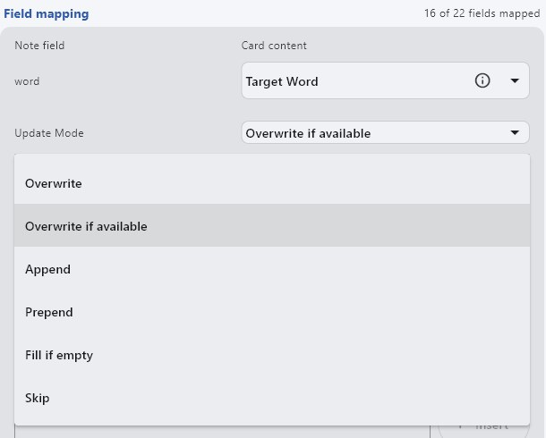
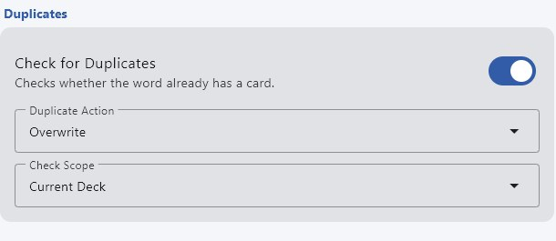

---
hide:
  - footer
---
# Pengaturan Note Type
---

 Diunggah: 11 November 2026 – `Yaaacha`

---

Tiap note type punya kebutuhan sendiri: field apa yang diisi, isinya apa, dan apa yang terjadi kalau kamu menambang kata yang sudah punya kartu. Halaman ini mengumpulkan pengaturannya untuk note type yang dipakai di situs ini, dalam dua versi: **Yomitan** dan **Manatan**.

Cara memasang dan memperbarui note type-nya ada di [Memperbarui Note Type](pembaruan-note-type.md). Kalau kamu memakai **Manatan-NoteType** di Manatan, kamu tidak perlu mengatur apa pun, karena note type itu dipasang dan diatur otomatis oleh Manatan.

---

## Letak pengaturannya

=== "Yomitan"

    - Isi field: `Yomitan settings` > `Anki` > `Configure Anki card format...`. Kolom kiri berisi isi field, kolom kanan berisi cara memperbarui field itu.
    - Kartu duplikat: `Yomitan settings` > `Anki`, bagian `Check for card duplicates` dan `When a duplicate is detected`.

=== "Manatan"

    - Isi field: `More` > ikon roda gigi > `Settings` > `Language learning` > `Flashcards` > `Field mapping`. Tiap field punya `Card content` (isinya) dan `Update Mode` (cara memperbaruinya).
    - Kartu duplikat: halaman yang sama, bagian `Duplicates` di paling bawah.
    - Manatan tidak punya pengaturan siap pakai untuk note type lain, jadi pilih note type di `Card Type` lalu isi field-nya sendiri.

    {height=400 width=500}

---

## Kartu duplikat dan cara memperbarui field

Saat kamu menambang kata yang sudah punya kartu, ada tiga pilihan:

| Yomitan (`When a duplicate is detected`) | Manatan (`Duplicate Action`) | Yang terjadi |
|---|---|---|
| `Prevent adding` | `Prevent` | Kartu tidak dibuat |
| `Allow overwriting` | `Overwrite` | Kartu lama diperbarui, sesuai cara pembaruan tiap field |
| `Allow adding` | `Add anyway` | Kartu baru tetap dibuat |

Cara pembaruan tiap field hanya berpengaruh kalau pilihan di atas diatur ke `Allow overwriting` atau `Overwrite`:

| Pilihan | Yang terjadi pada field |
|---|---|
| Overwrite | Isi lama diganti isi baru |
| Overwrite if available | Isi lama diganti hanya kalau isi baru tidak kosong |
| Append | Isi baru ditambahkan di belakang isi lama |
| Prepend | Isi baru ditambahkan di depan isi lama |
| Fill if empty | Diisi hanya kalau field masih kosong |
| Skip | Field tidak diubah |

{height=250 width=500}

Kebanyakan note type hanya menyimpan satu kalimat per kartu, jadi cukup pilih `Prevent adding`/`Prevent`. Senren bisa menyimpan beberapa adegan dalam satu kartu, jadi kata yang sama justru perlu menambah adegan ke kartu lama. Karena itu pengaturan Senren paling berbeda.

??? tip "Yomitan: profil khusus untuk memperbarui kartu lama <small>(klik di sini)</small>"

    Kadang kamu ingin menyegarkan isi kamus di kartu lama, misalnya setelah memasang kamus baru, tanpa mengubah kalimat dan gambarnya. Caranya, buat profil Yomitan kedua (misalnya `Senren (perbarui)`) dengan pengaturan:

    - `When a duplicate is detected`: `Allow overwriting`
    - Field kalimat, terjemahan, gambar, dan `miscInfo`: `Skip`
    - Field kata dan bacaan: `Overwrite`
    - Field arti, pitch, dan frekuensi: `Overwrite if available`
    - Field audio dan field yang biasanya kosong: `Fill if empty`

    Pindah ke profil itu hanya saat memperbarui kartu, lalu kembali ke profil biasa untuk menambang. Profil aktif bisa diganti dari ikon Yomitan di toolbar browser, atau di `Yomitan settings` bagian `Profile`.

---

## Isian per note type

Cara membaca tabel:

- **Kosong** berarti dikosongkan di Yomitan, atau pilih `None` di Manatan.
- Di Manatan, `Custom Template` berarti pilih `Custom Template` di `Card content`, lalu salin teksnya ke kotak `Custom Template`.
- `{single-glossary-...}` di Yomitan dan `Single Glossary` di Manatan perlu dipilih kamusnya. Pakai kamus yang isinya ringkas, misalnya JMdict atau JIDict.

=== "Lapis"

    Kartu duplikat: `Prevent adding` (Yomitan) atau `Prevent` (Manatan).

    | Field | Yomitan | Manatan |
    |---|---|---|
    | Expression | `{expression}` | `Target Word` |
    | ExpressionFurigana | `{furigana-plain}` | `Custom Template`: `{furigana-plain}` |
    | ExpressionReading | `{reading}` | `Reading` |
    | ExpressionAudio | `{audio}` | `Word Audio` |
    | SelectionText | `{popup-selection-text}` atau kosong | Kosong |
    | MainDefinition | `{single-glossary-...}` | `Single Glossary`, lalu pilih kamusnya |
    | DefinitionPicture | Kosong | Kosong |
    | Sentence | `{cloze-prefix}<b>{cloze-body}</b>{cloze-suffix}` | `Sentence with Bold Word` |
    | SentenceFurigana | Kosong. **Wajib kosong** | Kosong. **Wajib kosong** |
    | SentenceAudio | Kosong (diisi alat lain, misalnya asbplayer) | `Sentence Audio` |
    | Picture | Kosong (diisi alat lain) | `Image` |
    | Glossary | `{glossary}` | `Glossary` |
    | Hint | Kosong | Kosong |
    | IsWordAndSentenceCard, IsClickCard, IsSentenceCard, IsAudioCard | Kosong, lihat catatan | Kosong, lihat catatan |
    | PitchPosition | `{pitch-accent-positions}` | `Pitch Accent Positions` |
    | PitchCategories | `{pitch-accent-categories}` | `Pitch Accent Categories` |
    | Frequency | `{frequencies}` | `Frequencies` |
    | FreqSort | `{frequency-harmonic-rank}` | `Frequency Harmonic Rank` |
    | MiscInfo | `{document-title}` | `Media Name` |

    Kalau semua field `Is...Card` kosong, kartunya berupa kartu kosakata biasa. Untuk jenis kartu lain, isi **satu** field `Is...Card` saja dengan `x` (di Manatan lewat `Custom Template`):

    - `IsWordAndSentenceCard`: kalimat muncul sebagai petunjuk di bawah kata
    - `IsClickCard`: kata bisa diklik untuk memunculkan kalimat
    - `IsSentenceCard`: kalimat lengkap muncul di depan kartu
    - `IsAudioCard`: audio kalimat diputar dan kalimatnya muncul tanpa kata yang dicari

    Sumber: [Lapis](https://github.com/donkuri/lapis)

=== "Kiku"

    Field Kiku sama dengan Lapis, jadi ikuti tab **Lapis**. Ada dua field tambahan yang dibiarkan kosong, di Yomitan maupun Manatan:

    | Field | Isi |
    |---|---|
    | SentenceTranslation | Kosong |
    | RelatedExpression | Kosong |

    Kartu duplikat: `Prevent adding` (Yomitan) atau `Prevent` (Manatan).

    Kiku juga bisa menggabungkan beberapa kalimat dan gambar ke satu kartu, tapi caranya berbeda dengan Senren dan diatur dari Anki. Detailnya ada di [Field Grouping Kiku](https://github.com/youyoumu/kiku/blob/main/apps/docs/mds/field-grouping.md).

    Sumber: [Kiku: Switching From Lapis](https://github.com/youyoumu/kiku/blob/main/apps/docs/mds/migration.md)

=== "Senren"

    Senren bisa menyimpan beberapa adegan (kalimat, gambar, dan audio) untuk satu kata, lalu kamu bisa berpindah adegan di kartunya. Supaya ini jalan, menambang kata yang sama harus menambah adegan ke kartu lama.

    Kartu duplikat: nyalakan `Check for card duplicates` dan pilih `Allow overwriting` (Yomitan), atau nyalakan `Check for Duplicates` dan pilih `Overwrite` (Manatan). Lalu atur cara pembaruan tiap field sesuai tabel di tab Yomitan atau Manatan.

    === "Yomitan"

        | Field | Pembaruan | Isi |
        | --- | --- | --- |
        | word | `Overwrite if available` | `{expression}` |
        | reading | `Overwrite if available` | `{reading}` |
        | sentence | `Append` | `{cloze-prefix}{cloze-body}{cloze-suffix}` |
        | sentenceFurigana | `Append` | `{sentence-furigana}` |
        | sentenceTranslation | `Append` | `{clipboard-text}` |
        | sentenceCard | `Fill if empty` | Kosong |
        | audioCard | `Fill if empty` | Kosong |
        | notes | `Fill if empty` | Kosong |
        | hint | `Fill if empty` | Kosong |
        | picture | `Append` | Kosong (diisi alat lain) |
        | wordAudio | `Fill if empty` | `{audio}` |
        | sentenceAudio | `Fill if empty` | Kosong (diisi alat lain) |
        | selectionText | `Fill if empty` | `{popup-selection-text}` |
        | definition | `Fill if empty` | `{single-glossary-...}` |
        | glossary | `Fill if empty` | `{glossary}` |
        | pitchAccents | `Overwrite if available` | `{pitch-accents}` |
        | pitchPositions | `Overwrite if available` | `{pitch-accent-positions}` |
        | pitchCategories | `Overwrite if available` | `{pitch-accent-categories}` |
        | frequencies | `Overwrite if available` | `{frequencies}` |
        | freqSort | `Overwrite if available` | `{frequency-harmonic-rank}` |
        | miscInfo | `Append` | `{document-title}` |
        | dictionaryPreference | `Fill if empty` | Kosong |

    === "Manatan"

        | Field | Pembaruan | Isi |
        | --- | --- | --- |
        | word | `Overwrite if available` | `Target Word` |
        | reading | `Overwrite if available` | `Reading` |
        | sentence | `Append` | `Custom Template`: `{sentence-bold}` |
        | sentenceFurigana | `Append` | `Custom Template`: `{sentence-furigana-bold}` |
        | sentenceTranslation | `Append` | Kosong, atau `Sentence translation` (lihat catatan) |
        | sentenceCard | `Overwrite` | Kosong |
        | audioCard | `Overwrite` | Kosong |
        | notes | `Overwrite` | Kosong |
        | hint | `Overwrite` | Kosong |
        | picture | `Append` | `Image` |
        | wordAudio | `Overwrite` | `Word Audio` |
        | sentenceAudio | `Append` | `Sentence Audio` |
        | selectionText | `Overwrite` | `Popup Selection Text` |
        | definition | `Overwrite` | `Glossary First` |
        | glossary | `Overwrite` | `Glossary` |
        | pitchAccents | `Overwrite` | `Pitch Accent` |
        | pitchPositions | `Overwrite` | `Pitch Accent Positions` |
        | pitchCategories | `Overwrite` | `Pitch Accent Categories` |
        | frequencies | `Overwrite` | `Frequencies` |
        | freqSort | `Overwrite` | `Frequency Harmonic Rank` |
        | miscInfo | `Append` | `Media Name` |
        | dictionaryPreference | `Overwrite` | Kosong |

    Yang penting di Manatan hanya tujuh field: `word` dan `reading` (`Overwrite if available`), lalu `sentence`, `sentenceFurigana`, `picture`, `sentenceAudio`, dan `miscInfo` (`Append`). Field lainnya cukup dibiarkan `Overwrite` seperti bawaannya. Dengan pengaturan ini, menambang kata yang sama dari adegan lain menambah kalimat, furigana, gambar, dan audio kalimat ke kartu lama, sementara audio kata tetap satu.

    - `` adalah penanda satu adegan. Jangan dihapus dari template `sentence` dan `sentenceFurigana`.
    - Tombol pindah adegan baru muncul kalau kartunya punya minimal dua audio kalimat.
    - `miscInfo` ikut bertambah tiap adegan, jadi nama media yang sama bisa tertulis dua kali kalau kedua adegan dari judul yang sama.
    - **Terjemahan kalimat** (`sentenceTranslation`) diambil dari subtitle kedua, biasanya Inggris atau Indonesia. Di Yomitan, salin dulu subtitle keduanya sebelum menekan tombol tambang, supaya `{clipboard-text}` terisi. Di Manatan, pilihan `Sentence translation` mengambil subtitle kedua yang sedang terpasang (tombol `S` di menu subtitle pemutar). Isinya tidak bisa dibungkus ``, jadi kalau terjemahan muncul di adegan yang salah, bungkus manual di Anki. Kalau tidak memakai terjemahan, kosongkan saja.
    - Di Yomitan, `picture` dan `sentenceAudio` dikosongkan karena diisi alat lain, misalnya asbplayer. Di Manatan, gambar dan audio kalimat diambil langsung oleh Manatan, jadi kedua field itu diisi dengan `Append` supaya tiap adegan punya gambar dan audionya sendiri.

    Sumber: [Senren: scene switching](https://brenoaqua.github.io/Senren/scene_switching) dan [Senren Setup](https://brenoaqua.github.io/Senren/setup_overview/)

=== "Mining-JP"

    Kartu duplikat: `Prevent adding` (Yomitan) atau `Prevent` (Manatan).

    | Field | Yomitan | Manatan |
    |---|---|---|
    | Expression | `{expression}` | `Target Word` |
    | ExpressionFurigana | `{furigana-plain}` | `Custom Template`: `{furigana-plain}` |
    | ExpressionReading | `{reading}` | `Reading` |
    | ExpressionAudio | `{audio}` | `Word Audio` |
    | MainDefinition | `{popup-selection-text}` | `Popup Selection Text` |
    | Sentence | `{cloze-prefix}<b>{cloze-body}</b>{cloze-suffix}` | `Sentence with Bold Word` |
    | SentenceFurigana | Kosong | Kosong |
    | SentenceAudio | Kosong (diisi alat lain) | `Sentence Audio` |
    | FullDefinition | `{glossary}` | `Glossary` |
    | Image | Kosong (diisi alat lain) | `Image` |
    | Translation | Kosong | Kosong |
    | PitchPosition | `{pitch-accent-positions}` | `Pitch Accent Positions` |
    | Hint | Kosong | Kosong |
    | Frequency | `{frequencies}` | `Frequencies` |
    | FreqSort | Kosong atau `{frequency-harmonic-rank}` | Kosong atau `Frequency Harmonic Rank` |
    | MiscInfo | `{document-title}` | `Media Name` |
    | ExtraField | Kosong | Kosong |
    | *IsSentenceCard | Kosong | Kosong |

    `MainDefinition` diisi teks yang kamu sorot di popup, seperti saran pembuat note type ini. Kalau tidak menyorot apa pun, field ini kosong.

    Sumber: [JP-study (Mining-JP)](https://github.com/rudnam/JP-study)

---

## Kartu tidak sesuai?

- **Field kosong padahal sudah diisi:** cek lagi nama field di Anki. Huruf besar dan kecil harus sama persis, misalnya `sentence` di Senren berbeda dengan `Sentence` di Lapis.
- **Kalimat menumpuk di satu kartu (selain Senren):** kartu duplikat diatur `Allow overwriting`/`Overwrite` dan field kalimat diatur `Append`. Ganti ke `Prevent adding`/`Prevent`.
- **Adegan baru di Senren menimpa adegan lama:** field `sentence`, `sentenceFurigana`, `sentenceAudio`, `picture`, atau `miscInfo` belum `Append`.
- **Muncul kartu baru untuk kata yang sama:** pemeriksaan duplikat mati, atau diatur `Allow adding`/`Add anyway`.
