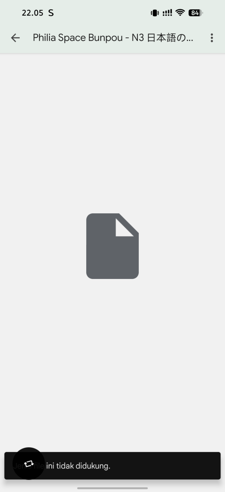
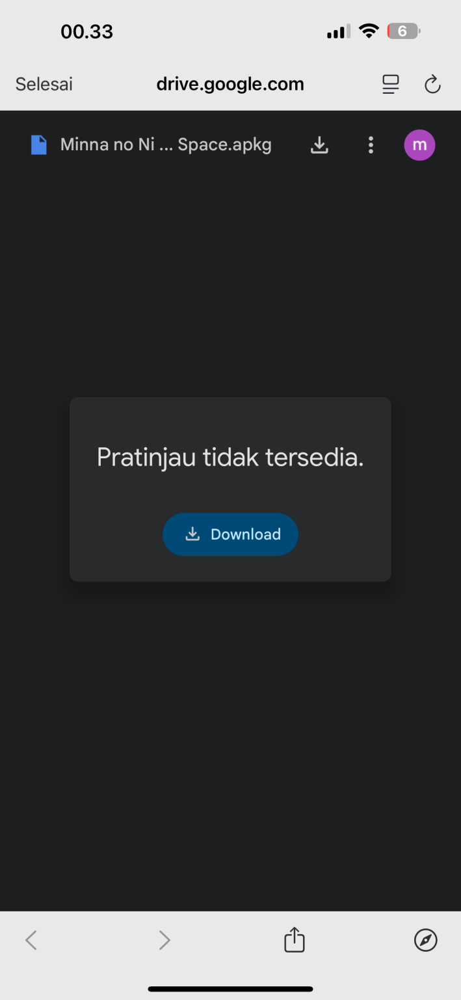

# Proyek Komunitas

Kamus, dek Anki, dan alat gratis buatan komunitas Philia Space. Sebagian besar untuk belajar bahasa Jepang, sebagian lagi untuk yang mau kerja di Jepang.

- [JIDict](#proyek-utama-jidict): kamus Jepang-Indonesia untuk Yomitan
- [Dek Anki Komunitas](#dek-anki-komunitas): dek yang dirawat anggota, dikelompokkan menurut tujuan belajarmu
- [Alat Belajar Lainnya](#alat-belajar-lainnya): aplikasi web yang jalan langsung di browser

---

## Proyek Utama: JIDict

**Kamus Jepang-Indonesia untuk Yomitan.** Lebih dari 300.000 entri dengan arti bahasa Indonesia, cara baca, kelas kata, dan tabel konjugasi untuk verba dan adjektiva-i. Format mengikuti Yomitan sehingga tinggal diimpor dan langsung jalan sebagai kamus popup saat kamu baca manga, novel, atau subtitle anime. Lisensi CC BY-NC 4.0.

**Cara pasang singkat:**

1. Unduh berkas ZIP dari halaman GitHub (tombol Download).
2. Buka pengaturan Yomitan → **Dictionaries** → **Import**, pilih ZIP tadi.
3. Pastikan kamusnya dicentang aktif.

Belum pasang Yomitan? Ikuti [Setup Yomitan PC](setup-yomitan-pc-lazy-guide.md) atau [Yomitan Android](setup-yomitan-android-lazy-guide.md) dulu.

[Repo & Pemasangan JIDict-yomitan](https://github.com/philiaspaceai/JIDict-yomitan#pemasangan){ .md-button .md-button--primary }
[JIDict Web (kamus offline di browser)](https://jidict.vercel.app/){ .md-button }

### JIDict Frequency

**Kamus frekuensi Jepang-Indonesia pertama dalam format Yomitan.** Berisi 13.168 kosakata level N1 sampai N5, disusun dari JIDict. Di popup kamus, kata yang punya data frekuensi akan menampilkan angkanya, jadi kamu tahu kata mana yang lebih penting dipelajari duluan. Bisa dipakai di Yomitan dan Yomichan, dan bisa diperbarui otomatis lewat **Check for Updates** di pengaturan Yomitan.

Cara pasangnya sama dengan JIDict: unduh ZIP-nya, lalu impor di **Dictionaries** → **Import**.

[Unduh JIDict Frequency](https://github.com/philiaspaceai/jidict-frequency-yomitan/releases/latest/download/jidict-frequency-yomitan.zip){ .md-button .md-button--primary }
[Repo JIDict Frequency](https://github.com/philiaspaceai/jidict-frequency-yomitan){ .md-button }

### RHDict

Kamus Jepang-Indonesia format Yomitan lain, v1.0.0 (September 2026). Pembuatnya anonim, dibagikan oleh RenRen. Repo GitHub-nya belum ada, jadi untuk sekarang unduh lewat [post RHDict di Discord](https://discord.com/channels/1370274344571240552/1544821080148025484). Filenya ada di Google Drive. Kalau tidak bisa dibuka di HP, lihat [cara mengunduhnya](#kendala-yang-diketahui). Bisa dipasang berdampingan dengan JIDict.

---

## Dek Anki Komunitas

Dek buatan anggota Philia Space, dikelompokkan menurut rute belajarmu. Yang diutamakan adalah dek yang masih dirawat **RenRen**, **Raychi**, dan **Jibal**: mereka masih merilis pembaruan dan menjawab laporan bug. Di bawah tiap rute ada beberapa dek dari anggota lain.

Semua dek gratis. File unduhannya ada di post Discord masing-masing, karena tautannya kadang diganti oleh pembuatnya. Tautan Discord hanya bisa dibuka kalau kamu sudah [bergabung ke server](join.md). Kalau file dari Google Drive tidak bisa dibuka di HP, lihat [cara mengunduhnya](#kendala-yang-diketahui).

??? info "Arti status <small>(klik di sini)</small>"
    - **Aktif**: pembuatnya masih merilis pembaruan atau menjawab laporan dalam 3 bulan terakhir.
    - **Berlanjut**: baru sebagian level yang jadi, level berikutnya sedang dikerjakan.
    - **Stabil**: sudah lengkap, belum ada pembaruan baru. Tetap aman dipakai.
    - **Ada kendala**: ada bug yang sudah dilaporkan. Cek bagian [Kendala yang diketahui](#kendala-yang-diketahui) sebelum mengunduh.

    Data per 16 November 2026.

### Rute 1: Bahasa untuk diri sendiri

Untuk kamu yang belajar supaya bisa menikmati anime, manga, novel, atau ngobrol dengan orang Jepang. Fokusnya kosakata umum yang paling sering muncul, ditambah kanji. Pilih **satu** dek kosakata dasar saja, lalu lanjut ke [mining](setup.md).

  

    

      <h4>Kaishi V2 (Immersion Upgrade)</h4>
      
<strong>Jibal</strong> · Aktif · <a href="#kendala-yang-diketahui">Ada kendala</a> · diperbarui 15 Jul 2026 (V2)

      
1.474 kosakata N5–N1. Tiap kartu punya <em>Native Insight</em>, penjelasan kenapa penutur asli memilih kata itu di kalimat contoh. Dek ini yang <a href="../panduan/#24-belajar-kosakata-dengan-anki">disarankan Panduan Bahasa Jepang</a> untuk mulai.

      <ul class="ps-card-links">
        <li><a href="https://discord.com/channels/1370274344571240552/1525753475051556954">Buka di Discord</a></li>
      </ul>
    

  

  

    

      <h4>Ankidrone Essentials V9 Indonesia</h4>
      
<strong>RenRen</strong> · Aktif · diperbarui 30 Jun 2026 (V9)

      
Ankidrone Essentials V9 dengan tampilan baru, diterjemahkan ke bahasa Indonesia. Pengganti V8.

      <ul class="ps-card-links">
        <li><a href="https://discord.com/channels/1370274344571240552/1378654438134386718">Buka di Discord</a></li>
      </ul>
    

  

  

    

      <h4>Kaishi 1.5k Indonesia (RenRen Version)</h4>
      
<strong>RenRen</strong> · Stabil · diperbarui 30 Jun 2026 (Final Fixed)

      
±1.500 kata yang paling sering dipakai, dengan arti bahasa Indonesia.

      <ul class="ps-card-links">
        <li><a href="https://discord.com/channels/1370274344571240552/1502926207535284335">Buka di Discord</a></li>
      </ul>
    

  

  

    

      <h4>Ankidrone Essentials V1 (Immersion Upgrade)</h4>
      
<strong>Jibal</strong> · Berlanjut · diperbarui 16 Jul 2026 (N5)

      
Kosakata dasar lewat kalimat contoh, satu kata baru per kalimat. Baru N5. Tautan unduhan diminta lewat DM ke pembuatnya.

      <ul class="ps-card-links">
        <li><a href="https://discord.com/channels/1370274344571240552/1527299139514269796">Buka di Discord</a></li>
      </ul>
    

  

  

    

      <h4>Shinsoku Ultimate 3.8k</h4>
      
<strong>RenRen</strong> · Stabil · diperbarui 21 Agu 2026 (perbaikan)

      
3.804 kosakata yang mencakup semua bacaan kun dan on dari 2.136 kanji jōyō, dengan audio.

      <ul class="ps-card-links">
        <li><a href="https://discord.com/channels/1370274344571240552/1540034582706131036">Buka di Discord</a></li>
      </ul>
    

  

  

    

      <h4>SSS シリーズ (Shoshinsha Series)</h4>
      
<strong>RenRen</strong> · Stabil · diperbarui 1 Jun 2026

      
Seri dek untuk pemula.

      <ul class="ps-card-links">
        <li><a href="https://discord.com/channels/1370274344571240552/1478352761082085418">Buka di Discord</a></li>
        <li><a href="https://ankiweb.net/shared/info/1000574403">Buka di AnkiWeb</a></li>
      </ul>
    

  

Dek lain: [JLPT All-in-One](https://discord.com/channels/1370274344571240552/1528265707140419624) dan [Kana, Kanji, Radicals Writing Practice](https://discord.com/channels/1370274344571240552/1522169293138038835) dari Soria Moria, [Deck Mina No Nihongo BAB 1-50](https://ankiweb.net/shared/info/67090940) dari Yaaacha.

### Rute 2: Bahasa untuk tes (JLPT, JFT)

Untuk kamu yang sedang mengejar sertifikat. Dek di sini mengikuti buku persiapan atau level JLPT, jadi bisa dipakai berdampingan dengan buku cetaknya.

  

    

      <h4>Philia Space Kotoba Deck N5 · N4</h4>
      
<strong>Raychi</strong> · Aktif · <a href="#kendala-yang-diketahui">Ada kendala</a> · diperbarui 10 Nov 2026 (patch)

      
2.007 kosakata Minna no Nihongo bab 1–50, dengan pitch accent, ±4.000 kalimat contoh beraudio, dan 3.273 klip anime.

      <ul class="ps-card-links">
        <li><a href="https://discord.com/channels/1370274344571240552/1377248289178652753/1569578713597747230">Buka di Discord</a></li>
      </ul>
    

  

  

    

      <h4>Philia Space Bunpou Deck N5 · N4 · N3</h4>
      
<strong>Raychi</strong> · Aktif · diperbarui 8 Nov 2026

      
294 pola tata bahasa: Minna no Nihongo bab 1–50 (N5, N4) dan Soumatome N3, dengan contoh dari anime.

      <ul class="ps-card-links">
        <li><a href="https://discord.com/channels/1370274344571240552/1377248289178652753/1568806513102028910">Buka di Discord</a></li>
        <li class="ps-card-links-inline">Post per dek: <a href="https://discord.com/channels/1370274344571240552/1568804725699248158">N5</a> · <a href="https://discord.com/channels/1370274344571240552/1568805095443791883">N4</a> · <a href="https://discord.com/channels/1370274344571240552/1568790458648498318">Soumatome N3</a></li>
      </ul>
    

  

  

    

      <h4>Philia Space Bunpou 日本語の森 Elite V1: N3 · N2 · N1</h4>
      
<strong>Raychi</strong> · Aktif · <a href="#kendala-yang-diketahui">Ada kendala</a> · diperbarui 12 Nov 2026

      
363 pola tata bahasa dari buku 日本語の森, dengan ±1.500 klip anime. Masuk ke dek induk yang sama dengan Bunpou Deck N5 · N4 · N3.

      <ul class="ps-card-links">
        <li><a href="https://discord.com/channels/1370274344571240552/1377248289178652753/1570408046021054565">Buka di Discord</a></li>
        <li class="ps-card-links-inline">Post per level: <a href="https://discord.com/channels/1370274344571240552/1570405798129963130">N3</a> · <a href="https://discord.com/channels/1370274344571240552/1570406384535736320">N2</a> · <a href="https://discord.com/channels/1370274344571240552/1570406945355997329">N1</a> · <a href="https://ankiweb.net/shared/info/1748118658">N3 di AnkiWeb</a></li>
      </ul>
    

  

  

    

      <h4>EggRolls JLPT v3.5 Indonesia</h4>
      
<strong>RenRen</strong> · Stabil · diperbarui 10 Sep 2026

      
10.641 kosakata JLPT, dengan arti bahasa Indonesia dari RHDict.

      <ul class="ps-card-links">
        <li><a href="https://discord.com/channels/1370274344571240552/1547709722919182366">Buka di Discord</a></li>
      </ul>
    

  

  

    

      <h4>Soumatome N3</h4>
      
<strong>RenRen</strong> · Stabil · diperbarui Mei 2026

      
Dek dari buku 日本語総まとめ N3.

      <ul class="ps-card-links">
        <li><a href="https://discord.com/channels/1370274344571240552/1500437414257229824">Buka di Discord</a></li>
      </ul>
    

  

  

    

      <h4>825 Bunpou N1–N5</h4>
      
<strong>RenRen</strong> · Stabil · diperbarui sebelum Mei 2026

      
825 pola tata bahasa dari N5 sampai N1.

      <ul class="ps-card-links">
        <li><a href="https://discord.com/channels/1370274344571240552/1394243548848849091">Buka di Discord</a></li>
      </ul>
    

  

  

    

      <h4>NANO-NANO V1 (Japanese Grammar)</h4>
      
<strong>Jibal</strong> · Berlanjut · diperbarui 18 Agu 2026 (N5)

      
130 pola tata bahasa N5 dalam 260 kartu. Seri sampai N1 sedang dikerjakan.

      <ul class="ps-card-links">
        <li><a href="https://discord.com/channels/1370274344571240552/1539285154089140265">Buka di Discord</a></li>
      </ul>
    

  

  

    

      <h4>N5–N3 Japanese Grammar Deck (Immersion Upgrade)</h4>
      
<strong>Jibal</strong> · Stabil · diperbarui sebelum Mei 2026

      
Tata bahasa N5 sampai N3.

      <ul class="ps-card-links">
        <li><a href="https://discord.com/channels/1370274344571240552/1493632030762733690">Buka di Discord</a></li>
      </ul>
    

  

Dek lain: [Anki Deck Soal JLPT 2010–2025](https://discord.com/channels/1370274344571240552/1519035130243448932) dari Dosen Tipsen, [Deck Bunpou Nihongo no Mori](https://discord.com/channels/1370274344571240552/1431808153774854154) dari Don Hans, [Soumatome N3 (Goi)](https://discord.com/channels/1370274344571240552/1537273268317454366) dari Seith. Untuk melihat level JLPT kata yang kamu temui saat immersion, pasang [JIDict Frequency](#jidict-frequency).

### Rute 3: Bahasa untuk kerja (magang, Tokutei Ginou)

Untuk kamu yang menyiapkan program magang (Ginou Jisshu), Tokutei Ginou (SSW), atau kerja kantoran di Jepang. Isinya kosakata bidang kerja dan soal ujian keahlian.

  

    

      <h4>All Deck Kotoba SSW dari Buku Modul SSW</h4>
      
<strong>RenRen</strong> · Stabil · diperbarui sebelum Mei 2026

      
Kosakata dari buku modul SSW.

      <ul class="ps-card-links">
        <li><a href="https://discord.com/channels/1370274344571240552/1393413108193558648">Buka di Discord</a></li>
      </ul>
    

  

  

    

      <h4>Deck Soal Latihan SSW Perhotelan</h4>
      
<strong>RenRen</strong> · Stabil · diperbarui sebelum Mei 2026

      
Soal latihan ujian SSW bidang perhotelan.

      <ul class="ps-card-links">
        <li><a href="https://discord.com/channels/1370274344571240552/1439573055616843886">Buka di Discord</a></li>
      </ul>
    

  

  

    

      <h4>IT日本語 × Ellen Joe</h4>
      
<strong>Raychi</strong> · Stabil · diperbarui 9 Sep 2026

      
233 kosakata kerja IT yang dipakai di kantor (仕様変更, 報連相, dan sebagainya), 301 kartu dalam 14 kategori, semua beraudio. Belum dites di Android.

      <ul class="ps-card-links">
        <li><a href="https://discord.com/channels/1370274344571240552/1547096004082405426">Buka di Discord</a></li>
      </ul>
    

  

Dek lain: SSW Kaigo dan SSW Pengolahan Makanan ([Kaigo](https://discord.com/channels/1370274344571240552/1391920424631402546), [PM](https://discord.com/channels/1370274344571240552/1391954713230049421)) dari onizuka eikichi, [SSW Building Cleaning](https://discord.com/channels/1370274344571240552/1560138481165017149) dari Rofiqhere. Alat untuk mencari lembaga pendukung dan mengirim lamaran ada di [Untuk yang Mau Kerja di Jepang](#untuk-yang-mau-kerja-di-jepang).

### Rute 4: Bahasa untuk lanjut pendidikan (sekolah, kuliah, riset)

Untuk kamu yang mau sekolah, kuliah, atau riset di Jepang. Universitas biasanya meminta JLPT N2 atau N1, jadi mulai dari dek tata bahasa N2–N1 di Rute 2. Bahan di bawah memakai materi sekolah Jepang sebagai patokan.

  

    

      <h4>1.944 Kosakata untuk Kanji Kyouiku</h4>
      
<strong>RenRen</strong> · Stabil · diperbarui 20 Agu 2026

      
Daftar kosakata yang mencakup 教育漢字, kanji wajib SD di Jepang. Setara bacaan lulusan SD.

      <ul class="ps-card-links">
        <li><a href="https://discord.com/channels/1370274344571240552/1539901507829366814">Buka di Discord</a></li>
      </ul>
    

  

  

    

      <h4>Bunpou Tingkat SMP 中1〜中3</h4>
      
<strong>RenRen</strong> · Stabil · diperbarui 23 Agu 2026

      
Kumpulan tautan materi 国語 (pelajaran bahasa Jepang) SMP kelas 1–3, sesuai kurikulum Jepang.

      <ul class="ps-card-links">
        <li><a href="https://discord.com/channels/1370274344571240552/1541119372892835860">Buka di Discord</a></li>
      </ul>
    

  

  

    

      <h4>Philia Space Bunpou 日本語の森 Elite V1: N2 · N1</h4>
      
<strong>Raychi</strong> · Aktif · diperbarui 12 Nov 2026

      
Tata bahasa N2 dan N1, level yang biasa diminta universitas. Detailnya ada di Rute 2.

      <ul class="ps-card-links">
        <li><a href="https://discord.com/channels/1370274344571240552/1570406384535736320">Buka di Discord</a></li>
      </ul>
    

  

Belum ada dek khusus EJU atau bahasa Jepang akademik. Kalau kamu membuatnya, bagikan di `#kontribusi` di Discord.

### Kendala yang diketahui

??? warning "File dek atau kamus dari Google Drive tidak bisa dibuka di HP"
    Dek (`.apkg`) dan kamus (`.zip`) yang dibagikan lewat Google Drive kadang tidak bisa langsung dibuka di HP. Google Drive mencoba menampilkan pratinjau file, padahal file seperti ini memang tidak bisa dipratinjau. Filenya tidak rusak, cukup diunduh dulu.

    === "Android"

        Di aplikasi Google Drive muncul tulisan **Jenis file ini tidak didukung**.

        {width=250 height=547}

        1. Tekan ikon titik tiga di kanan atas.
        2. Tekan `Download`.
        3. Impor file yang sudah terunduh (langkahnya di bawah).

    === "iPhone"

        Di browser muncul tulisan **Pratinjau tidak tersedia**.

        {width=250 height=542}

        1. Tekan tombol `Download`.
        2. Impor file yang sudah terunduh (langkahnya di bawah).

    **Cara mengimpor file yang sudah diunduh:**

    - **Dek Anki (`.apkg`)**: buka filenya dengan AnkiDroid atau AnkiMobile. Di PC, buka Anki lalu klik `File` > `Import`.
    - **Kamus (`.zip`)**: jangan diekstrak. Impor ZIP-nya lewat pengaturan kamus di aplikasi yang kamu pakai: [Yomitan](setup-yomitan-android-lazy-guide.md), [Hoshi Reader](Setup-Hoshi-Reader.md), atau [Manatan](Setup-Manatan.md).

    **Tautannya sama sekali tidak bisa dibuka?** Kalau halaman Google Drive atau AnkiWeb tidak muncul, atau unduhan gagal terus:

    1. Buka tautannya di browser lain, misalnya Chrome atau Firefox.
    2. Kalau masih gagal, ganti DNS atau pakai VPN, misalnya [Cloudflare WARP](https://developers.cloudflare.com/cloudflare-one/team-and-resources/devices/warp/download-warp/) (aplikasi 1.1.1.1), lalu buka lagi tautannya.

??? warning "Philia Space Kotoba Deck: sisi belakang kartu kosong di HP"
    Di HP, sisi belakang kartu bisa kosong dan hanya ada audio.

    1. Unduh dan impor [patch `Philia Patch - Kotoba (fix layar blank).apkg`](https://discord.com/channels/1370274344571240552/1377248289178652753/1569634602048561192). Satu file ini saja, dek tidak perlu diunduh ulang.
    2. Kalau masih kosong, hapus deknya, impor dek lengkapnya, lalu impor patch-nya ([saran Raychi](https://discord.com/channels/1370274344571240552/1570405798129963130/1570428768600719372)).
    3. Kalau patch ditolak ("invalid"), hapus centang semua opsi impor, lalu hapus note type `kotoba philia` sebelum impor ulang ([saran Raychi](https://discord.com/channels/1370274344571240552/1570405798129963130/1570432935679500362)).

    Di sebagian HP masalah ini belum selesai. Raychi menduga ini masalah kompatibilitas dan sedang menyiapkan [perbaikan lain](https://discord.com/channels/1370274344571240552/1570405798129963130/1570435402416922675).

??? warning "日本語の森 Elite: isi kartu hilang setelah impor"
    1. Hapus dek 日本語の森 ([saran Raychi](https://discord.com/channels/1370274344571240552/1570405798129963130/1570423314806214828)).
    2. Buka `Tools` > `Manage Note Types`, hapus note type `bunpo mori`, lalu impor ulang deknya ([langkah lengkap](https://discord.com/channels/1370274344571240552/1570405798129963130/1570423461816434770)).

    Kalau unduhan dari Google Drive gagal, pakai [versi AnkiWeb N3](https://ankiweb.net/shared/info/1748118658).

??? warning "Kaishi V2: furigana, posisi teks, dan tautan unduhan"
    Laporan berikut belum ada perbaikannya per 16 November 2026:

    - [Furigana tidak terkonversi](https://discord.com/channels/1370274344571240552/1525753475051556954/1571382751859576935) (15 Nov).
    - [Teks kartu tidak di tengah di HP](https://discord.com/channels/1370274344571240552/1525753475051556954/1559233867129294972) (12 Okt). Saran sementara: [pakai Kaishi versi RenRen](https://discord.com/channels/1370274344571240552/1525753475051556954/1559612564130889839).
    - [Tautan Google Drive tidak bisa diunduh](https://discord.com/channels/1370274344571240552/1525753475051556954/1571101754488262778) (14 Nov).

### Riwayat pembaruan

Pembaruan dan perbaikan dek dalam enam bulan terakhir, masing-masing dengan tautan ke pengumumannya di Discord.

??? note "Raychi"
    - **12 Nov 2026**: [rilis 日本語の森 Elite V1 N3 · N2 · N1](https://discord.com/channels/1370274344571240552/1377248289178652753/1570408046021054565). Isinya sudah dikoreksi ulang sebelum rilis (±180 perbaikan makna, sambungan, dan contoh). Hari yang sama ditambah [mirror AnkiWeb](https://discord.com/channels/1370274344571240552/1570405798129963130/1570419776701075499).
    - **10 Nov 2026**: [patch Kotoba Deck untuk layar kosong di HP](https://discord.com/channels/1370274344571240552/1377248289178652753/1569634602048561192), setelah [laporan bug di hari yang sama](https://discord.com/channels/1370274344571240552/1568804725699248158/1569623447972220930).
    - **10 Nov 2026**: [rilis Kotoba Deck N5 · N4](https://discord.com/channels/1370274344571240552/1377248289178652753/1569578713597747230).
    - **8 Nov 2026**: [rilis Bunpou Deck N5 · N4 · N3](https://discord.com/channels/1370274344571240552/1377248289178652753/1568806513102028910).
    - **9 Sep 2026**: [rilis IT日本語 × Ellen Joe](https://discord.com/channels/1370274344571240552/1547096004082405426/1547096004082405426), lalu [file versi Retro](https://discord.com/channels/1370274344571240552/1547096004082405426/1547104497053081600) menyusul.

??? note "RenRen"
    - **10 Sep 2026**: [rilis EggRolls JLPT v3.5 Indonesia](https://discord.com/channels/1370274344571240552/1547709722919182366/1547709722919182366).
    - **2 Sep 2026**: [rilis RHDict v1.0.0](https://discord.com/channels/1370274344571240552/1544821080148025484/1544821080148025484).
    - **21 Agu 2026**: [perbaikan Shinsoku Ultimate 3.8k](https://discord.com/channels/1370274344571240552/1540034582706131036/1540115224940781568): 5 baris dengan bacaan yang salah dibuang. Dek dirilis [sehari sebelumnya](https://discord.com/channels/1370274344571240552/1540034582706131036/1540034582706131036).
    - **30 Jun 2026**: [Ankidrone Essentials V9 versi Indonesia](https://discord.com/channels/1370274344571240552/1378654438134386718/1521532223814369470), menggantikan V8.
    - **30 Jun 2026**: [Kaishi 1.5k RenRen Version "Final Fixed"](https://discord.com/channels/1370274344571240552/1502926207535284335/1521535198242803893): perbaikan terjemahan yang meleset.
    - **1 Jun 2026**: [SSS シリーズ di AnkiWeb](https://discord.com/channels/1370274344571240552/1478352761082085418/1510896622106710086).

??? note "Jibal"
    - **3 Sep 2026**: [file NANO-NANO V1 diunggah langsung di Discord](https://discord.com/channels/1370274344571240552/1539285154089140265/1545129184504840222).
    - **18 Agu 2026**: [rilis NANO-NANO V1 N5](https://discord.com/channels/1370274344571240552/1539285154089140265/1539285154089140265).
    - **16 Jul 2026**: [rilis Ankidrone Essentials V1 (Immersion Upgrade)](https://discord.com/channels/1370274344571240552/1377248289178652753/1527300754262462525).
    - **16 Jul 2026**: [tautan unduhan Kaishi V2 diperbarui](https://discord.com/channels/1370274344571240552/1525753475051556954/1527114448551018496).
    - **15 Jul 2026**: [rilis Kaishi V2 dengan Native Insight](https://discord.com/channels/1370274344571240552/1377248289178652753/1526973272787521627). Kaishi V1 ([12 Jul](https://discord.com/channels/1370274344571240552/1525753475051556954/1525753624431562845)) sudah ditarik.

---

## Alat Belajar Lainnya

  

    

      <h3>Philia Bunrei</h3>
      
Kamus contoh kalimat. Ketik kosakata atau bunpou (misal 勉強, 食べる, のは) dan lihat pemakaiannya dalam kalimat asli.

      <ul class="ps-card-links">
        <li><a href="https://philiabunrei.vercel.app/">Cari contoh kalimat</a></li>
      </ul>
    

  

  

    

      <h3>Philia Test: Tes Baca Kanji</h3>
      
Cek berapa banyak kanji yang bisa kamu baca. Tekan kata yang bisa kamu baca dengan lantang. Hasilnya berupa peta kanji jōyō yang sudah kamu kuasai, plus perkiraan seberapa banyak teks anime, novel, subtitle YouTube, dan kosakata JLPT yang bisa kamu baca.

      <ul class="ps-card-links">
        <li><a href="https://philiatest.vercel.app/id/">Mulai tes</a></li>
      </ul>
    

  

  

    

      <h3>Jimaku Bunseki</h3>
      
Analisis tingkat kesulitan anime dari subtitle Jepangnya. Unggah 6 berkas .srt satu judul, lalu pakai hasilnya untuk memilih tontonan immersion.

      <ul class="ps-card-links">
        <li><a href="https://jimakubunseki.vercel.app/">Analisis subtitle anime</a></li>
      </ul>
    

  

  

    

      <h3>PhiList</h3>
      
Cek tingkat kesulitan bahasa Jepang dari ±18.800 judul anime, drama, film, manga, novel, visual novel, dan game sebelum kamu mulai menonton atau membaca. Tiap judul diberi level 0 (pemula) sampai 5 (ekstrem), dihitung dari data jiten.moe. Level ini bukan level JLPT.

      <ul class="ps-card-links">
        <li><a href="https://philist.vercel.app/">Cari judul</a></li>
      </ul>
    

  

  

    

      <h3>Shizen しぜん</h3>
      
Aplikasi web (PWA) untuk menghafal hiragana dan katakana. Bisa dipasang di HP seperti aplikasi biasa, cocok untuk minggu pertama belajar.

      <ul class="ps-card-links">
        <li><a href="https://philia-shizen.vercel.app/">Hafalkan kana</a></li>
      </ul>
    

  

---

## Untuk yang Mau Kerja di Jepang

Dua alat ini bukan untuk belajar bahasa, jadi ditaruh terpisah.

- [Philia Kensaku](https://philiakensaku.vercel.app/): cari TSK (Registered Support Organization) untuk peserta Tokutei Ginou dari Indonesia. Datanya dari daftar resmi Kementerian Kehakiman Jepang (moj.go.jp).
- [JobApp Mailer](https://auto-mail-lilac.vercel.app/): simpan template email lamaran kerja dan kirim ke banyak tujuan dari satu tempat.

---

Ada bug atau saran? Sampaikan di [Discord Philia](join.md). Ikuti juga TikTok Philia Space: [@philiaspace.id](https://www.tiktok.com/@philiaspace.id).
