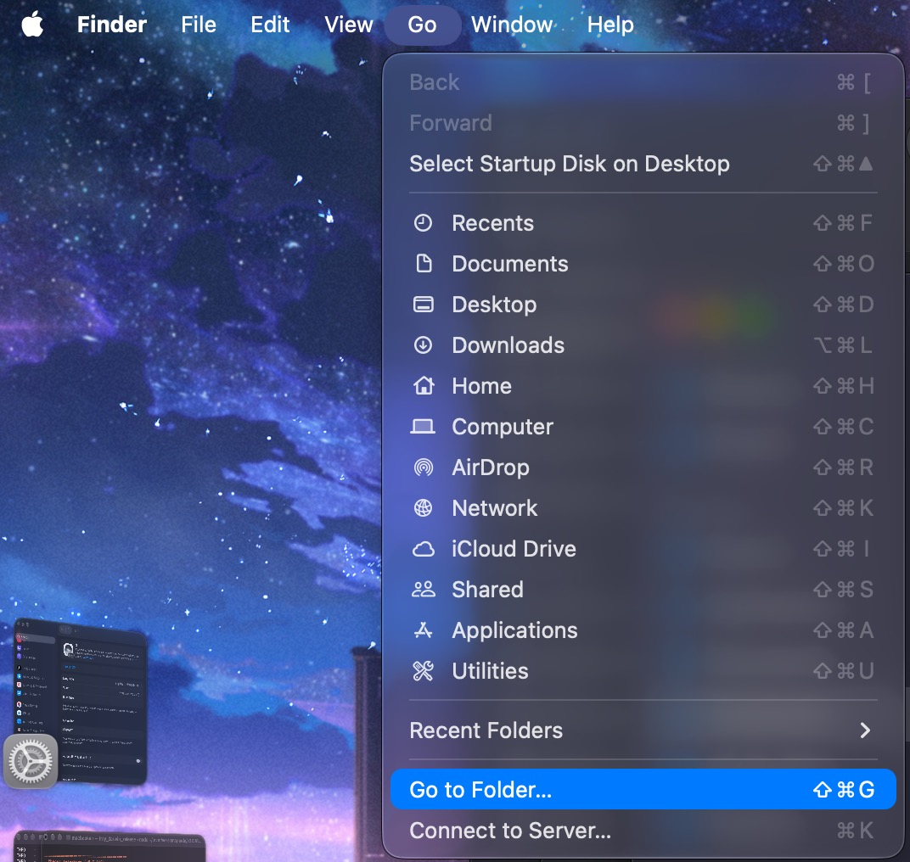
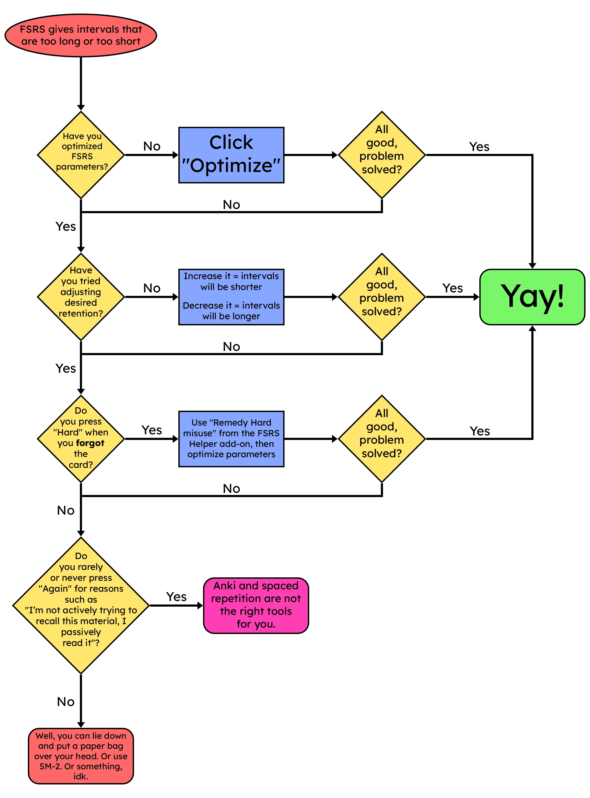

<!-- upstream: setupAnki @ 2025-11-28 -->
# Setup Anki di PC [LazyGuide](https://lazyguidejp.github.io/jp-lazy-guide/setupAnki/)
---

 Diunggah: 1 Agustus 2025 · Diperbarui: 5 November 2026 – `Yaaacha`

---

- Anki adalah program flashcard berbasis SRS (Spaced Repetition System). Algoritmanya yang menentukan kapan setiap kartu perlu diulas lagi.
- Bisa dipakai juga di HP.
- Tampilan Anki: [Light](img/anki-pc-light.png) | [Dark](img/anki-pc-dark.png)

---

- Mau memperbarui format Lapis (atau note type lain) yang sudah kamu punya?
    - Buka [Memperbarui Note Type](pembaruan-note-type.md)

---

## Unduh dan Pasang

- Pasang [Anki](https://apps.ankiweb.net/) di PC
    - [Android](https://play.google.com/store/apps/details?id=com.ichi2.anki&hl=en_US) | [iOS](https://apps.apple.com/us/app/ankimobile-flashcards/id373493387) (panduan ini untuk PC, tapi hasilnya nanti bisa dipakai juga di HP)
- Unduh [add-on Anki](https://drive.google.com/drive/folders/1dfmYAp0eg_bhhAkohUISYaS6B6QOBtww?usp=sharing)

---

## Cara Setup
1. Buka Anki, lalu klik `Sync` untuk membuat akun dan profil

    {height=250 width=500}

2. Ekstrak file `Anki addons21.7z` (password: `lazyguide`), lalu pindahkan folder `addons21` ke folder Anki sesuai sistem operasimu

    === "Windows"
        Folder di Windows: `C:\Users\NamaUserKamu\AppData\Roaming\Anki2`
        {height=70% width=70%} 
    === "MacOS"
        Folder di MacOS: `~/Library/Application Support/Anki2`

        Folder `Library` tersembunyi secara bawaan, jadi buka lewat `Finder` > `Go` > `Go to Folder...` (++cmd+shift+g++), tempel alamat folder di atas, lalu tekan ++enter++

        {height=50% width=50%}

        {height=70% width=70%}

3. Tutup lalu buka lagi Anki. Tekan ++ctrl+shift+a++ (Windows) atau ++cmd+shift+a++ (MacOS) untuk membuka menu add-on, atau pilih `Tools` > `Add-ons` > `Check for add-ons update`
    - Perbarui semua add-on, lalu tutup dan buka lagi Anki

    {height=250 width=500}

4. Unduh format [Lapis](https://github.com/donkuri/lapis/releases/latest)
    - Gulir ke bagian `Assets`, lalu cari `Lapis.apkg`

    {height=150 width=300}

5. Buka file `Lapis.apkg` yang tadi diunduh untuk mengimpornya ke Anki. Saat tampilan ini muncul, klik `Import`

    {height=300 width=600}

6. Ganti nama dek `Lapis` jadi `Mining Deck`

    {height=250 width=500}

7. Buka opsi dek kamu. Di desktop, klik ikon gir di samping dek. Di Android, tahan nama dek lalu pilih `Deck Option`. Samakan isinya dengan [pengaturan ini](setup-anki-pc-lazy-guide.md/#__tabbed_2_1)
    - ([Pengaturan 2](setup-anki-pc-lazy-guide.md/#__tabbed_2_2)) Aktifkan `FSRS`
        - Isi `Desired Retention` dengan `85%`
    - ([Pengaturan 2](setup-anki-pc-lazy-guide.md/#__tabbed_2_2)) Selama bulan pertama, biarkan `FSRS Parameter` bawaan. Setelah itu:
        - Klik `Optimize Current Preset` setiap bulan
        - (Opsional) Klik `Deck Options` > `FSRS Helper` > `Reschedule all cards`

    - Klik `Tools` > `Preferences` di menu kiri atas, lalu samakan isinya dengan [pengaturan ini](setup-anki-pc-lazy-guide.md/#__tabbed_2_4)

    === "Pengaturan 1"
        {height=300 width=600}
    === "Pengaturan 2"
        {height=300 width=600}
    === "Pengaturan 3"
        {height=300 width=600}
    === "Preferensi Anki"
        {height=300 width=600}
    === "Preferensi Anki (Android)"
        {height=300 width=600}

8. Tutup lalu buka lagi Anki. Selesai!

Template Anki kamu sudah siap. Selanjutnya, siapkan Yomitan:

[Langsung ke Setup Yomitan](setup-yomitan-pc-lazy-guide.md){ .md-button .md-button }

---

## Info Tambahan & Tips

#### Info 1: Daftar Add-ons Anki

??? info "Daftar add-on Anki <small>(klik untuk buka)</small>"

    Daftar add-on Anki yang dipakai:

    - Fungsi tiap add-on bisa dicek dengan klik `View Add-on Page`
    - Sebagian besar bisa dibuka dari menu `Tools` di bagian atas jendela Anki

    {height=250 width=500}

#### Info 2: Mode Terang & Gelap Anki

??? info "Mode Terang & Gelap Anki <small>(klik untuk buka)</small>"

    Klik `Tools` > `Preferences` > `Theme` untuk mengganti tema Anki.

    {height=300 width=600}

#### Info 3: Cara Atur Retention

??? info "Cara Atur Retention <small>(klik untuk buka)</small>"

    Kalau retensimu terasa rendah, buka [Tentang Retention](tentang-retention.md) untuk saran pengaturan Anki dan tips lainnya. (Halamannya belum selesai, tunggu pembaruan berikutnya, ya.)

#### Info 4: Diagram Troubleshooting Interval FSRS

??? info "Diagram Troubleshooting Interval FSRS <small>(klik untuk buka)</small>"

    Kalau interval kartumu terasa aneh (terlalu panjang atau terlalu pendek), ikuti diagram ini. [Sumber](https://www.reddit.com/r/Anki/comments/1mrsr30/i_updated_the_fsrs_interval_troubleshooting/)

    {height=70% width=70%}

#### Tip 1: Saat Mengulas Kartu di Anki

??? tip "Saat mengulas kartu di Anki <small>(klik untuk buka)</small>"

    - Cukup pakai tombol `again (1 = lupa)` atau `good (spasi/3 = tahu)` saja. Tidak perlu repot memikirkan `hard (2)` atau `easy (4)`
    - Cara menilainya sederhana:
         - Bisa baca ✅ tahu makna ✅ = Good/Pass
         - Bisa baca ✅ tahu makna ❌ = Again/Fail
         - Bisa baca ❌ tahu makna ✅ = Again/Fail
         - Bisa baca ❌ tahu makna ❌ = Again/Fail

#### Tip 2: Warna Pitch Accent Anki

??? tip "Warna Pitch Accent Anki <small>(klik untuk buka)</small>"

    Saat melihat kartu, warna menunjukkan jenis pitch accent:

    {height=250 width=500}

#### Tip 3: Ganti Kamus Bilingual/Monolingual

??? tip "Ganti Kamus Bilingual/Monolingual <small>(klik untuk buka)</small>"

    Saat mengulas kartu, klik bagian kiri definisi untuk berganti antara `Monolingual` dan `Bilingual`

    {height=250 width=500}

---

## Pertanyaan Umum

#### Pertanyaan 1: Bisa menambah gambar selain screenshot?

??? question "Bisa menambah gambar selain screenshot? <small>(klik untuk buka)</small>"

    - Bisa. Tambahkan gambar sebanyak yang kamu mau ke field `DefinitionPicture` lewat `Browse` di Anki, lalu pilih kartunya

    - Atau tempel langsung saat mengulas lewat mode `Edit` (tekan ++e++)

#### Pertanyaan 2: Bagaimana kalau ada masalah dengan Format Lapis?

??? question "Ada masalah dengan format Lapis? <small>(klik untuk buka)</small>"

    - Cek [FAQ Lapis](https://github.com/donkuri/lapis?tab=readme-ov-file#faq)

#### Pertanyaan 3: Mau ganti font atau ukuran teks?

??? question "Mau ganti font atau ukuran teks? <small>(klik untuk buka)</small>"

    - Cek [panduan ini](https://github.com/donkuri/lapis?tab=readme-ov-file#how-can-i-change-the-font-size)

#### Pertanyaan 4: Dek bisa diganti nama?

??? question "Dek bisa diganti nama? <small>(klik untuk buka)</small>"

    - Secara teknis bisa, tapi tidak disarankan. Kamu harus mengatur ulang `Anki Card Format` di Yomitan dan add-on `AutoReorder` di Anki

#### Pertanyaan 5: Bagaimana cara memakai sentence card?

??? question "Bagaimana cara memakai sentence card? <small>(klik untuk buka)</small>"

    Ikuti [Setup Yomitan](setup-yomitan-pc-lazy-guide.md) dulu kalau belum. Panduan itu urutan berikutnya setelah halaman ini.

    ??? info "Yomitan sudah terpasang <small>(klik untuk buka)</small>"

        Buka `Yomitan settings` > `Anki` > `configure Anki card format...`

        {height=300 width=600}
        
        Di tab `Terms` (nama di Yomitan versi lama; di versi baru bagian ini bernama `Expression`), gulir ke bawah, cari `IsSentenceCard`, isi dengan `1`, lalu tutup jendelanya

        {height=300 width=600}

        Terapkan pengaturan ini di semua profil lewat `Active Profile`. Pastikan `Monolingual`, `Bilingual`, `Android (Anime, LN & Manga)`, dan `Android (VN)` sudah diubah semua. Di versi lama ada juga profil Editing dan default, keduanya bisa diabaikan

        {align=left height=300 width=600}
