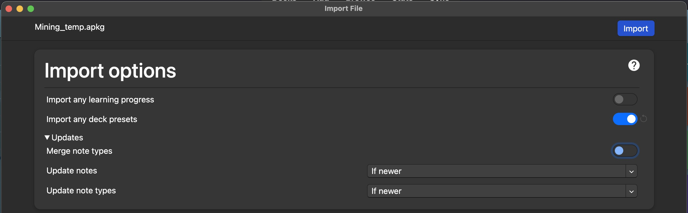

# Setup Yomitan dan Anki PC (Yaaacha)

---

Diunggah: 1 Agustus 2025 · Diperbarui: 5 November 2026 – `Yaaacha`

---

## Persiapan
Unduh aplikasi berikut:

- [Anki](https://apps.ankiweb.net/)
- [Browser Thorium Windows](https://github.com/Alex313031/Thorium-Win/releases) atau [Browser Thorium MacOS](https://github.com/Alex313031/Thorium-MacOS/releases)
	* Windows: unduh sesuai urutan prioritas AVX2, AVX, SSE3, SSE4. Pasang dari prioritas pertama. Kalau tidak bisa, turun ke prioritas berikutnya.
	* MacOS: Intel pakai x64, sedangkan M1, M2, dan M3 pakai ARM.
	* Browser Thorium sangat disarankan karena paling aman (tidak ada eror) untuk memutar video dengan asbplayer. Kamu juga bisa pakai Brave. Jangan pakai Firefox karena kompatibilitasnya paling buruk (cek [di sini](https://docs.asbplayer.dev/docs/compatibility)).
- [qBittorrent](https://www.qbittorrent.org/download), terutama untuk mengunduh audio yang dipakai add-on Local Audio for Yomichan

Pasang ekstensi di browser:

- [Yomitan](https://chromewebstore.google.com/detail/yomitan-popup-dictionary/likgccmbimhjbgkjambclfkhldnlhbnn) (Chrome Webstore)
- [Yomitan](https://addons.mozilla.org/en-GB/firefox/addon/yomitan/) (Firefox)

### Impor Note Type

Sebelum mulai mining dengan Yomitan, kamu perlu menyesuaikan dek Anki yang kamu pakai terlebih dahulu.  
Unduh file APKG [Note Type Mining-JP](https://github.com/rudnam/JP-study/raw/main/Mining_temp.apkg) untuk mengimpor template-nya.  
Setelah diunduh, buka file tersebut untuk mengimpornya ke Anki.

[](img/Ganti-Deck-Note-Type-0-5.jpg){ data-md-img="true" style="max-width: 100%; width: 40%;" }

---
### Local Audio for Yomichan (Opsional)
  Sebelum mulai, unduh dulu file di bawah yang berisi audio untuk add-on Local Audio for Yomichan.

<b>Alasan kamu bisa pakai atau tidak pakai setup ini</b>
<details>
<summary><b>Manfaat:</b> <i>(klik di sini)</i></summary>

<p><b>1.</b> Sebagian besar audio bisa didapat <strong>hampir instan</strong>. Tanpa <em>local audio server</em>, Yomitan mengambil audio secara online, dan prosesnya bisa memakan waktu 1 detik sampai beberapa menit, tergantung koneksi.</p>

<p>Saat Yomitan membuat kartu, jeda paling lama biasanya muncul ketika mencari audio. Jadi, mengambil audio bisa jadi hambatan utama saat membuat kartu Anki. Add-on ini menghilangkan hambatan itu, sehingga kartu Anki bisa langsung dibuat nyaris tanpa jeda.</p>

<p><b>2.</b> Kalau sedang tidak ada akses internet, kartumu tetap bisa mendapat audio.</p>

<p><b>3.</b> Dibandingkan audio bawaan Yomitan, cakupan audio add-on ini lebih luas karena mengambil dari berbagai sumber yang tidak dicakup Yomitan, seperti Forvo (tergantung pengguna yang dipilih), NHK 2016, dan Shinmeikai 8.</p>

<p><b>4.</b> Audionya sudah melalui banyak <a href="https://github.com/Aquafina-water-bottle/local-audio-yomichan-build-scripts">pre-processing</a> supaya kualitasnya sebaik mungkin:</p>

<ul>
  <li>Semua audio sudah dinormalisasi, jadi volumenya relatif sama di setiap file.</li>
  <li>Bagian diam di awal dan akhir audio sudah dipotong.</li>
  <li>Dengan data JMdict, bentuk varian yang bacaannya sama ikut diisi dengan audio yang sudah ada.</li>
</ul>

</details>

<details>
<summary><b>Kekurangan:</b> <i>(klik di sini)</i></summary>

<p><b>1.</b> Pengaturan ini butuh sekitar <strong>3–5 GB ruang penyimpanan kosong</strong>.</p>

<p><b>2.</b> Anki harus selalu terbuka (atau servernya dijalankan manual) supaya Yomitan bisa mengambil datanya. Kalau servernya tidak ada (Anki tertutup atau local server-nya mati) atau audio untuk kata yang dicari tidak ada, Yomitan tetap bisa kembali ke pengaturan bawaan.</p>

</details>


Pengaturan ini bisa dipakai untuk Anki versi PC (Windows, MacOS, Linux).
Unduh audionya dengan qBittorrent.
Klik ikon rantai (di bawah menu `File` di pojok kiri atas), lalu masukkan tautan ini:

	magnet:?xt=urn:btih:5bd0aa89667860e68b31a585dc6e7a2bfc811702&dn=local-yomichan-audio-collection-2023-06-11-mp3.tar.xz&tr=http%3a%2f%2fanidex.moe%3a6969%2fannounce&tr=http%3a%2f%2fnyaa.tracker.wf%3a7777%2fannounce&tr=udp%3a%2f%2fexodus.desync.com%3a6969%2fannounce&tr=udp%3a%2f%2ftracker.opentrackr.org%3a1337%2fannounce&tr=udp%3a%2f%2fopen.stealth.si%3a80%2fannounce&tr=udp%3a%2f%2ftracker.tiny-vps.com%3a6969%2fannounce&tr=udp%3a%2f%2ftracker.moeking.me%3a6969%2fannounce&tr=udp%3a%2f%2fopentracker.i2p.rocks%3a6969%2fannounce&tr=udp%3a%2f%2ftracker.openbittorrent.com%3a6969%2fannounce&tr=udp%3a%2f%2ftracker.torrent.eu.org%3a451%2fannounce&tr=udp%3a%2f%2fexplodie.org%3a6969%2fannounce&tr=udp%3a%2f%2ftracker.zerobytes.xyz%3a1337%2fannounce

<figcaption style="text-align: center; font-style: italic;">
Unduh berkas untuk Local Audio.
</figcaption>

[](img/Awal1.jpg){ .lightbox data-group="awal" style="width: 48%; display: inline-block;" }
[](img/Awal2.jpg){ .lightbox data-group="awal" style="width: 48%; display: inline-block;" }

[](img/Awal3.jpg){ .lightbox data-group="awal" style="width: 48%; display: inline-block;" }
[](img/Awal4.jpg){ .lightbox data-group="awal" style="width: 48%; display: inline-block;" }


Setelah unduhan selesai, ekstrak filenya. Setelah itu, biarkan dulu sampai bagian Pengaturan Add-ons.
!!! info "**Cara pasang**"
    Buka `Tools` > `Add-ons` > `Get Add-ons...`, masukkan dua kode di bawah, lalu mulai ulang Anki.
    
    - `2055492159` (AnkiConnect)
    - `1045800357` (Local Audio Server for Yomichan)

---
### Pengaturan Add-ons
!!! info "Pengaturan Add-ons"
    Buka `Tools` > `Add-ons`, pilih add-on yang mau diatur, lalu klik `Config` (pojok kanan bawah).
    Masukkan kode berikut:
    


#### AnkiConnect
Pilih AnkiConnect, lalu klik `Config`. Timpa teks konfigurasinya dengan kode di bawah, lalu klik `OK`. Setelah itu, buka ekstensi Yomitan, masuk ke bagian `Anki`, lalu matikan dan nyalakan lagi `Enable Anki integration`. Selesai.
```
{
    "apiKey": null,
    "apiLogPath": null,
    "ignoreOriginList": [],
    "webBindAddress": "127.0.0.1",
    "webBindPort": 8765,
    "webCorsOriginList": [
        "http://localhost",
        "https://killergerbah.github.io",
        "https://reader.mokuro.app",
        "https://app.yatsu.moe"
    ]
}
```
!!! note "NB"
    Tautan 1 untuk **Yomitan**  
    Tautan 2 untuk **asbplayer** (anime dan materi berbasis video)  
    Tautan 3 untuk **Mokuro** (membaca manga)  
    Tautan 4 untuk **Yatsu Reader** (membaca novel, LN, dan lainnya)

#### Local Audio Server for Yomichan
- Buka Anki.
- Buka `Tools` > `Add-ons` > `Local Audio for Yomichan` > `View Files`. Jendela baru akan terbuka di folder `Anki2/addons21/1045800357`.
- Buka folder `user_files`.
- Pindahkan semua audio yang sudah diunduh dengan qBittorrent di langkah Persiapan Awal ke folder `user_files`.
- Buka ekstensi Yomitan di browser, lalu matikan dan nyalakan lagi (Off, lalu On).
- Mulai ulang Anki.

Saat mining, Anki harus tetap terbuka (boleh di-minimize) supaya add-on Local Audio bisa berjalan.


---
## Yomitan
### Kamus

Setelah Yomitan terpasang, kamu perlu mengimpor kamus ke dalamnya.
File kamus berformat `.zip` dan **tidak perlu diekstrak**.

Kalau kamu belum bisa bahasa Inggris, unduh kamus Jepang-Indonesia [JIDict](https://github.com/philiaspaceai/JIDict-yomitan#pemasangan). Kamus ini hanya untuk membantu di awal. Kalau sudah lebih lancar membaca bahasa Jepang, sebisa mungkin pakai kamus monolingual.

Impor juga kamus lain dari daftar di bawah untuk membantu proses immersion kamu.

- [Koleksi Shoui](https://learnjapanese.link/dictionaries) dari TMW
- [Koleksi Marv](https://drive.google.com/drive/folders/1xURpMJN7HTtSLuVs9ZtIbE7MDRCdoU29) dari Yomitan

Kalau tidak ingin punya terlalu banyak kamus, pakai daftar ringkas di bawah.

??? info "Daftar Ringkas oleh [Donkuri](https://donkuri.github.io/learn-japanese/setup/#what-if-i-dont-want-to-use-all-these-dictionaries): <small>(klik di sini)</small>"

	<ul>
	  <li>JMdict (atau Jitendex)</li>
	  <li>JMnedict</li>
	  <li>三省堂 8th Ed (atau 明鏡 2nd Ed)</li>
	  <li>Kanji Jitenon</li>
	  <li>NHK2016</li>
	  <li>JPDB Frequency v2.2</li>
	</ul>

Di bawah ini ada beberapa rekomendasi yang bisa kamu pilih. Kamu bisa mencampurnya atau mengikuti semuanya, sesuai keinginan.

<details>
<summary><b>Daftar Rekomendasi <i>shoui</i> dari TheMoeWay (TMW):</b> <i>(klik di sini)</i></summary>

<p><b>Bilingual</b></p>
<ul>
  <li>[Bilingual] JMdict Extra (Recommended).zip</li>
  <li>[Bilingual] 新和英.zip</li>
</ul>

<p><b>Frekuensi</b></p>
<ul>
  <li>[Freq] CC100.zip</li>
  <li>[Freq] JPDB (Recommended).zip</li>
</ul>

<p><b>Kanji</b></p>
<ul>
  <li>[Kanji] KANJIDIC (English) (Recommended).zip</li>
</ul>

<p><b>Monolingual</b></p>
<ul>
  <li>[Monolingual] 実用日本語表現辞典 (Recommended).zip</li>
  <li>[Monolingual, Encyclopedia] PixivLight.zip</li>
</ul>

<p><b>Tata Bahasa</b></p>
<ul>
  <li>[Grammar] Dictionary of Japanese Grammar 日本語文法辞典 (Recommended).zip</li>
  <li>[Grammar] どんなとき使う日本語表現文型辞典.zip</li>
  <li>[Grammar] 毎日のんびり日本語教師 (nihongosensei).zip</li>
  <li>[Grammar] JLPT文法解説まとめ(nihongo_kyoushi).zip</li>
  <li>[Grammar] 絵でわかる日本語.zip</li>
</ul>

<p><b>Nama</b></p>
<ul>
  <li>[Names] JMnedict.zip</li>
</ul>

<p><b>Pitch</b></p>
<ul>
  <li>[Pitch] アクセント辞典v2 (Recommended).zip</li>
</ul>

</details>

<details>
<summary><b>Daftar Rekomendasi <i>marv</i> dari Yomitan:</b> <i>(klik di sini)</i></summary>

<p><b>Bilingual</b></p>
<ul>
  <li>[JA-EN] jitendex-yomichan</li>
  <li>[JA-EN] NEW 斎藤和英大辞典</li>
  <li>[JA-EN] 新和英</li>
</ul>

<p><b>Tata Bahasa</b></p>
<ul>
  <li>[JA Grammar] dojg-consolidated-v1_01</li>
</ul>

<p><b>Frekuensi</b></p>
<ul>
  <li>[JA Freq] JPDB_2022-05-10T03_27_02.930Z</li>
  <li>[JA Freq] Freq_CC100</li>
  <li>[JA Freq] BCCWJ-LUW</li>
</ul>

<p><b>Monolingual</b></p>
<ul>
  <li>[JA-JA] 実用日本語表現辞典</li>
  <li>[JA-JA] デジタル大辞泉</li>
  <li>[JA-JA Encyclopedia] Pixiv</li>
</ul>

<p><b>Kanji</b></p>
<ul>
  <li>[Kanji] KANJIDIC_english</li>
  <li>[Kanji] JPDB Kanji</li>
</ul>

<p><b>Pitch Accent</b></p>
<ul>
  <li>[Pitch] 大辞泉</li>
</ul>

</details>

<details>
<summary><b>Daftar Kamus Pilihan Yaaacha:</b> <i>(klik di sini)</i></summary>

<p><b>Kamus Bilingual</b></p>
<ul>
  <li>1. JIDict<br>   Kamus Jepang-Indonesia berbasis JMdict dan Sanseido, dikembangkan oleh tim Philia Space, berfokus pada hasil yang mudah dipahami pelajar bahasa Jepang di Indonesia.</li>
  <li>2. JMdict<br>   Kamus Jepang-Inggris utama dengan lebih dari 180.000 entri. Banyak dipakai sebagai sumber utama kamus turunan lain. Secara bawaan sudah terhubung dengan Yomitan, jadi pembaruannya bisa dicek langsung di menu <code>Dictionaries</code>.</li>
  <li>3. Jitendex.org<br>   Versi gabungan dari kamus bilingual JMdict, dengan tambahan fitur khusus dari situs Jitendex.org. Secara bawaan sudah terhubung dengan Yomitan, jadi pembaruannya bisa dicek langsung di menu <code>Dictionaries</code>.</li>
  <li>4. 新和英<br>   Kamus Jepang-Inggris resmi dari Kenkyusha, dengan definisi yang lebih formal dan kontekstual dibanding JMdict.</li>
</ul>

<p><b>Kamus Nama & Kanji</b></p>
<ul>
  <li>5. JMnedict<br>   Kamus nama orang, tempat, dan organisasi dalam bahasa Jepang. Berguna saat menemukan nama khusus. Secara bawaan sudah terhubung dengan Yomitan, jadi pembaruannya bisa dicek langsung di menu <code>Dictionaries</code>.</li>
  <li>6. KANJIDIC (English)<br>   Informasi karakter kanji dalam bahasa Inggris, termasuk makna, bacaan, stroke, dan level JLPT. Secara bawaan sudah terhubung dengan Yomitan, jadi pembaruannya bisa dicek langsung di menu <code>Dictionaries</code>.</li>
  <li>7. 漢字源<br>   Kamus kanji berbahasa Jepang dengan penjelasan etimologi dan penggunaan historis. Lebih cocok untuk pembelajar lanjutan.</li>
  <li>8. weblio 古語辞典<br>   Kamus kosakata klasik Jepang. Membantu memahami bahasa kuno yang sering muncul dalam sastra dan sejarah.</li>
</ul>
<p><b>Monolingual – Kamus Besar & Onomatope</b></p>
<ul>
  <li>9. 旺文社国語辞典 第十一版<br> Kamus modern dengan definisi yang mudah dipahami, cocok untuk pelajar bahasa Jepang tingkat menengah.</li>
  <li>10. 明鏡国語辞典 第三版<br> Menyediakan definisi dengan gaya penjelasan yang jernih dan mudah dibaca.</li>
  <li>11. デジタル大辞泉<br> Kamus komprehensif modern yang sering digunakan oleh penutur asli.</li>
  <li>12. 岩波国語辞典 第八版<br> Kamus yang terkenal dengan keakuratan dan gaya konservatifnya.</li>
  <li>13. 広辞苑 第七版<br> Salah satu kamus Jepang terbesar dan paling prestisius.</li>
  <li>14. 精選版 日本国語大辞典<br> Versi ringkas dari 日本国語大辞典, tetap komprehensif namun lebih praktis.</li>
  <li>15. ハイブリッド新辞林<br> Gabungan dari berbagai sumber, cepat dan ringan untuk pencarian harian.</li>
  <li>16. 新明解国語辞典 第八版<br> Dikenal karena penjelasan yang berani dan interpretatif.</li>
  <li>17. 三省堂国語辞典 第八版<br> Kamus ringkas namun mendalam, sangat cocok untuk pengguna tingkat menengah.</li>
  <li>18. 例解学習国語辞典 第十一版<br> Kamus anak-anak yang sangat ramah pelajar asing.</li>
  <li>19. 新選国語辞典 第十版<br> Kamus ringkas untuk referensi cepat.</li>
  <li>20. 国語辞典オンライン<br> Versi daring ringan yang berisi banyak entri praktis.</li>
  <li>21. 実用日本語表現辞典<br> Fokus pada ekspresi praktis dan idiom.</li>
  <li>22. surasura 擬声語<br> Khusus kosakata onomatope, lengkap dengan contoh penggunaan dan makna.</li>
</ul>
<p><b>Kamus Tata Bahasa & Pelajaran:</b></p>
<ul>
  <li>23. 日本語文法辞典（全集）<br> Seri lengkap kamus tata bahasa DoJG (Beginner–Advanced) dalam format yang bisa dicari.</li>
  <li>24. JLPT文法解説まとめ<br> Ringkasan tata bahasa JLPT dari berbagai sumber, mudah ditelusuri.</li>
  <li>25. 毎日のんびり日本語教師<br> Penjelasan tata bahasa yang ringan dan jelas, dengan label level JLPT.</li>
  <li>26. 絵でわかる日本語<br> Kamus tata bahasa berbasis ilustrasi, cocok untuk pemula dan yang lebih mudah belajar lewat gambar.</li>
</ul>

<p><b>Kamus Pendukung (3 kanji atau lebih):</b></p>
<ul>
  <li>27. 学研 四字熟語辞典<br> Fokus pada idiom empat kanji, termasuk makna dan contoh penggunaan.</li>
  <li>28. 新明解四字熟語辞典<br> Alternatif dengan definisi yang unik dan gaya khas 新明解.</li>
</ul>

<p><b>Kamus Khusus (dialek, peribahasa, dan sejenisnya):</b></p>
<ul>
  <li>29. 故事ことわざの辞典<br>Berisi peribahasa dan ungkapan klasik Jepang.</li>
  <li>30. 故事・ことわざ・慣用句オンライン<br>Versi daring dari berbagai sumber idiomatik.</li>
  <li>31. ことわざ・慣用句の百科事典<br>Ensiklopedia idiom dan ungkapan tetap (set phrases).</li>
  <li>32. 全国方言辞典<br>Kamus dialek dari berbagai daerah Jepang.</li>
</ul>

<p><b>Kamus JLPT, Frekuensi & Korpus:</b></p>
<ul>
  <li>33. JLPT<br>Kumpulan kosakata JLPT level N1–N5.</li>
  <li>34. CC100<br>Korpus bahasa Jepang yang digunakan untuk analisis frekuensi kata.</li>
  <li>35. JPDB<br>Frekuensi kosakata dari database JPDB.</li>
  <li>36. YouTube<br>Frekuensi kata berdasarkan subtitle video YouTube Jepang.</li>
  <li>37. BCCWJ<br>Balanced corpus of contemporary written Japanese (BCCWJ).</li>
  <li>38. PixivLight<br>Frekuensi kosakata dari karya buatan pengguna di Pixiv.</li>
</ul>

<p><b>Kamus Pitch Accent:</b></p>
<ul>
  <li>39. 大辞林第四版<br>Selain kamus besar, versi ini menyertakan informasi pitch accent.</li>
  <li>40. 三省堂国語辞典第八版 (pitch)<br>Tambahan aksen dari 三省堂 untuk entri tertentu.</li>
  <li>41. 新明解第八版 (pitch)<br>Informasi pitch berdasarkan edisi 新明解 ke-8.</li>
  <li>42. 大辞泉 (pitch)<br>Pitch accent versi tambahan untuk entri 大辞泉.</li>
  <li>43. アクセント辞典<br>Kamus aksen khusus untuk penutur asli dan pembelajar tingkat lanjut.</li>
  <li>44. NHK 日本語発音アクセント新辞典<br>Standar referensi aksen NHK untuk kata-kata Jepang modern.</li>
  <li>45. NHK (pitch)<br>Tambahan pitch untuk entri berdasarkan standar NHK.</li>
</ul>

</details>

### Daftar Frekuensi yang Direkomendasikan

Yomitan mendukung **kamus frekuensi**, yaitu kamus yang menunjukkan seberapa umum sebuah kata dipakai.

<b>JPDB</b>
Daftar frekuensi dari [jpdb.io](https://jpdb.io), situs yang menganalisis banyak *light novel*, *visual novel*, anime, dan *J-drama*. Jadi, daftar ini menunjukkan seberapa sering sebuah kata muncul di media fiksi berbahasa Jepang.

<b>CC100</b>
Daftar frekuensi dari korpus teks internet Jepang. Kata-kata formal akan tampak lebih umum di daftar ini.  
Contoh: 審議会 (*council*) memiliki peringkat ke-9733 di CC100, tetapi ke-58730 di JPDB.

<b>Apa yang dimaksud dengan "kata umum"?</b>

- **Sangat umum:** 1–10.000
- **Umum:** 10.001–20.000
- **Cukup umum:** 20.001–30.000
- **Agak jarang:** 30.001–40.000
- **Jarang:** 40.001–50.000
- **Sangat jarang:** 50.001–80.000
- **Tingkat yang mungkin tidak dikenal penutur asli:** 80.000+


### Impor Kamus

???+ note "1. Buka pengaturan ekstensi Yomitan"
???+ note "2. Di bagian `Dictionaries`, klik `Configure installed and enabled dictionaries…`"
	<figcaption style="text-align: center; font-style: italic;">
	Buka pengaturan Dictionaries.
	</figcaption>
	[](img/Import-Kamus-1.png){ data-md-img="true" style="max-width: 40%; width: 40%;" }

???+ note "3. Klik `Import`, lalu seret file zip kamusnya ke sana atau pilih dari folder unduhan"
	<figcaption style="text-align: center; font-style: italic;">
	Impor kamus.
	</figcaption>
	[](img/Import-Kamus-2.png){ data-md-img="true" style="max-width: 40%; width: 40%;" }
	
	<figcaption style="text-align: center; font-style: italic;">
	Seret file ke sini atau buka folder.
	</figcaption>
	[](img/Import-Kamus-3.png){ data-md-img="true" style="max-width: 100%; width: 40%;" }
???+ note "4. Tunggu sampai semua kamus selesai diimpor (ada bar progres di bawah)"
	Lama proses impor tergantung ukuran kamus dan bisa agak lama, jadi tunggu saja.
???+ note "5. Aktifkan atau nonaktifkan kamus sesuai kebutuhan, lalu urutkan sesuai prioritasmu."
	<figcaption style="text-align: center; font-style: italic;">
	Aktifkan dan geser sesuai keinginan (tidak perlu digeser kalau kamu mau mengimpor pengaturan di bawah).
	</figcaption>
	[](img/Import-Kamus-4.png){ data-md-img="true" style="max-width: 100%; width: 40%;" }

---

### Pengaturan Yomitan

1. Di halaman awal Yomitan, klik `Permissions page`, lalu aktifkan `clipboardRead` dan `nativeMessaging`

	???+ note "Klik tombol `Permission Page` di halaman izin Yomitan"
		{height=250 width=500}
		
		<small>Klik tombol `Permission Page` di halaman izin Yomitan.</small>

	???+ note "Beri izin Yomitan"
		{height=250 width=500}
		
		<small>Aktifkan `clipboardRead` dan `nativeMessaging` di bagian bawah.</small>

2. Buka `chrome://extensions`, `edge://extensions`, atau `about:addons` (Firefox), lalu buka pengaturan ekstensi Yomitan

3. Pastikan:
    - Chrome/Edge: aktifkan `Allow access to file URLs`
    - Firefox: aktifkan `Access your data for all websites`
    === "Chrome/Edge"
        {height=150 width=300}
    === "Firefox"
        {height=300 width=600}


Kamu bisa langsung mengunduh pengaturan Yomitan dari Yaaacha [di sini](https://github.com/yaaacha/Immerse-Archive/blob/main/Yomitan%20Setting%20Full%20Lapis.json). Untuk mengimpornya, buka `Backup` > `Import Settings`. Tidak semua pengaturan dijamin langsung berfungsi karena ada beberapa yang harus diatur manual, terutama untuk mining nanti. Kamu juga bisa menghapus atau menduplikasi profil.

Tetap baca _startup guide_ Yomitan supaya kamu paham cara kerjanya secara umum. Cek pengaturan di bawah untuk menyesuaikannya dengan preferensimu.

???+ note "Impor pengaturan dari sini."
	[](img/Import-Setting-Yomitan.jpg){ data-md-img="true" style="max-width: 100%; width: 40%;" }

???+ note "Klik `Configure profile...` untuk memilih profil."
	[](img/Setting-Yomitan-1.jpg){ data-md-img="true" style="max-width: 100%; width: 40%;" }

???+ note "Pengaturan lanjutan untuk personalisasi."
	[](img/Setting-Yomitan-2.jpg){ data-md-img="true" style="max-width: 100%; width: 40%;" }


---

## Penyesuaian Akhir

### Penyesuaian Dek

Buat dek baru di Anki.

- Klik tombol `Create Deck`.
- Beri nama dek, misalnya `Mining`.

### Atur Dek di Yomitan

- Buka pengaturan Yomitan > `Anki` > `Configure Anki flashcards...`, lalu sesuaikan dek seperti di gambar.
- Kamu juga bisa mengganti note type dengan mengimpor template note type lain. Pilihan note type lainnya bisa dicek [di sini](https://arbyste.github.io/jp-mining-note/alternatives/).
- Yomitan dan dek Anki siap dipakai.


---

## Penutup

Terima kasih sudah membaca. Panduan ini masih jauh dari sempurna dan mungkin akan diperbarui nanti. Yuk, diskusi di [Philia Space](https://discord.gg/hp55WMbbG6).
